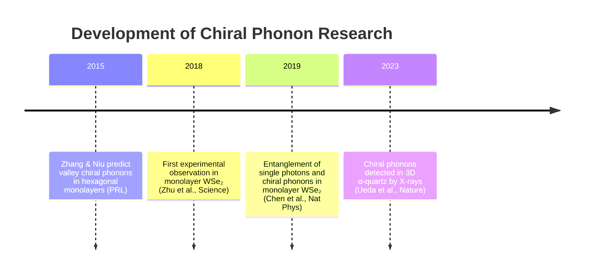
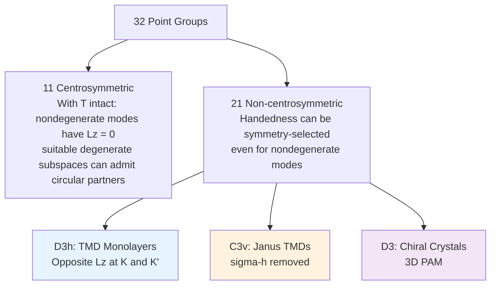

## Video Lecture

<div class="video-container">
  <iframe
    width="560"
    height="315"
    src="https://www.youtube.com/embed/6BFGvrQna9s"
    title="Chiral Phonons Ch.1: Theoretical Foundations"
    allow="accelerometer; autoplay; clipboard-write; encrypted-media; gyroscope; picture-in-picture"
    allowfullscreen>
  </iframe>
</div>

> This video covers the same content as the text below. Choose your preferred learning format.

---

🌐 EN | [🇯🇵 JP](../../../jp/MS/chiral-phonons/chapter-1.md) | Last sync: 2025-12-19

[Materials Science Dojo](../index.md) > [Chiral Phonons](index.md) > Chapter 1

---

**Reading time:** 50-60 minutes | **Difficulty:** Advanced | **Code examples:** 1 | **Exercises:** 5 problems

---

This chapter establishes the theoretical foundations of chiral phonons, covering phonon angular momentum (PAM), symmetry requirements for chirality, Berry phase connections, and group theory analysis. We explore the mathematical formulation of circular phonon polarization and implement computational methods to calculate PAM from phonon eigenvectors.

---

## Learning Objectives

By completing this chapter, you will be able to:

- ✅ Define phonon angular momentum (PAM) and understand its physical origin
- ✅ Distinguish between left-handed and right-handed chiral phonons
- ✅ State the symmetry conditions under which a mode's angular momentum must vanish
- ✅ Apply group theory to classify phonon modes, keeping the discrete pseudo-angular-momentum label apart from the mechanical angular momentum
- ✅ Understand the connection between phonon chirality and Berry phase
- ✅ Calculate PAM from phonon eigenvectors using Python
- ✅ Analyze selection rules for chiral phonon excitation
- ✅ Predict chirality in materials from crystal structure

---

## 1.1 Introduction: Discovery and Historical Context

### The Birth of Chiral Phonon Physics

Angular momentum carried by lattice vibrations, and the circular atomic motion behind it, had been analysed before 2015 — including by Zhang and Niu themselves, in their earlier work on phonon angular momentum. What the 2015 *Physical Review Letters* paper of Zhang and Niu added was the specific prediction of **valley chiral phonons**: modes at the high-symmetry \\(K\\)/\\(K'\\) points of a monolayer hexagonal lattice that carry angular momentum tied to the valley. That is the prediction this chapter builds on. The first widely cited experimental observation in a 2D material was reported later, in 2018, for monolayer WSe₂.

> **📚 Historical Milestones**
>
> • **Zhang, L. & Niu, Q. (2015)**. "Chiral Phonons at High-Symmetry Points in Monolayer Hexagonal Lattices." *Physical Review Letters*, 115, 115502. — Theoretical prediction of chiral phonons at the K/K' valleys of monolayer hexagonal lattices and of their angular momentum properties.
>
> • **Zhu, H. et al. (2018)**. "Observation of chiral phonons." *Science*, 359(6375), 579–582. — Experimental observation of chiral phonons in monolayer WSe₂ (this experiment covers WSe₂ only).
>
> • **Chen, X. et al. (2019)**. "Entanglement of single-photons and chiral phonons in atomically thin WSe₂." *Nature Physics*, 15, 221. — Entanglement between an emitted single photon and a chiral phonon; the entangled degrees of freedom are photon and phonon, not "valley and phonon".
>
> • **Ueda, H. et al. (2023)**. "Chiral phonons in quartz probed by X-rays." *Nature*, 618, 946. — Chiral phonons in a 3D chiral crystal, α-quartz.

### Why Chiral Phonons Matter

Chiral phonons represent a paradigm shift in lattice dynamics for several reasons:

- **Valley-phonon coupling**: in suitable hexagonal monolayers with well-separated valleys, the modes at the time-reversal-related \\(K\\) and \\(K'\\) points carry opposite angular momentum, which opens a route to phonon-assisted valley manipulation. Two-dimensionality on its own guarantees neither valleys nor non-zero phonon angular momentum
- **Angular momentum transport**: chiral phonons can carry and transport angular momentum without charge, opening pathways for phonon-based spintronics
- **Contact with band topology**: some phonon systems combine chiral polarization with a band topology established independently. Chiral polarization by itself establishes neither a topological invariant nor protected boundary states (§1.5.3)
- **Polarization-resolved spectroscopy**: polarization-resolved Raman measurements can probe suitable chiral modes, with the selection rule set by the Raman tensor and by *both* the incident and the scattered polarization. Ordinary first-order Raman scattering accesses zone-centre modes; individual \\(K\\)-valley phonons are not generally reachable that way and require a momentum-supplying process (§1.4.2)
- **Quantum information**: chiral phonons provide potential platforms for quantum state manipulation in solid-state systems



---

## 1.2 Phonon Angular Momentum (PAM)

### 1.2.1 Definition and Physical Origin

For a phonon mode with frequency \\(\omega\\) and wavevector \\(\mathbf{q}\\), the **phonon angular momentum (PAM)** is the time-averaged angular momentum carried by atomic displacements in the lattice vibration.

For atoms of mass \\(m_i\\) at positions \\(\mathbf{R}_i\\) with displacements \\(\mathbf{u}_i(t)\\), the total angular momentum is \\(\sum_i m_i (\mathbf{R}_i + \mathbf{u}_i) \times \dot{\mathbf{u}}_i\\); we keep the vibrational part:

> **Definition: Phonon Angular Momentum (PAM)**
>
> \\[
> \mathbf{L}_{\text{phonon}} = \sum_{i} m_i \left( \mathbf{u}_i \times \dot{\mathbf{u}}_i \right)
> \\]
>
> For a phonon eigenmode with displacement pattern \\(\mathbf{u}_i = \text{Re}\left[ \mathbf{e}_i e^{-i\omega t} \right]\\) where \\(\mathbf{e}_i\\) is the complex eigenvector, the time-averaged PAM is:
>
> \\[
> \langle \mathbf{L} \rangle = \frac{\omega}{2} \sum_{i} m_i \, \text{Im}\left( \mathbf{e}_i^* \times \mathbf{e}_i \right)
> \\]

### 1.2.2 Two Angular-Momentum Labels, and the Circular Polarization Basis

Two different quantities are routinely called "the angular momentum" of a phonon. This chapter keeps them apart, and the distinction is used consistently in every later section.

**Mechanical angular momentum \\(L_z\\)** is the quantity defined in §1.2.1: an expectation value computed from the polarization eigenvector. It is *not* in general an integer multiple of \\(\hbar\\). It varies continuously with the ellipticity of the mode (§1.6), so writing \\(L_z = s\hbar\\) with an integer \\(s\\) is wrong for a general mode. What is true is a limiting statement:

\\[
L_z = \pm \hbar \qquad \text{(fully circular in-plane motion, eigenvector normalised to one phonon quantum)}
\\]

These fully circular modes are the familiar textbook examples, and the ones usually meant by "chiral phonon". Elliptically polarized modes carry intermediate non-zero values; a mode need not reach \\(\pm\hbar\\) to be chiral.

**Pseudo-angular momentum \\(m\\)** is a different object: a *discrete symmetry label*, not a mechanical quantity. At a wavevector left invariant by an \\(n\\)-fold rotation, a non-degenerate mode is an eigenvector of that rotation with eigenvalue \\(e^{-2\pi i m/n}\\), and inside a degenerate subspace a basis that diagonalises the rotation can be chosen (a real basis of the same subspace does not); \\(m\\) is defined only **modulo \\(n\\)** — for the three-fold case of §1.4, \\(m = 0, \pm 1 \pmod 3\\). Crucially, \\(m\\) records how the whole Bloch displacement *pattern* turns under the rotation, including how the rotation permutes the atoms, whereas \\(L_z\\) is a weighted sum over the local circular motion of each atom. **\\(m\\) is not \\(L_z/\hbar\\)**: the two are reported separately throughout this chapter, and neither is inferred from the other. (Neither is the valley-resolved Berry flux of §1.5.2, a partial integral that is generally not quantised.)

> **Notation.** In this series **PAM** always abbreviates *phonon angular momentum*, the mechanical quantity \\(L_z\\) of §1.2.1. The rotation label is always written out as *pseudo-angular momentum* \\(m\\). Some of the literature abbreviates the second one as PAM too; when reading, check which is meant.

### Left-Handed vs Right-Handed Phonons

> **🧭 Handedness convention (declared once, used throughout this series)**
>
> \\(L_z = +\hbar\\) ⇔ counterclockwise rotation viewed from \\(+z\\) ⇔ **left-handed**. Every "left-handed" / "right-handed" label in this series refers to this single definition.
>
> This is a *naming* convention and nothing more. Which light helicity excites or detects a given mode is a separate, process-specific question (§1.4.2): it depends on the interaction, the material, the scattering geometry, the momentum transfer and the other states involved. A convention cannot establish a selection rule.

Phonon handedness is determined by the sign of \\(L_z\\):

| Property | Left-Handed (L) | Right-Handed (R) |
|----------|-----------------|------------------|
| **Angular Momentum** | \\(L_z > 0\\), reaching \\(+\hbar\\) for a fully circular normalised mode | \\(L_z < 0\\), reaching \\(-\hbar\\) for a fully circular normalised mode |
| **Rotation Direction** | Counterclockwise (viewed from +z) | Clockwise (viewed from +z) |
| **Circular Basis Component** | \\(c_+\\) dominant (§1.2.3) | \\(c_-\\) dominant (§1.2.3) |
| **Complex Eigenvector (fully circular case)** | \\(\mathbf{e} \propto (1, i, 0)\\) | \\(\mathbf{e} \propto (1, -i, 0)\\) |
| **Optical excitation / detection** | Process-dependent (§1.4.2); not fixed by the handedness label | Process-dependent (§1.4.2); not fixed by the handedness label |

> **Example: Circular Motion in 2D**
>
> Consider a single atom of mass \\(m\\) executing circular motion in the xy-plane:
>
> \\[
> \mathbf{u}(t) = A \left( \cos(\omega t), \sin(\omega t), 0 \right)
> \\]
>
> The velocity is:
>
> \\[
> \dot{\mathbf{u}}(t) = A\omega \left( -\sin(\omega t), \cos(\omega t), 0 \right)
> \\]
>
> The angular momentum is:
>
> \\[
> \mathbf{L} = m \mathbf{u} \times \dot{\mathbf{u}} = m A^2 \omega \left( 0, 0, \cos^2(\omega t) + \sin^2(\omega t) \right) = m A^2 \omega \, \hat{\mathbf{z}}
> \\]
>
> Time-averaged: \\(\langle L_z \rangle = m A^2 \omega > 0\\) (left-handed chirality)
>
> For the opposite rotation \\(\mathbf{u}(t) = A(\cos(\omega t), -\sin(\omega t), 0)\\), we get \\(\langle L_z \rangle = -m A^2 \omega < 0\\) (right-handed).

### 1.2.3 Mathematical Formulation in Complex Notation

It is convenient to work with complex eigenvector basis. Define circular polarization basis vectors:

\\[
\hat{\mathbf{e}}_+ = \frac{1}{\sqrt{2}} \left( \hat{\mathbf{x}} + i \hat{\mathbf{y}} \right), \quad
\hat{\mathbf{e}}_- = \frac{1}{\sqrt{2}} \left( \hat{\mathbf{x}} - i \hat{\mathbf{y}} \right)
\\]

Any in-plane displacement can be decomposed as:

\\[
\mathbf{e} = c_+ \hat{\mathbf{e}}_+ + c_- \hat{\mathbf{e}}_-, \qquad
c_\pm = \hat{\mathbf{e}}_\pm^* \cdot \mathbf{e} = \frac{e_x \mp i e_y}{\sqrt{2}}
\\]

Note the **minus** sign in \\(c_+\\): for \\(\mathbf{e} = (1, i)\\) it gives \\(c_+ = \sqrt{2}\\) and \\(c_- = 0\\).

The PAM for a single atom is then:

\\[
L_z = \frac{\omega m}{2} \left( |c_+|^2 - |c_-|^2 \right)
\\]

> **Theorem: PAM from Eigenvector Decomposition**
>
> For a phonon mode with complex eigenvector \\(\mathbf{e}_i\\) for atom \\(i\\) (mass \\(m_i\\)), the z-component of PAM is:
>
> \\[
> L_z = \frac{\omega}{2i} \sum_{i} m_i \left( e_{i,x}^* e_{i,y} - e_{i,x} e_{i,y}^* \right)
> = \omega \sum_{i} m_i \, \text{Im}\left( e_{i,x}^* e_{i,y} \right)
> \\]
>
> where \\(e_{i,x}, e_{i,y}\\) are the x and y components of the complex eigenvector. The bracket is purely imaginary, so the \\(1/i\\) is what makes \\(L_z\\) real.
>
> For a **fully circular** in-plane mode, **and with the eigenvector normalised to one phonon quantum**, this reduces to \\(L_z = \pm \hbar\\), the sign giving the handedness. With an arbitrarily scaled eigenvector the expression still fixes the sign, and it does fix the magnitude once *physical* displacement amplitudes are supplied — but an unnormalised eigenvector does not supply them. Such an eigenvector therefore fixes neither the physical amplitude nor the angular momentum per phonon until it is normalised, or used in a normalisation-independent ratio such as \\(\chi\\) — which is why the code in §1.7 prints its \\(L_z\\) in arbitrary units.

---

## 1.3 Symmetry Requirements for Chiral Phonons

### 1.3.1 Inversion, Time Reversal, and When \\(L_z\\) Must Vanish

Chiral phonons are often said to **require broken inversion symmetry**. Stated unconditionally that is false, and the correct statement is worth deriving, because PAM is an axial (pseudo) vector and is **even** under spatial inversion, as the transformation below shows. The constraint comes from a degeneracy argument, not from a sign change under inversion alone.

Under inversion operation \\(\mathcal{I}: \mathbf{r} \to -\mathbf{r}\\):

- Displacement: \\(\mathbf{u} \to -\mathbf{u}\\) (polar vector)
- Velocity: \\(\dot{\mathbf{u}} \to -\dot{\mathbf{u}}\\) (polar vector)
- Angular momentum: \\(\mathbf{L} = \mathbf{u} \times \dot{\mathbf{u}} \to (-\mathbf{u}) \times (-\dot{\mathbf{u}}) = \mathbf{u} \times \dot{\mathbf{u}} = \mathbf{L}\\) (pseudovector, unchanged)

Inversion therefore maps \\(\mathbf{q} \to -\mathbf{q}\\) at fixed \\(+L_z\\), while time reversal (§1.3.2) maps \\(\mathbf{q} \to -\mathbf{q}\\) and \\(L_z \to -L_z\\). With **both** symmetries present, the combined \\(\mathcal{PT}\\) maps \\(\mathbf{q} \to \mathbf{q}\\) and \\(L_z \to -L_z\\). This gives a conditional restriction, and the conditions matter:

> **🔑 The \\(\mathcal{PT}\\) restriction (conditional, not an unconditional requirement)**
>
> In a crystal that preserves **both** inversion and time reversal, a **non-degenerate** phonon mode is its own \\(\mathcal{PT}\\) image, so its mechanical angular momentum must vanish: \\(L_z = 0\\).
>
> Two exceptions remain, and both occur in real systems:
>
> - **Degenerate subspaces.** Inside a degenerate multiplet \\(\mathcal{PT}\\) maps a combination carrying \\(+L_z\\) onto a partner carrying \\(-L_z\\). Where the angular-momentum operator projected into the multiplet does not vanish, both circular combinations are legitimate eigenmodes with definite non-zero \\(L_z\\), even though inversion and time reversal are intact; degeneracy permits this, it does not guarantee it. What symmetry fails to do here is *select* one handedness as preferred; it does not forbid the circular modes.
> - **Breaking \\(\mathcal{P}\\) or \\(\mathcal{T}\\).** Removing inversion (the non-centrosymmetric materials below) or removing time reversal (a magnetically ordered or field-biased background coupled to the lattice, a rotating frame) lifts the restriction for non-degenerate modes as well, so a definite handedness can then be singled out by symmetry.

Non-centrosymmetric structures are therefore the usual route to modes whose handedness is *symmetry-selected* — not a precondition for circular atomic motion as such. Materials commonly used this way:

- **2D**: 1H-phase monolayer TMDs (MX₂ with M = Mo, W and X = S, Se, Te). The chemical formula alone does not fix the structure — the 1H monolayer is non-centrosymmetric, while other polymorphs can possess an inversion centre, so the phase has to be stated.
- **3D**: α-quartz (SiO₂), tellurium (Te), selenium (Se).
- **Heterostructures**: bilayers whose stacking leaves no inversion centre, e.g. a 3R-type TMD bilayer. The common 2H homobilayer *is* centrosymmetric, and "AB stacking" means different things in different conventions, so the registry, the layer composition and the convention must all be specified.

### 1.3.2 Time-Reversal Symmetry

Unlike inversion, **time-reversal symmetry is preserved in the models used throughout this chapter**: the ordinary harmonic, non-magnetic lattice-dynamical model simply contains no term that breaks it. That is a property of the model, not of nature. A time-reversal-broken background — magnetic order, or a magnetic field acting on charged constituents — transmitted to the lattice by spin–lattice coupling, and gyroscopic or Coriolis terms in a rotating frame, can produce time-reversal-breaking phonon dynamics; spin–lattice coupling on its own preserves time reversal, so the effective term it generates has to be time-reversal-odd for the mechanism to work. These are omitted here, not ruled out. Under time-reversal \\(\mathcal{T}: t \to -t\\):

- Displacement: \\(\mathbf{u}(t) \to \mathbf{u}(-t)\\) (even)
- Velocity: \\(\dot{\mathbf{u}}(t) \to -\dot{\mathbf{u}}(-t)\\) (odd)
- Angular momentum: \\(\mathbf{L} \to -\mathbf{L}\\) (odd under time-reversal)

Time reversal relates a mode at \\(\mathbf{q}\\) to its partner at \\(-\mathbf{q}\\): whatever angular momentum the first carries, the second carries the opposite. It does not create valleys, and it does not require the value to be non-zero — for a mode with \\(L_z = 0\\) the relation is empty. For the modes that *do* carry non-zero angular momentum in a hexagonal monolayer, it gives the valley relation

\\[
L_z(\mathbf{K}) = -L_z(-\mathbf{K}) = -L_z(\mathbf{K}')
\\]

where \\(\mathbf{K}\\) and \\(\mathbf{K}'\\) are inequivalent valley points in the Brillouin zone.

### 1.3.3 Crystal Classes Supporting Chiral Phonons

Out of 32 crystallographic point groups, 21 are non-centrosymmetric. These are the groups in which a *non-degenerate* mode can have a symmetry-selected handedness; per §1.3.1 the remaining 11 still admit circular combinations within *suitable* degenerate subspaces — several of them have only one-dimensional irreps, and degeneracy alone does not guarantee a non-zero projected angular momentum. The groups most relevant to current research are:

| Point Group | Dimensionality | Example Materials | Key Features |
|-------------|----------------|-------------------|--------------|
| **D<sub>3h</sub>** | 2D | 1H-MoS₂, 1H-WSe₂, h-BN monolayer | Hexagonal; the K and K′ modes are related by time reversal and carry opposite \\(L_z\\) |
| **C<sub>3v</sub>** | 2D | Janus TMDs (MoSSe) | The horizontal mirror \\(\sigma_h\\) is absent, so out-of-plane displacement components may mix into modes that were purely in-plane in D<sub>3h</sub> |
| **D<sub>3</sub>** | 3D | α-quartz (SiO₂), Te, Se | Structurally chiral (enantiomorphic); no mirrors, so handedness is a property of the crystal itself |
| **C<sub>6v</sub>** | 3D | wurtzite GaN, wurtzite ZnO | Polar hexagonal axis, non-centrosymmetric bulk (note: zinc-blende GaN is T<sub>d</sub> instead) |



---

## 1.4 Group Theory Analysis

### 1.4.1 Irreducible Representations and Phonon Modes

Group theory provides a systematic way to determine which phonon modes *can* carry angular momentum. For a crystal with point group \\(G\\), the modes at a wavevector \\(\mathbf{q}\\) transform according to the irreducible representations (irreps) of the **little co-group of \\(\mathbf{q}\\)** — the subgroup of \\(G\\) that leaves \\(\mathbf{q}\\) invariant modulo a reciprocal-lattice vector. At \\(\Gamma\\) the little co-group is always the full point group \\(G\\); at another high-symmetry point it may be the full group again — invariance holds only modulo a reciprocal-lattice vector, as at the square-lattice M or simple-cubic R points — or a proper subgroup, and at the K point of the monolayer discussed here it is a proper subgroup, so the labels of \\(G\\) do not apply there. (For non-symmorphic space groups the classification requires the little group of the space group, including its fractional translations, rather than a point group alone.)

### Case Study: D<sub>3h</sub> Point Group (TMD Monolayers)

The D<sub>3h</sub> point group has the following irreducible representations:

| Irrep | Dimension | Basis Functions | Circular combinations permitted? |
|-------|-----------|-----------------|-----|
| A'<sub>1</sub> | 1 | x² + y² | No (real 1D irrep) |
| A'<sub>2</sub> | 1 | R<sub>z</sub> | No (real 1D irrep) |
| **E'** | 2 | (x, y), (x² - y², xy) | Yes |
| A''<sub>1</sub> | 1 | — | No (real 1D irrep) |
| A''<sub>2</sub> | 1 | z | No (real 1D irrep) |
| **E''** | 2 | (R<sub>x</sub>, R<sub>y</sub>), (xz, yz) | Yes |

Read the last column carefully. The four one-dimensional irreps of D<sub>3h</sub> are *real*, so their eigenvectors can be chosen real and carry \\(L_z = 0\\); that is a property of these particular irreps, not of one-dimensionality as such — the **complex** one-dimensional irreps of C<sub>3h</sub> at K are exactly the \\(m = \pm 1\\) labels discussed below. A two-dimensional irrep spans a degenerate subspace, and *any* basis of that subspace is an equally valid set of eigenmodes — including the real, linearly polarized pair with \\(L_z = 0\\). The label **permits** circular combinations; it does not fix \\(L_z\\), and certainly not to \\(\pm\hbar\\). The actual value has to be computed from a *normalized displacement eigenvector*; the code of §1.7 performs that computation but deliberately feeds it arbitrary amplitudes, so what it prints is in arbitrary units, not per phonon. Two-dimensional E-type irreps also occur in centrosymmetric groups, consistent with the degeneracy exception of §1.3.1.

These are \\(\Gamma\\)-point labels. At \\(\Gamma\\) the two circular partners of an **E'** or **E''** doublet are degenerate, so each may carry non-zero \\(L_z\\) individually while symmetry selects neither handedness. At **K** the little co-group of a D<sub>3h</sub> monolayer drops to C<sub>3h</sub> (the in-plane \\(C_2\\) axes and \\(\sigma_v\\) do not leave K invariant) and all its irreps are one-dimensional, so symmetry forces no degeneracy there (accidental degeneracies are not excluded) and each K mode is an eigenvector of \\(C_3\\) with a definite pseudo-angular momentum \\(m = 0, \pm 1 \pmod 3\\).

Per §1.2.2, \\(m\\) is a symmetry label and **not** \\(L_z/\hbar\\): it records how the whole Bloch displacement pattern turns under \\(C_3\\), including the permutation of the atoms, while \\(L_z\\) is a weighted sum over each atom's local circular motion. So the \\(m = \pm 1\\) modes are the natural candidates for a symmetry-selected handedness, but the sign *and* magnitude of their \\(L_z\\) must be computed from the eigenvector; and \\(m = 0\\) does not by itself imply \\(L_z = 0\\), nor the absence of local circular motion. Report the two quantities side by side.

**Naming K-point modes.** Because E' and E'' are D<sub>3h</sub> \\(\Gamma\\)-point labels, they must not be used for modes at K. Refer to K-point modes either by their C<sub>3h</sub> irrep and \\(m\\) value, or — where a branch is meant — as "the branch connected to the \\(\Gamma\\)-point E' mode". This convention is used in §1.4.2, §1.7 and the exercises.

### 1.4.2 Selection Rules from Symmetry

Circularly polarized light \\(\mathbf{E}^{\pm} \propto \hat{\mathbf{x}} \pm i\hat{\mathbf{y}}\\) transforms as the E' irrep of D<sub>3h</sub>, so the group-theoretical selection rule reads:

\\[
\Gamma_{\text{initial}} \otimes \Gamma_{\text{light}} \ni \Gamma_{\text{final}}
\\]

Under \\(C_3\\) the pseudo-angular momentum is conserved only **modulo 3**,

\\[
m_{\text{initial}} + m_{\text{light}} \equiv m_{\text{final}} + m_{\text{phonon}} \ (\text{mod } 3)
\\]

taken over the electronic initial and final states together with the phonon. This constrains *which transitions are allowed*. It is not the origin of the valley relation: that the two valleys carry **opposite** \\(L_z\\) follows separately from time reversal (§1.3.2), and whether those values are non-zero at all depends on the modes involved. Selection rules say how to excite and detect; time reversal says how the two valleys are related. Keep the two apart.

A K-point phonon (\\(q \approx 1.3\\) Å⁻¹) cannot be created directly by a visible or infrared photon, whose wavevector is smaller by orders of magnitude (\\(q \sim 10^{-3}\\) Å⁻¹ for visible light, smaller still in the infrared). In Zhu *et al.* (2018) the sequence is two-step: a σ⁺ pump creates valley-polarised holes at K, and an infrared probe then drives the intervalley K → K′ transition, emitting the chiral phonon. The table below is the bookkeeping of that two-step process, **not** a one-photon phonon selection rule. Its helicity column refers to **step 1 only** — which electronic valley the pump prepares:

| Valley populated (step 1) | Pump helicity (step 1) | Phonon emitted (step 2) | Mechanical angular momentum |
|--------|-------------------|----------------|-----|
| K | σ⁺ (LCP) | the K-point branch connected to the \\(\Gamma\\)-point E' mode | \\(L_z(K)\\) |
| K' | σ⁻ (RCP) | the same branch at K' | \\(-L_z(K)\\) |

Three caveats attach to this table. First, the valley-to-helicity assignment is the one reported for that experiment, read with the sign conventions of §1.2; it is an experimental input, not a consequence of the handedness convention. Second, the third column names a *branch*, because E' is a \\(\Gamma\\)-point D<sub>3h</sub> label and does not classify K-point modes (§1.4.1). Third, time reversal fixes only that the two entries in the last column are equal and opposite — it does not fix their magnitude, and in particular does not make it \\(\hbar\\); that requires the normalized eigenvector of the identified branch.

---

## 1.5 Connection to Berry Phase

### 1.5.1 Phonon Berry Curvature

The Berry phase formalism, widely used in electronic topology, extends naturally to phonon systems. For a phonon band \\(n\\) with eigenvector \\(|\mathbf{u}_n(\mathbf{q})\rangle\\) at wavevector \\(\mathbf{q}\\), the **Berry connection** is:

\\[
\mathbf{A}_n(\mathbf{q}) = i \langle \mathbf{u}_n(\mathbf{q}) | \nabla_{\mathbf{q}} | \mathbf{u}_n(\mathbf{q}) \rangle
\\]

The **Berry curvature** is the curl of the Berry connection:

\\[
\mathbf{\Omega}_n(\mathbf{q}) = \nabla_{\mathbf{q}} \times \mathbf{A}_n(\mathbf{q})
\\]

For 2D materials, the z-component is most relevant:

\\[
\Omega_n^z(\mathbf{q}) = \frac{\partial A_n^y}{\partial q_x} - \frac{\partial A_n^x}{\partial q_y}
\\]

### 1.5.2 Relation to Phonon Angular Momentum

The Berry curvature of a non-degenerate band can be written in the standard sum-over-states (perturbative) form:

\\[
\Omega_n^z(\mathbf{q}) = -2 \text{Im} \sum_{m \neq n} \frac{\langle \mathbf{u}_n | \hat{v}_x | \mathbf{u}_m \rangle \langle \mathbf{u}_m | \hat{v}_y | \mathbf{u}_n \rangle}{\left( \omega_m(\mathbf{q}) - \omega_n(\mathbf{q}) \right)^2}
\\]

where \\(\hat{v}_\alpha = \partial H(\mathbf{q})/\partial q_\alpha\\) and \\(H(\mathbf{q})\\) is cast in the form whose eigenvalues are the frequencies \\(\omega_n(\mathbf{q})\\) themselves (for a dynamical matrix, with eigenvalues \\(\omega_n^2\\), the denominator must be rewritten).

At a degeneracy the denominator vanishes and the expression is *invalid* — a degenerate-subspace treatment is required. In the gapped two-band valley models normally used for this discussion, the two branches that split at K have curvature peaked near K; that peaking is a property of those models, not a universal feature of phonon bands near K. Within such a model, integrating over a **small disc \\(D_K\\) around K only** defines a valley-resolved quantity:

\\[
n_w^{K} = \frac{1}{2\pi} \int_{D_K} \Omega_n^z(\mathbf{q}) \, d^2\mathbf{q}
\\]

In a band structure where these integrals have actually been computed and found non-zero, \\(n_w^{K}\\) and \\(n_w^{K'}\\) carry **opposite signs**, because time reversal maps one disc onto the other and reverses the curvature. Two things do *not* follow, and are asserted here nowhere: a non-zero \\(L_z\\) does not imply a non-zero Berry curvature or a non-zero valley integral, and no general law ties the *sign* of \\(n_w^{K}\\) to the sign of \\(L_z\\) at the same valley. Both quantities are odd under time reversal, which constrains each one separately across the two valleys but says nothing about their relative sign or magnitude at one valley; any such correlation is a property of a specific model. Magnitudes depend on the model and on the chosen disc \\(D_K\\), so no number is quoted here. \\(n_w^{K}\\) is also **not** a Chern number: the Chern number is the same integrand over the *whole* BZ (§1.5.3), exactly quantised, and zero under time reversal.

### 1.5.3 Topological Protection

Within a *specified* gapped valley-Hall model of the two branches that split at K, the Berry curvature is concentrated near the valleys and the valley-resolved integrals are non-zero and opposite. As long as that model's gap at K stays open and inter-valley mixing is neglected, the valley label — and with it the sign of the valley integral — is preserved under smooth deformations of the model.

That is a statement about the model, and the qualifications are not decorative. Mechanical angular momentum is **not** a topological invariant: its sign and magnitude change continuously as the composition of a mode changes, with no universal gap-closing condition standing in the way. And an approximate, valley-resolved protection of *boundary* modes — the phonon analogue of valley-Hall interface states — requires in addition a specified interface, a specified pair of branches, and explicit assumptions about intervalley scattering. Local circularity and peaked valley curvature do not by themselves establish either the interface states or their protection. The bulk invariant is the Chern number below, and it vanishes.

> **Theorem: Chern Number and Phonon Chirality**
>
> For a phonon band with Berry curvature \\(\Omega_n^z(\mathbf{q})\\) in a 2D Brillouin zone, the Chern number is:
>
> \\[
> C_n = \frac{1}{2\pi} \int_{\text{BZ}} \Omega_n^z(\mathbf{q}) \, d^2\mathbf{q}
> \\]
>
> Under time reversal \\(\Omega_n^z(-\mathbf{q}) = -\Omega_n^z(\mathbf{q})\\), so for every *isolated* band of a non-magnetic phonon spectrum — or every isolated group of bands mapped onto itself by time reversal, an individual Chern number being undefined where bands touch —
>
> \\[
> C_n = 0 \quad \text{(time-reversal symmetry)}
> \\]
>
> This is established directly from the symmetry of the integrand, not from the valley discs. Two small discs are not a decomposition of the Brillouin zone; written as a decomposition, it must include everything else:
>
> \\[
> C_n = n_w^K + n_w^{K'} + n_w^{\text{rest}}
> \\]
>
> With time reversal and time-reversal-matched discs, \\(n_w^K + n_w^{K'} = 0\\) and the remaining region — being itself mapped onto itself by time reversal — contributes \\(n_w^{\text{rest}} = 0\\) separately. Being partial integrals, \\(n_w^K\\) and \\(n_w^{K'}\\) are not exactly quantised, and their being non-zero is a model-specific result (§1.5.2), not a definition of valley-dependent chirality: the valley dependence of \\(L_z\\) follows from time reversal on its own.

---

## 1.6 Mathematical Formulation of Phonon Circular Polarization

### 1.6.1 Circular Polarization Degree

To quantify the degree of circular polarization in a phonon mode, we define the **circularity parameter** \\(\chi\\):

\\[
\chi = \frac{|c_+|^2 - |c_-|^2}{|c_+|^2 + |c_-|^2}
\\]

where \\(c_\pm\\) are the coefficients in the circular basis decomposition \\(\mathbf{e} = c_+ \hat{\mathbf{e}}_+ + c_- \hat{\mathbf{e}}_-\\).

- \\(\chi = +1\\): Perfectly left-circularly polarized (L phonon)
- \\(\chi = -1\\): Perfectly right-circularly polarized (R phonon)
- \\(\chi = 0\\): Linear polarization (no chirality)

These readings hold for a **single** displacement vector \\(\mathbf{e}\\). For a multi-atom mode the code of §1.7 sums \\(|c_\pm|^2\\) over the atoms, so its \\(\chi\\) is an aggregate measure of the *net* in-plane circularity. A vanishing aggregate can arise in three ways: every atomic contribution is individually zero (each atom moving along a straight line), non-zero contributions cancel — atoms circling in opposite senses — or there is no in-plane amplitude at all; the aggregate alone does not say which. Atom-resolved polarization has to be inspected separately.

### 1.6.2 Stokes Parameters for Phonons

Analogous to Stokes parameters for light, we can define phonon polarization parameters:

\\[
S_0 = |e_x|^2 + |e_y|^2, \quad
S_1 = |e_x|^2 - |e_y|^2
\\]

\\[
S_2 = 2 \text{Re}(e_x^* e_y), \quad
S_3 = 2 \text{Im}(e_x^* e_y)
\\]

The circularity is then:

\\[
\chi = \frac{S_3}{\sqrt{S_1^2 + S_2^2 + S_3^2}}
\\]

### 1.6.3 Phonon Polarization Ellipse

For a general complex eigenvector \\(\mathbf{e} = (e_x, e_y)\\), the trajectory traces an ellipse. Two distinct quantities must not be conflated. The **signed ellipticity** carries the handedness:

\\[
\epsilon = \frac{|c_+| - |c_-|}{|c_+| + |c_-|} \in [-1, +1]
\\]

while the **geometric axis ratio** is by construction non-negative:

\\[
\frac{\text{minor axis}}{\text{major axis}} = \frac{\bigl| |c_+| - |c_-| \bigr|}{|c_+| + |c_-|} = |\epsilon| \in [0, 1]
\\]

The orientation of the major axis needs the two-argument arctangent:

\\[
\theta = \frac{1}{2} \, \text{atan2}\left( S_2, S_1 \right)
\\]

\\(\frac{1}{2}\arctan(S_2/S_1)\\) loses the quadrant and errs by 90° when \\(S_1 < 0\\) (for \\(\mathbf{e} = (0.5, 1)\\): −26.57° instead of 63.43°); for circular motion \\(S_1 = S_2 = 0\\) and \\(\theta\\) is undefined. Circular phonons have \\(\epsilon = \pm 1\\). At generic \\(\mathbf{q}\\) points \\(0 \le |\epsilon| \le 1\\): away from symmetry-enforced polarisation constraints elliptical motion is allowed and commonly occurs, and \\(\epsilon = 0\\) (linear polarisation) is allowed, but perfect circularity is not *forbidden* away from the high-symmetry points either — it is simply not enforced by symmetry, and can occur accidentally or in particular models.

---

## 1.7 Computational Implementation

### Code Example 1: PAM Calculation from Phonon Eigenvectors

Two reading notes before the code. The printed \\(L_z\\) is in arbitrary units because the eigenvectors are not normalised to one phonon quantum (§1.2.3), so it must not be read as a multiple of \\(\hbar\\). And the printed circularity \\(\chi\\) is a **mass-weighted sum over atoms**: it measures the *net* in-plane circularity of the mode, so a zero value means that every atomic contribution vanished individually, that non-zero contributions cancelled, or that there is no in-plane amplitude — which is why `handedness()` reports "zero net in-plane circularity" rather than calling the motion linear (§1.6.1). Example 4 is deliberately labelled as an illustrative three-atom pattern: it carries the masses of an MoS₂ formula unit, but it is hand-made, and it is not a symmetry-classified K-point eigenvector — E' is a \\(\Gamma\\)-point D<sub>3h</sub> label that does not apply at K (§1.4.1).

**💻 Code Example 1: Calculate Phonon Angular Momentum (PAM)**

```python
# Requirements:
# - Python 3.9+
# - numpy>=1.24.0
# - matplotlib>=3.7.0

"""
Calculate Phonon Angular Momentum (PAM) from Complex Eigenvectors
Purpose: Demonstrate qualitative PAM calculation for 2D phonon modes
Target: Graduate students and researchers
Runtime: the computation is trivial, but with a GUI backend plt.show()
normally blocks until the figure windows are closed (behaviour depends on the
backend and on the interactive state), so no wall-clock time is promised here.

Important notes on units/normalization:
- The eigenvectors below are plain displacement amplitudes, NOT the
  mass-weighted eigenvectors of a dynamical matrix. The masses therefore
  appear explicitly; with mass-weighted eigenvectors they must not be
  multiplied in again.
- This example uses arbitrary eigenvector amplitudes and does not enforce
  one-phonon normalization. As such, the printed "PAM" value is in
  unnormalized arbitrary units and should NOT be interpreted as ±ħ.
- The circularity χ in [-1, 1] is a dimensionless, mass-weighted measure of
  the NET in-plane circularity summed over all atoms. As a ratio it is
  independent of the overall amplitude, EXCEPT that the fixed 1e-10 cutoff
  in calculate_pam() reports χ = 0 for any input scaled below it — including
  a perfectly circular one — so the reported χ is amplitude-dependent at very
  small amplitudes. χ = 0 means that each atomic contribution vanishes
  individually, that non-zero contributions cancel, or that there is no
  in-plane amplitude at all — it does not mean that every atom moves along a
  straight line. Atom-resolved polarization has to be inspected separately.
"""

import numpy as np
import matplotlib.pyplot as plt

def calculate_pam(eigenvector, masses, omega):
    """
    Calculate phonon angular momentum (PAM) from eigenvector.

    Parameters:
    -----------
    eigenvector : ndarray, shape (N_atoms, 3)
        Complex eigenvector with (ex, ey, ez) for each atom
    masses : ndarray, shape (N_atoms,)
        Mass of each atom in atomic mass units (amu)
    omega : float
        Angular frequency ω = 2πf in rad/ps (f in THz)

    Returns:
    --------
    L_z : float
        z-component of PAM (unnormalized, arbitrary units)
    circularity : float
        Circularity parameter χ ∈ [-1, 1]
    """
    N_atoms = len(masses)
    L_z_total = 0.0

    for i in range(N_atoms):
        ex, ey, ez = eigenvector[i]
        # L_z = (ω/2) Σ m Im(e_x* e_y - e_x e_y*) = ω Σ m Im(e_x* e_y)
        L_z_i = masses[i] * (ex.conjugate() * ey - ex * ey.conjugate()).imag
        L_z_total += L_z_i

    # Factor of 0.5 from time-averaging, times the angular frequency ω.
    # No division by ℏω and no one-phonon normalization: arbitrary units.
    L_z_unnormalized = 0.5 * omega * L_z_total

    # Calculate circularity parameter
    # χ = (|c+|² - |c-|²) / (|c+|² + |c-|²)
    c_plus_sq = 0.0
    c_minus_sq = 0.0

    for i in range(N_atoms):
        ex, ey = eigenvector[i][:2]
        # Circular basis ê± = (x̂ ± i ŷ)/√2, so c± = ê±* · e = (ex ∓ i*ey)/√2
        c_plus = (ex - 1j * ey) / np.sqrt(2)
        c_minus = (ex + 1j * ey) / np.sqrt(2)
        # Mass weighting matches the mass weighting of L_z above
        c_plus_sq += masses[i] * np.abs(c_plus)**2
        c_minus_sq += masses[i] * np.abs(c_minus)**2

    if c_plus_sq + c_minus_sq > 1e-10:
        circularity = (c_plus_sq - c_minus_sq) / (c_plus_sq + c_minus_sq)
    else:
        circularity = 0.0

    return L_z_unnormalized, circularity


def handedness(chi, tol=1e-9):
    """Return the interpretation implied by the aggregate circularity χ.

    χ is a sum over atoms, so |χ| <= tol says only that the NET in-plane
    circularity vanishes: every atom may move along a straight line, opposite
    circular motions of different atoms may cancel, and the |c+|²+|c-|² cutoff
    in calculate_pam() also returns 0 whenever the in-plane amplitude falls
    below 1e-10, a perfectly circular one included. None of these cases is
    established by the value of χ alone.
    """
    if chi > tol:
        return 'Left-handed phonon'
    if chi < -tol:
        return 'Right-handed phonon'
    return 'Zero net in-plane circularity'


def visualize_phonon_mode(eigenvector, title="Phonon Mode"):
    """
    Visualize atomic trajectories for a phonon mode.

    Parameters:
    -----------
    eigenvector : ndarray, shape (N_atoms, 3)
        Complex eigenvector
    title : str
        Plot title
    """
    N_atoms = len(eigenvector)
    fig, ax = plt.subplots(1, 1, figsize=(6, 6))

    # Plot circular trajectories
    theta = np.linspace(0, 2*np.pi, 100)
    colors = plt.cm.viridis(np.linspace(0, 1, N_atoms))

    for i in range(N_atoms):
        ex, ey = eigenvector[i][:2]
        # Real displacement: u(t) = Re[e * exp(-iωt)]
        x_traj = np.real(ex * np.exp(-1j * theta))
        y_traj = np.real(ey * np.exp(-1j * theta))

        ax.plot(x_traj, y_traj, color=colors[i], linewidth=2,
                label=f'Atom {i+1}')
        ax.arrow(0, 0, x_traj[0], y_traj[0], head_width=0.05,
                 head_length=0.05, fc=colors[i], ec=colors[i], alpha=0.6)

    ax.set_xlabel('x displacement (arb. units)', fontsize=12)
    ax.set_ylabel('y displacement (arb. units)', fontsize=12)
    ax.set_title(title, fontsize=14, fontweight='bold')
    ax.grid(True, alpha=0.3)
    ax.set_aspect('equal')
    ax.legend(fontsize=10)
    plt.tight_layout()
    plt.show()


def main():
    # ============================================================
    # Example 1: Perfectly Chiral Left-Handed Phonon (L mode)
    # ============================================================
    print("=" * 60)
    print("Example 1: Left-Handed Chiral Phonon (L mode)")
    print("=" * 60)

    # Single atom, circular motion (1, i, 0)
    eigenvector_L = np.array([
        [1.0 + 0j, 0.0 + 1j, 0.0 + 0j]
    ])
    masses = np.array([32.0])   # S atom mass (amu)
    f = 10.0                    # cyclic frequency (THz)
    omega = 2 * np.pi * f       # angular frequency (rad/ps)

    L_z, chi = calculate_pam(eigenvector_L, masses, omega)
    print(f"Eigenvector: {eigenvector_L[0]}")
    print(f"PAM (unnormalized): {L_z:.4f}")
    print(f"Circularity χ: {chi:.4f}")
    print(f"Interpretation: {handedness(chi)}\n")

    visualize_phonon_mode(eigenvector_L, "Left-Handed Chiral Phonon (L)")

    # ============================================================
    # Example 2: Right-Handed Chiral Phonon (R mode)
    # ============================================================
    print("=" * 60)
    print("Example 2: Right-Handed Chiral Phonon (R mode)")
    print("=" * 60)

    eigenvector_R = np.array([
        [1.0 + 0j, 0.0 - 1j, 0.0 + 0j]
    ])

    L_z, chi = calculate_pam(eigenvector_R, masses, omega)
    print(f"Eigenvector: {eigenvector_R[0]}")
    print(f"PAM (unnormalized): {L_z:.4f}")
    print(f"Circularity χ: {chi:.4f}")
    print(f"Interpretation: {handedness(chi)}\n")

    visualize_phonon_mode(eigenvector_R, "Right-Handed Chiral Phonon (R)")

    # ============================================================
    # Example 3: Linear Polarization (No Chirality)
    # ============================================================
    print("=" * 60)
    print("Example 3: Linear Polarization (No Chirality)")
    print("=" * 60)

    eigenvector_linear = np.array([
        [1.0 + 0j, 0.0 + 0j, 0.0 + 0j]
    ])

    L_z, chi = calculate_pam(eigenvector_linear, masses, omega)
    print(f"Eigenvector: {eigenvector_linear[0]}")
    print(f"PAM (unnormalized): {L_z:.4f}")
    print(f"Circularity χ: {chi:.4f}")
    print(f"Interpretation: {handedness(chi)}\n")

    # ============================================================
    # Example 4: Illustrative Three-Atom Circular Displacement Pattern
    # ============================================================
    print("=" * 60)
    print("Example 4: Illustrative Three-Atom Circular Pattern")
    print("=" * 60)

    # Three atoms carrying the masses of an MoS2 formula unit. The pattern
    # below is hand-made for illustration: it is NOT a symmetry-classified
    # K-point eigenvector, and E'/E" are Gamma-point D3h labels that do not
    # apply at K (see section 1.4.1).
    eigenvector_3atom = np.array([
        [0.0 + 0j,     0.0 + 0j,     0.0 + 0j],     # heavy atom (stationary)
        [1.0 + 0j,     0.0 + 1j,     0.0 + 0j],     # light atom 1 (left circular)
        [1.0 + 0j,     0.0 + 1j,     0.0 + 0j]      # light atom 2 (left circular)
    ])
    masses_3atom = np.array([95.94, 32.06, 32.06])  # Mo, S, S (amu)
    f_3atom = 12.5                                  # THz (illustrative value)
    omega_3atom = 2 * np.pi * f_3atom               # rad/ps

    L_z, chi = calculate_pam(eigenvector_3atom, masses_3atom, omega_3atom)
    print(f"PAM (unnormalized): {L_z:.4f}")
    print(f"Circularity χ: {chi:.4f}")
    print(f"Interpretation: {handedness(chi)}\n")

    visualize_phonon_mode(eigenvector_3atom,
                          "Illustrative Three-Atom Circular Pattern")

    print("=" * 60)
    print("All examples completed successfully!")
    print("=" * 60)


if __name__ == "__main__":
    main()
```

**Expected Output (PAM in arbitrary units):**

```
============================================================
Example 1: Left-Handed Chiral Phonon (L mode)
============================================================
Eigenvector: [1.+0.j 0.+1.j 0.+0.j]
PAM (unnormalized): 2010.6193
Circularity χ: 1.0000
Interpretation: Left-handed phonon

============================================================
Example 2: Right-Handed Chiral Phonon (R mode)
============================================================
Eigenvector: [1.+0.j 0.-1.j 0.+0.j]
PAM (unnormalized): -2010.6193
Circularity χ: -1.0000
Interpretation: Right-handed phonon

============================================================
Example 3: Linear Polarization (No Chirality)
============================================================
Eigenvector: [1.+0.j 0.+0.j 0.+0.j]
PAM (unnormalized): 0.0000
Circularity χ: 0.0000
Interpretation: Zero net in-plane circularity

============================================================
Example 4: Illustrative Three-Atom Circular Pattern
============================================================
PAM (unnormalized): 5035.9730
Circularity χ: 1.0000
Interpretation: Left-handed phonon

============================================================
All examples completed successfully!
============================================================
```

---

## 1.8 Summary and Key Takeaways

This chapter established the theoretical foundations of chiral phonons, covering:

> **📌 Key Concepts Covered**
>
> - **Phonon Angular Momentum (PAM)**: the mechanical \\(L_z\\) computed from the polarization eigenvector. A **fully circular** mode normalised to one phonon quantum reaches \\(L_z = \pm\hbar\\); general elliptical modes carry intermediate, continuously varying values (§1.2.2, §1.2.3)
> - **Pseudo-angular momentum**: the discrete \\(C_3\\) rotation label \\(m\\), defined modulo 3, is a symmetry label — not \\(L_z/\hbar\\). Report the two separately (§1.2.2, §1.4.1)
> - **Symmetry Requirements**: with inversion *and* time reversal both present, a **non-degenerate** mode has \\(L_z = 0\\); suitable degenerate subspaces still admit circular partners, and breaking \\(\mathcal{P}\\) or \\(\mathcal{T}\\) lifts the restriction. Time reversal gives corresponding non-zero-\\(L_z\\) modes at time-reversed valleys opposite angular momentum (§1.3)
> - **Group Theory**: modes are classified by the little co-group of their wavevector, so \\(\Gamma\\)-point labels such as E' and E'' do not name K-point modes. Suitable degenerate E-type subspaces *admit* angular-momentum-carrying circular combinations; the label alone does not fix \\(L_z\\) (§1.4.1)
> - **Berry Phase Connection**: appropriate gapped valley models can exhibit non-zero, valley-peaked Berry curvature; mechanical chirality does not by itself imply non-zero curvature, and the bulk Chern number vanishes under time reversal (§1.5)
> - **Circular Polarization**: coupling to circularly polarized light is governed by material- and process-specific selection rules — some modes are optically inactive, and K-point phonons need an appropriate momentum-supplying mechanism (§1.4.2)
> - **Computational Methods**: \\(L_z\\) can be calculated from complex phonon eigenvectors (§1.7)

### Looking Ahead

In Chapter 2, we will explore chiral phonons in real materials:

- 2D transition metal dichalcogenides (MoS₂, WSe₂)
- Valley-phonon coupling mechanisms
- 3D chiral crystals (α-quartz, tellurium)
- Janus materials with broken mirror symmetry

---

## Exercises

> **Exercise 1.1: PAM Calculation (Conceptual)**
>
> **Problem:** An atom of mass \\(m = 50\\) amu executes circular motion with radius \\(A = 0.1\\) Å at cyclic frequency \\(f = 15\\) THz. Calculate the classical angular momentum \\(L_z\\) and express it in units of \\(\hbar\\).
>
> **Hint:** Use \\(L_z = m A^2 \omega\\) with the **angular** frequency \\(\omega = 2\pi f\\) — the \\(2\pi\\) is not optional, since \\(e^{-i\omega t}\\) requires an angular frequency. Take \\(\hbar = 1.055 \times 10^{-34}\\) J·s. Convert units: 1 amu = \\(1.66 \times 10^{-27}\\) kg, 1 THz = \\(10^{12}\\) Hz, 1 Å = \\(10^{-10}\\) m.

> **Exercise 1.2: Eigenvector Decomposition**
>
> **Problem:** A phonon eigenvector is \\(\mathbf{e} = (1, i/2, 0)\\). Decompose it into circular basis \\(\hat{\mathbf{e}}_\pm\\) and calculate the circularity parameter \\(\chi\\).
>
> **Hint:** Use \\(\mathbf{e} = c_+ \hat{\mathbf{e}}_+ + c_- \hat{\mathbf{e}}_-\\) where \\(\hat{\mathbf{e}}_\pm = (\hat{\mathbf{x}} \pm i\hat{\mathbf{y}})/\sqrt{2}\\).

> **Exercise 1.3: Symmetry Analysis**
>
> **Problem:** Pristine graphene (D<sub>6h</sub>, centrosymmetric, non-magnetic) preserves both \\(\mathcal{P}\\) and \\(\mathcal{T}\\). (a) Show that a **non-degenerate** phonon mode of such a crystal must have \\(L_z = 0\\). (b) Explain why its degenerate E-type doublets are an exception, and what symmetry nevertheless fails to do for them. (c) Explain how a substrate that breaks inversion changes the situation, and state what changes about the *handedness* of the modes — as opposed to whether circular motion is possible at all.
>
> **Hint:** Consider the combined \\(\mathcal{PT}\\) operation of §1.3.1 and how substrate interaction modifies the point group. Distinguish carefully between "no mode carries angular momentum" and "no handedness is singled out by symmetry".

> **Exercise 1.4: Valley Locking**
>
> **Problem:** For monolayer 1H-WSe₂, consider the K-point branch connected to the \\(\Gamma\\)-point E' mode, and **assume** — as a hypothesis for this exercise, not as an established value — that it carries \\(L_z = +\hbar\\) at K with the conventions of §1.2. (a) Using time reversal, determine its angular momentum at K'. (b) Using the two-step process of §1.4.2, state which *pump* helicity prepares the electronic valley whose subsequent intervalley transition emits that mode at K'. (c) Explain why (b) is not the same question as "which photon directly excites this phonon", and why E' is the wrong label for a mode at K.
>
> **Hint:** Time-reversal: \\(L_z(\mathbf{q}) \to -L_z(-\mathbf{q})\\), and K' = -K + reciprocal lattice vector. For (c), compare the photon momentum with the K-point wavevector, and re-read §1.4.1 on little co-groups.

> **Exercise 1.5: Python Implementation**
>
> **Problem:** Modify the provided Python code to calculate PAM for an elliptically polarized phonon with eigenvector \\(\mathbf{e} = (1, 0.5i, 0)\\). Determine if this mode is closer to left-handed or right-handed chirality.
>
> **Deliverable:** Report the circularity \\(\chi\\) and create a visualization of the atomic trajectory.

---

[← Series Top](index.md) [Chapter 2 →](chapter-2.md)

---

## Disclaimer

This educational content was created with AI assistance for the Hashimoto Lab knowledge base. While efforts have been made to ensure theoretical accuracy and alignment with current research (e.g., Zhang & Niu 2015, PRL 115, 115502; Zhu et al. 2018, Science 359, 579), readers should verify critical information with primary sources and peer-reviewed literature. Computational examples are for educational purposes and may require validation and proper normalization for research applications.

---

© 2025 Hashimoto Lab, Tohoku University. All rights reserved.
