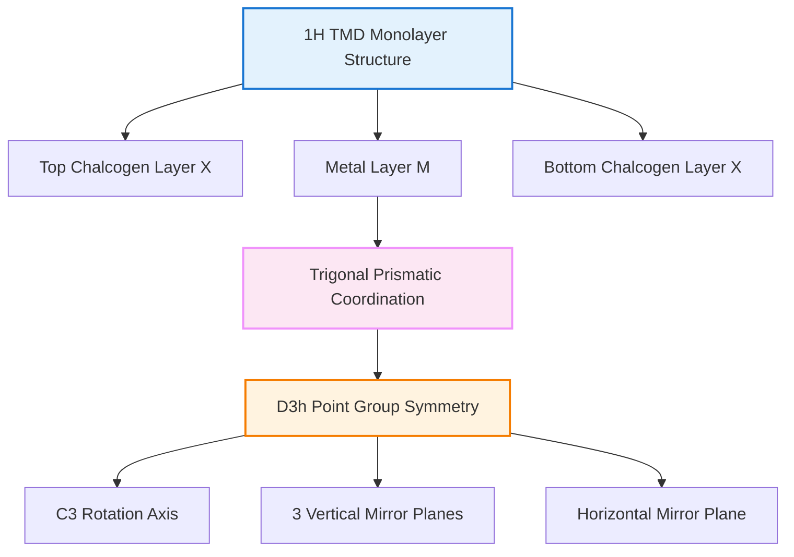
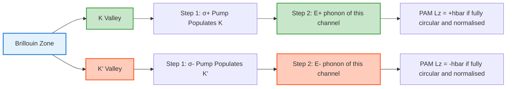
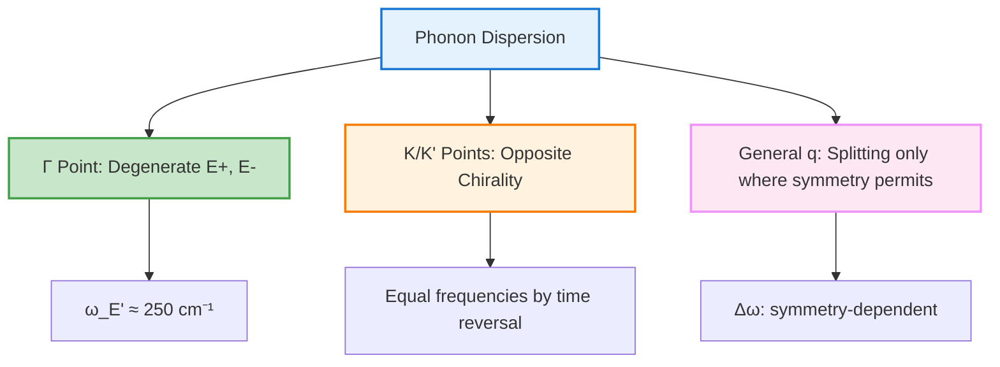

## Video Lecture

<div class="video-container">
  <iframe
    width="560"
    height="315"
    src="https://www.youtube.com/embed/6BFGvrQna9s?start=626"
    title="Chiral Phonons Ch.2: Materials"
    allow="accelerometer; autoplay; clipboard-write; encrypted-media; gyroscope; picture-in-picture"
    allowfullscreen>
  </iframe>
</div>

> This video covers the same content as the text below. Choose your preferred learning format.

---

🌐 EN | [🇯🇵 JP](../../../jp/MS/chiral-phonons/chapter-2.md) | Last sync: 2025-12-19

[Materials Science Dojo](../index.html) > [Chiral Phonons](index.md) > Chapter 2

---

Valley chiral phonons in monolayer hexagonal lattices were predicted theoretically in 2015 (Zhang & Niu) — circular lattice vibrations and phonon angular momentum as such have older antecedents — and chiral phonons were first widely reported experimentally in 2018 for monolayer WSe₂. This chapter explores the materials that host chiral phonons, from valley-coupled phonons in WSe₂ and MoS₂ monolayers to intrinsic chirality in 3D crystals like α-quartz and tellurium. We examine the symmetry requirements, experimental signatures, and temperature-dependent behavior that make these materials platforms for exploring phonon angular momentum.

**📖 Reading time:** 30-40min | **📊 Difficulty:** Advanced | **💻 Code examples:** 2 examples

## Learning Objectives

By reading this chapter, you will be able to:

- ✅ Understand the crystal structure and symmetry of TMD monolayers (WSe₂, MoS₂, MoSe₂)
- ✅ Explain valley-phonon coupling and its role in chiral phonon physics
- ✅ Describe optical selection rules for valley-selective excitation
- ✅ Identify 3D chiral crystals and their symmetry requirements
- ✅ Analyze phonon dispersion relations with chirality
- ✅ Model valley-phonon coupling using computational methods
- ✅ Evaluate temperature-dependent behavior of chiral phonons

---

## 2.1 Chiral Phonons in 2D Transition Metal Dichalcogenides

### Crystal Structure and Symmetry

Semiconducting **1H** monolayers of the transition metal dichalcogenides (TMDs) MX₂ (M = Mo, W; X = S, Se, Te) have trigonal prismatic metal coordination and belong to the **D₃ₕ point group**. The qualifier is not decorative: the same compositions also form octahedral (1T) and distorted (1T') polymorphs — common among the tellurides — whose symmetry is different, and some of them are centrosymmetric. Everything in this section refers to the 1H phase.

**1H TMD Monolayer Structure**

A 1H TMD monolayer consists of:

- One layer of transition metal atoms (M) sandwiched between two layers of chalcogen atoms (X)
- X-M-X stacking with trigonal prismatic coordination
- Hexagonal lattice; the 1H monolayer has no inversion centre (other polymorphs can)
- Point group: D₃ₕ (threefold rotation axis, three in-plane twofold axes, and a horizontal mirror plane)



### Key TMD Materials

| Material | Lattice Constant (Å) | Optical Gap (eV) | Doubly Degenerate Γ Modes |
|----------|---------------------|--------------|-------------------|
| **WSe₂** | 3.28 | 1.65 (direct, excitonic) | E', E'' at Γ point |
| **MoS₂** | 3.16 | 1.88 (direct, excitonic) | E', E'' at Γ point |
| **MoSe₂** | 3.29 | 1.55 (direct, excitonic) | E', E'' at Γ point |
| **WS₂** | 3.15 | 2.05 (direct, excitonic) | E', E'' at Γ point |

All four entries are semiconducting 1H monolayers. The lattice constants are representative monolayer values as usually quoted; the gaps are optical (excitonic) gaps, not quasiparticle gaps.

### E' and E'' Phonon Modes at Γ Point

The E' and E'' modes in TMD monolayers are doubly degenerate at the Brillouin zone center (Γ point). Although these 2D irreps can be expressed in a circular polarization basis, the degeneracy at Γ implies no intrinsic energy splitting between opposite circular components.

**E Modes and Circular Basis**

For D₃ₕ symmetry, the doubly degenerate E modes can be represented in circularly polarized eigenstates. The values \\(L_z = \pm\hbar\\) written below hold for a **fully circular in-plane eigenvector normalised to one phonon quantum**; the symmetry label on its own does not fix the mechanical angular momentum (Chapter 1 §1.2.2):

\\[
|\text{E}^+\rangle = \frac{1}{\sqrt{2}}(|E_x\rangle + i|E_y\rangle), \quad L_z = +\hbar
\\]

\\[
|\text{E}^-\rangle = \frac{1}{\sqrt{2}}(|E_x\rangle - i|E_y\rangle), \quad L_z = -\hbar
\\]

where the superscripts ± denote opposite circular components in the chosen basis. Whether a mode carries a nonzero net phonon angular momentum (PAM) depends on symmetry and wavevector; valley-locked chiral phonons are typically discussed at the K/K' points.

**Physical characteristics (material dependent)**:

- **E' mode (~250 cm⁻¹ for monolayer WSe₂)**: Predominantly in-plane optical motion
- **E'' mode (~176 cm⁻¹ for monolayer WSe₂)**: Also **in-plane** motion — the two chalcogens moving against each other, antisymmetric under \\(\sigma_h\\) (D₃ₕ basis \\((R_x, R_y)\\), \\((xz, yz)\\)). The genuinely out-of-plane Γ modes are A₁' and A₂''
- Circular basis is a convenient representation; net PAM and selection rules are most prominent at K/K'

### Valley-Phonon Coupling at K and K' Points

The most remarkable feature of TMD monolayers is the coupling between **valley degree of freedom** and **chiral phonons**.

**Valley Degree of Freedom**

In the hexagonal Brillouin zone of these semiconducting 1H monolayers, the band-edge extrema of the direct gap lie at the inequivalent K and K' points. That is the standard picture for the four materials tabulated above and not a property of every TMD phase: strain, dielectric environment and layer number can reorder the bands and bring the Q conduction valley (between Γ and K) or the Γ valence valley into competition.

- **K valley**: Located at +K point in reciprocal space
- **K' valley**: Located at -K point (time-reversed partner)
- Related by time-reversal symmetry but spatially distinct
- Carriers in K and K' valleys have opposite Berry curvature and magnetic moments



Throughout this section **E⁺ / E⁻** denote the two circular components of the phonon branch under discussion: at Γ they are the circular combinations of the E' doublet, and in an intervalley process they are the same *branch* evaluated at the finite wavevector the process requires, not the literal Γ-point mode.

**Valley preparation and the phonon that follows** (every handedness label below follows the single convention declared in Chapter 1 §1.2: \\(L_z = +\hbar\\) ⇔ counterclockwise viewed from \\(+z\\) ⇔ left-handed ⇔ \\(\sigma^+\\)). The two lines below are the bookkeeping of the **two-step** process of Chapter 1 §1.4.2 — the circularly polarized pump selects which valley is populated, and the handedness of the chiral phonon follows for the *one* intervalley channel written here. Which branch and which handedness a given process involves is set by the initial and final electronic states, the spin and the matrix element, not by the populated valley alone. They are not a one-photon rule by which a σ⁺ photon creates a Γ-point E⁺ phonon: a visible photon carries essentially no momentum, while the phonon in a K → K' process carries \\(q \approx K - K'\\):

\\[
\text{K valley} \xrightarrow{\sigma^+} |\text{E}^+\rangle \quad (L_z = +\hbar \ \text{for a fully circular normalised mode})
\\]

\\[
\text{K' valley} \xrightarrow{\sigma^-} |\text{E}^-\rangle \quad (L_z = -\hbar \ \text{for a fully circular normalised mode})
\\]

This coupling arises from:

1. **Mod-3 bookkeeping of pseudo-angular momentum**: under \\(C_3\\) the pseudo-angular momentum is conserved only modulo 3, \\(m_{\text{initial}} + m_{\text{light}} \equiv m_{\text{final}} + m_{\text{phonon}}\ (\text{mod } 3)\\), taken over the electronic **initial and final** states (Chapter 1 §1.4.2). Ordinary addition of photon, valley and phonon labels does not close; the mod-3 rule does
2. **Symmetry constraints**: the opposite helicity at K and K' follows from the \\(C_3\\) eigenvalues of the band-edge electronic states involved *together with* time-reversal symmetry, which maps K onto K'. The D₃ₕ point group on its own does not fix every electron–phonon helicity channel
3. **Electron–phonon matrix elements**: symmetry-resolved, and dependent on the phonon branch and on the electronic wavefunctions. The valley-dependent deformation potential used in the model below is one approximation to them, not the complete coupling

### Valley-Selective Optical Excitation

The valley degree of freedom can be selectively addressed using circularly polarized light:

**Optical Selection Rules**

The table is the **valley-preparation convention** of Chapter 1 §1.4.2, not a universal phonon-creation rule: the polarization column refers to the pump that selects the valley, and the last column to the handedness of the chiral phonon involved in the subsequent intervalley step.

| Pump polarization (step 1) | Valley populated | \\(C_3\\) label \\(m\\) of the band-edge transition (mod 3) | Chiral phonon in step 2 of this channel |
|-------------------|----------------|------------------|----------------|
| σ⁺ (left circular) | K valley | +1 | E⁺ (\\(L_z = +\hbar\\) for a fully circular normalised mode) |
| σ⁻ (right circular) | K' valley | −1 | E⁻ (\\(L_z = -\hbar\\) for a fully circular normalised mode) |

Here \\(m\\) is the \\(C_3\\) pseudo-angular-momentum label of the **electronic band-edge transition** at that valley (final state minus initial state), defined only modulo 3. It is a property of the specified conduction and valence states and their rotation eigenvalues — not an intrinsic number attached to a valley independently of the bands, the spin treatment and the rotation centre.

**Experimental manifestations**:

- **Polarization-resolved Raman spectroscopy**: the selection rules of the E' doublet are set by the **pair** of incident and analysed polarizations (co- versus cross-circular channels), not by the incident helicity alone. An unpumped, nonmagnetic, ideal monolayer shows no σ⁺/σ⁻ intensity asymmetry for the complete degenerate pair; an asymmetry requires valley polarization or some other broken symmetry (Chapter 3)
- **Valley photoluminescence**: Preferential emission from one valley under polarized excitation
- **Intervalley scattering**: Chiral phonons mediate K ↔ K' valley transitions

### Intervalley Scattering via Chiral Phonons

Chiral phonons provide one mechanism for intervalley scattering — defects, other phonon channels and, for excitons, electron–hole exchange contribute as well:

\\[
|K, n\rangle + |\text{E}^+\rangle \longrightarrow |K', n-1\rangle
\\]

\\[
|K', n\rangle + |\text{E}^-\rangle \longrightarrow |K, n-1\rangle
\\]

where \\(n\\) is the **occupation number of that chiral phonon mode**: the electron absorbs one phonon, so the population of the mode drops from \\(n\\) to \\(n-1\\). Checking the first line with the mod-3 rule as bookkeeping — \\(m_K = +1\\) and \\(m_{K'} = -1\\) being the \\(C_3\\) labels of the **band-edge transition** at each valley (§2.1), not intrinsic labels of the individual electron states — \\(m_K + m_{E^+} = 1 + 1 = 2 \equiv -1 \equiv m_{K'}\ (\text{mod } 3)\\); the second gives \\(-1 + (-1) = -2 \equiv +1 \equiv m_K\\). Applied to a real transition the rule needs the \\(C_3\\) eigenvalues of the specified initial and final electron states, with their band, spin and rotation-centre conventions. This process:

- Conserves pseudo-angular momentum modulo 3, electronic initial state + phonon ≡ electronic final state
- Requires momentum transfer ~K - K' (large momentum transfer), so the phonon absorbed in the channel written here is the finite-\\(q\\) member of the branch connected to the Γ-point E' mode, never the literal Γ-point mode, which cannot supply that momentum. Other branches — acoustic ones included — can mediate intervalley scattering (§2.3); which one dominates follows from a dispersion and matrix-element calculation
- Requires, in addition, an available final electronic state at the matching energy: agreement of the mod-3 labels is a necessary condition for the channel, not a sufficient one
- Is temperature-dependent (population of chiral phonons)
- Contributes to valley depolarization, and hence to the valley lifetime, and modifies valley Hall transport; the intrinsic valley Hall response itself originates in the Berry curvature of the electronic bands

---

## 2.2 3D Chiral Crystals

Beyond 2D materials, chiral phonons also exist in three-dimensional crystals with specific symmetry properties.

### α-Quartz: Chiral Phonons in a 3D Crystal

Chiral phonons in a three-dimensional crystal — **α-quartz (SiO₂)** — were detected with X-rays by Ueda *et al.*, *Nature* **618**, 946 (2023). The 2018 measurement by Zhu *et al.* was on monolayer WSe₂, not on quartz.

**α-Quartz Structure and Chirality**

**Crystal structure**:

- Space group: P3₁21 (3₁ screw, laevorotatory "left quartz") or P3₂21 (3₂ screw, dextrorotatory "right quartz")
- Screw axis: 3₁ or 3₂ (threefold rotation + translation along c-axis)
- Trigonal crystal system, point group 32 (D₃)
- Naturally occurring enantiomorphs (structural chirality)

> **⚠️ Two handednesses, opposite labels.** A 3₁ axis is a **right-handed structural screw** (IUCr definition: +120° combined with +c/3), yet the crystal built from it is **laevorotatory**: the optical designation runs opposite to the screw sense named in the space-group symbol. Right-handed (dextrorotatory) low quartz is **P3₂21**; left-handed (laevorotatory) low quartz is **P3₁21** (Donnay & Le Page, *Acta Cryst.* **A34**, 584 (1978); Glazer, *J. Appl. Cryst.* **51**, 915 (2018)). State which of the two conventions is meant whenever "right-handed quartz" is used.

**Chiral phonon characteristics**:

- At Γ, the doubly degenerate **E** optical phonons can be recombined into circular (±) pairs; the one-dimensional A₁ and A₂ modes cannot. Away from Γ the little group is smaller, and a chiral eigenmode there need not belong to a two-dimensional representation at all
- A single circular component **can** carry nonzero phonon angular momentum summed over the unit cell, but the value follows from the normalized mode eigenvectors and from nothing else: in a multi-atom crystal the atomic contributions can be elliptical, or partly cancel. Where it is nonzero, a thermal population still fills both partners equally, so the net PAM of the equilibrium crystal is zero
- For the two enantiomorphs, corresponding modes carry opposite chirality — a statement with content only once the mode-to-mode mapping, the propagation direction and the coordinate convention have been fixed (Exercise 4)

**Signatures to look for**:

- **Circularly polarised scattering**: an intensity difference \\(I_{R} - I_{L} \neq 0\\) for certain modes — this is the quantity Ueda *et al.* (2023) resolved with X-rays
- **Mode-specific chirality**: Not all phonons are chiral; it depends on the symmetry representation
- **Structural bound**: the α phase itself exists only up to the α–β transition at ~573 °C (§2.4)

### Screw Axis Symmetry

One route to phonon chirality in a 3D crystal is the **screw axis**. It is the characteristic element of the examples below, but it is neither necessary for circular atomic motion nor present in every structurally chiral crystal:

**Screw Axis**

A screw axis nₘ combines:

- n-fold rotation about an axis
- Translation by m/n of the lattice constant along that axis

For chiral phonons:

- **3₁ screw axis**: 120° rotation + 1/3 c-axis translation — a **right-handed screw**, found in laevorotatory ("left") quartz
- **3₂ screw axis**: 120° rotation + 2/3 c-axis translation — a **left-handed screw**, found in dextrorotatory ("right") quartz

A screw-axis label alone does not establish chirality: that requires the complete space group. For the named quartz groups P3₁21 and P3₂21 the check is explicit — every operation is a proper rotation or a screw, with no mirror, inversion or rotoinversion — so both are **Sohncke** groups, and a structure in either of them is chiral. That property is about the absence of improper operations only. It is a separate fact that these two particular group types are mirror images of one another (3₁ ↔ 3₂ under reflection) and therefore form an **enantiomorphic pair**.

### Tellurium and Selenium

**Trigonal tellurium** and **trigonal selenium** are elemental crystals built from helical chains along the c-axis, and are chiral in that form. (Selenium also has monoclinic ring-molecule allotropes and an amorphous form, which are not meant here.)

| Property | Tellurium (Te) | Selenium (Se) |
|----------|---------------|---------------|
| **Space Group** | P3₁21 or P3₂21 | P3₁21 or P3₂21 |
| **Structure** | Helical chains along c-axis | Helical chains along c-axis |
| **Lattice** | a = 4.46 Å, c = 5.93 Å | a = 4.37 Å, c = 4.95 Å |
| **Circular (±) Mode Pairs** | E modes (92, 141 cm⁻¹) | E modes |
| **Key Feature** | Strong spin-orbit coupling | Similar to Te, lighter mass |

At Γ, only the doubly degenerate E modes can be combined into a circular pair; the one-dimensional A₁ mode of Te (121 cm⁻¹) cannot. Te frequencies from Pine & Dresselhaus, *Phys. Rev. B* **4**, 356 (1971).

**Physical manifestations**:

- **Circular photogalvanic effect**: the photocurrent direction depends on the light helicity — established in trigonal Te

A phonon thermal Hall effect and a coupling of chiral phonons to a Weyl pseudospin are sometimes raised for these materials. Neither is asserted here, and no source is offered for either: a thermal Hall response is the *antisymmetric* part of the thermal conductivity and a linear equilibrium response of that kind requires a stated source of time-reversal breaking, while ambient Te and Se are not generic Weyl semimetals — the Weyl-like features discussed in the literature come with their own material and pressure conditions.

### Chiral Organic Crystals

Molecular crystals built from chiral molecules are **candidate** hosts. Enantiopure molecules force a Sohncke space group, but molecular handedness by itself does not show that a particular mode moves circularly or carries net angular momentum; that requires a calculated or measured mode. The examples below are named as candidates, with no chiral-phonon result claimed for them here.

**Candidate Chiral Organic Crystals**

- **Enantiopure amino-acid crystals (L- or D-)**: enantiopurity restricts the crystal to a Sohncke space group, while the class, packing and polymorph — and with them the vibrational selection rules — follow from the actual structure; which lattice modes carry angular momentum has to be established mode by mode
- **Helicenes**: helically twisted polycyclic aromatic hydrocarbons — a prospective example only; no specific helicene crystal or mode is cited here
- **Nucleic-acid crystals**: the DNA double helix is a *molecular* helix, and its helical repeat is not a crystallographic threefold screw. The space group of a given crystal has to be read off that structure, not inferred from the handedness of the molecule
- **Chiral metal–organic frameworks (MOFs)**: these crystallize in Sohncke groups and sometimes contain screw axes, but neither the particular screw symmetry nor any chiral-phonon evidence follows from the class name — both depend on the individual framework

**Unique aspects**:

- Phonon angular momentum from both molecular rotation and lattice vibration
- Weak intermolecular forces put the external (lattice) modes at low frequency, over a range that depends on the material
- Potential for chemical tuning of chirality

---

## 2.3 Phonon Dispersion with Chirality

### Chirality-Induced Band Splitting

Opposite-chirality phonon branches can split along certain directions where the symmetry permits it — not throughout the Brillouin zone. In the **nonmagnetic, time-reversal-symmetric** systems treated in this chapter, the Γ-point E doublets are protected by the crystal symmetry and stay degenerate. That protection is conditional, not universal: if time-reversal symmetry is broken — by magnetic order, an applied field, or a gyroscopic (Coriolis-like) coupling — a splitting of the circular partners at Γ can become allowed as well, and whether it actually is follows from the magnetic (or dynamical) symmetry group that survives, since a remaining two-dimensional irrep still protects the degeneracy:

\\[
\omega_+(\mathbf{q}) \neq \omega_-(\mathbf{q})
\\]

where \\(\omega_{\pm}\\) are frequencies of phonons with opposite chirality at wavevector \\(\mathbf{q}\\).

**Comparison with Electronic Band Structure**

This is analogous to Rashba or Dresselhaus splitting in electronic bands, but for phonons:

- **Electrons**: spin–orbit coupling **together with** broken inversion symmetry (Rashba, Dresselhaus) → spin-split bands. Spin–orbit coupling on its own does not lift the spin degeneracy
- **Phonons**: in the model systems where it has been analysed, a coupling between rotational and translational degrees of freedom in the dynamical matrix can split opposite-chirality branches. Which coupling is responsible is system-specific, so this is an analogy, not a universal microscopic mechanism

### Phonon Dispersion in WSe₂

For WSe₂ monolayer, representative features often discussed include:

1. **Γ point**: E' and E'' modes are doubly degenerate (circular components are basis choices)
2. **K and K' points**: valley-resolved chiral character emerges; opposite valleys host opposite handedness **at the same frequency**, which time-reversal symmetry requires of that pair
3. **General q-points**: Small wavevector-dependent effects can appear; details are material- and calculation-dependent



### Acoustic vs Optical Considerations

- Both acoustic and optical branches can carry circular polarization, including at zone-boundary wavevectors. Which of them is observable depends on the system and on the probe, not on a general hierarchy between the two.
- In 2D TMDs the Γ-point E'/E'' doublets and the valley phonons at K/K' are different objects: the E labels belong to the little group at the zone centre, whereas valley physics involves finite-momentum acoustic and optical branches at K/K', where the little group is smaller. A discussion of "chiral E modes" should state which of the two is meant.
- Librational (external) modes in molecular crystals can exhibit circular motion. They are distinguished from internal (intramolecular) modes by their **displacement pattern** — whole molecules rotating rigidly against one another, as against bond stretching and bending inside a molecule — and not by a frequency cutoff: librations sit at the low-frequency end of a material-dependent range, and internal bending, torsional and skeletal modes can fall low enough to overlap with them. Quantitative PAM requires case-by-case analysis with proper normalization.

---

## 2.4 Temperature Dependence

### Thermal Population of Chiral Phonons

The population of chiral phonons follows the Bose-Einstein distribution:

\\[
n(\omega, T) = \frac{1}{e^{\hbar\omega / k_B T} - 1}
\\]

At finite temperature:

- **Low T (kᵦT << ℏω)**: Exponentially suppressed phonon population
- **High T (kᵦT >> ℏω)**: Classical limit \\(n \approx k_B T / \hbar\omega\\)

**Implications for valley dynamics**:

- Intervalley scattering rate \\(\Gamma_{KK'} \propto 2n(\omega_E) + 1\\): emission carries \\(n+1\\) and absorption carries \\(n\\), so *if* the two channels are assigned **equal matrix elements and equal accessible phase space**, their sum is \\(2n+1\\). Both assumptions are needed, and neither is automatic — the two channels reach different final states and see different electronic occupation factors — so this is a toy rate model. That one choice is used in the text, in the code of §2.5 and in Exercise 2(c)
- Valley lifetime \\(\tau_v \propto 1/\Gamma_{KK'}\\) within the same two-valley rate model, and only while this intervalley channel dominates the relaxation
- At room temperature (300 K), E' modes (~250 cm⁻¹ ≈ 360 K) are partially populated: \\(n = 0.4315\\), hence \\(2n+1 = 1.863\\)

### Anharmonic Effects

Phonon-phonon interactions modify chiral phonon properties at elevated temperatures:

1. **Frequency shift**:
   \\[
   \omega(T) = \omega_0 + \Delta\omega_{\text{anharmonic}}(T)
   \\]
   For the Γ-point optical modes of the materials discussed here, warming from cryogenic to room temperature usually **softens** the frequency by of order a few cm⁻¹. Neither the sign nor the magnitude is universal: it has to be quoted for a specified material, mode and temperature interval

2. **Linewidth broadening**:
   \\[
   \Gamma(T) = \Gamma_0 + \Gamma_{\text{anharmonic}}(T)
   \\]
   Determines the phonon lifetime \\(\tau = \hbar/\Gamma\\), where this \\(\Gamma\\) is the FWHM **energy linewidth** of the mode — not the intervalley scattering rate \\(\Gamma_{KK'}\\) of §2.4

3. **Angular-momentum relaxation**: three-phonon processes relax a non-equilibrium *population* of one circular component back towards equilibrium, through the symmetry-allowed decay channels. That is distinct from a change in the eigenmodes themselves: symmetry fixes the representation label of a mode, while its detailed polarization — ellipticity, atom-resolved amplitudes — follows from the eigenvectors of the temperature-dependent dynamical matrix, and anharmonic scattering does not by itself destroy the label or mix every opposite-handed pair

### Phase Transitions

Some materials undergo structural phase transitions that affect chiral phonons:

**α-Quartz → β-Quartz Transition (573°C)**

- **α-phase**: P3₁21 or P3₂21 — point group 32, chiral
- **β-phase**: P6₂22 or P6₄22 — point group 622, **also chiral**. 622 is one of the 11 enantiomorphic point groups: generating it explicitly gives 12 operations, all proper rotations, with no mirror, inversion or rotoinversion
- **What the transition does**: it raises the symmetry 32 → 622 while **preserving** the crystal's handedness (P6₄22 ⊃ P3₁21 and P6₂22 ⊃ P3₂21, both of index 2, since \\((6_4)^2 \equiv 3_1\\) and \\((6_2)^2 \equiv 3_2\\)). The screw sense named in the symbol reverses across the transition even though the optical handedness does not
- **Consequence for phonons**: mode labels and selection rules are reassigned across the transition through the representation correlations 32 → 622. Both point groups admit two-dimensional E representations at Γ, so the Γ-point doublets are not where a change of degeneracy should be expected; which wavevectors and branches actually change degeneracy has to be read off those correlations. Chirality is not lost
- **Mechanism**: the transition has soft-mode character — an A₁ mode of the α phase softens on approach — but it is not a simple continuous soft-mode transition: it is weakly first order, with a narrow incommensurate phase between the α and β phases

---

## 2.5 Computational Modeling: Valley-Phonon Coupling

We now implement an abstract two-sector mixing model inspired by valley-phonon coupling in TMD monolayers. It is a toy model, not a phonon dispersion: mixing the two distinct crystal momenta K and K' coherently requires a momentum-supplying perturbation (or an enlarged unit cell), and the model supplies neither, so what it produces are abstract model eigenvalues rather than the phonon bands of a material.

**Code Example 1: TMD Valley-Phonon Coupling Model**

```python
# Requirements:
# - Python 3.9+
# - numpy>=1.24.0
# - matplotlib>=3.7.0
# - scipy>=1.10.0

"""
TMD Valley-Phonon Coupling Model
Purpose: toy model of valley-phonon coupling in a TMD monolayer
Target: Graduate students and researchers
Execution time: the numerical work is small, but the two plt.show() calls can
block until the figure windows are closed, so no wall-clock bound is promised.

Model choices, stated explicitly so that every printed number is reproducible:
- Frequencies are converted with 1 cm^-1 = 0.124 meV.
- The k-path runs Gamma -> K. |K| = 4*pi/3 in units of 1/a, so the path
  endpoint is the K point itself; the coupling is scaled by |k|/|K|.
- The intervalley scattering rate is modelled as Gamma ~ 2n + 1, that is
  emission (n + 1) plus absorption (n) with equal matrix elements AND equal
  accessible phase space. Both are assumptions of this toy rate model; the same
  choice is used in the text and in Exercise 2(c).
- The + and - helicity blocks of the 4x4 Hamiltonian are identical, so this
  model does NOT split opposite helicities. Its four eigenvalues are pairwise
  degenerate and the splitting is between the valley combinations (K +/- K').
- The two valley sectors are mixed coherently by hand. In a crystal, that would
  require a momentum-supplying perturbation (or an enlarged unit cell); neither
  is included here, so the eigenvalues printed below are abstract model
  eigenvalues, not the phonon dispersion of a material.
"""

import numpy as np
import matplotlib.pyplot as plt
from scipy.linalg import eigh

CM1_TO_MEV = 0.124   # 1 cm^-1 in meV
K_MAG = 4 * np.pi / 3   # |K| of a hexagonal BZ, in units of 1/a


# Parameters for WSe2 monolayer
class TMDParameters:
    def __init__(self):
        # Lattice constant (angstrom, representative monolayer value)
        self.a = 3.28
        # Phonon frequencies (cm^-1)
        self.omega_E_prime = 250.0  # E' mode (E_2g in bulk notation)
        self.omega_E_double_prime = 176.0  # E'' mode (E_1g in bulk notation)
        # Valley coupling strength at the K point (meV)
        self.g_valley = 5.0
        # Temperature (K)
        self.T = 300
        # Boltzmann constant (meV/K)
        self.k_B = 0.0861733

def bose_einstein(omega_cm, T, k_B=0.0861733):
    """
    Bose-Einstein distribution
    omega_cm: phonon frequency in cm^-1
    T: temperature in K
    k_B: Boltzmann constant in meV/K
    """
    omega_meV = omega_cm * CM1_TO_MEV
    if T == 0:
        return 0
    x = omega_meV / (k_B * T)
    return 1.0 / (np.exp(x) - 1)

def valley_phonon_hamiltonian(k_vec, params):
    """
    Construct valley-phonon coupled Hamiltonian
    k_vec: momentum vector [kx, ky] in units of 1/a
    params: TMDParameters object

    Returns 4x4 Hamiltonian in basis |K,+>, |K,->, |K',+>, |K',->
    where +/- denote E+ and E- chiral phonon states (phonon helicity,
    NOT spin: this model contains no spin-orbit term).

    The + and - blocks are identical by construction, so the eigenvalues come
    in degenerate pairs E_phonon +/- g: the model splits the symmetric and
    antisymmetric valley combinations, not the two helicities.
    """
    kx, ky = k_vec
    k_norm = np.sqrt(kx**2 + ky**2)

    # Phonon energies (in meV)
    E_phonon = params.omega_E_prime * CM1_TO_MEV

    # Valley-phonon coupling, growing linearly with |k| and reaching
    # g_valley at the K point (k_norm / K_MAG is dimensionless)
    g = params.g_valley * (k_norm / K_MAG)

    # Hamiltonian matrix
    H = np.array([
        [E_phonon, 0, g, 0],           # |K,+>
        [0, E_phonon, 0, g],           # |K,->
        [g, 0, E_phonon, 0],           # |K',+>
        [0, g, 0, E_phonon]            # |K',->
    ])

    return H

def k_point_on_path(fraction):
    """Momentum vector (units of 1/a) a given fraction of the way Gamma -> K."""
    direction = np.array([0.5, np.sqrt(3) / 2])   # unit vector towards K
    return fraction * K_MAG * direction

def plot_valley_phonon_dispersion():
    """
    Plot the eigenvalues of the toy Hamiltonian along Gamma -> K.

    These are abstract model eigenvalues, NOT the phonon dispersion of a
    material: the two valley sectors are mixed by hand (see module docstring).
    """
    params = TMDParameters()

    # Define k-path: Gamma -> K
    n_k = 100
    k_fraction = np.linspace(0, 1.0, n_k)  # fraction of the Gamma->K distance

    eigenvalues = np.zeros((n_k, 4))

    for i, frac in enumerate(k_fraction):
        k_vec = k_point_on_path(frac)
        H = valley_phonon_hamiltonian(k_vec, params)
        eigvals, eigvecs = eigh(H)
        eigenvalues[i, :] = eigvals

    # Convert to cm^-1
    eigenvalues_cm = eigenvalues / CM1_TO_MEV

    plt.figure(figsize=(10, 6))
    for band in range(4):
        plt.plot(k_fraction, eigenvalues_cm[:, band], linewidth=2)

    plt.xlabel('k along Γ→K (fraction of |K| = 4π/3a)', fontsize=12)
    plt.ylabel('Phonon Energy (cm⁻¹)', fontsize=12)
    plt.title('Valley-Coupled Phonon Bands in WSe₂ (toy model)', fontsize=14)
    plt.axhline(y=params.omega_E_prime, color='gray', linestyle='--',
                alpha=0.5, label='Uncoupled E\' mode')
    plt.legend(['Band 1', 'Band 2', 'Band 3', 'Band 4', 'Uncoupled'],
               fontsize=10)
    plt.grid(True, alpha=0.3)
    plt.tight_layout()
    plt.savefig('valley_phonon_dispersion.png', dpi=300)
    plt.show()

def plot_temperature_dependent_scattering():
    """
    Plot the illustrative 2n + 1 thermal factor of a fixed-energy mode.

    The mode energy is the Gamma-point E' frequency; the factor is the toy
    rate model of the module docstring, not a calculated intervalley rate.
    """
    params = TMDParameters()
    temperatures = np.linspace(10, 500, 100)

    # Scattering rate proportional to 2n+1 (emission + absorption)
    scattering_rates = np.zeros_like(temperatures)

    for i, T in enumerate(temperatures):
        n_phonon = bose_einstein(params.omega_E_prime, T, params.k_B)
        # Simplified scattering rate (arbitrary units):
        # emission (n+1) + absorption (n), equal matrix elements
        scattering_rates[i] = 2 * n_phonon + 1

    plt.figure(figsize=(10, 6))
    plt.plot(temperatures, scattering_rates, linewidth=2, color='darkblue')
    plt.xlabel('Temperature (K)', fontsize=12)
    plt.ylabel('Thermal factor 2n+1 (arb. units)', fontsize=12)
    plt.title('Illustrative 2n+1 Thermal Factor for a 250 cm⁻¹ Mode',
              fontsize=14)
    plt.axvline(x=300, color='red', linestyle='--', alpha=0.5,
                label='Room Temperature')
    plt.grid(True, alpha=0.3)
    plt.legend(fontsize=10)
    plt.tight_layout()
    plt.savefig('temperature_scattering.png', dpi=300)
    plt.show()

# Execute visualizations
if __name__ == "__main__":
    print("=== TMD Valley-Phonon Coupling Simulation ===\n")

    params = TMDParameters()
    print(f"Material: WSe₂ monolayer")
    print(f"E' phonon frequency: {params.omega_E_prime} cm⁻¹")
    print(f"Valley coupling at K: {params.g_valley} meV")
    print(f"Temperature: {params.T} K\n")

    # Calculate phonon population at room temperature
    n_300K = bose_einstein(params.omega_E_prime, 300)
    print(f"Phonon population at 300K: {n_300K:.4f}")
    print(f"This means ~{n_300K:.1f} phonons per mode on average")
    print(f"Scattering rate 2n+1 at 300K: {2 * n_300K + 1:.3f} (arb. units)\n")

    # What the 4x4 model actually splits
    for label, frac in (("Γ", 0.0), ("K", 1.0)):
        eigvals = eigh(valley_phonon_hamiltonian(k_point_on_path(frac), params))[0]
        print(f"Eigenvalues at {label} (meV): " +
              ", ".join(f"{e:.3f}" for e in eigvals))
    print("Pairwise degenerate: the + and - helicity blocks are identical,")
    print("so the splitting is between valley combinations, not helicities.\n")

    print("Generating plots...")
    plot_valley_phonon_dispersion()
    plot_temperature_dependent_scattering()
    print("Done!")
```

**Expected Output (Code Example 1):**
```
=== TMD Valley-Phonon Coupling Simulation ===

Material: WSe₂ monolayer
E' phonon frequency: 250.0 cm⁻¹
Valley coupling at K: 5.0 meV
Temperature: 300 K

Phonon population at 300K: 0.4315
This means ~0.4 phonons per mode on average
Scattering rate 2n+1 at 300K: 1.863 (arb. units)

Eigenvalues at Γ (meV): 31.000, 31.000, 31.000, 31.000
Eigenvalues at K (meV): 26.000, 26.000, 36.000, 36.000
Pairwise degenerate: the + and - helicity blocks are identical,
so the splitting is between valley combinations, not helicities.

Generating plots...
Done!
```

### Code Explanation

1. **TMDParameters class**: Stores material-specific parameters for WSe₂
2. **bose_einstein function**: Calculates thermal phonon population
3. **valley_phonon_hamiltonian**: Constructs the 4×4 Hamiltonian in the basis |K,±⟩, |K',±⟩, where ± is the **phonon helicity** (E⁺/E⁻), not a spin index — the model contains no spin-orbit term, and `g_valley` is an illustrative parameter, not a measured one
4. **plot_valley_phonon_dispersion**: Shows the four eigenvalues along Γ→K. They are **pairwise degenerate**, \\(E_{\text{phonon}} \pm g\\): the + and − helicity blocks of the matrix are identical, so this model splits the symmetric and antisymmetric **valley** combinations, not the two helicities
5. **plot_temperature_dependent_scattering**: Demonstrates the temperature effect on intervalley transitions using \\(\Gamma \propto 2n+1\\)

---

## 2.6 Phonon Chirality in Different Material Classes

**Code Example 2: Comparing Chiral Phonons Across Materials**

```python
# Requirements:
# - Python 3.9+
# - numpy>=1.24.0
# - matplotlib>=3.7.0
# - pandas>=2.0.0

"""
Comparing Chiral Phonons Across Materials
Purpose: tabulate and plot the doubly degenerate modes that can be combined
         into circular (+/-) pairs in four host materials
Execution time: the numerical work is small, but plt.show() can block until
the figure window is closed, so no wall-clock bound is promised.

At the Gamma point, only the doubly degenerate E representations can be
recombined into a circular (+/-) pair, so the one-dimensional A representations
are deliberately absent from the database (Te A1 = 121 cm^-1, for instance, is
non-degenerate). Away from Gamma the restriction does not apply: a chiral
eigenmode there need not belong to a two-dimensional representation.

The +1 / -1 stored with each entry is a CIRCULAR SYMMETRY LABEL - which member
of the +/- combination it is - and NOT a mechanical angular momentum. A symmetry
label does not fix L_z: in a multi-atom crystal the atomic contributions can be
elliptical, mixed, or cancel, and L_z can only be obtained from normalized mode
eigenvectors, which this database does not carry.

Measured frequencies (E_2g / E_1g are the corresponding bulk-mode notation):
- WSe2 monolayer: E' ~250 cm^-1, E'' ~176 cm^-1
- MoS2 monolayer: E' ~383 cm^-1
- alpha-quartz E modes: 128 and 265 cm^-1
  (Scott & Porto, Phys. Rev. 161, 903 (1967))
- trigonal Te E modes: 92 and 141 cm^-1; the 121 cm^-1 line is A1
  (Pine & Dresselhaus, Phys. Rev. B 4, 356 (1971))
"""

import numpy as np
import matplotlib.pyplot as plt
import pandas as pd

class ChiralPhononMaterial:
    """Base class for materials hosting chiral phonons"""
    def __init__(self, name, dimension, symmetry):
        self.name = name
        self.dimension = dimension  # '2D' or '3D'
        self.symmetry = symmetry
        self.chiral_modes = []

    def add_chiral_mode(self, frequency, circular_label, symmetry_label):
        """Add one circular component of a doubly degenerate mode.

        circular_label is +1 or -1: a symmetry label saying which member of the
        circular (+/-) combination this is.  It is NOT a mechanical angular
        momentum - L_z would require normalized mode eigenvectors, which this
        database does not carry - so nothing here is quoted in units of hbar.
        """
        self.chiral_modes.append({
            'frequency': frequency,  # cm^-1
            'circular_label': circular_label,  # +1 / -1 symmetry label, not L_z
            'label': symmetry_label
        })

    def get_summary(self):
        """Return summary of material properties"""
        return {
            'Name': self.name,
            'Dimension': self.dimension,
            'Symmetry': self.symmetry,
            'Num_Modes': len(self.chiral_modes)
        }

# Define materials database
def create_materials_database():
    materials = []

    # WSe2 monolayer
    wse2 = ChiralPhononMaterial('WSe₂', '2D', 'D₃ₕ')
    wse2.add_chiral_mode(176, +1, 'E\'\'+')
    wse2.add_chiral_mode(176, -1, 'E\'\'-')
    wse2.add_chiral_mode(250, +1, 'E\'+')
    wse2.add_chiral_mode(250, -1, 'E\'-')
    materials.append(wse2)

    # MoS2 monolayer
    mos2 = ChiralPhononMaterial('MoS₂', '2D', 'D₃ₕ')
    mos2.add_chiral_mode(383, +1, 'E\'+')
    mos2.add_chiral_mode(383, -1, 'E\'-')
    materials.append(mos2)

    # α-Quartz (E modes only; A1 modes are non-degenerate)
    quartz = ChiralPhononMaterial('α-SiO₂', '3D', 'P3₁21')
    quartz.add_chiral_mode(128, +1, 'E(128)+')
    quartz.add_chiral_mode(128, -1, 'E(128)-')
    quartz.add_chiral_mode(265, +1, 'E(265)+')
    quartz.add_chiral_mode(265, -1, 'E(265)-')
    materials.append(quartz)

    # Tellurium (E modes only; the 121 cm^-1 A1 mode is non-degenerate)
    te = ChiralPhononMaterial('Te', '3D', 'P3₁21')
    te.add_chiral_mode(92, +1, 'E(92)+')
    te.add_chiral_mode(92, -1, 'E(92)-')
    te.add_chiral_mode(141, +1, 'E(141)+')
    te.add_chiral_mode(141, -1, 'E(141)-')
    materials.append(te)

    return materials

def plot_chiral_mode_comparison(materials):
    """Plot comparison of chiral phonon frequencies across materials"""
    fig, ax = plt.subplots(figsize=(12, 8))

    colors_2d = '#e74c3c'
    colors_3d = '#3498db'

    y_positions = []
    y_labels = []

    for i, mat in enumerate(materials):
        y_pos = i * 2
        y_positions.append(y_pos)
        y_labels.append(f"{mat.name}\n({mat.dimension})")

        # Get frequencies of the degenerate pairs
        frequencies = [mode['frequency'] for mode in mat.chiral_modes]
        unique_freqs = sorted(list(set(frequencies)))

        for freq in unique_freqs:
            color = colors_2d if mat.dimension == '2D' else colors_3d
            ax.scatter(freq, y_pos, s=150, c=color, alpha=0.7,
                      edgecolors='black', linewidth=1.5, zorder=3)

    ax.set_yticks(y_positions)
    ax.set_yticklabels(y_labels, fontsize=11)
    ax.set_xlabel('Phonon Frequency (cm⁻¹)', fontsize=13)
    ax.set_title('Degenerate Mode Frequencies Across Materials', fontsize=15,
                 fontweight='bold')
    ax.grid(True, alpha=0.3, axis='x')

    # Legend
    ax.scatter([], [], c=colors_2d, s=150, label='2D Materials')
    ax.scatter([], [], c=colors_3d, s=150, label='3D Materials')
    ax.legend(fontsize=11, loc='upper right')

    plt.tight_layout()
    plt.savefig('chiral_phonon_comparison.png', dpi=300)
    plt.show()

def create_materials_table(materials):
    """Create summary table of materials"""
    data = []
    for mat in materials:
        freqs = [mode['frequency'] for mode in mat.chiral_modes]
        data.append({
            'Material': mat.name,
            'Dimension': mat.dimension,
            'Symmetry': mat.symmetry,
            'Circular Components': len(mat.chiral_modes),
            'Degenerate Pairs': len(set(freqs)),
            'Freq Range (cm⁻¹)': f"{min(freqs):.0f}-{max(freqs):.0f}"
        })

    df = pd.DataFrame(data)
    print("\n=== Chiral Phonon Materials Database ===\n")
    print(df.to_string(index=False))
    print("\nThe +1 / -1 attached to each circular component is a symmetry")
    print("label, not an angular momentum: L_z follows from normalized mode")
    print("eigenvectors, which this database does not carry.")
    print("\n")

    return df

# Execute
if __name__ == "__main__":
    materials = create_materials_database()
    df = create_materials_table(materials)
    plot_chiral_mode_comparison(materials)
```

**Expected Output (Code Example 2):**
```

=== Chiral Phonon Materials Database ===

Material Dimension Symmetry  Circular Components  Degenerate Pairs Freq Range (cm⁻¹)
    WSe₂        2D      D₃ₕ                    4                 2           176-250
    MoS₂        2D      D₃ₕ                    2                 1           383-383
  α-SiO₂        3D    P3₁21                    4                 2           128-265
      Te        3D    P3₁21                    4                 2            92-141

The +1 / -1 attached to each circular component is a symmetry
label, not an angular momentum: L_z follows from normalized mode
eigenvectors, which this database does not carry.


```

---

## Exercises

### Exercise 1: Valley Selection Rules

**Problem**: Consider a WSe₂ monolayer excited by σ⁺ circularly polarized light at the K valley. Take a **hot** electron, some tens of meV above the conduction-band minimum, so that a final state at the right energy exists, and let it relax by emitting a chiral phonon on the branch connected to the Γ-point E' mode, evaluated at the wavevector the process requires (\\(q \approx 0\\) within one valley, \\(q \approx K - K'\\) between valleys). An electron sitting exactly at the conduction-band minimum cannot emit a finite-energy phonon at all, and the emission additionally needs a nonzero matrix element for the branch in question.

(a) Which pseudo-angular momentum must the emitted phonon carry if the electron remains in the K valley — and can a phonon whose \\(C_3\\) label is \\(m = \pm 1\\) satisfy it?
(b) Which chiral phonon (E⁺ or E⁻) is emitted if the electron scatters to the K' valley?
(c) Explain your answers using the mod-3 rule.

**Hint**: take \\(m = +1\\) at K and \\(m = -1\\) at K' as the \\(C_3\\) label of the **band-edge transition** at that valley (§2.1) and use it as bookkeeping for this idealised exercise, not as an intrinsic quantum number of the electron; it is defined only **modulo 3** (Chapter 1 §1.4.2). For emission, \\(m_{\text{initial}} \equiv m_{\text{final}} + m_{\text{phonon}}\ (\text{mod } 3)\\). Note that \\(m = 2\\) and \\(m = -1\\) label the same \\(C_3\\) eigenvalue.

### Exercise 2: Temperature Effects

**Problem**: The E' phonon mode in WSe₂ has frequency ω = 250 cm⁻¹.

(a) Calculate the phonon population n(ω,T) at T = 100 K, 300 K, and 500 K.
(b) At what temperature does n(ω,T) = 1?
(c) Using the single scattering model of this chapter, \\(\Gamma_{KK'} \propto 2n(\omega,T) + 1\\), compute the ratio \\(\Gamma(500\ \text{K})/\Gamma(100\ \text{K})\\).

**Useful conversion**: 1 cm⁻¹ ≈ 0.124 meV ≈ 1.44 K (in energy units).

### Exercise 3: Symmetry Analysis

**Problem**: A material has point group C₃ᵥ (threefold rotation axis + vertical mirror planes).

(a) Does this symmetry allow *structural* chirality? Does it forbid circular phonon motion at every wavevector? Distinguish the two questions.
(b) What symmetry element must be removed to enable structural chirality?
(c) Compare with D₃ₕ symmetry of TMD monolayers. What is the key difference?

### Exercise 4: α-Quartz Chirality

**Problem**: α-Quartz exists in two enantiomorphic forms: P3₁21 (3₁ screw, laevorotatory) and P3₂21 (3₂ screw, dextrorotatory). Recall that the optical designation is opposite to the screw sense named in the symbol.

(a) Describe the difference in screw axis operations between these two forms.
(b) For corresponding modes of the two enantiomorphs, how do the **signs** of the phonon angular momentum compare, and why does such a comparison require a fixed propagation direction and coordinate convention before it means anything?
(c) What experimental technique could distinguish between these two forms?

### Exercise 5: Coding Challenge - 3D Chiral Crystal

**Problem**: Modify the `valley_phonon_hamiltonian` function to model a 3D chiral crystal (e.g., tellurium) instead of a 2D TMD.

(a) How would the Hamiltonian structure change?
(b) Add a term representing screw axis coupling along the c-axis.
(c) Plot the phonon dispersion along the Γ-A direction (parallel to c-axis).

**Hint**: For 3D, include kᵤ dependence and consider how the E doublet splits away from Γ. This is a qualitative exercise — several modifications satisfy the request, so state your assumptions (there is no unique numerical answer).

---

## Summary

In this chapter, we explored the materials landscape hosting chiral phonons:

- **Semiconducting 1H TMD monolayers (WSe₂, MoS₂, MoSe₂)**: D₃ₕ symmetry gives Γ-point E' and E'' doublets that can be written in a circular basis, plus valley-phonon coupling at K/K'
- **Valley degree of freedom**: corresponding time-reversed, symmetry-allowed valley–phonon channels at K and K' involve opposite phonon chirality; the optical helicity enters as the valley-**preparation** step of a two-step process, not as a direct photon → phonon rule
- **3D chiral crystals**: α-quartz and trigonal Te/Se crystallize in P3₁21 or P3₂21 with a 3₁ or 3₂ screw. Chiral *organic* crystals span many Sohncke space groups and need not contain either screw. The optical designation of quartz is opposite to the screw sense in its space-group symbol, and the β phase above 573 °C is chiral too
- **Phonon dispersion**: chirality can split bands along certain directions when symmetry permits, while in the nonmagnetic, time-reversal-symmetric case the E doublets remain degenerate at Γ
- **Temperature effects**: Bose-Einstein statistics govern phonon population and scattering rates

The next chapter will focus on experimental techniques for detecting and characterizing chiral phonons, including circularly polarized Raman spectroscopy and ultrafast methods.

---

[← Chapter 1](chapter-1.md) [Chapter 3 →](chapter-3.md)

---

## Disclaimer

This educational content was generated with AI assistance for the Hashimoto Lab knowledge base. While efforts have been made to ensure accuracy, readers should verify critical information with primary sources and peer-reviewed literature. Key references include:

- Zhang, L. & Niu, Q. (2015). Chiral phonons at high-symmetry points in monolayer hexagonal lattices. *Physical Review Letters*, 115(11), 115502.
- Zhu, H. et al. (2018). Observation of chiral phonons. *Science*, 359(6375), 579-582. (monolayer WSe₂)
- Chen, X. et al. (2019). Entanglement of single-photons and chiral phonons in atomically thin WSe₂. *Nature Physics*, 15, 221-227.
- Ueda, H. et al. (2023). Chiral phonons in quartz probed by X-rays. *Nature*, 618, 946.
- Donnay, J. D. H. & Le Page, Y. (1978). The vicissitudes of the low-quartz crystal setting. *Acta Crystallographica A*, 34, 584.
- Glazer, A. M. (2018). Confusion over the description of the quartz structure yet again. *Journal of Applied Crystallography*, 51, 915.
- Pine, A. S. & Dresselhaus, G. (1971). Raman spectra and lattice dynamics of tellurium. *Physical Review B*, 4, 356.
- Scott, J. F. & Porto, S. P. S. (1967). Longitudinal and transverse optical lattice vibrations in quartz. *Physical Review*, 161, 903.
