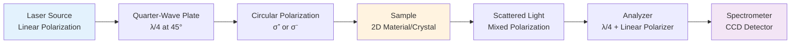
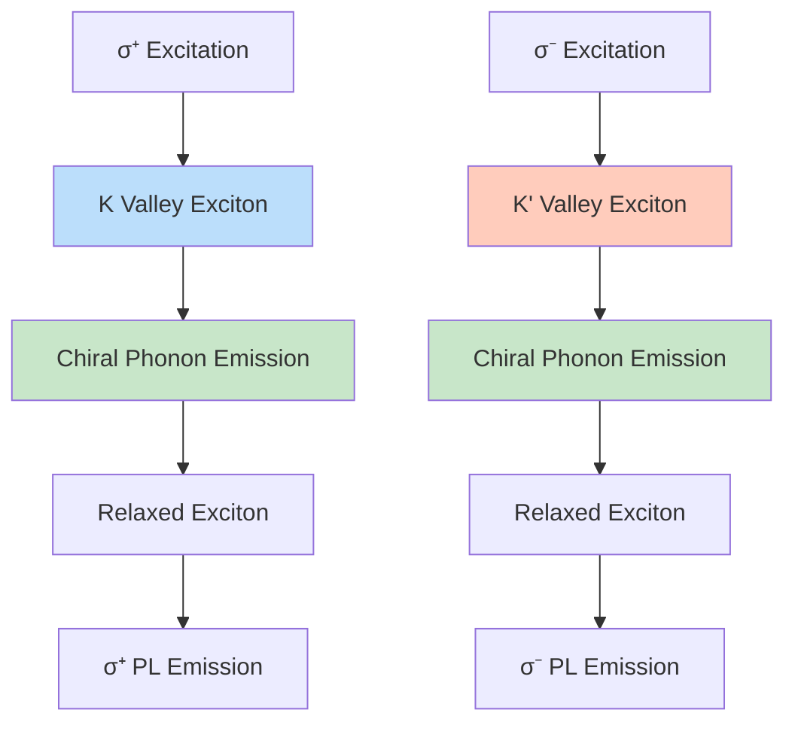

## Video Lecture

<div class="video-container">
  <iframe
    width="560"
    height="315"
    src="https://www.youtube.com/embed/6BFGvrQna9s?start=1278"
    title="Chiral Phonons Ch.3: Experimental Detection"
    allow="accelerometer; autoplay; clipboard-write; encrypted-media; gyroscope; picture-in-picture"
    allowfullscreen>
  </iframe>
</div>

> This video covers the same content as the text below. Choose your preferred learning format.

---

🌐 EN | [🇯🇵 JP](../../../jp/MS/chiral-phonons/chapter-3.md) | Last sync: 2025-12-19

[Knowledge Base](../../index.html) > [Materials Science](../index.html) > [Chiral Phonons](index.md) > Chapter 3

---

# Chapter 3: Experimental Detection of Chiral Phonons

**From Circularly Polarized Raman to Ultrafast Spectroscopy**

⏱️ Reading time: 40-45 minutes | 💻 Code examples: 3 | 📊 Difficulty: Advanced | 🔬 Practical exercises: 5

---

This chapter covers the experimental techniques for detecting and characterizing chiral phonons. You will learn circularly polarized Raman spectroscopy, circular dichroism methods, ultrafast spectroscopy, and key experimental results that confirmed the existence of chiral phonons in materials.

## Learning Objectives

Upon completing this chapter, you will acquire the following skills and knowledge:

- ✅ Understand the experimental setup for circularly polarized Raman spectroscopy
- ✅ Explain Raman selection rules for chiral phonons, and what the circular polarization contrast does and does not measure
- ✅ Understand circular dichroism in phonon absorption, and what a model must supply before it can be connected to angular momentum
- ✅ Describe helicity-resolved photoluminescence and valley polarization detection
- ✅ Explain ultrafast spectroscopy techniques for time-resolved chiral phonon detection
- ✅ Analyze key experimental results in WSe₂ and α-quartz
- ✅ Simulate Raman polarization dependence using Python

## 3.1 Circularly Polarized Raman Spectroscopy

### 3.1.1 Fundamentals of Raman Scattering

**Raman scattering** is an inelastic light scattering process where incident photons interact with phonons (lattice vibrations) in a material. The scattered light's frequency shift reveals the phonon energy:

\\[
\omega_{\text{scattered}} = \omega_{\text{incident}} \pm \omega_{\text{phonon}}
\\]

For chiral phonons, the key innovation is **circularly polarized light**. Three quantities have to be kept apart here, and this chapter keeps them apart throughout. The *optical selection rules* say which circular channel a given mode can scatter into. The *pseudo-angular momentum* \\(m\\) is the discrete rotation label those rules constrain, defined only modulo the rotation order (Chapter 1 §1.2.2). The *mechanical angular momentum* \\(L_z\\) is an expectation value computed from the mode's displacement eigenvector. A polarization measurement gives the first directly; converting it into a statement about the third needs the mode identified and its eigenvector calculated or measured. The experimental configuration distinguishes between co-polarized and cross-polarized scattering.

> **💡 Polarization Configurations**
>
> \\(\sigma^{\pm}\\) below are **fixed-axis** circular polarization vectors \\((\hat{\mathbf{x}} \pm i\hat{\mathbf{y}})/\sqrt{2}\\), referred to the laboratory \\(z\\) axis — the basis the code of §3.7 uses. They are *not* propagation-relative helicities: in backscattering the collected beam travels along \\(-z\\), so the same fixed-axis label corresponds to the opposite helicity. The two conventions must not be mixed.
>
> **Co-polarized (\\(\sigma^+/\sigma^+\\) or \\(\sigma^-/\sigma^-\\))**
> - Incident and scattered light carry the same fixed-axis circular label
> - In the backscattering geometry and the \\(D_{3h}\\) Γ-point channels of §3.1.3, this is the channel in which the totally symmetric mode appears
> - Example: the \\(A_1'\\) mode of an ideal 1H monolayer. Co-circular scattering is a statement about that channel, not a proof that the excitation carries no mechanical angular momentum
>
> **Cross-polarized (\\(\sigma^+/\sigma^-\\) or \\(\sigma^-/\sigma^+\\))**
> - Incident and scattered light carry opposite fixed-axis circular labels, so the projection of the light's angular momentum on the laboratory \\(z\\) axis differs by \\(2\hbar\\) between the incoming and the outgoing photon
> - A \\(C_3\\) axis conserves pseudo-angular momentum only **modulo 3**, and \\(\pm 2 \equiv \mp 1\ (\text{mod } 3)\\), so the mode that takes up the difference carries the rotation label \\(m = \mp 1\\) (Chapter 1 §1.4.2). This is bookkeeping in \\(m\\), a symmetry label defined mod 3 — it does **not** assign \\(\pm 2\hbar\\), or any particular \\(L_z\\), to the phonon, and other degrees of freedom can take part in the balance
> - Example: the \\(E'\\) doublet of an ideal 1H monolayer, read in the circular basis

### 3.1.2 Experimental Setup with Quarter-Wave Plates

The experimental setup for circularly polarized Raman spectroscopy requires precise control of light polarization using optical elements:



**Key Components:**

1. **Quarter-Wave Plate (QWP):** Converts linear polarization to circular by introducing a 90° phase shift between orthogonal components
2. **Linear Polarizer:** Selects specific linear polarization direction
3. **Analyzer System:** Second QWP + polarizer to select circular polarization of scattered light
4. **Backscattering Geometry:** A convenient and commonly used collection geometry for microscopes and thin samples — not a universal maximum of Raman signal. Keeping the incident and collected beams on one axis also simplifies the polarization bookkeeping

### 3.1.3 Raman Selection Rules for Chiral Phonons

The Raman scattering intensity is determined by the Raman tensor \\(\mathbf{R}\\) and the polarization vectors of incident (\\(\mathbf{e}_i\\)) and scattered (\\(\mathbf{e}_s\\)) light:

\\[
I \propto |\mathbf{e}_s^{*} \cdot \mathbf{R} \cdot \mathbf{e}_i|^2
\\]

The **outgoing polarization enters conjugated**; for circular polarization vectors dropping the conjugate exchanges the co- and cross-polarized predictions.

For a mode carrying the rotation label \\(m\\), the Raman tensor has specific symmetry properties. In an ideal 1H TMD monolayer such as semiconducting monolayer WSe₂ (point group \\(D_{3h}\\)), the \\(E'\\) mode is a degenerate pair at Γ — it does not split there — spanned by the two real tensors \\(R_x = \begin{pmatrix} 1 & 0 \\\\ 0 & -1\end{pmatrix}\\) and \\(R_y = \begin{pmatrix} 0 & 1 \\\\ 1 & 0\end{pmatrix}\\). Its circular combinations \\(R_\pm = (R_x \pm i R_y)/2\\) are symmetric and traceless, and each one connects one pair of *opposite* fixed-axis circular polarization vectors, so the two partners are addressed by opposite cross-polarized channels.

Configurations are written **incident/scattered**. Handedness follows the single convention of Chapter 1 §1.2.2 (\\(L_z = +\hbar\\) ⇔ counterclockwise seen from \\(+z\\) ⇔ left-handed), which names a *mechanical* rotation sense and by itself asserts nothing about which helicity excites a mode. The rotation label \\(m\\) of the two \\(E'\\) partners is a different quantity, defined modulo 3 (Chapter 1 §1.2.2). Calling the \\(m = +1\\) partner "left-handed" below is therefore a naming shorthand for the circular tensor partner \\(R_+\\); it coincides with \\(L_z = +\hbar\\) only for a fully circular partner whose eigenvector is normalised to one phonon quantum, which symmetry alone does not guarantee.

| Phonon Mode | Rotation label \\(m\\) (mod 3) | Active Configuration | Inactive Configuration |
|-------------|------------------|----------------------|------------------------|
| **\\(A_1'\\) (out-of-plane optical)** | \\(m = 0\\) | \\(\sigma^+/\sigma^+\\), \\(\sigma^-/\sigma^-\\) | \\(\sigma^+/\sigma^-\\), \\(\sigma^-/\sigma^+\\) |
| **\\(E'_L\\) (partner \\(R_+\\))** | \\(m = +1\\) | \\(\sigma^-/\sigma^+\\) | \\(\sigma^+/\sigma^-\\) and both co-polarized |
| **\\(E'_R\\) (partner \\(R_-\\))** | \\(m = -1\\) | \\(\sigma^+/\sigma^-\\) | \\(\sigma^-/\sigma^+\\) and both co-polarized |

(The \\(A_1'\\) mode of a 1H monolayer is the intralayer optical mode in which the two chalcogen planes move oppositely along \\(z\\); it is not the low-frequency interlayer breathing mode, which requires more than one layer.)

These are the intensities printed by §3.7 Example 1, and they are selection rules for the circular *symmetry partners* of the doublet. Which partner is *populated* in a given measurement is a separate question of valley-phonon coupling (§3.3), and the intensity pattern alone does not establish a rotating displacement.

> **⚠️ Critical Considerations**
> - **Valley Selection:** The Γ-point \\(E'\\) rules above follow from crystal symmetry alone and do not require valley-selective populations. Valley dependence enters separately, through resonant or intervalley *electronic* processes that preferentially populate or probe one partner (§3.3)
> - **Sample Quality:** Defects and strain can break selection rules and cause depolarization
> - **Detection Efficiency:** QWP alignment and optical aberrations affect the measured circular polarization contrast
> - **Temperature Effects:** Phonon linewidth and polarization can vary with temperature

### 3.1.4 Circular Polarization Contrast

The **circular polarization contrast** compares the light collected in the two circular channels:

\\[
P_c = \frac{I_{\text{co}} - I_{\text{cross}}}{I_{\text{co}} + I_{\text{cross}}}
\\]

where \\(I_{\text{co}}\\) is the co-polarized intensity and \\(I_{\text{cross}}\\) the cross-polarized intensity.

This is a property of the **scattered light**, not of the phonon. It records which channel the scattering went into, and nothing more. §3.7 Example 1 makes the limitation explicit: it returns \\(P_c = -1\\) for **both** \\(E'\\) partners, because each is cross-polarized in one channel, and it averages over the two incident helicities. The contrast therefore cannot distinguish the handedness of the two partners, and it is not a measure of phonon mechanical angular momentum or of a net phonon population imbalance.

**Interpretation:**
- \\(P_c = +1\\): all of the signal is in the co-polarized channels — the behaviour of the ideal \\(A_1'\\) mode in this geometry. Co-circular scattering is not in general proof that an excitation carries zero mechanical angular momentum
- \\(P_c = -1\\): all of the signal is in the cross-polarized channels. A linearly polarized member of the degenerate \\(E'\\) representation, or an unresolved balanced doublet, gives the same value, so neither a rotating displacement nor a population imbalance follows from cross-circular intensity alone
- \\(|P_c| < 1\\): incomplete contrast between the two circular channels. This is not the same as "partially polarized light" — fully linearly or elliptically polarized light also has a reduced circular Stokes component. Mixed mode character, overlapping modes with *different* channel patterns and instrumental depolarization all produce it — unresolved partners of the same ideal \\(E'\\) doublet do not, since in this geometry both scatter exclusively into cross-circular channels — and separating the causes needs a full polarization (Stokes) analysis of the scattered beam together with the instrument calibration, the spectral resolution and a response model

Establishing that a phonon is chiral takes more than \\(P_c\\): the mode has to be identified and a chirality-sensitive observable measured with a validated mode assignment — by resolving or preparing the two partners separately, or, as in the momentum-resolved X-ray measurement of §3.6.2, by a dichroic scattering measurement read against a calculation. §3.6 states what each cited experiment supplies.

## 3.2 Circular Dichroism in Phonon Absorption

### 3.2.1 Infrared Circular Dichroism (IR-CD)

**Circular dichroism** is the differential absorption of left- and right-handed circularly polarized light:

\\[
\text{CD} = A(\sigma^+) - A(\sigma^-)
\\]

where \\(A(\sigma^+)\\) and \\(A(\sigma^-)\\) are the absorbances for left- and right-handed circular polarization respectively, in the convention of Chapter 1 §1.2.2. In the vibrational range this is infrared vibrational CD.

A mode carrying angular momentum does not by itself produce CD. The two helicities are absorbed unequally only when some mechanism makes the responses to \\(\sigma^+\\) and \\(\sigma^-\\) inequivalent **and** the contributions of opposite partners do not cancel: two degenerate partners of opposite handedness, equally populated and equally coupled, give no net signal. Degeneracy, populations, symmetry and the transition matrix elements all enter.

> **💡 Three distinct routes to a circular-dichroism signal**
>
> 1. **Natural (non-magnetic) vibrational CD** — requires a chiral, non-centrosymmetric structure in the isotropic (solution-like) case; in an oriented crystal the optical-activity tensor and the propagation direction decide, and some achiral non-centrosymmetric crystals are gyrotropic along particular directions. The mechanism is the interference between the electric-dipole and magnetic-dipole transition moments of the mode (the rotational strength of §3.2.2); in crystals the electric-quadrupole contribution and the sample orientation also enter, so the measured signal is geometry-dependent.
> 2. **Magnetic CD (MCD)** — needs neither chirality nor broken inversion. An applied magnetic field or a magnetic order breaks time-reversal symmetry, and MCD is routinely observed in centrosymmetric crystals. Broken inversion is therefore *not* a universal prerequisite for circular dichroism.
> 3. **Non-equilibrium CD** — an optically or electrically driven population imbalance between two partners can make the response helicity-dependent where the equilibrium crystal gives none, but only through a stated population-dependent mechanism: in the net linear response of ideal harmonic phonons the absorption and stimulated-emission factors cancel, so the imbalance by itself produces no absorption CD.
>
> In α-quartz the structural chirality of the lattice (point group 32: no inversion centre and no mirror plane) is what places it in route 1 and shapes which of its modes show natural vibrational optical activity. Structural chirality is **not** a prerequisite for a phonon to carry angular momentum — monolayer WSe₂, discussed throughout this chapter, is not a structurally chiral crystal. How large the resulting CD is depends on the mode and on the material, and is not fixed by symmetry alone.

### 3.2.2 Connection to Phonon Angular Momentum

Within the natural-CD route the signal is governed by the **rotational strength** of the transition:

\\[
R = \text{Im}[\mathbf{\mu} \cdot \mathbf{m}^*]
\\]

where \\(\mathbf{\mu}\\) is the electric dipole transition moment and \\(\mathbf{m}\\) is the magnetic dipole transition moment. A non-zero rotational strength produces CD.

Rotational strength is an **optical transition quantity**, not a proportional measure of a mode's mechanical angular momentum: no general law of the form CD \\(\propto L_z\\) exists. Relating the two for a specific material requires the displacement eigenvector of the mode, the Born effective charges that turn it into \\(\mathbf{\mu}\\), and a model of the magnetic response that gives \\(\mathbf{m}\\). None of these is supplied here, so nothing in this chapter converts a CD amplitude into an \\(L_z\\).

## 3.3 Helicity-Resolved Photoluminescence

### 3.3.1 Valley Polarization Detection

In monolayer TMDs, optical transitions at the K and K' valleys couple to circularly polarized light with opposite helicities. Phonon-assisted photoluminescence (PL) can probe valley-phonon coupling. The diagram below sketches **one possible** pathway, for the states named in it; its helicity assignment is the valley-preparation bookkeeping of Chapter 1 §1.4.2. Phonon emission does not in general preserve the emitting valley or the helicity of the emitted photon — the outcome depends on the initial and final exciton states, the phonon momentum and the applicable conservation rules, and intervalley channels compete with the branch drawn here:



The quantity measured in such an experiment is defined as:

\\[
P_v = \frac{I_{\sigma^+} - I_{\sigma^-}}{I_{\sigma^+} + I_{\sigma^-}}
\\]

where \\(I_{\sigma^+}\\) and \\(I_{\sigma^-}\\) are PL intensities with circular polarizations.

As written, this is the **circular polarization of the photoluminescence**. It is a proxy for the underlying *valley population* polarization \\(P_v^{\text{pop}} = (n_K - n_{K'})/(n_K + n_{K'})\\) only under further assumptions: that the emitting states obey the assumed valley–helicity selection rules, that the two valleys convert population into photons at equal radiative rates, and that the collection optics treat both helicities equally — and, if a steady-state measurement is to be read as a statement about preparation or relaxation, that the non-radiative rates match as well. When those fail — for example when emission comes partly from momentum-dark or phonon-assisted states — the two quantities differ.

### 3.3.2 Phonon-Assisted Processes

All three processes below involve phonons generally; their existence does not require phonon chirality. Chirality matters where it changes a specific selection rule or matrix element, and that has to be stated case by case:

1. **Phonon Replicas:** sidebands in PL spectra displaced by a phonon energy. Some replicas are valley-selective — the phonon-assisted replicas of the momentum-dark excitons of monolayer WSe₂ are the studied case — but valley selectivity is not a defining or universal property of a phonon replica; which excitonic transition and which phonon are involved decides it
2. **Valley Depolarization:** intervalley scattering mediated by phonons shortens the valley lifetime. Here momentum conservation fixes the wavevector of the phonon that can mediate the K → K' transfer, while the little-group symmetries of the electronic and phonon states constrain the matrix element separately
3. **Indirect Transitions:** phonon-assisted absorption and emission in momentum-indirect materials, where the phonon supplies the missing momentum

## 3.4 Ultrafast Spectroscopy

### 3.4.1 Time-Resolved Detection of Chiral Phonons

**Ultrafast pump-probe spectroscopy** resolves lattice dynamics on the femtosecond timescale — fast enough to follow a coherent phonon oscillation directly in the time domain. Ordinary transient oscillations do not by themselves identify chirality: that needs a chirality-sensitive observable, for example a helicity-resolved probe, or the two orthogonal displacement components measured in quadrature so that the rotational sense can be reconstructed. The scalar transient simulated in §3.7 Example 3 is not such an observable. The technique uses:

- **Pump pulse:** Excites the material (often circularly polarized)
- **Probe pulse:** Detects transient changes in optical properties as a function of time delay
- **Time delay:** Controlled by an optical delay line; 0–10 ps is the illustrative window used throughout this chapter, not a characteristic or a limit of the method

The differential transmission/reflection reveals coherent phonon oscillations:

\\[
\frac{\Delta T}{T}(t) = A \cos(\omega_{\text{ph}} t + \phi) e^{-t/\tau}
\\]

where \\(\omega_{\text{ph}}\\) is the phonon frequency, \\(\phi\\) is the initial phase, and \\(\tau\\) is the dephasing time.

### 3.4.2 Coherent Phonon Generation

Coherent phonons are generated through impulsive stimulated Raman scattering (ISRS) when the pump pulse duration is shorter than the phonon period:

> **💡 Coherent Chiral Phonon Generation Mechanisms**
>
> **1. Displacive Excitation (DECP)**
> - Sudden change in the equilibrium lattice position
> - *Under the usual assumption that the photoexcited state preserves the crystal symmetry*, the displaced equilibrium can only move along **totally symmetric** coordinates. If the excitation itself lowers the symmetry, other coordinates become available
>
> **2. Impulsive Stimulated Raman Scattering (ISRS)**
> - Coherent Raman process with ultrashort pulses
> - A circularly polarized pump does **not** by itself produce a rotating displacement: two lattice coordinates must be driven in quadrature — degenerate ones for a persistent circular oscillation, while non-degenerate orthogonal coordinates give only a transient elliptical motion — and ordinary non-resonant coupling through real symmetric Raman tensors does not supply the required relative phase. A resonant (electronically mediated) contribution, a magnetic contribution, or a shaped pulse sequence has to provide it
>
> **3. Valley-Selective Excitation**
> - A circularly polarized pump creates a valley polarization
> - Valley-selective scattering can build an **incoherent population imbalance** between phonons of opposite handedness. That is not the same as a phase-coherent rotating displacement; the two must be distinguished when a transient is interpreted

### 3.4.3 Pump-Probe Techniques for Chirality Detection

To look for a chirality-sensitive response, the pump and probe polarizations are varied. What a given combination actually detects follows from the material's pump coupling, its probe susceptibility, the scattering geometry and the electronic dynamics — it is **not** fixed by the polarization combination alone, and none of the rows below is a universal selection rule. They are the *typical observations* in the geometry assumed throughout this chapter: backscattering along the \\(C_3\\) axis of an ideal 1H monolayer, with the pump resonant with the band-edge excitons.

| Configuration | Pump | Probe | Typically used for, in this geometry |
|---------------|------|-------|---------------|
| **Co-circular** | \\(\sigma^+\\) | \\(\sigma^+\\) | Following the population prepared in the pumped valley, together with the totally symmetric coherent modes |
| **Counter-circular** | \\(\sigma^+\\) | \\(\sigma^-\\) | Read *against* the co-circular trace: the difference isolates the helicity-dependent part of the response, which contains electronic valley populations as well as any phonon contribution — the configuration alone does not isolate chiral phonons |
| **Cross-linear** | Linear | Linear ⊥ | Selecting anisotropic Raman channels: the crossed analyser suppresses the isotropic part of the *detected tensor component*, while orthogonal pump and probe polarizations alone do not suppress an isotropic transient response. Which modes survive depends on the excitation and detection tensor contractions, and either can vanish, so this does not access every Raman-active mode |

The polarization dependence constrains the possible mechanisms; by itself it is not an angular-momentum measurement. Separating a phonon contribution from electronic and purely optical ones needs control measurements (sample-orientation and field-sign reversals, off-resonant references) together with a response model.

## 3.5 Inelastic Neutron and X-ray Scattering

### 3.5.1 Polarized Neutron Scattering

**Ordinary first-order Raman scattering and direct infrared phonon absorption** are confined to the zone centre (\\(\mathbf{q} \approx 0\\)), because a visible or infrared photon carries almost no crystal momentum. That restriction applies to those first-order (one-phonon) processes only — first-order Raman scattering involves an incoming *and* an outgoing photon, and it is the small **momentum transfer** between them, not a single photon momentum, that confines it to the zone centre: multiphonon, defect-assisted, double-resonant and phonon-*assisted* electronic processes do reach finite wavevector, and the Zhu *et al.* (2018) measurement of §3.6.1 is exactly such an assisted optical observation of finite-\\(\mathbf{q}\\) phonons. **Inelastic neutron scattering (INS)** and **inelastic X-ray scattering (IXS)** measure phonon dispersion directly throughout the Brillouin zone.

Neutrons carry spin 1/2, so a polarized-neutron experiment can analyse spin-dependent scattering. That does not automatically make neutrons sensitive to phonon handedness: ordinary nuclear phonon scattering is not a direct analyzer of phonon angular momentum. A handedness measurement needs a specific spin-dependent interaction — magnetic scattering from a spin–lattice-coupled system, or nuclear-polarization and interference terms — together with a polarization preparation and analysis matched to that interaction and observable — full analysis of both the incident and the scattered polarization in some schemes, an incident-polarization asymmetry in others. Detecting phonon chirality with neutrons remains challenging.

### 3.5.2 Challenges and Opportunities

**Challenges:**
- Neutron flux limitations require large sample sizes
- Energy resolution (~0.1-1 meV) may be insufficient for narrow phonon lines
- Separating chiral phonon signatures from conventional phonon scattering is non-trivial

**Opportunities:**
- Complete phonon dispersion mapping across Brillouin zone
- Momentum-resolved intensities and dispersions across the zone. Converting these into a phonon angular momentum requires a chirality-sensitive coupling and an analysis that extracts the eigenvectors, so this is a conditional research opportunity rather than a generic INS capability
- Coupling between magnons and chiral phonons in magnetic materials
- Bulk crystal measurements (not limited to 2D materials)

## 3.6 Key Experimental Results

### 3.6.1 WSe₂ Experiments (2018–2019)

Two reports on monolayer WSe₂ are routinely cited together, but they measured different things, with different observables and at different phonon momenta:

- **Zhu *et al.* (2018)**, *Science* **359**, 579–582, "Observation of chiral phonons": chiral phonons at **finite wavevector**, near the K point. A σ⁺ pump prepared valley-polarised holes at K, and a tunable infrared probe then drove the intervalley K → K′ transition, emitting the phonon; the phonon was identified from the resonance in that transient absorption. This is a phonon-*assisted* optical process, not first-order Raman scattering or direct infrared absorption (§3.5.1); that is how an optical experiment can reach a zone-corner phonon at all. The handedness assignment rests on the helicity dependence of the two-step sequence (Chapter 1 §1.4.2).
- **Chen *et al.* (2019)**, *Nature Physics* **15**, 221–227, "Entanglement of single-photons and chiral phonons in atomically thin WSe₂": entanglement between an emitted single photon and a chiral phonon. The entangled degrees of freedom are photon and phonon: the measurement uses polarization-resolved, phonon-assisted emission and the underlying valley and optical selection rules, but its central result is the entanglement, not a Raman channel contrast or a valley–phonon coupling strength.

Neither experiment is described by the Γ-point picture of §3.1 and §3.7 Example 1. That picture is the symmetry bookkeeping of the doubly degenerate \\(E'\\) mode of an ideal 1H monolayer in a conventional backscattering Raman geometry — the simplest setting in which the circular selection rules can be written down, and the setting the code in this chapter simulates.

> **🔬 What each setting contributes**
> 1. **\\(E'\\) circular partners (Γ-point symmetry, not a measurement):** the doubly degenerate \\(E'\\) mode near ~250 cm⁻¹ can be resolved into two circular partners obeying the selection rules of §3.1.3
> 2. **Valley-selective preparation (Zhu *et al.*):** a circularly polarized pump populates one valley, and the phonon emitted in the subsequent intervalley transition is the one connecting K and K′. It is the *momentum*, not the helicity alone, that makes this a finite-\\(q\\) result
> 3. **Photon–phonon entanglement (Chen *et al.*):** a correlation between a single emitted photon and a chiral phonon, which is a different kind of evidence from any polarization ratio
> 4. **Polarization contrast:** a large contrast between the circular channels is reported for chirality-sensitive configurations, but its magnitude is setup- and sample-dependent and no value from either paper is quoted here
> 5. **Layer dependence:** in a 2H-stacked bilayer inversion symmetry is restored, the simple global valley–helicity picture of the monolayer no longer applies, and the valley-selective PL polarization is strongly reduced under the usual excitation and detection conditions — which is why a monolayer is the natural sample. Which observable is suppressed, and how far, depends on the symmetry, the excitation and the detection. "Fewer layers always means a stronger signature" is not a general rule — stacking registry, resonance condition and the chosen observable all matter

**Typical configuration for the Γ-point Raman measurement of §3.1** (this is the textbook bench described in §3.1.2, *not* the setup of either experiment above):
- A visible Raman laser; 532 nm is a common choice. Whether it is resonant with a particular WSe₂ excitonic transition depends on which transition and on the sample, and no resonance is assumed here
- Sample: mechanically exfoliated monolayer WSe₂ on SiO₂/Si, or hBN-encapsulated
- Temperature: chosen for the measurement — cryogenic operation narrows the phonon lines, while the symmetry selection rules themselves do not require cooling. The temperatures used in the cited experiments are not attributed here
- Backscattering geometry with circular polarization control on both the incident and the collected beam

### 3.6.2 α-Quartz Experiments (Ueda et al. 2023)

Zhu *et al.* (2018) measured monolayer WSe₂ only. Chiral phonons in a **bulk** chiral crystal were detected later, in α-quartz, by Ueda *et al.* (*Nature* **618**, 946 (2023)) using circularly polarized X-rays:

> **🔬 What the α-quartz measurement establishes**
> 1. **Beyond two dimensions:** chiral phonons are not a monolayer-only effect — they exist in a bulk three-dimensional chiral crystal
> 2. **Beyond the zone centre:** X-rays carry enough momentum to address phonons away from Γ *directly*, which first-order Raman scattering and direct infrared absorption cannot do. (Assisted optical processes reach finite \\(q\\) indirectly — that is how Zhu *et al.* observed a zone-corner phonon, §3.5.1.)
> 3. **Structural chirality:** α-quartz has neither an inversion centre nor a mirror plane (point group 32), a symmetry setting that *permits* non-zero mode-resolved phonon angular momentum. A non-zero *net* angular momentum of the equilibrium crystal would additionally require a population imbalance or time-reversal breaking, and structural chirality is in any case a property of this crystal, not a requirement for chiral phonons in general
>
> No CD amplitude or mode frequency from this measurement is quoted here; the frequencies in §3.7 Example 2 are **toy-model inputs**, not measured values.

Chiral phonons are therefore not confined to 2D materials, but they are not guaranteed by broken inversion either. Symmetry identifies which modes are *allowed* to carry a net angular momentum, given the point group and the wavevector (Chapter 1 §1.4) — it does not fix the value. That depends on the eigenvectors, on the degeneracy, and on the time-reversal or magnetic symmetry at the wavevector concerned, and has to be calculated or measured (Chapter 1 §1.4.1).

## 3.7 Python Code: Simulating Raman Polarization Dependence

We will simulate the Raman scattering intensity as a function of polarization configuration for chiral and non-chiral phonon modes.

### Example 1: Raman Intensity for Chiral Phonon Modes

```python
# Requirements:
# - Python 3.9+
# - matplotlib>=3.7.0
# - numpy>=1.24.0, <2.0.0

"""
Raman intensity of chiral phonon modes in a circular polarization basis.

Conventions (declared in Chapter 1 §1.2.2 and used throughout this series):
- L_z = +hbar (counterclockwise seen from +z) is LEFT-handed. That names a
  mechanical rotation sense; it does not by itself assert which light helicity
  excites or detects a mode.
- sigma+ and sigma- are FIXED-AXIS circular polarization vectors
  (x +/- i y)/sqrt(2) referred to the laboratory z axis, not propagation-relative
  helicities: in backscattering the collected beam travels along -z, so the same
  label corresponds to the opposite helicity.
- A configuration is written incident/scattered: 'sigma+/sigma-' means sigma+ in,
  sigma- collected.
- The scattering amplitude is the contraction e_out* . R . e_in: the outgoing
  polarization enters conjugated.

The E' doublet of an ideal 1H (D_3h) monolayer is spanned by the two real Raman
tensors R_x = [[1, 0], [0, -1]] and R_y = [[0, 1], [1, 0]]. The circular
combinations used here are R_pm = (R_x +/- i R_y)/2, which are symmetric,
traceless, linearly independent (a genuine doublet) and connect one pair of
opposite fixed-axis circular labels each. Their overall scale is illustrative:
no material-specific Raman polarizability enters, so only the pattern of
vanishing channels and the polarization contrast P_c are meaningful, not the
absolute intensities. The mode names printed below use the handedness label as
shorthand for the circular tensor partner; identifying a partner with a
mechanical L_z = +/- hbar is a further assumption (a fully circular displacement
eigenvector normalised to one phonon quantum) that this calculation does not
make.
"""
import numpy as np
import matplotlib.pyplot as plt


def raman_tensor_A1():
    """
    Raman tensor for the A1' mode (non-chiral, m = 0).

    Returns:
        R: 2x2 Raman tensor
    """
    # A1' mode: diagonal and isotropic in plane
    R = np.array([[1, 0],
                  [0, 1]], dtype=complex)
    return R


def raman_tensor_E_circular(chirality=+1):
    """
    Raman tensor for one circular component of the E' doublet.

    Args:
        chirality: +1 selects the circular tensor partner R_+ = (R_x + i R_y)/2,
                   -1 selects R_- = (R_x - i R_y)/2. This is a label for the
                   tensor combination, not a computed angular momentum: the
                   symmetry labels m = +/-1 (defined mod 3) and the mechanical
                   L_z = +/- hbar of a fully circular normalised mode are
                   separate quantities (Chapter 1 §1.2.2).

    Returns:
        R: 2x2 symmetric traceless Raman tensor (R_x +/- i R_y)/2
    """
    R_x = np.array([[1, 0],
                    [0, -1]], dtype=complex)
    R_y = np.array([[0, 1],
                    [1, 0]], dtype=complex)
    R = (R_x + chirality * 1j * R_y) / 2
    return R


def circular_polarization_vector(circular_label=+1):
    """
    Fixed-axis circular polarization vector.

    Args:
        circular_label: +1 for sigma+, -1 for sigma-. These are FIXED-AXIS
            labels referred to the laboratory z axis, NOT propagation-relative
            helicities: in backscattering the collected beam travels along -z,
            so the same label is the opposite physical helicity there.

    Returns:
        e: 2D complex polarization vector
    """
    e = np.array([1, circular_label * 1j]) / np.sqrt(2)
    return e


def raman_intensity(R, e_in, e_out):
    """
    Raman scattering intensity for one polarization configuration.

    Args:
        R: 2x2 Raman tensor
        e_in: Incident polarization vector
        e_out: Scattered polarization vector

    Returns:
        I: Raman intensity, |e_out* . R . e_in|^2
    """
    amplitude = np.dot(e_out.conj(), np.dot(R, e_in))
    I = np.abs(amplitude)**2
    return I


def simulate_raman_polarization():
    """
    Tabulate the Raman intensity of each mode in the four circular
    configurations and report the circular polarization contrast.
    """
    sigma_plus = circular_polarization_vector(+1)
    sigma_minus = circular_polarization_vector(-1)

    modes = {
        "A1' (non-chiral, m=0)": raman_tensor_A1(),
        "E' left-handed (m=+1)": raman_tensor_E_circular(chirality=+1),
        "E' right-handed (m=-1)": raman_tensor_E_circular(chirality=-1),
    }

    configs = {
        'σ⁺/σ⁺ (co)': (sigma_plus, sigma_plus),
        'σ⁺/σ⁻ (cross)': (sigma_plus, sigma_minus),
        'σ⁻/σ⁺ (cross)': (sigma_minus, sigma_plus),
        'σ⁻/σ⁻ (co)': (sigma_minus, sigma_minus),
    }

    results = {}
    for mode_name, R in modes.items():
        results[mode_name] = {}
        for config_name, (e_in, e_out) in configs.items():
            results[mode_name][config_name] = raman_intensity(R, e_in, e_out)

    # Plot results
    fig, axes = plt.subplots(1, 3, figsize=(15, 4))

    for idx, (mode_name, intensities) in enumerate(results.items()):
        ax = axes[idx]
        config_names = list(intensities.keys())
        values = list(intensities.values())

        ax.bar(range(len(config_names)), values,
               color=['#2196F3', '#FF9800', '#FF9800', '#2196F3'])
        ax.set_xticks(range(len(config_names)))
        ax.set_xticklabels(config_names, rotation=45, ha='right')
        ax.set_ylabel('Raman Intensity (a.u.)')
        ax.set_title(mode_name)
        ax.set_ylim([0, 1.2])
        ax.grid(axis='y', alpha=0.3)

    plt.tight_layout()
    plt.savefig('raman_chiral_phonon_polarization.png', dpi=300, bbox_inches='tight')
    plt.show()

    header = ['incident/scattered'] + list(configs)
    print("\nRaman intensity |e_out* . R . e_in|^2 (arbitrary units)")
    print("=" * 70)
    print(f"{header[0]:24s}" + "".join(f"{name:>15s}" for name in header[1:]))
    for mode_name, intensities in results.items():
        row = "".join(f"{intensities[name]:>15.3f}" for name in configs)
        print(f"{mode_name:24s}" + row)

    print("\nCircular polarization contrast P_c = (I_co - I_cross)/(I_co + I_cross)")
    print("=" * 70)
    for mode_name, intensities in results.items():
        I_co = (intensities['σ⁺/σ⁺ (co)'] + intensities['σ⁻/σ⁻ (co)']) / 2
        I_cross = (intensities['σ⁺/σ⁻ (cross)'] + intensities['σ⁻/σ⁺ (cross)']) / 2

        if I_co + I_cross > 0:
            P_c = (I_co - I_cross) / (I_co + I_cross)
            print(f"{mode_name:24s}: P_c = {P_c:+.3f}")
        else:
            print(f"{mode_name:24s}: P_c undefined (no signal in either channel)")


if __name__ == "__main__":
    simulate_raman_polarization()
```

**Expected Output (Example 1):**

```

Raman intensity |e_out* . R . e_in|^2 (arbitrary units)
======================================================================
incident/scattered           σ⁺/σ⁺ (co)  σ⁺/σ⁻ (cross)  σ⁻/σ⁺ (cross)     σ⁻/σ⁻ (co)
A1' (non-chiral, m=0)             1.000          0.000          0.000          1.000
E' left-handed (m=+1)             0.000          0.000          1.000          0.000
E' right-handed (m=-1)            0.000          1.000          0.000          0.000

Circular polarization contrast P_c = (I_co - I_cross)/(I_co + I_cross)
======================================================================
A1' (non-chiral, m=0)   : P_c = +1.000
E' left-handed (m=+1)   : P_c = -1.000
E' right-handed (m=-1)  : P_c = -1.000
```

The \\(A_1'\\) tensor gives signal only in the co-polarized channels (\\(P_c = +1\\)); each \\(E'\\) partner gives signal in exactly **one** cross-polarized channel, and the two partners take *opposite* channels (both \\(P_c = -1\\)). That opposition is the selection rule for the two circular symmetry partners, and it is what lets a helicity-resolved measurement address them separately. It does not by itself prove a net chiral phonon population, nor fix a mechanical angular momentum — note that the contrast \\(P_c\\) is identical for the two partners, so it is the *channel*, not \\(P_c\\), that tells them apart. An antisymmetric tensor \\(\begin{pmatrix} 0 & c \\\\ -c & 0\end{pmatrix}\\) cannot produce the pattern at all: it preserves the fixed-axis circular label, so both signs of \\(c\\) give zero cross-polarized intensity.

### Example 2: Simulating Phonon Circular Dichroism

An **illustrative** model, not a calculation of any material: each mode contributes one dispersive term, which is *not* the derivative of the Lorentzian beside it (their ratio is not constant), and \\(A(\sigma^+)\\) and \\(A(\sigma^-)\\) are never built separately, so the definition \\(\text{CD} = A(\sigma^+) - A(\sigma^-)\\) of §3.2.1 is not evaluated.

Two clarifications before reading the plot. CD is a differential **absorption**, so a real CD spectrum carries the absorptive lineshapes of the two helicities; the dispersive shape used below is this model's own choice, not a property of CD. The dispersive partner of a CD spectrum is the **circular birefringence** — the optical rotation — linked to it by the causal (Kramers–Kronig) relation between the real and imaginary parts of the complex optical-activity response. And the sign parameter called `chirality` in the code is a toy label: the sign and amplitude of a real CD come from the rotational strength of each mode (§3.2.2), which this model does not compute, so nothing here states a law connecting handedness to a CD amplitude.

```python
# Requirements:
# - Python 3.9+
# - matplotlib>=3.7.0
# - numpy>=1.24.0, <2.0.0

"""
Toy model of infrared circular dichroism from chiral phonons.

Every parameter below is an illustrative input chosen to make the shape of the
model visible; none of them is a measured value, and no material is being
reproduced. The model is deliberately minimal: each mode contributes ONE
dispersive term

    CD(omega) = chirality * strength * gamma * (omega - omega0)
                / ((omega - omega0)^2 + gamma^2),

which is odd about its own omega0 and is NOT the derivative of the Lorentzian
plotted beside it (their ratio is not constant).

Circular dichroism is a differential ABSORPTION, CD = A(sigma+) - A(sigma-), so
a real CD spectrum carries the absorptive lineshapes of the two helicities; the
dispersive shape used here is this model's own choice, not a property of CD. The
dispersive counterpart of a CD spectrum is the circular birefringence (optical
rotation), linked to it by the causal Kramers-Kronig relation between the real
and imaginary parts of the complex optical-activity response. The sign parameter
called `chirality` below is a toy label: the sign and amplitude of a real CD
follow from the rotational strength of the mode, which this model does not
compute. In the Lorentzian used here gamma is the half width at half maximum, so
the full width is 2*gamma.
"""
import numpy as np
import matplotlib.pyplot as plt


def lorentzian(omega, omega0, gamma):
    """
    Lorentzian lineshape for phonon absorption.

    Args:
        omega: Frequency array [cm^-1]
        omega0: Phonon frequency [cm^-1]
        gamma: Half width at half maximum [cm^-1]

    Returns:
        L: Lorentzian profile
    """
    return gamma / ((omega - omega0)**2 + gamma**2)


def dispersive_CD(omega, omega0, gamma, chirality, strength=1.0):
    """
    One illustrative dispersive circular-dichroism term.

    Args:
        omega: Frequency array [cm^-1]
        omega0: Phonon frequency [cm^-1]
        gamma: Half width at half maximum [cm^-1]
        chirality: arbitrary signed model label, +1 or -1, that fixes the sign
            of this term. It is NOT a mechanical angular momentum: no
            eigenvector and no normalization enter here, so nothing in this
            model establishes L_z = +hbar for the +1 branch
        strength: Amplitude of the term [arbitrary units]

    Returns:
        CD: Circular dichroism contribution of this mode
    """
    x = omega - omega0
    return chirality * strength * gamma * x / (x**2 + gamma**2)


def simulate_phonon_CD():
    """
    Sum the illustrative CD terms of three model modes and report what the
    summed curve actually does.
    """
    omega = np.linspace(200, 1000, 1000)

    # Illustrative model modes. These frequencies are inputs to this toy model,
    # not measured phonon frequencies of any crystal.
    modes = [
        {'omega0': 400, 'gamma': 10, 'chirality': +1, 'strength': 0.5, 'name': 'mode 1 (L)'},
        {'omega0': 450, 'gamma': 8, 'chirality': -1, 'strength': 0.3, 'name': 'mode 2 (R)'},
        {'omega0': 800, 'gamma': 15, 'chirality': +1, 'strength': 0.7, 'name': 'mode 3 (L)'},
    ]

    CD_total = np.zeros_like(omega)

    fig, axes = plt.subplots(2, 1, figsize=(10, 8))

    for mode in modes:
        absorption = lorentzian(omega, mode['omega0'], mode['gamma'])
        CD = dispersive_CD(omega, mode['omega0'], mode['gamma'],
                           mode['chirality'], mode['strength'])
        CD_total += CD

        axes[0].plot(omega, absorption, label=mode['name'], alpha=0.7)
        axes[1].plot(omega, CD, label=mode['name'], alpha=0.7)

    axes[0].set_xlabel('Frequency (cm⁻¹)')
    axes[0].set_ylabel('Absorption (a.u.)')
    axes[0].set_title('Model Absorption Spectrum')
    axes[0].legend()
    axes[0].grid(alpha=0.3)

    axes[1].plot(omega, CD_total, 'k-', linewidth=2, label='Total CD')
    axes[1].axhline(y=0, color='gray', linestyle='--', alpha=0.5)
    axes[1].set_xlabel('Frequency (cm⁻¹)')
    axes[1].set_ylabel('CD Signal (a.u.)')
    axes[1].set_title('Model Circular Dichroism Spectrum')
    axes[1].legend()
    axes[1].grid(alpha=0.3)

    plt.tight_layout()
    plt.savefig('phonon_circular_dichroism.png', dpi=300, bbox_inches='tight')
    plt.show()

    print("\nIllustrative phonon circular dichroism model")
    print("=" * 70)
    print(f"{'mode':12s}{'omega0 [cm^-1]':>16s}{'gamma [cm^-1]':>15s}"
          f"{'handedness':>13s}{'strength':>10s}")
    for mode in modes:
        hand = "left" if mode['chirality'] > 0 else "right"
        print(f"{mode['name']:12s}{mode['omega0']:>16d}{mode['gamma']:>15d}"
              f"{hand:>13s}{mode['strength']:>10.1f}")

    crossing_idx = np.nonzero(np.diff(np.sign(CD_total)) != 0)[0]
    crossings = omega[crossing_idx]
    print("\nSummed model curve")
    print("=" * 70)
    print(f"minimum        : {CD_total.min():+.4f} a.u. at {omega[CD_total.argmin()]:.1f} cm^-1")
    print(f"maximum        : {CD_total.max():+.4f} a.u. at {omega[CD_total.argmax()]:.1f} cm^-1")
    print(f"zero crossings : {len(crossings)} on the sampled grid 200-1000 cm^-1")
    print("               : " + ", ".join(f"{x:.1f}" for x in crossings) + " cm^-1")
    print("Each term is odd about its own omega0, but that alone does not force a")
    print("zero of the SUM near every centre: the tails of the other terms shift")
    print("the crossings and can remove or add them. The crossing list above is a")
    print("property of these parameters, computed from this grid.")


if __name__ == "__main__":
    simulate_phonon_CD()
```

**Expected Output (Example 2):**

```

Illustrative phonon circular dichroism model
======================================================================
mode          omega0 [cm^-1]  gamma [cm^-1]   handedness  strength
mode 1 (L)               400             10         left       0.5
mode 2 (R)               450              8        right       0.3
mode 3 (L)               800             15         left       0.7

Summed model curve
======================================================================
minimum        : -0.3441 a.u. at 785.4 cm^-1
maximum        : +0.3555 a.u. at 815.0 cm^-1
zero crossings : 3 on the sampled grid 200-1000 cm^-1
               : 399.4, 451.5, 799.8 cm^-1
Each term is odd about its own omega0, but that alone does not force a
zero of the SUM near every centre: the tails of the other terms shift
the crossings and can remove or add them. The crossing list above is a
property of these parameters, computed from this grid.
```

Each term is odd about its own \\(\omega_0\\), but that alone guarantees nothing about the *sum*: the tails of the other terms shift the crossings and can remove or add them. For these particular parameters the executed model crosses zero three times on the sampled grid — at 399.4, 451.5 and 799.8 cm⁻¹, one near each mode centre — which is a property of this parameter set, not a consequence of the individual oddness. The printed extrema are arbitrary units of this model, not a prediction for any crystal.

### Example 3: Coherent Phonon Dynamics from Pump-Probe

Symbols: \\(f\\) is the **ordinary** frequency in THz and \\(\omega = 2\pi f\\) the angular frequency in rad/ps, so the oscillation reads \\(\cos(2\pi f t + \phi)\\) with \\(t\\) in ps. Only 7.5 THz is a real phonon (the \\(E'\\) mode of monolayer WSe₂ near 250 cm⁻¹); 8.2 THz is a model parameter chosen to make the beat visible, not a measured \\(A_1'\\) frequency.

What this example detects is the **coherent oscillation**, not its handedness. The simulated signal is scalar: it carries no pair of orthogonal displacement components in quadrature and no helicity-resolved variable, so nothing in it distinguishes the two rotational senses: its Fourier transform gives the frequencies and the line shapes of the transient, but no handedness. Adding a chirality-sensitive observable (a helicity-resolved probe, or the two displacement components with their relative phase) is what would be needed to read a rotational sense from such a transient (§3.4.1). The figure is named `coherent_phonon_dynamics.png` accordingly.

```python
# Requirements:
# - Python 3.9+
# - matplotlib>=3.7.0
# - numpy>=1.24.0, <2.0.0

"""
Coherent phonon oscillations in a pump-probe transient, as a damped cosine.

Symbol convention (used throughout this series): f is the ORDINARY frequency
in THz and omega = 2*pi*f the angular frequency in rad/ps, so the signal is
written cos(2*pi*f*t + phi) with t in ps. The two modes below are illustrative
inputs chosen so the beat between them is visible in the 10 ps window; only
the 7.5 THz value corresponds to a real mode (the E' mode of monolayer WSe2 at
about 250 cm^-1). The second frequency is a model parameter, not a measured
A1' frequency.

This transient is a SCALAR signal. It shows that a coherent oscillation exists,
how fast it dephases, and at which frequencies it sits; it contains no variable
that distinguishes the two rotational senses. Reconstructing handedness would
require two orthogonal displacement components in quadrature, or a
helicity-resolved probe and a detection model (§3.4.1). The output file is named
accordingly.
"""
import numpy as np
import matplotlib.pyplot as plt


def coherent_phonon_signal(t, f_thz, amplitude, phase, dephasing_time):
    """
    Damped coherent phonon oscillation.

    Args:
        t: Time array [ps]
        f_thz: Ordinary phonon frequency [THz]; angular frequency is 2*pi*f_thz
        amplitude: Oscillation amplitude [a.u.]
        phase: Initial phase [radians]
        dephasing_time: Dephasing time [ps]

    Returns:
        signal: Time-dependent differential transmission
    """
    signal = amplitude * np.cos(2 * np.pi * f_thz * t + phase) * np.exp(-t / dephasing_time)
    return signal


def simulate_pump_probe():
    """
    Simulate a two-mode pump-probe transient and its Fourier transform.
    """
    t = np.linspace(0, 10, 1000)  # 0-10 ps

    modes = [
        {'f_thz': 7.5, 'amplitude': 1.0, 'phase': 0, 'tau': 3.0,
         'name': "E' (WSe₂, ~250 cm⁻¹)", 'color': '#2196F3'},
        {'f_thz': 8.2, 'amplitude': 0.5, 'phase': np.pi / 4, 'tau': 2.0,
         'name': 'second mode (model)', 'color': '#FF9800'},
    ]

    fig, axes = plt.subplots(3, 1, figsize=(10, 10))

    signals = []
    for mode in modes:
        signal = coherent_phonon_signal(t, mode['f_thz'], mode['amplitude'],
                                        mode['phase'], mode['tau'])
        signals.append(signal)
        axes[0].plot(t, signal, label=mode['name'], color=mode['color'], alpha=0.7)

    axes[0].set_xlabel('Time Delay (ps)')
    axes[0].set_ylabel('ΔT/T (a.u.)')
    axes[0].set_title('Individual Coherent Phonon Modes')
    axes[0].legend()
    axes[0].grid(alpha=0.3)

    total_signal = np.sum(signals, axis=0)
    axes[1].plot(t, total_signal, 'k-', linewidth=1.5)
    axes[1].axhline(y=0, color='gray', linestyle='--', alpha=0.5)
    axes[1].set_xlabel('Time Delay (ps)')
    axes[1].set_ylabel('ΔT/T (a.u.)')
    axes[1].set_title('Total Pump-Probe Signal')
    axes[1].grid(alpha=0.3)

    # Fourier transform to the frequency domain
    dt = t[1] - t[0]
    frequencies = np.fft.fftfreq(len(t), dt)
    fft_signal = np.fft.fft(total_signal * np.exp(-t / 5.0))  # Apply window

    positive_freq_mask = frequencies > 0
    freq_thz = frequencies[positive_freq_mask]
    fft_amplitude = np.abs(fft_signal[positive_freq_mask])

    axes[2].plot(freq_thz, fft_amplitude, 'k-', linewidth=1.5)
    axes[2].set_xlabel('Frequency (THz)')
    axes[2].set_ylabel('FFT Amplitude (a.u.)')
    axes[2].set_title('Fourier Transform: Phonon Frequency Spectrum')
    axes[2].set_xlim([0, 15])
    axes[2].grid(alpha=0.3)

    for mode in modes:
        axes[2].axvline(x=mode['f_thz'], color=mode['color'],
                        linestyle='--', alpha=0.5, label=mode['name'])
    axes[2].legend()

    plt.tight_layout()
    plt.savefig('coherent_phonon_dynamics.png', dpi=300, bbox_inches='tight')
    plt.show()

    print("\nCoherent phonon model parameters")
    print("=" * 70)
    for mode in modes:
        omega = 2 * np.pi * mode['f_thz']
        print(f"{mode['name']:22s}: f = {mode['f_thz']:.1f} THz, "
              f"omega = 2*pi*f = {omega:.2f} rad/ps, tau = {mode['tau']:.1f} ps")

    beat_thz = abs(modes[0]['f_thz'] - modes[1]['f_thz'])
    print(f"\nBeat frequency |f1 - f2| = {beat_thz:.1f} THz "
          f"(beat period {1 / beat_thz:.2f} ps)")
    print(f"Nominal Fourier spacing 1/T over the {t[-1]:.0f} ps window: "
          f"{1 / (t[-1] - t[0]):.2f} THz")
    print("(a nominal spacing only: what can actually be resolved also depends on")
    print("the damping, the extra exponential window applied above, the sampling")
    print("convention, the peak separation and the noise level)")


if __name__ == "__main__":
    simulate_pump_probe()
```

**Expected Output (Example 3):**

```

Coherent phonon model parameters
======================================================================
E' (WSe₂, ~250 cm⁻¹)  : f = 7.5 THz, omega = 2*pi*f = 47.12 rad/ps, tau = 3.0 ps
second mode (model)   : f = 8.2 THz, omega = 2*pi*f = 51.52 rad/ps, tau = 2.0 ps

Beat frequency |f1 - f2| = 0.7 THz (beat period 1.43 ps)
Nominal Fourier spacing 1/T over the 10 ps window: 0.10 THz
(a nominal spacing only: what can actually be resolved also depends on
the damping, the extra exponential window applied above, the sampling
convention, the peak separation and the noise level)
```

## 3.8 Exercises

> **📐 Constants and conversions needed below**
>
> \\(h = 6.62607015 \times 10^{-34}\\) J·s, \\(\hbar = h/2\pi = 1.054572 \times 10^{-34}\\) J·s, \\(c = 2.99792458 \times 10^{8}\\) m/s, \\(k_B = 1.380649 \times 10^{-23}\\) J/K \\(= 8.617333 \times 10^{-2}\\) meV/K.
>
> \\(1\\) cm⁻¹ \\(= 0.02997925\\) THz \\(= 0.1239842\\) meV; \\(1\\) THz \\(= 4.135668\\) meV (\\(0.02997925 \times 4.135668 = 0.1239842\\)). Bose–Einstein occupation: \\(n(T) = 1/(e^{h f / k_B T} - 1)\\) with \\(f\\) the ordinary frequency.

### Exercise 1: Raman Selection Rules

Consider an ideal 1H TMD monolayer, point group \\(D_{3h}\\).

**(a)** Using group theory, derive the selection rules for Raman scattering with circularly polarized light. Show which phonon modes (\\(A_1'\\), \\(E'\\)) are active in co-polarized (\\(\sigma^+/\sigma^+\\)) and cross-polarized (\\(\sigma^+/\sigma^-\\)) configurations.

**(b)** The Γ-point \\(E'\\) Raman selection rules of part (a) follow from crystal symmetry alone and are not valley dependent. Identify an *electronic* process whose selection rule **is** valley dependent — a valley-resolved resonant transition, or an intervalley scattering channel — and explain how it can make a measured \\(E'\\) signal depend on the pump helicity even though the Raman tensor does not.

**(c)** Consider a **2H-stacked** bilayer (the AA′ registry of the common semiconducting polytype), whose point group is \\(D_{3d}\\) and which has an inversion centre, measured in the same backscattering geometry. How do the circular selection rules change relative to the monolayer, and what happens to the valley-selective response? Contrast this with a **3R-stacked** bilayer, which has no inversion centre. Why is "AB stacking" alone not enough to specify the problem?

---

### Exercise 2: Circular Dichroism Calculation

A frequency, a linewidth and an angular-momentum label do **not** determine two absorption spectra: the polarization-resolved transition strengths are needed as well (§3.2.2). This exercise therefore supplies them explicitly, as a model.

For a phonon mode at \\(\omega_0 = 500\\) cm⁻¹ with damping \\(\gamma = 10\\) cm⁻¹ (half width at half maximum), assume the absorbance for each helicity is the Lorentzian

\\[
A_{\pm}(\omega) = S_{\pm}\,\frac{\gamma^{2}}{(\omega - \omega_0)^{2} + \gamma^{2}}, \qquad S_{+} = 1.10, \quad S_{-} = 0.90 \ \text{(arbitrary units)}
\\]

where \\(S_{\pm}\\) are the given transition strengths for \\(\sigma^{\pm}\\).

**(a)** Plot \\(A_{+}(\omega)\\) and \\(A_{-}(\omega)\\) over 400–600 cm⁻¹.

**(b)** Compute \\(\text{CD}(\omega) = A_{+}(\omega) - A_{-}(\omega)\\), give the peak CD and the frequency at which it occurs, and form the dissymmetry factor \\(\text{CD}(\omega_0)\\) divided by the mean absorbance \\(\tfrac{1}{2}[A_{+}(\omega_0) + A_{-}(\omega_0)]\\).

**(c)** In this model the CD amplitude is set entirely by the *given* strengths \\(S_{+} - S_{-}\\) — not by an angular-momentum label. Identifying that difference with the electric-dipole–magnetic-dipole rotational strength of §3.2.2 would require choosing the natural-CD mechanism and its normalization, which this exercise deliberately does not do. Explain why no general scaling law of the form CD \\(\propto m\\) can be written down, and list what would have to be calculated for a real material to obtain \\(S_{\pm}\\) from the displacement eigenvector. Finally: if \\(S_{+} - S_{-} = 0\\), what does that tell you, and what does it *not* tell you, about the mode's mechanical angular momentum?

---

### Exercise 3: Experimental Design

You want to measure chiral phonons in a new 2D material with unknown phonon frequencies.

**(a)** Design a complete experimental setup for circularly polarized Raman spectroscopy. Specify all optical components, their orientations, and the detection scheme.

**(b)** What control experiments would you perform to verify that the observed signals are genuine chiral phonon signatures and not experimental artifacts?

**(c)** Equilibrium eigenmode properties (which modes the crystal's symmetry permits to carry angular momentum) and valley-selective excitation (which of those modes a given pump populates and a given probe detects) are **not** competing origins: the first fixes what is available, the second selects among it. Design measurements that separate the two contributions — what changes when you reverse the pump helicity at fixed sample, and what changes when you change the crystal or its stacking at fixed optics?

---

### Exercise 4: Valley Polarization Dynamics

In a pump-probe experiment on monolayer WSe₂:

**(a)** A \\(\sigma^+\\) pump pulse excites K valley excitons. Describe the phonon-assisted relaxation processes that can lead to valley depolarization.

**(b)** In non-magnetic monolayer WSe₂ the K and K′ valleys are time-reversal partners and are therefore **degenerate**: there is no intrinsic K/K′ energy splitting. (The large splittings usually quoted for WSe₂ are the spin–orbit splitting of the valence band *within* one valley, and the exciton fine structure — neither is a K–K′ separation. A genuine valley splitting requires an appropriate time-reversal-breaking perturbation, of which a magnetic field and a magnetic substrate are the usual examples.) Valley degeneracy therefore removes any intrinsic valley-edge offset, but it does not remove **energy conservation**: a finite phonon energy must still be balanced by the carrier kinetic energies and the final-state dispersion, so two states of exactly equal energy cannot exchange one finite-energy phonon. What the transfer requires in addition is **momentum** — a phonon at the wavevector connecting K and K′, i.e. a zone-corner phonon, not a Γ-point optical mode.

Explain why the 7.5 THz Γ-point \\(E'\\) mode cannot by itself mediate K → K′, and list what would be needed to estimate a rate: the phonon dispersion at the connecting wavevector, the electronic dispersions of the initial and final states, whether the phonon is emitted or absorbed, the occupation factor at 300 K, and the spin/symmetry matrix element. Then, with the constants box, compute the thermal occupation \\(n(300\ \text{K})\\) of a 7.5 THz phonon and use it to discuss the occupation factors that weight emission (\\(n+1\\)) and absorption (\\(n\\)); whether either channel is actually open follows from the zone-corner mode and the electronic states, not from the occupation.

**(c)** Take the simplest kinetic model, \\(P_v(t) = P_v(0)\,e^{-t/\tau_v}\\), in which \\(\tau_v\\) is the valley depolarization time set by the **sum** of all depolarizing rates (phonon-mediated intervalley scattering, electron–hole exchange, defect scattering) and competes with the recombination time \\(\tau_r\\) that ends the observation. Sketch \\(P_v(t)\\) for \\(\tau_v = 0.5\\) ps and for \\(\tau_v = 10\\) ps at fixed \\(\tau_r = 2\\) ps, state which rate you varied, and explain why the coupling strength alone does not determine the trace.

---

### Exercise 5: Temperature Dependence

Chiral phonon signatures can vary with temperature.

**(a)** Explain the physical mechanisms that cause phonon frequency and linewidth to change with temperature (consider anharmonicity and phonon-phonon scattering).

**(b)** Using the Bose-Einstein distribution, estimate the phonon occupation number at T = 10 K, 77 K, and 300 K for a chiral phonon at 250 cm⁻¹ (~7.5 THz). How does this affect coherent phonon signals?

**(c)** Symmetry selection rules are properties of the crystal structure, not of the thermal population. Explain why the ideal mode selection rules survive heating as long as the relevant crystallographic *and* magnetic symmetries are unchanged, and identify which *measured* quantities typically degrade with temperature (linewidth, polarization contrast, coherence time), by what mechanism, and why none of those trends is guaranteed to be universal or monotonic.

---

## Summary

In this chapter, we explored the diverse experimental techniques for detecting and characterizing chiral phonons:

- **Circularly polarized Raman spectroscopy** with careful control of polarization states resolves the circular *symmetry partners* of a degenerate mode through selection rules. Identifying a rotating eigenvector, or a net population of one handedness, needs the mode assignment and further evidence besides the polarization contrast (§3.1.4)
- **Circular dichroism** in infrared absorption probes a helicity-dependent optical response. It becomes evidence about phonon angular momentum only with a model connecting the displacement pattern to the electric and magnetic transition moments — the model §3.2.2 states is missing here — so there is no direct CD-to-\\(L_z\\) reading
- **Helicity-resolved photoluminescence** detects valley-phonon coupling in 2D materials, with the PL circular polarization standing in for the valley population only under the conditions listed in §3.3.1
- **Ultrafast pump-probe spectroscopy** follows coherent phonon dynamics with femtosecond resolution; demonstrating *chirality* additionally requires an excitation mechanism that produces a rotating displacement and a chirality-sensitive detection, neither of which a scalar damped cosine supplies
- **Landmark experiments** measured different things and are not interchangeable: Zhu *et al.* (2018) observed finite-wavevector chiral phonons in monolayer WSe₂ through a phonon-assisted infrared transient; Chen *et al.* (2019) demonstrated photon–phonon entanglement in the same material; Ueda *et al.* (2023) detected chiral phonons in bulk α-quartz with X-rays

These experimental advances have transformed chiral phonons from a theoretical curiosity to a measurable degree of freedom in condensed matter systems.

---

## Navigation

[← Chapter 2: Chiral Phonons in Materials](chapter-2.md) | [Series Home](index.md) | [Chapter 4: Applications and Computation →](chapter-4.md)

---

## Disclaimer

This educational content was generated with AI assistance for the Hashimoto Lab knowledge base. While efforts have been made to ensure accuracy, readers should verify critical information with primary sources and peer-reviewed literature.

**Key References:**
- Zhu et al., "Observation of chiral phonons," *Science* **359**, 579–582 (2018) — monolayer WSe₂, finite-wavevector phonons observed through a phonon-assisted optical process
- Ueda et al., "Chiral phonons in quartz probed by X-rays," *Nature* **618**, 946 (2023) — bulk α-quartz
- Chen et al., "Entanglement of single-photons and chiral phonons in atomically thin WSe₂," *Nature Physics* **15**, 221–227 (2019)
- Zhang & Niu, "Angular Momentum of Phonons and the Einstein–de Haas Effect," *Phys. Rev. Lett.* **112**, 085503 (2014)

---

© 2025 Hashimoto Lab, Tohoku University. All rights reserved.
