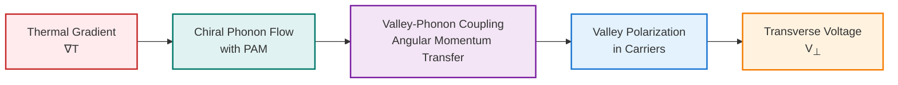
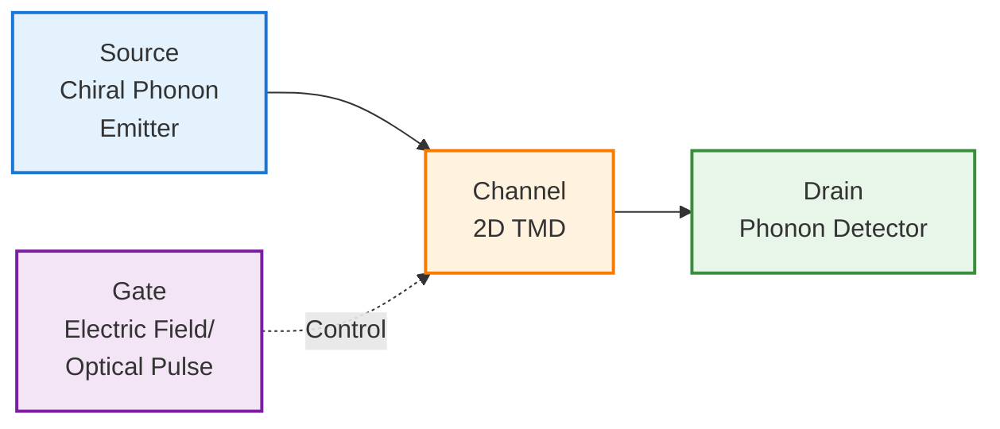

## Video Lecture

<div class="video-container">
  <iframe
    width="560"
    height="315"
    src="https://www.youtube.com/embed/6BFGvrQna9s?start=1953"
    title="Chiral Phonons Ch.4: Applications and Computational Methods"
    allow="accelerometer; autoplay; clipboard-write; encrypted-media; gyroscope; picture-in-picture"
    allowfullscreen>
  </iframe>
</div>

> This video covers the same content as the text below. Choose your preferred learning format.

---

🌐 EN | [🇯🇵 JP](../../../jp/MS/chiral-phonons/chapter-4.md) | Last sync: 2025-12-19

[Materials Science Dojo](../index.html) > [Chiral Phonons](index.md) > Chapter 4

# Chapter 4: Applications and Computational Methods

**Chiral Phonons Series - From DFT Calculations to Device Applications**

📖 Reading time: 45-60min | 📊 Difficulty: Advanced | 💻 Code examples: 8 examples

---

This chapter bridges theory and application by covering computational methods for calculating phonon chirality and emerging applications in valleytronics and phonon-based devices. You will learn how to extract phonon angular momentum from DFT calculations using Phonopy and Quantum ESPRESSO, understand phonon angular momentum transport phenomena, and explore device concepts that leverage chiral phonons for information processing.

## Learning Objectives

By reading this chapter, you will be able to:

- ✅ Calculate phonon eigenvectors and extract circular polarization from DFT results
- ✅ Compute phonon angular momentum from the circular polarization as \\(\mathbf{L} = \hbar \sum_\kappa \mathbf{C}_\kappa\\), with no extra mass factor
- ✅ Set up and run phonon calculations with Phonopy and Quantum ESPRESSO
- ✅ Understand phonon angular momentum transport and the phononic Einstein-de Haas effect
- ✅ Apply chiral phonons to valleytronics applications including valley manipulation
- ✅ Explore emerging device concepts: phonon transistors, polarizers, and filters
- ✅ Understand chiral phonon-polaritons and light-matter coupling

---

## 4.1 Computational Methods for Phonon Chirality

### 4.1.1 Overview of DFT-Based Phonon Calculations

Calculating the mechanical phonon angular momentum from a lattice-dynamical model requires the polarization eigenvectors; symmetry analysis and chirality-sensitive experiments can identify chiral character without them. First-principles density functional theory (DFT) is the route used throughout this chapter, but it is not the only one: analytical lattice models, empirical force constants and other interatomic potentials supply eigenvectors as well. The DFT workflow consists of:

```mermaid
flowchart TD
    A[Structure Optimization<br/>DFT relaxation] --> B[Force Constant Calculation<br/>Phonopy/DFPT]
    B --> C[Diagonalize Dynamical Matrix<br/>Obtain eigenvalues & eigenvectors]
    C --> D[Extract Phonon Eigenvectors<br/>Complex vectors e<sub>κα</sub>]
    D --> E[Calculate Circular Polarization<br/>C = Σ<sub>κ</sub> Im[e<sub>κ</sub>* × e<sub>κ</sub>]]
    E --> F[Compute Phonon Angular Momentum<br/>L = ℏC]

    style A fill:#e3f2fd,stroke:#1976d2,stroke-width:2px
    style B fill:#f3e5f5,stroke:#7b1fa2,stroke-width:2px
    style C fill:#fff3e0,stroke:#f57c00,stroke-width:2px
    style D fill:#e8f5e9,stroke:#388e3c,stroke-width:2px
    style E fill:#fce4ec,stroke:#c2185b,stroke-width:2px
    style F fill:#e0f2f1,stroke:#00796b,stroke-width:2px
```

#### Dynamical Matrix Formalism

The phonon eigenvectors are obtained from the dynamical matrix:

\\[D_{\kappa\alpha,\kappa'\beta}(\mathbf{q}) = \frac{1}{\sqrt{M_\kappa M_{\kappa'}}} \sum_{\mathbf{R}} \Phi_{\kappa\alpha,\kappa'\beta}(\mathbf{R}) e^{i\mathbf{q}\cdot\mathbf{R}}\\]

where:

- \\(\kappa, \kappa'\\): Atom indices in the unit cell
- \\(\alpha, \beta\\): Cartesian components (\\(x, y, z\\))
- \\(M_\kappa\\): Mass of atom \\(\kappa\\)
- \\(\Phi_{\kappa\alpha,\kappa'\beta}(\mathbf{R})\\): Force constant matrix
- \\(\mathbf{q}\\): Phonon wavevector

Diagonalization yields phonon frequencies \\(\omega_j\\) and eigenvectors \\(\mathbf{e}_j\\):

\\[D(\mathbf{q}) \mathbf{e}_j(\mathbf{q}) = \omega_j^2(\mathbf{q}) \mathbf{e}_j(\mathbf{q})\\]

### 4.1.2 Extracting Circular Polarization from Eigenvectors

The phonon eigenvector \\(\mathbf{e}_j(\mathbf{q})\\) is a complex vector describing the atomic displacement pattern. For a phonon mode with atoms displaced in a circular pattern, the eigenvector exhibits a phase difference between orthogonal components.

#### Circular Polarization Formula

The **circular polarization** vector measures the *mechanical* rotational content of the mode. It is not the crystal pseudo-angular momentum \\(m\\), which is the eigenvalue label of a discrete rotation (§4.3.1, Chapter 1 §1.2.2); the two are computed and reported separately, and neither follows from the other.

The eigenvector \\(\mathbf{e}_j\\) has \\(3N\\) components, and an ordinary three-dimensional cross product of a \\(3N\\)-component object is undefined. The cross product is therefore taken atom by atom, on the three Cartesian components belonging to atom \\(\kappa\\), and then summed:

\\[\mathbf{C}_j(\mathbf{q}) = \sum_\kappa \text{Im}\left[\mathbf{e}_{j,\kappa}^*(\mathbf{q}) \times \mathbf{e}_{j,\kappa}(\mathbf{q})\right]\\]

For an individual atom \\(\kappa\\):

\\[\mathbf{C}_{j,\kappa}(\mathbf{q}) = \text{Im}\left[e_{j,\kappa}^*(x) e_{j,\kappa}(y) - e_{j,\kappa}^*(y) e_{j,\kappa}(x)\right] \hat{z} + \text{cyclic permutations}\\]

In 2D materials (e.g., monolayer TMDs), focusing on in-plane motion:

\\[C_{j,\kappa}^z = \text{Im}\left[e_{j,\kappa,x}^* e_{j,\kappa,y} - e_{j,\kappa,y}^* e_{j,\kappa,x}\right]\\]

> **Physical Interpretation**: \\(C_{j,\kappa}^z > 0\\) indicates counterclockwise *rotational polarization* viewed from \\(+z\\) — elliptical trajectories included, with the \\(e^{-i\omega t}\\) convention of Chapter 1 — i.e. left-handed chirality, while \\(C_{j,\kappa}^z < 0\\) indicates clockwise rotation (right-handed) — the single handedness convention declared in Chapter 1 §1.2.2. That convention is a naming rule only; it does not by itself fix which light helicity excites or detects a mode.

#### Phonon Angular Momentum (PAM)

The angular momentum carried by **one phonon** in a normalized mode is:

\\[\mathbf{L}_j(\mathbf{q}) = \hbar \sum_\kappa \mathbf{C}_{j,\kappa}(\mathbf{q})\\]

This is a per-phonon quantity, not a total: an angular momentum per unit cell would additionally require the mode occupations, the zero-point contributions, and division by the number of cells.

No atomic mass appears in this sum. The dynamical matrix of §4.1.1 is already mass-weighted, \\(D = \Phi/\sqrt{M_\kappa M_{\kappa'}}\\), so the eigenvectors it returns are mass-weighted and normalized to \\(\sum_\kappa |\mathbf{e}_{j,\kappa}|^2 = 1\\); multiplying by \\(M_\kappa\\) a second time would count the mass weighting twice. The result would not be a phonon angular momentum at all: it is dimensionally different, a number of order the atomic mass in amu rather than a multiple of \\(\hbar\\).

Units: \\(\hbar\\) per phonon. \\(|L_z|\\) attains its maximum \\(\hbar\\) only when every non-zero displacement contribution is circular in the \\(xy\\) plane **with the same sense of rotation**; atoms that counter-rotate, or that rotate in different planes, give intermediate values, so \\(L_z\\) is not quantized in general. The discrete \\(C_3\\) label \\(m\\) of §4.3.1 is a separate quantity: \\(m = \pm 1\\) does not by itself imply \\(L_z = \pm\hbar\\), which has to be computed from the eigenvector.

**💻 Code Example: PAM from Mass-Weighted Eigenvectors**

```python
# Requirements:
# - Python 3.9+
# - numpy>=1.24.0, <2.0.0

"""
Phonon angular momentum from mass-weighted eigenvectors.

The dynamical matrix of §4.1.1 is mass-weighted, D = Phi / sqrt(M_k M_k'), so the
eigenvectors it returns are already mass-weighted and are normalised to
sum_k |e_k|^2 = 1. The angular momentum carried by one phonon is therefore

    L_z = hbar * sum_k C_k,   C_k = 2 Im(e*_kx e_ky)

with no atomic mass in the sum: the mass weighting already sits inside the
eigenvector normalisation. Multiplying C_k by M_k a second time double-counts it
and returns a dimensionally different quantity - a number of order the atomic
mass in amu, not a multiple of hbar - which is what the last two rows below show.

Conventions (Chapter 1 §1.2.2): L_z = +hbar is counterclockwise motion viewed
from +z, i.e. left-handed. That is a naming convention only; which light helicity
excites or detects a given mode is a separate, process-specific question.

The discrete C3 label m (pseudo-angular momentum, defined modulo 3) is a
different quantity from the mechanical L_z computed here and is not labelled in
this script.
"""
import numpy as np

# Atomic masses of the WSe2 unit cell (amu), in the atom order used below.
MASSES = np.array([183.84, 78.97, 78.97])


def circular_polarization_z(eigvec):
    """
    Per-atom z circular polarization C_k = 2 Im(e*_kx e_ky).

    Args:
        eigvec: complex array of shape (num_atoms, 3), one phonon eigenvector

    Returns:
        ndarray of shape (num_atoms,), dimensionless
    """
    ex = eigvec[:, 0]
    ey = eigvec[:, 1]
    return 2.0 * np.imag(np.conj(ex) * ey)


def pam_in_hbar(eigvec):
    """Phonon angular momentum L_z / hbar = sum_k C_k (no mass factor)."""
    return float(np.sum(circular_polarization_z(eigvec)))


def mass_weighted_sum(eigvec, masses):
    """The discarded expression sum_k M_k C_k, in amu; shown only for its size."""
    return float(np.sum(masses * circular_polarization_z(eigvec)))


def normalised(rows):
    """Return the eigenvector normalised to sum_k |e_k|^2 = 1."""
    e = np.array(rows, dtype=complex)
    return e / np.linalg.norm(e)


def main():
    modes = {
        "single atom, CCW circular": normalised([[1, 1j, 0]]),
        "single atom, CW circular": normalised([[1, -1j, 0]]),
        "single atom, linear (L_z = 0)": normalised([[1, 0, 0]]),
        "WSe2: W circular, Se still": normalised([[1, 1j, 0], [0, 0, 0], [0, 0, 0]]),
        "WSe2: W and Se counter-rot.": normalised([[1, 1j, 0], [1, -1j, 0], [1, -1j, 0]]),
    }

    print("\nPAM of mass-weighted, unit-normalised eigenvectors")
    print("=" * 74)
    print(f"{'mode':30s}{'sum|e|^2':>10s}{'sum C_k':>10s}{'L_z/hbar':>12s}")
    for name, e in modes.items():
        norm = float(np.sum(np.abs(e) ** 2))
        c_sum = float(np.sum(circular_polarization_z(e)))
        print(f"{name:30s}{norm:>10.4f}{c_sum:>10.4f}{pam_in_hbar(e):>+12.4f}")

    print("\nWhy the mass factor must not be applied twice")
    print("=" * 74)
    for name in ("WSe2: W circular, Se still", "WSe2: W and Se counter-rot."):
        e = modes[name]
        print(f"{name:30s}  hbar*sum C_k = {pam_in_hbar(e):+8.4f} hbar")
        print(f"{'':30s}  sum M_k C_k = {mass_weighted_sum(e, MASSES):+8.4f} amu (wrong)")

    print("\nA single atom moving on a circle reaches |L_z| = 1 hbar. With several")
    print("atoms, |L_z| reaches hbar only when every non-zero displacement is")
    print("circular in the xy plane with the same sense of rotation; counter-")
    print("rotating atoms give intermediate values, so L_z is not quantised in")
    print("general. The discrete C3 label m is a separate quantity, not L_z/hbar.")


if __name__ == "__main__":
    main()
```

**Expected Output (PAM from Mass-Weighted Eigenvectors):**

```

PAM of mass-weighted, unit-normalised eigenvectors
==========================================================================
mode                            sum|e|^2   sum C_k    L_z/hbar
single atom, CCW circular         1.0000    1.0000     +1.0000
single atom, CW circular          1.0000   -1.0000     -1.0000
single atom, linear (L_z = 0)     1.0000    0.0000     +0.0000
WSe2: W circular, Se still        1.0000    1.0000     +1.0000
WSe2: W and Se counter-rot.       1.0000   -0.3333     -0.3333

Why the mass factor must not be applied twice
==========================================================================
WSe2: W circular, Se still      hbar*sum C_k =  +1.0000 hbar
                                sum M_k C_k = +183.8400 amu (wrong)
WSe2: W and Se counter-rot.     hbar*sum C_k =  -0.3333 hbar
                                sum M_k C_k =  +8.6333 amu (wrong)

A single atom moving on a circle reaches |L_z| = 1 hbar. With several
atoms, |L_z| reaches hbar only when every non-zero displacement is
circular in the xy plane with the same sense of rotation; counter-
rotating atoms give intermediate values, so L_z is not quantised in
general. The discrete C3 label m is a separate quantity, not L_z/hbar.
```

### 4.1.3 Software Tools: Phonopy and Quantum ESPRESSO

#### Phonopy

[Phonopy](https://phonopy.github.io/phonopy/) is a Python-based phonon calculation tool that interfaces with various DFT codes (VASP, Quantum ESPRESSO, Abinit, etc.).

**Key capabilities**:

- Finite displacement method for force constants
- Phonon dispersion and DOS calculations
- Extraction of eigenvectors at arbitrary q-points
- Irreducible-representation labelling of modes at the q-points its symmetry routines support (the available analysis depends on the Phonopy version)

**Installation**:

```bash
pip install phonopy
# For plotting
pip install matplotlib
# Optional: SeeK-path, a utility that generates standardized high-symmetry
# q-paths and the associated crystal conventions (it is not a plotting library)
pip install seekpath
```

#### Quantum ESPRESSO

[Quantum ESPRESSO](https://www.quantum-espresso.org/) is an open-source DFT suite with powerful phonon capabilities via DFPT (Density Functional Perturbation Theory).

**Key modules**:

- `pw.x`: Ground state DFT calculations
- `ph.x`: Phonon calculations using DFPT
- `dynmat.x`: Post-processing of dynamical matrices

### 4.1.4 Python Code Example: PAM from a Phonopy Calculation

The script below post-processes an existing Phonopy calculation. It is not self-contained: it reads `POSCAR` (the unit cell, a structure input), `FORCE_SETS` (assembled from the forces of the finite-displacement runs) and, optionally, `BORN` (Born charges and dielectric tensor from a response calculation) — files that have to be prepared from the structure and the required DFT calculations, not products of one ordinary run. No output block is given here for that reason.

```python
#!/usr/bin/env python3
"""
Phonon Angular Momentum (PAM) Calculator
Calculates circular polarization and PAM from Phonopy eigenvectors

Requirements: phonopy (>= 2.x), numpy, matplotlib

Input files, read from the working directory. They are not products of one
ordinary DFT run: each has to be prepared from the structure and from the
required DFT force and response calculations.
  POSCAR      unit cell in VASP format (a structure input)
  FORCE_SETS  displacement-force data assembled from the finite-displacement runs
  BORN        (optional) Born effective charges and dielectric tensor, from a
              response calculation, formatted for phonopy
"""

import numpy as np
from phonopy import Phonopy
from phonopy.interface.vasp import read_vasp
from phonopy.file_IO import parse_FORCE_SETS, parse_BORN
import matplotlib.pyplot as plt

class PAMCalculator:
    """Calculate phonon angular momentum from phonon eigenvectors"""

    def __init__(self, phonopy_obj):
        """
        Parameters
        ----------
        phonopy_obj : Phonopy
            Phonopy object with force constants set
        """
        self.phonopy = phonopy_obj

        # The eigenvectors belong to the PRIMITIVE cell that Phonopy actually
        # diagonalizes, which may differ from the input unit cell when
        # primitive_matrix='auto' (it is the same cell when the input already is
        # an appropriate primitive cell). Atom count and ordering must come from it.
        self.primitive = phonopy_obj.primitive
        self.masses = self.primitive.masses
        self.num_atoms = len(self.masses)
        # The masses are kept for reference only. They are NOT used below: the
        # eigenvectors are already mass-weighted (see calculate_PAM).

    def calculate_circular_polarization(self, eigvec):
        """
        Calculate circular polarization C = Im[e* x e], atom by atom

        The cross product is taken on the three Cartesian components of each
        atom separately; the full 3N-component eigenvector has no ordinary
        three-dimensional cross product.

        Parameters
        ----------
        eigvec : ndarray, shape (num_atoms, 3)
            Complex phonon eigenvector for one mode

        Returns
        -------
        C_total : float
            Sum over atoms of the z-component of circular polarization
        C_per_atom : ndarray, shape (num_atoms,)
            z-component per atom
        """
        C_per_atom = np.zeros(self.num_atoms)

        for atom_idx in range(self.num_atoms):
            ex = eigvec[atom_idx, 0]  # x component (complex)
            ey = eigvec[atom_idx, 1]  # y component (complex)

            # C_z = Im[e_x* e_y - e_y* e_x]
            #     = Im[e_x* e_y] - Im[e_y* e_x]
            #     = 2 * Im[e_x* e_y]
            C_z = 2 * np.imag(np.conj(ex) * ey)
            C_per_atom[atom_idx] = C_z

        C_total = np.sum(C_per_atom)
        return C_total, C_per_atom

    def calculate_PAM(self, eigvec):
        """
        Calculate phonon angular momentum L = h_bar * sum_kappa C_kappa

        Phonopy diagonalizes the mass-weighted dynamical matrix, so its
        eigenvectors are already mass-weighted and normalized to
        sum_kappa |e_kappa|^2 = 1. The masses read in __init__ must therefore
        NOT be applied again here, and no mass argument is taken.

        Parameters
        ----------
        eigvec : ndarray, shape (num_atoms, 3)
            Complex phonon eigenvector

        Returns
        -------
        L_total : float
            Mechanical angular momentum of one phonon, in units of h_bar
        L_per_atom : ndarray
            Contribution per atom, in units of h_bar
        """
        C_total, C_per_atom = self.calculate_circular_polarization(eigvec)

        # PAM per atom in units of h_bar; no further mass weighting
        L_per_atom = C_per_atom
        L_total = C_total

        return L_total, L_per_atom

    def analyze_qpoint(self, qpoint, plot=True):
        """
        Analyze all phonon modes at a specific q-point

        Parameters
        ----------
        qpoint : array-like, shape (3,)
            q-point in fractional (crystal) coordinates of the reciprocal
            lattice of the primitive cell used by the Phonopy object
        plot : bool
            Whether to plot results

        Returns
        -------
        results : dict
            Dictionary containing frequencies, PAM values, etc.
        """
        # Eigenvectors are not computed unless they are requested explicitly.
        self.phonopy.run_qpoints([qpoint], with_eigenvectors=True)
        qpoints_dict = self.phonopy.get_qpoints_dict()

        # frequencies: shape (num_qpoints, num_modes); keep this q-point only,
        # so that the masks and prints below act on a 1D array of modes.
        freqs = qpoints_dict['frequencies'][0]  # THz

        # eigenvectors: shape (num_qpoints, 3*num_atoms, 3*num_atoms).
        # Mode j is the COLUMN eigvecs_raw[:, j]. Reshaping the matrix as a
        # whole would mix components belonging to different modes.
        eigvecs_raw = qpoints_dict['eigenvectors'][0]

        num_modes = 3 * self.num_atoms
        eigvecs = np.array([
            eigvecs_raw[:, j].reshape(self.num_atoms, 3)
            for j in range(num_modes)
        ])

        # Calculate PAM for each mode
        PAM_values = []
        C_values = []

        for mode_idx in range(num_modes):
            L_total, _ = self.calculate_PAM(eigvecs[mode_idx])
            C_total, _ = self.calculate_circular_polarization(eigvecs[mode_idx])

            PAM_values.append(L_total)
            C_values.append(C_total)

        results = {
            'qpoint': qpoint,
            'frequencies': freqs,  # THz
            'PAM': np.array(PAM_values),
            'circular_polarization': np.array(C_values)
        }

        if plot:
            self._plot_PAM_spectrum(results)

        return results

    def _plot_PAM_spectrum(self, results):
        """Plot frequency vs PAM"""
        fig, (ax1, ax2) = plt.subplots(2, 1, figsize=(10, 8))

        freqs = results['frequencies']
        PAM = results['PAM']
        C = results['circular_polarization']

        # Plotting choice only: it hides the near-zero branches at Gamma.
        # Which branches it removes at another q-point depends on the actual
        # dispersion of the material, so inspect the dispersion before use.
        mask = freqs > 0.5  # THz

        # Plot PAM
        ax1.scatter(freqs[mask], PAM[mask], c=PAM[mask],
                   cmap='RdBu', s=100, alpha=0.7)
        ax1.axhline(0, color='k', linestyle='--', linewidth=0.5)
        ax1.set_xlabel('Frequency (THz)', fontsize=12)
        ax1.set_ylabel('PAM (h_bar per phonon)', fontsize=12)
        ax1.set_title(f'Phonon Angular Momentum at q = {results["qpoint"]}',
                     fontsize=14)
        ax1.grid(True, alpha=0.3)

        # Plot circular polarization
        ax2.scatter(freqs[mask], C[mask], c=C[mask],
                   cmap='RdBu', s=100, alpha=0.7)
        ax2.axhline(0, color='k', linestyle='--', linewidth=0.5)
        ax2.set_xlabel('Frequency (THz)', fontsize=12)
        ax2.set_ylabel('Circular Polarization', fontsize=12)
        ax2.grid(True, alpha=0.3)

        plt.tight_layout()
        plt.savefig('PAM_spectrum.png', dpi=300, bbox_inches='tight')
        plt.show()

        return fig

# Example usage
def main():
    """Example: Calculate PAM for monolayer WSe2"""

    # Read structure from VASP POSCAR
    unitcell = read_vasp("POSCAR")

    # Create Phonopy object
    phonon = Phonopy(unitcell,
                     supercell_matrix=[[4, 0, 0], [0, 4, 0], [0, 0, 1]],
                     primitive_matrix='auto')

    # FORCE_SETS holds displacement-force data, not an assembled force-constant
    # matrix; produce_force_constants() builds that matrix from it.
    phonon.dataset = parse_FORCE_SETS()
    phonon.produce_force_constants()

    # Optional non-analytic correction, gated on the DIMENSIONALITY of the
    # system and not on whether a BORN file happens to be readable. BORN supplies
    # the standard bulk (3D) correction; an isolated polar monolayer needs a
    # dedicated 2D treatment (Coulomb truncation and an explicit dielectric
    # environment), so the branch below is correct for bulk polar crystals only.
    # This example is monolayer WSe2, hence is_bulk = False.
    is_bulk = False
    if is_bulk:
        try:
            phonon.nac_params = parse_BORN(phonon.primitive)
        except Exception as exc:
            print(f"No usable NAC parameters ({exc}); proceeding without NAC")
    else:
        print("Monolayer example: the bulk BORN correction is NOT applied; "
              "a 2D non-analytic treatment would be required instead")

    # Create PAM calculator
    pam_calc = PAMCalculator(phonon)

    # Analyze K-point (valley point in TMD).
    # (1/3, 1/3, 0) are fractional coordinates of the reciprocal lattice of the
    # hexagonal primitive cell a1 = a(1, 0, 0), a2 = a(-1/2, sqrt(3)/2, 0).
    # primitive_matrix='auto' may choose a different cell for an arbitrary
    # POSCAR: check the primitive lattice, or take K from the standardized
    # reciprocal lattice (e.g. with SeeK-path), before using this triplet.
    K_point = np.array([1./3., 1./3., 0.0])
    results_K = pam_calc.analyze_qpoint(K_point, plot=True)

    # Report the modes whose net mechanical angular momentum exceeds a chosen
    # threshold. The threshold is a reporting choice, not a definition of
    # phonon chirality and not a statement about the C3 label m.
    print("\n=== Modes at K with |L_z| > 0.1 h_bar ===")
    for i, (freq, pam) in enumerate(zip(results_K['frequencies'],
                                        results_K['PAM'])):
        if abs(pam) > 0.1 and freq > 0.5:
            chirality = "Left" if pam > 0 else "Right"
            print(f"Mode {i}: {freq:.2f} THz, L_z = {pam:+.3f} h_bar ({chirality})")

if __name__ == "__main__":
    main()
```

#### Key Steps in the Code

1. **Initialization**: read the structure, build the force constants from the displacement–force data, and take the atom count from the primitive cell Phonopy diagonalizes
2. **Eigenvector Extraction**: request eigenvectors explicitly at the q-point, then take mode \\(j\\) from *column* \\(j\\) of the eigenvector matrix
3. **Circular Polarization**: calculate \\(C_z = 2\text{Im}[e_x^* e_y]\\) per atom
4. **PAM Calculation**: sum over atoms, \\(L = \hbar \sum_\kappa C_\kappa\\) — no mass factor, because the eigenvectors are already mass-weighted
5. **Visualization**: plot frequency vs PAM to identify modes with large mechanical angular momentum. Within a degenerate subspace a numerical eigensolver returns an arbitrary basis, so fix a symmetry or angular-momentum basis there before assigning mode-resolved chirality

### 4.1.5 Example: Quantum ESPRESSO Workflow

For polar materials, the long-range electrostatic interaction has to be treated explicitly. Quantum ESPRESSO with DFPT is one suitable route — any validated DFPT or finite-displacement workflow with the appropriate non-analytic correction will do — and for an isolated monolayer the two-dimensional electrostatics (Coulomb truncation, dielectric environment) must be handled on top of it:

```bash
# Step 1: SCF calculation
pw.x < scf.in > scf.out

# Step 2: Phonon calculation at K-point
ph.x < ph_K.in > ph_K.out

# Step 3: Post-process dynamical matrix
dynmat.x < dynmat.in > dynmat.out
```

**Example ph.x input (ph_K.in)**:

```bash
&inputph
  prefix = 'wse2'
  outdir = './tmp/'
  fildyn = 'wse2.dyn'

  ! K-point in TMD Brillouin zone
  ldisp = .false.
  qplot = .true.

  tr2_ph = 1.0d-14
  alpha_mix = 0.7
/
1                            ! Number of q-points
0.333333 0.577350 0.0        ! K, Cartesian, in units of 2*pi/alat
```

**The two interfaces do not use the same coordinates.** Phonopy takes q in fractional (crystal) coordinates of the reciprocal lattice, where K = (1/3, 1/3, 0). `ph.x` reads its q-vectors in **Cartesian coordinates in units of \\(2\pi/a_{\text{lat}}\\)**. For the hexagonal cell \\(\mathbf{a}_1 = a(1,0,0)\\), \\(\mathbf{a}_2 = a(-1/2, \sqrt{3}/2, 0)\\) (`ibrav = 4`), the reciprocal vectors are \\(\mathbf{b}_1 = (2\pi/a)(1, 1/\sqrt{3}, 0)\\) and \\(\mathbf{b}_2 = (2\pi/a)(0, 2/\sqrt{3}, 0)\\), so

\\[\mathbf{K} = \tfrac{1}{3}\mathbf{b}_1 + \tfrac{1}{3}\mathbf{b}_2 = \frac{2\pi}{a}\left(\tfrac{1}{3},\ \tfrac{1}{\sqrt{3}},\ 0\right) = \frac{2\pi}{a}\,(0.333333,\ 0.577350,\ 0)\\]

Feeding the fractional triplet (0.333333, 0.333333, 0) to `ph.x` selects a different point of the Brillouin zone.

The eigenvectors can then be extracted from the dynamical matrix file and post-processed with Python to calculate PAM.

---

## 4.2 Phonon Angular Momentum Transport

### 4.2.1 Einstein-de Haas Effect for Phonons

The **Einstein–de Haas effect** in its original form is the mechanical rotation of a freely suspended ferromagnet that accompanies a change of its magnetization: the angular momentum given up by the electronic magnetization — spin and orbital contributions alike — reappears as rigid-body rotation. The phononic analogue asks the same bookkeeping question for lattice vibrations:

> For a body free to rotate and subject to no external torque, exciting chiral phonons that carry angular momentum \\(\mathbf{L}_{\text{phonon}}\\) must be compensated, and rigid-body rotation of the crystal is the compensating channel when no other reservoir is available.

\\[\mathbf{L}_{\text{total}} = \mathbf{L}_{\text{phonon}} + \mathbf{L}_{\text{lattice}} = \text{constant}\\]

Here \\(\mathbf{L}_{\text{lattice}}\\) is the *rigid-body* rotation, distinct from the internal vibrational angular momentum. The two-term balance holds only for an isolated system: optical excitation supplies angular momentum from the photon field, and electron spins, defects and the sample mount are further reservoirs (and sources of external torque) that must be included whenever they are present.

#### Experimental Status

Experimental demonstrations of a phononic Einstein–de Haas effect remain an active area of research. Building on theoretical proposals (e.g., Zhang & Niu 2014, PRL 112, 085503), ongoing efforts explore optical excitation of chiral phonons and possible transfer of phonon angular momentum to lattice rotations. Reported observations and inferred magnitudes vary by system and methodology; careful calibration and controls are essential.

### 4.2.2 Phonon Spin Current

Analogous to electronic spin currents, **phonon spin currents** represent a flow of phonon angular momentum. They transport angular momentum without an accompanying electronic charge current, which is what makes them of interest in insulators. Such a flow need not be accompanied by a net energy current, but the two vanish independently only under extra conditions (for instance when counter-propagating modes of opposite chirality are equally populated); zero energy transport is not automatic.

#### Definition

The phonon spin current density carries two indices — the direction in which it flows and the component of angular momentum it transports — so it is a tensor, not the scalar dot product of two vectors:

\\[j_s^{\alpha\beta} = \frac{1}{V} \sum_{j,\mathbf{q}} v_{g,j}^{\alpha}(\mathbf{q}) \, L_j^{\beta}(\mathbf{q}) \, n_j(\mathbf{q})\\]

where:

- \\(\alpha\\): Cartesian direction of flow; \\(\beta\\): Cartesian component of the angular momentum carried
- \\(L_j^{\beta}\\): PAM of mode \\(j\\), in units of \\(\hbar\\)
- \\(v_{g,j}^{\alpha}\\): Group velocity component along \\(\alpha\\)
- \\(n_j\\): Phonon occupation number
- \\(V\\): Crystal volume, which normalizes the mode sum to a density

This is the quasiparticle (semiclassical) transport approximation: it presumes well-defined mode populations \\(n_j\\) and drops both intermode coherence and the torque terms through which phonon angular momentum is not separately conserved. The equilibrium contribution has to be subtracted where symmetry does not already cancel it.

#### Generation Mechanisms

1. **Thermal Gradient**: in a crystal whose symmetry leaves the response uncancelled, a temperature difference drives a phonon flow with net angular momentum; a temperature gradient alone does not guarantee one, since the contributions of symmetry-related modes can cancel
2. **Optical Excitation**: circularly polarized light can preferentially excite one chirality where the transition is dipole- or Raman-allowed and momentum-matched. Far-field photons carry negligible momentum, so a valley phonon at K is not created directly by absorption; it is reached indirectly, through relaxation of optically prepared carriers
3. **Phonon Pumping**: ultrafast pulses of suitable polarization can drive two degenerate modes with a controlled relative phase, producing coherent circular lattice motion; an arbitrary ultrafast pulse does not establish those amplitudes and phases

### 4.2.3 Thermal Hall Effect and Phonon Angular Momentum

The **thermal Hall effect** is the transverse heat flow perpendicular to a temperature gradient, observed in some insulators.

#### Connection to Chiral Phonons

In materials with broken time-reversal symmetry (e.g., under magnetic field), chiral phonons can contribute to the thermal Hall conductivity. The intrinsic Berry-curvature contribution is

\\[\kappa_{xy} = -\frac{k_B^2 T}{\hbar} \sum_j \int \frac{d^3q}{(2\pi)^3} \, c_2\!\left(n_j(\mathbf{q})\right) \Omega_j^z(\mathbf{q})\\]

where:

- \\(n_j(\mathbf{q})\\): Bose-Einstein occupation of mode \\(j\\)
- \\(c_2(n) = (1+n)\left[\ln\frac{1+n}{n}\right]^2 - (\ln n)^2 - 2\,\text{Li}_2(-n)\\): dimensionless thermal weight
- \\(\Omega_j^z\\): \\(z\\)-component of the phonon Berry curvature in wavevector space, of dimension area (related to PAM)

The \\(\int d^3q/(2\pi)^3\\) supplies the per-volume normalization: \\(k_B^2 T/\hbar\\) is in W/K, \\(\Omega\\) in m², and m⁻³ × m² = m⁻¹, so \\(\kappa_{xy}\\) comes out in W m⁻¹ K⁻¹ as a thermal conductivity must (Qin, Zhou & Shi, *Phys. Rev. B* **86**, 104305 (2012)).

**Key insight**: phonon Berry curvature is a *geometric*, model-dependent property of the band structure, and the phonon angular momentum of §4.1.2 is a mechanical one. The two are correlated in particular models, but neither determines the other, and neither is topological by itself — a topological invariant arises only from an appropriate integral of the curvature over the Brillouin zone.

### 4.2.4 Phonon Nernst Effect

The **phonon Nernst effect**, in the strict sense, is a *transverse flow of phonon angular momentum* driven by a thermal gradient. It is not by itself an electronic Nernst voltage: a transverse voltage appears only if a further mechanism converts the phonon angular momentum into a charge response (in the TMD scenario below, through the valley polarization of the carriers; phonon drag is another, distinct route). When such a conversion is present the transverse field is written

\\[E_y = S_{yx} \nabla_x T\\]

where \\(S_{yx}\\) is the transverse thermopower, i.e. the Nernst *signal*; "Nernst coefficient" is often reserved for that signal divided by the magnetic field.

**Proposed mechanism in TMDs** (a chain of steps, each with its own conditions, not an established sequence):

1. Temperature gradient drives thermal phonon current
2. The driven phonon distribution carries *net* angular momentum — this requires an imbalance that survives the sum over modes, not merely the existence of chiral modes
3. Valley–phonon coupling transfers angular momentum to valley carriers through scattering processes that satisfy the energy, momentum, spin and \\(C_3\\) constraints; the transfer is not automatic
4. The valley imbalance is converted into a transverse electric field. A pure valley Hall current carries no net charge, so this last step needs the charge response, the driving force and the open-circuit boundary conditions to be specified before a voltage follows



---

## 4.3 Applications in Valleytronics

### 4.3.1 Valley-Phonon Coupling for Valley Manipulation

In 2D TMDs, the valley degree of freedom (K and K' valleys) can be addressed through phonons, with the \\(C_3\\) pseudo-angular-momentum bookkeeping of Chapter 1 §1.4.2 constraining which processes are allowed.

#### Selection Rules

For valley-phonon coupling in monolayer WSe₂:

| Valley | Exciton pseudo-angular momentum \\(m\\) (mod 3) | Phonon \\(C_3\\) label in the mod-3 balance | Helicity that prepares the valley |
|--------|--------------------------|---------------------------|------------------|
| K      | \\(+1\\)                 | \\(m_{\text{phonon}} = +1 \pmod 3\\)     | \\(\sigma^+\\)   |
| K'     | \\(-1\\)                 | \\(m_{\text{phonon}} = -1 \pmod 3\\)    | \\(\sigma^-\\)   |

Three qualifications belong with this table. The middle column is the \\(C_3\\) bookkeeping of Chapter 1 §1.4.2 for the specific intervalley process considered there, and it is a statement modulo 3 about a symmetry label — it does not fix the *mechanical* angular momentum \\(L_z\\) of the emitted mode, which has to be computed from the eigenvector (§4.1.2) and is generally not \\(\pm\hbar\\) for a multi-atom valley phonon. The last column is the valley-preparation rule reported for monolayer WSe₂ (Chapter 1 §1.4.2): an experimental input for step 1 of a two-step process, not a universal rule for creating phonons of a given handedness. And no phonon "chirality" is *required* by a valley index alone: which phonon can be emitted follows from the initial and final electronic states, the phonon branch and wavevector, and whether the process is emission or absorption.

#### Valley Initialization via Phonons

1. **Optical Pumping**: \\(\sigma^+\\) light excites K-valley excitons
2. **Phonon Emission**: relaxation of that carrier can emit a phonon whose \\(C_3\\) label satisfies the mod-3 balance below. Which branch is emitted depends on the electronic initial and final states; intravalley, multi-branch and non-phononic channels compete, and the mechanical \\(L_z\\) of whichever mode is emitted follows from its eigenvector, not from \\(m\\)
3. **Angular Momentum Bookkeeping**: under the \\(C_3\\) axis the pseudo-angular momentum is conserved only **modulo 3** (Chapter 1 §1.4.2), taken over the electronic initial and final states:

\\[m_{\text{electron}}^{\text{initial}} \equiv m_{\text{electron}}^{\text{final}} + m_{\text{phonon}} \ (\text{mod } 3)\\]

### 4.3.2 Chiral Phonon-Mediated Intervalley Scattering

Intervalley scattering (K → K' transitions) can occur via emission or absorption of chiral phonons.

#### Scattering Rate

A single phonon-**emission** contribution to the intervalley scattering rate reads

\\[\Gamma_{K\rightarrow K'} = \frac{2\pi}{\hbar} |g_{ep}|^2 [n(\omega) + 1] \delta(E_K - E_{K'} - \hbar\omega)\\]

where:

- \\(g_{ep}\\): Electron-phonon coupling strength
- \\(n(\omega)\\): Phonon occupation number (Bose-Einstein)
- \\(\omega = 2\pi f\\): Angular frequency of the chiral phonon, with \\(f\\) its cyclic frequency; the phonon energy is \\(\hbar\omega = hf\\), so a 5.0 THz phonon carries 20.68 meV, not 3.29 meV

This is one channel only. The full intervalley rate adds the absorption channel (proportional to \\(n\\)), the sum over the phonon branches and wavevectors that connect K to K′, the sum over final electronic states, and the carrier occupation factors.

The \\(\delta\\)-function has dimensions of inverse energy, so evaluating it means summing over final states: an absolute rate requires a density of final states \\(\rho(E_f)\\). Without \\(\rho\\) the expression fixes only the **phonon occupation factor** of \\(\Gamma\\), and that factor is all the simulation below reports; matrix elements, accessible final states, broadening and the carrier distribution are held fixed there, although in a real material they are temperature dependent too.

**Temperature Dependence**: emission is proportional to \\(n+1\\) and absorption to \\(n\\), so \\(\Gamma \propto 2n+1\\) — this step assumes equal, temperature-independent prefactors and available final states for both channels, which is what reduces the sum of the two phase-space factors to \\(2n+1\\). As \\(T \to 0\\) the occupation vanishes while spontaneous emission does not, \\(2n+1 \to 1\\), so the rate saturates and the lifetime reaches a **finite low-temperature plateau** — *provided a spontaneous-emission channel is open*. The \\(\delta\\)-function requires the carrier to have at least \\(\hbar\omega\\) of excess energy; between the minima of two equivalent valleys that condition can fail, and the phonon-mediated rate then vanishes at low temperature instead of reaching a plateau.

### 4.3.3 Valley Information Storage

**Valley information storage** is a valleytronics proposal: binary information is encoded in the valley index of the carriers, and chiral phonons enter as the angular-momentum bookkeeping of the write and relaxation steps. Phonon scattering is also one of the channels that *erase* valley polarization — which one dominates depends on the carrier species and the regime, electron–hole exchange being particularly important for bright excitons — so a net beneficial role for chiral phonons has to be demonstrated rather than assumed.

- **Bit "0"**: K valley (exciton pseudo-angular momentum \\(m = +1 \pmod 3\\))
- **Bit "1"**: K' valley (exciton pseudo-angular momentum \\(m = -1 \pmod 3\\))

The labels are the two valleys; they are not mechanical-angular-momentum eigenvalues of \\(\pm 1\\).

#### Read/Write Operations

**Write**:

- \\(\sigma^+\\) laser pulse → Initialize K valley (bit "0")
- \\(\sigma^-\\) laser pulse → Initialize K' valley (bit "1")

**Read**:

- Detect valley-selective photoluminescence
- Measure the valley Hall response — a pure valley Hall current carries no net charge, so an electrical readout requires an explicit conversion step (a non-local valley-transport geometry, or a charge Hall response produced by a valley imbalance)

**Lifetime and coherence** are two different quantities. The valley *population* relaxes by intervalley scattering, and for room-temperature bright excitons in monolayer TMDs it is short; valley *coherence* decays separately. Pure dephasing destroys coherence while preserving the populations, but electron–hole exchange is not population-preserving: it couples the bright-exciton valley states and drives valley-pseudospin precession and depolarization, so it enters both quantities. The much longer valley lifetimes quoted in the literature are important examples measured at cryogenic temperature, on resident carriers and on dark or interlayer excitonic states, not on room-temperature bright excitons

### 4.3.4 Code Example: Valley-Phonon Scattering Simulation

```python
# Requirements:
# - Python 3.9+
# - matplotlib>=3.7.0
# - numpy>=1.24.0, <2.0.0

"""
Temperature dependence of chiral-phonon-mediated intervalley scattering.

Three things fix what this model can and cannot report:

1. Frequencies are quoted as cyclic frequencies f in THz, so the phonon energy is
   hbar*omega = h*f with omega = 2*pi*f. Using f as if it were omega understates
   the phonon energy by 2*pi and overstates the occupation by far more.
2. The golden rule of §4.3.2 contains a delta function of energy; a number for the
   rate needs that delta function replaced by a density of final states, which this
   toy model does not supply. What survives without it is the temperature-dependent
   factor of the rate, and that factor is what is reported here: the emission plus
   absorption channels give Gamma(T) proportional to (2n+1), so

       Gamma(T) / Gamma(T -> 0) = 2 n(f, T) + 1,

   a dimensionless ratio. No absolute lifetime is printed, because none is
   determined by the quantities given.
3. tau = 1/Gamma is the one-way scattering time. Between two equivalent valleys
   the population imbalance decays at 2*Gamma, i.e. with lifetime 1/(2*Gamma).
   The two definitions differ by a factor of two but share the same temperature
   factor, so the ratio tabulated below applies to either.
"""
import numpy as np
import matplotlib.pyplot as plt


class ValleyPhononScattering:
    """Temperature factor of chiral-phonon-mediated intervalley scattering."""

    def __init__(self, temperature, phonon_freq):
        """
        Parameters
        ----------
        temperature : float
            Temperature in Kelvin
        phonon_freq : float
            Chiral phonon cyclic frequency f in THz
        """
        self.T = temperature
        self.f = phonon_freq * 1e12            # cyclic frequency, Hz
        self.omega = 2 * np.pi * self.f        # angular frequency, rad/s

        # Constants (CODATA 2018)
        self.hbar = 1.054571817e-34  # J·s
        self.kB = 1.380649e-23       # J/K

    def phonon_occupation(self):
        """Bose-Einstein occupation n(f, T); the exponent is h*f / (kB*T).

        The exponent divides by T, so only T > 0 can be evaluated; T <= 0 is
        returned as the limiting value n -> 0 rather than raising.
        """
        if self.T <= 0.0:
            return 0.0
        x = self.hbar * self.omega / (self.kB * self.T)
        if x > 50:  # Avoid overflow; n < 2e-22 there
            return 0.0
        return 1.0 / (np.exp(x) - 1.0)

    def relative_rate(self):
        """
        Intervalley rate relative to its T -> 0 value.

        Emission is proportional to (n + 1) and absorption to n, so the sum is
        proportional to (2n + 1), which tends to 1 in the limit T -> 0. The
        occupation routine evaluates positive temperatures and returns that
        limit for T <= 0.
        """
        return 2.0 * self.phonon_occupation() + 1.0

    def relative_lifetime(self):
        """
        One-way scattering time relative to its T -> 0 plateau, tau(T)/tau(0)
        with tau = 1/Gamma. The valley-polarisation lifetime is 1/(2*Gamma) and
        carries the same temperature factor, so this ratio describes both.
        """
        return 1.0 / self.relative_rate()

    def population_imbalance(self, t_over_tau0):
        """
        Valley population imbalance (n_K - n_K') normalised to its initial value.

        With a one-way transfer rate Gamma between two equivalent valleys the
        imbalance relaxes at 2*Gamma, not at Gamma; time is given in units of
        tau(0) = 1/Gamma(0), the T -> 0 one-way scattering time. The valley
        polarisation therefore decays with lifetime 1/(2*Gamma), not 1/Gamma.
        """
        return np.exp(-2.0 * self.relative_rate() * np.asarray(t_over_tau0))


def main():
    phonon_freq = 5.0  # THz (cyclic), typical for a TMD chiral phonon

    temperatures = np.linspace(10.0, 300.0, 50)  # K
    rel_lifetimes = [
        ValleyPhononScattering(T, phonon_freq).relative_lifetime() for T in temperatures
    ]

    plt.figure(figsize=(10, 6))
    plt.plot(temperatures, rel_lifetimes, linewidth=2, color='#1976d2')
    plt.xlabel('Temperature (K)', fontsize=14)
    plt.ylabel(r'Relative one-way scattering time  $\tau(T)/\tau(0)$', fontsize=14)
    plt.title('Temperature factor of phonon-mediated intervalley scattering', fontsize=16)
    plt.ylim(0, 1.05)
    plt.grid(True, alpha=0.3)
    plt.tight_layout()
    plt.savefig('valley_lifetime_vs_T.png', dpi=300)
    plt.close()

    print(f"\nChiral phonon: f = {phonon_freq:.1f} THz, h*f = "
          f"{4.135667696 * phonon_freq:.2f} meV")
    print("=" * 62)
    print(f"{'T (K)':>8s}{'n(f,T)':>14s}{'2n+1':>12s}{'tau(T)/tau(0)':>18s}")
    for T in (10.0, 50.0, 100.0, 200.0, 300.0):
        sim = ValleyPhononScattering(T, phonon_freq)
        print(f"{T:>8.0f}{sim.phonon_occupation():>14.4e}"
              f"{sim.relative_rate():>12.4f}{sim.relative_lifetime():>18.4f}")

    print("\nLimits")
    print("=" * 62)
    print("T -> 0   : n -> 0, 2n+1 -> 1, so the rate saturates and the lifetime")
    print("           reaches a finite plateau set by spontaneous emission -")
    print("           it does not grow without bound as the temperature falls.")
    print("           This holds only where that emission channel is OPEN: per")
    print("           section 4.3.2 the carrier needs at least h*f of excess")
    print("           energy, and where it does not the phonon-mediated rate")
    print("           vanishes at low temperature instead of reaching a plateau.")
    print("kB*T >> h*f : n -> kB*T/(h*f), so the rate grows linearly with T.")
    print("\ntau = 1/Gamma above is the one-way scattering time; the valley")
    print("population imbalance decays at 2*Gamma, i.e. with lifetime 1/(2*Gamma).")
    print("Both share the same temperature factor, so the tabulated ratio applies")
    print("to either definition.")
    print("\nThe absolute lifetime is not determined by these inputs: it requires")
    print("the density of final states omitted from the golden rule.")


if __name__ == "__main__":
    main()
```

**Expected Output (Valley-Phonon Scattering):**

```

Chiral phonon: f = 5.0 THz, h*f = 20.68 meV
==============================================================
   T (K)        n(f,T)        2n+1     tau(T)/tau(0)
      10    3.7894e-11      1.0000            1.0000
      50    8.3044e-03      1.0166            0.9837
     100    9.9810e-02      1.1996            0.8336
     200    4.3113e-01      1.8623            0.5370
     300    8.1615e-01      2.6323            0.3799

Limits
==============================================================
T -> 0   : n -> 0, 2n+1 -> 1, so the rate saturates and the lifetime
           reaches a finite plateau set by spontaneous emission -
           it does not grow without bound as the temperature falls.
           This holds only where that emission channel is OPEN: per
           section 4.3.2 the carrier needs at least h*f of excess
           energy, and where it does not the phonon-mediated rate
           vanishes at low temperature instead of reaching a plateau.
kB*T >> h*f : n -> kB*T/(h*f), so the rate grows linearly with T.

tau = 1/Gamma above is the one-way scattering time; the valley
population imbalance decays at 2*Gamma, i.e. with lifetime 1/(2*Gamma).
Both share the same temperature factor, so the tabulated ratio applies
to either definition.

The absolute lifetime is not determined by these inputs: it requires
the density of final states omitted from the golden rule.
```

---

## 4.4 Emerging Device Concepts

### 4.4.1 Phonon-Based Information Processing

Chiral phonons offer a new platform for information processing with potential advantages:

- **No Charge Transport**: Phonons move angular momentum without moving charge, so the dissipation channels differ from those of electronic logic; whether that yields a net power advantage has not been established, and no figure of merit is quoted here
- **High Frequency**: the multi-THz modes considered here have sub-picosecond oscillation periods, while acoustic branches extend continuously towards zero frequency. A THz *switching rate* does not follow from a THz oscillation: generation, modulation, propagation and readout each impose their own response time, and the slowest of them sets the device speed
- **Coherence**: population lifetime, polarization (chirality) lifetime and coherence time are three different quantities. Mode mixing, elastic scattering and dephasing can randomize the circular polarization while the vibrational population persists, so chirality does *not* simply survive as long as the phonon does; the operating window is set by whichever of the three the chosen encoding and protocol actually require, and all are strongly material- and temperature-dependent
- **Valley Integration**: valley–phonon coupling exists and motivates a *proposed* interface to valleytronic logic; no concrete architecture, demonstration or supporting proposal is given here

#### Phonon Logic Gates

Proposed schemes for phononic logic:

1. **Equality (XNOR-type) gate**: with the bit encoded in chirality, two equal-amplitude inputs of *opposite* chirality superpose into a linearly polarized motion of zero net chirality, while two inputs of the *same* chirality add to a chiral mode. The readout must therefore be the *magnitude* (or the square) of the differential signal followed by a threshold: a signed \\(\sigma^+ - \sigma^-\\) detector returns opposite signs for the two equal-input cases, so it gives one common high output only after that mapping. With it, the output is high for equal inputs and low for unequal ones — the truth table of an equality (XNOR) gate, not of an AND gate. Two further points matter. A linearly polarized motion still *contains* both circular components, so a detector selective for one circular component does respond to it; what vanishes is the **differential** \\(\sigma^+ - \sigma^-\\) signal, which is the quantity the gate must measure. And the superposition requires the two inputs to be coherent, phase-locked, matched in frequency and in the same spatial mode — phonons from opposite valleys have different wavevectors, and even same-chirality inputs cancel at the wrong relative phase. Zero net chirality is also not the symmetry eigenstate \\(m = 0\\): a linear vector is a superposition of the two opposite rotation eigenstates
2. **NOT gate** — *a proposal with no mechanism given here*: chirality reversal by coupling to valley degrees of freedom. No protocol, fidelity or supporting proposal is specified
3. **XOR gate** — *a proposal with no mechanism given here*: detection of a chirality mismatch through interference. No interference architecture, detector or truth table is specified

### 4.4.2 Chiral Phonon Transistors

A **chiral phonon transistor** modulates phonon angular momentum current using an external control.

#### Device Structure



#### Operating Principle

This is a hypothetical architecture: the steps below are design requirements, not a demonstrated device.

1. **Source**: generate chiral phonons — for example by \\(\sigma^+\\) excitation of a TMD followed by carrier relaxation. The helicity and the material name do not by themselves specify a phonon source: the branch, the excitation pathway, the energy and momentum matching and the emitted population or coherence all have to be stated
2. **Channel**: a 2D material in which valley–phonon coupling can be modulated. No material-specific implementation or quantitative control mechanism is given here
3. **Gate**: optical pumping can create valley polarization. A static gate voltage changes the carrier density and does not by itself distinguish the time-reversed K and K′ valleys, so a separate symmetry-breaking or non-equilibrium mechanism is required for valley control
4. **Drain**: detect the phonon angular momentum. The thermal Hall effect is at best an indirect probe — it receives several microscopic contributions — so a detector sensitive to the mode polarization, or a validated transduction model with controls, is needed

**Switching Mechanism**: gating the carrier density changes the electron–phonon scattering rate. Whether that yields *chirality*-selective transmission depends on whether the gate controls the total density, the valley imbalance or the transition energies; the resulting contrast has to be calculated, not assumed

### 4.4.3 Phonon Polarizers and Filters

Analogous to optical polarizers, **phonon polarizers** selectively transmit phonons of specific chirality.

#### Design Strategies

1. **Symmetry-Based Filtering**:
   - What has to be removed is any symmetry of the *complete* device and excitation geometry that exchanges the two chirality channels — not every mirror plane, and a magnetic bias or a geometric asymmetry can do it instead: whether one chirality is absorbed and the other transmitted then depends on the remaining symmetries and on the transition matrix elements
   - The chirality-resolved absorption coefficients have to be derived from that symmetry analysis

2. **Resonant Filtering**:
   - Design a cavity whose mode structure and coupling lift the degeneracy of the time-reversed partners
   - Frequency splitting is one route to favouring a single handedness at the resonance, but it is not necessary: chirality-selective external coupling — unequal port coupling, or directional excitation — can favour one member of a degenerate pair. Either way the selectivity has to be engineered (cavity symmetry, propagation direction, resonance splitting, external coupling), not assumed from the existence of a resonance

3. **Valley-Selective Filtering**:
   - Apply a valley-polarized carrier population (via optical pumping)
   - Phonons that can scatter those carriers are attenuated where the net carrier-induced absorption exceeds stimulated emission and other gain processes — in a pumped population the net effect can be damping, negligible attenuation or gain; chirality matching alone does not determine absorption, because Pauli blocking, stimulated emission and competing channels enter as well
   - The transmission contrast follows from the specific carrier transitions and the phonon-dependent scattering rates

#### Performance Metrics

- **Extinction Ratio**: \\(\eta = I_{\text{transmitted}}^{\text{left}} / I_{\text{transmitted}}^{\text{right}}\\)
- **Bandwidth**: Frequency range of filtering
- **Loss**: Total phonon intensity reduction

### 4.4.4 Phonon Circulators

A **phonon circulator** routes one and the same signal cyclically between its ports, \\(1 \to 2 \to 3 \to 1\\), with the reverse path suppressed — non-reciprocal routing, which is a different function from sorting phonons by chirality.

#### Three-Port Circulator

- **Cyclic routing**: power entering port 1 leaves at port 2, power entering port 2 leaves at port 3, power entering port 3 leaves at port 1
- **Non-reciprocity, not sorting**: a device that sends left-handed phonons one way and right-handed phonons another is a chirality *sorter*; circulation of a single input requires broken reciprocity (a magnetic field, or a time-modulated coupling), which chirality selection alone does not supply
- **Status**: a device concept; no chiral-phonon circulator has been demonstrated

**Application**: non-reciprocal routing in phononic circuits, for example isolating a source from reflected signals

---

## 4.5 Chiral Phonon-Polaritons

### 4.5.1 Coupling Chiral Phonons to Photons

**Phonon-polaritons** are hybrid quasiparticles arising from strong coupling between photons and phonons. When an optically active phonon that carries angular momentum hybridizes with a symmetry- and momentum-compatible photon mode, the polariton can inherit that angular-momentum character; whether it does depends on the coupling, the mode composition, the degeneracy of the phonon branch and the photon polarization. Large-wavevector valley phonons do not couple to far-field light at all without a momentum-matching mechanism.

#### Coupling Hamiltonian

\\[H = \hbar\omega_{\text{ph}} a_{\text{ph}}^\dagger a_{\text{ph}} + \hbar\omega_{\gamma} a_{\gamma}^\dagger a_{\gamma} + \hbar g (a_{\text{ph}}^\dagger a_{\gamma} + a_{\gamma}^\dagger a_{\text{ph}})\\]

where:

- \\(a_{\text{ph}}\\): Phonon annihilation operator
- \\(a_{\gamma}\\): Photon annihilation operator
- \\(g\\): Coupling strength, an angular frequency (\\(\hbar g\\) is the coupling energy)

#### Polariton Dispersion

When the coherent coupling exceeds the damping rates \\(\gamma_{\text{ph}}\\) and \\(\gamma_{\gamma}\\) of the phonon and photon modes (\\(g > \gamma_{\text{ph}}, \gamma_{\gamma}\\) — a conservative sufficient condition rather than a universal threshold; the operational criterion depends on the linewidth convention and on whether coherent exchange, eigenvalue splitting or spectrally resolved peaks is meant), the dispersion splits into upper and lower polariton branches:

\\[E_{\pm} = \frac{\hbar(\omega_{\text{ph}} + \omega_{\gamma})}{2} \pm \frac{\hbar}{2}\sqrt{(\omega_{\text{ph}} - \omega_{\gamma})^2 + 4g^2}\\]

**Rabi splitting**: at resonance the two branches of this lossless model are separated by \\(\Omega_R = 2g\\) in angular frequency, that is by an energy gap \\(\Delta E = 2\hbar g\\); unequal damping modifies the complex eigenvalue splitting, so a measured peak separation only approximates \\(2\hbar g\\) when damping is negligible. The energy axis of a polariton dispersion must be labelled \\(2\hbar g\\), never \\(2g\\).

### 4.5.2 Light-Matter Interaction and Circular Dichroism

Hybridization changes the circular dichroism (CD) of a chiral phonon resonance. It does not universally enhance it: depending on the geometry, detuning and losses, the response can be enhanced, redistributed, reduced or reversed in sign, so any enhancement claim needs a specified system, a metric, a baseline, and a calculation or measurement.

#### Circular Dichroism

\\[\text{CD} = \frac{A_{\sigma^+} - A_{\sigma^-}}{A_{\sigma^+} + A_{\sigma^-}}\\]

where \\(A_{\sigma^\pm}\\) is the absorption for \\(\sigma^\pm\\) polarized light.

**Mechanism**: the polariton mixes the phonon's angular momentum with the photon's spin. Whether the measured CD grows is decided by the coupling matrix element — optical activity, oscillator strength, field overlap, symmetry and mode volume — not by the presence of two angular-momentum-bearing components.

### 4.5.3 Applications

All three are prospective applications; none is demonstrated here.

1. **Tunable THz Sources** (conditional concept): a radiatively coupled chiral polariton, suitably pumped and out-coupled, could emit circularly polarized THz radiation if its populated modes and its out-coupling select that polarization — both helicities, mixed mode populations and polarization-altering out-coupling are the alternatives. The existence of the polariton supplies neither the pumping, nor the tunability, nor the far-field out-coupling, nor a definite emitted helicity
2. **Quantum Optics** (proposal, no mechanism given): single-phonon-polariton sources for quantum information. The linear coupled-oscillator Hamiltonian above generates no non-classical state by itself, and no preparation mechanism or supporting source is provided
3. **Nonlinear Optics** (proposal, no supporting result): second-harmonic generation with chirality transfer. No material, nonlinear coupling model, measurement or citation supports an enhancement claim here

---

## 4.6 Future Directions and Challenges

### 4.6.1 Quantum Phononics with Chirality

**Quantum phononics** aims to utilize phonons as quantum information carriers. Chiral phonons add angular momentum as a quantum degree of freedom.

#### Potential Applications

- **Phonon Qubits**: Encode quantum information in phonon chirality (left/right)
- **Phonon Entanglement**: Create entangled chiral phonon pairs
- **Quantum Transduction**: Convert between photonic and phononic qubits

#### Challenges

- **Decoherence**: Phonon-phonon scattering limits coherence times
- **Single-Phonon Sources**: Difficult to generate and detect single phonons
- **Temperature**: Thermal occupation of phonons limits quantum fidelity

### 4.6.2 Topological Protection of Chiral Phonons

Combining chiral phonons with topological protection could yield robust phononic states.

#### Topological Chiral Phonons

- **Chiral Edge Channels**: phonon modes propagating unidirectionally along an edge. "Chiral" here names the directionality of the band structure, not the motion of the ions: an edge channel need not carry local mechanical angular momentum, and the two notions must be kept apart
- **Weyl Phonons**: band crossings in three dimensions whose "chirality" is the topological charge of the node — again distinct from the rotational polarization of the lattice motion
- **Floquet Engineering**: Use time-periodic driving to create topological chiral phonon bands

**Advantage**: an *isolated chiral* edge channel inside a bulk gap has no counter-propagating partner at the same energy on the same edge — a non-zero Chern number fixes the net edge chirality rather than forbidding additional counter-propagating pairs — which suppresses backscattering from disorder that respects the protecting symmetry. This does not extend to every topological edge channel: helical and valley-protected edges do have counter-propagating partners, protected only as long as the actual protecting symmetry of the design survives — a crystalline, pseudospin or engineered effective symmetry, since ordinary phonon time reversal squares to \\(+1\\) and supplies no Kramers protection of its own, or in the valley case the suppression of large-momentum scattering. Even in the chiral case the claim is one of non-reciprocal, one-way routing — not of a loss-free phononic circuit, since anharmonic decay and leakage into bulk modes remain

### 4.6.3 Room-Temperature Applications

Most current studies of chiral phonons focus on low temperatures. Room-temperature operation is what many envisaged applications would require; others — quantum transduction, single-phonon experiments, sensing — are perfectly usable cryogenically, so the temperature requirement follows from the intended application rather than from practicality in general.

#### Strategies for Room-Temperature Phononics

1. **High Phonon Energy**: use materials whose chiral-mode energy is sufficiently larger than \\(k_BT\\) at 300 K to meet a stated maximum Bose occupation — a finite-energy mode has non-zero occupation at every positive temperature, so the criterion is a small \\(n\\), not zero. This is a criterion on the phonon energy; the splitting between opposite chiralities, or between valleys, is a separate quantity (item 3)
2. **Ultrafast Dynamics**: operate on timescales faster than the relevant relaxation and dephasing. Those times depend on material, mode, excitation and process and have to be measured or calculated for the proposed device rather than assumed sub-picosecond
3. **High Valley Contrast**: a large valley splitting suppresses the equilibrium occupation of the higher valley and the uphill transitions; the downhill relaxation of a prepared upper-valley state is a separate question, and time-reversed valleys need a time-reversal-breaking perturbation to split at all
4. **Encapsulation**: Protect 2D materials from environmental scattering

#### Promising Materials

- **h-BN**: Large bandgap, stable phonons at room temperature
- **Group-IV Monochalcogenides (GeS, GeSe, SnS, SnSe)**: in-plane ferroelectricity in their predicted or measured polar monolayer/few-layer phases, together with a valley-selective optical response; it is not a property of every bulk or layered form of these compounds. Transition temperatures are largely predicted rather than uniformly measured, and depend on the material and the layer thickness (these are group-IV, not transition-metal, monochalcogenides)
- **Heterostructures**: Engineer valley and phonon properties through stacking

### 4.6.4 Integration with Existing Technologies

For widespread adoption, chiral phononic devices must integrate with electronics and photonics.

#### Integration Pathways

1. **Silicon Integration**: fabricating phononic elements on Si substrates is one step; CMOS process compatibility additionally constrains contamination, thermal budget, materials and the sequence of manufacturing steps
2. **Hybrid Circuits**: Combine electronic control with phononic logic
3. **Optical Interconnects** (proposed interface): chiral phonon-polaritons as a bridge between optics and phononics. A usable interconnect requires frequency and momentum matching, an efficient conversion step, and propagation and readout losses small enough to be quoted
4. **Thermal Management**: phononic structuring alters thermal transport, but an additional role for *chirality* is not automatic — it would require identifying the heat-carrying frequency range and a specific chirality-dependent transport mechanism in it

---

## 4.7 Exercises

### Exercise 4.1: PAM Calculation from Eigenvector

Consider a phonon mode in a monolayer TMD in which the whole mass-weighted eigenvector sits on the metal atom (mass 180 amu), normalized to \\(\sum_\kappa |\mathbf{e}_\kappa|^2 = 1\\):

- \\(e_x = \frac{1}{\sqrt{2}}\\)
- \\(e_y = \frac{i}{\sqrt{2}}\\)
- \\(e_z = 0\\)

**(a)** Calculate the circular polarization \\(C_z\\) for this atom.
**(b)** Calculate the phonon angular momentum in units of \\(\hbar\\). Check that the atomic mass does not enter, so that the answer is \\(+1\hbar\\) and not \\(180\hbar\\).
**(c)** Determine the chirality (left-handed or right-handed) from the sign of PAM, using the convention of Chapter 1 §1.2.2.

### Exercise 4.2: Temperature Dependence of Valley Lifetime

Using the valley-phonon scattering simulation code, investigate:

**(a)** Plot the relative valley lifetime \\(\tau(T)/\tau(0)\\) vs temperature for a chiral phonon of cyclic frequency \\(f = 6.0\\) THz.
**(b)** At what temperature has the relative lifetime fallen to one half of its low-temperature plateau, i.e. \\(2n+1 = 2\\)?
**(c)** Explain physically why the lifetime decreases with temperature, why it does not diverge as \\(T \to 0\\), and why this model cannot quote an absolute lifetime in picoseconds.

### Exercise 4.3: Phonon Polarizer Design

Design a phonon polarizer using a 2D TMD material.

**(a)** Sketch the device structure, indicating source, filter medium, and detector.
**(b)** Explain how valley-selective optical pumping can filter phonon chirality.
**(c)** Estimate the extinction ratio \\(\eta = I_{\text{transmitted}}^{\text{left}} / I_{\text{transmitted}}^{\text{right}}\\) for a valley polarization \\(P = (n_K - n_{K'})/(n_K + n_{K'}) = 0.80\\), stating explicitly how you let the 50% phonon-valley coupling efficiency convert that polarization into chirality-selective absorption: the answer is fixed by that model, not by the two percentages alone.

### Exercise 4.4: Phonon-Polariton Rabi Splitting

A chiral phonon of cyclic frequency \\(f_{\text{ph}} = 5.0\\) THz is coupled to a photon mode at \\(f_{\gamma} = 5.2\\) THz with coupling strength \\(g = 0.3\\) THz, also a cyclic frequency. Every angular frequency is \\(\omega = 2\pi f\\), so the \\(2\pi\\) cancels throughout and \\(E_{\pm} = \frac{h}{2}\left[(f_{\text{ph}} + f_{\gamma}) \pm \sqrt{(f_{\text{ph}} - f_{\gamma})^2 + 4g^2}\right]\\).

**(a)** Calculate the upper and lower polariton energies \\(E_+\\) and \\(E_-\\) (in meV).
**(b)** What is the Rabi splitting at resonance, \\(\Delta E = 2\hbar(2\pi g) = 2hg\\), and by how much do the two branches actually separate at this detuning?
**(c)** Sketch the polariton dispersion diagram showing the anti-crossing.

### Exercise 4.5: Quantum Phononic Qubit

Consider using a chiral phonon as a qubit, where \\(|0\rangle\\) represents left-handed chirality and \\(|1\rangle\\) represents right-handed chirality.

**(a)** If the phonon coherence time is \\(\tau_c = 500\\) ps and a single-qubit gate takes 10 ps, estimate roughly how many gate operations fit within one coherence time. Explain why this is not a hard maximum: a coherence time is a characteristic decay scale, so any practical operation count also requires a target gate fidelity.
**(b)** What temperature brings the mean Bose-Einstein occupation of an \\(f = 5.0\\) THz phonon below \\(n = 0.01\\)? (Use \\(\hbar\omega = hf\\); note that \\(n < 0.01\\) is not the same condition as a below-1% probability of any excitation.)
**(c)** Propose a scheme to initialize, manipulate, and read out this phonon qubit.

---

## Summary

This chapter covered computational methods and applications of chiral phonons:

- **Computational Methods**: DFT calculations with Phonopy/Quantum ESPRESSO, extraction of the circular polarization atom by atom, \\(\mathbf{C} = \sum_\kappa \text{Im}[\mathbf{e}_\kappa^* \times \mathbf{e}_\kappa]\\), and the per-phonon angular momentum \\(\mathbf{L} = \hbar \sum_\kappa \mathbf{C}_\kappa\\)
- **PAM Transport**: Einstein-de Haas effect, phonon spin currents, thermal Hall effect, and phonon Nernst effect
- **Valleytronics**: Valley-phonon coupling, intervalley scattering, valley initialization and storage
- **Devices**: Phonon transistors, polarizers, filters, and circulators — the specific microscopic chiral-phonon architectures outlined in this chapter are device *concepts*, presented without demonstrations
- **Phonon-Polaritons**: Strong light-matter coupling with chiral phonons, and its model-dependent effect on circular dichroism
- **Future Directions**: Quantum phononics, topological protection, room-temperature operation, and technology integration

Chiral phonons represent a frontier in condensed matter physics with rich opportunities for fundamental research and technological innovation.

---

[← Chapter 3](chapter-3.md) | [Series Top →](index.md)

---

## Disclaimer

This educational content was generated with AI assistance for the Hashimoto Lab knowledge base. While efforts have been made to ensure accuracy, readers should verify critical information with primary sources and peer-reviewed literature. For the latest research on chiral phonons, consult recent publications in journals such as Nature, Physical Review Letters, and Science.
