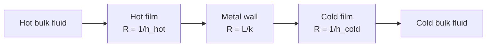

## Video Lecture

<div class="video-container">
  <iframe
    width="560"
    height="315"
    src="https://www.youtube.com/embed/fpjFV6KX1hc"
    title="Chemical Engineering Heat Transfer Ch.1: Conduction, Convection, and the Overall Coefficient"
    allow="accelerometer; autoplay; clipboard-write; encrypted-media; gyroscope; picture-in-picture"
    allowfullscreen>
  </iframe>
</div>

> This video covers the same content as the text below. Choose your preferred learning format.

---

# Chapter 1: Conduction, Convection, and the Overall Coefficient

This chapter opens the series with the two mechanisms that govern most exchanger duties — conduction through solids and convection at surfaces — and combines them into a central sizing parameter for surface heat exchangers: the overall heat transfer coefficient $U$. Radiation, which carries a substantial share of the duty in high-temperature equipment, waits for [Chapter 4](chapter-4.html).

**Fourier's Law, Film Coefficients, and Thermal Resistances in Series**

## Learning Objectives

By completing this chapter, you will be able to:

  * ✅ Place heat transfer in the transport-phenomena framework as *flux = coefficient × driving force*
  * ✅ Apply Fourier's law and quote thermal conductivities across the metal-to-gas range
  * ✅ Explain why the film coefficient $h$ is not a material property but a consequence of flow, and use Dittus–Boelter only inside its stated range
  * ✅ Combine film and wall resistances in series to compute an overall coefficient $U$
  * ✅ Identify the controlling resistance and predict which improvements will and will not pay
  * ✅ Describe fouling as a growing resistance and what a falling $U$ signals in service

**Reading Time**: 20-25 minutes **Code Examples**: 1 **Exercises**: 3

* * *

## 1.1 The Third Transport

**Diagnostic.** A 5 mm carbon steel wall, $k = 45$ W/(m·K), separates water films of 1,000 and 2,000 W/(m²·K). Added as if the wall were flat, the three resistances give $U = 620.7$ W/(m²·K). Roll that wall into a tube of 25 mm inside diameter: is 620.7 too high, too low, or right — and by how much? Answer at Section 1.4.

[Introduction Chapter 1](../chemical-engineering-introduction/chapter-1.html) set out **transport phenomena** as one table with three rows — momentum, heat, mass — each an instance of *flux = coefficient × driving force*. The [Fluid Mechanics](../chemical-engineering-fluid-mechanics/chapter-1.html) series developed the momentum row, whose coefficient is viscosity. This one develops the heat row, where the driving force is a temperature difference and the coefficients are this chapter's subject.

The commercial reason is already on the table. [Thermodynamics Chapter 1](../chemical-engineering-thermodynamics/chapter-1.html) showed that a distillation column's reboiler and condenser are the largest utility consumers on the flowsheets that series works through. Thermodynamics gives *how much* heat that takes — for a steady-flow stream with work and kinetic and potential terms neglected, the rate is $\dot{Q} = \dot{m}\,\Delta h$ — and stops: it never says how large the exchanger must be, or whether a fouled bundle will still make duty in August. Those are heat transfer questions, and nearly all route through one equation:

$$ Q = U A \Delta T $$

Duty $Q$ in watts, area $A$ in m², a representative temperature difference $\Delta T$ in kelvin, and $U$ — the **overall heat transfer coefficient**, W/(m²·K) — carrying the materials, the fluids and the flow. This chapter builds $U$; [Chapter 2](chapter-2.html) makes $\Delta T$ precise, and Chapters 3 to 5 extend the picture to boiling, radiation and design.

## 1.2 Conduction: Fourier's Law

**Conduction** is heat moving through matter by microscopic interaction rather than by bulk motion — energy handed between neighboring molecules, and in metals carried by free electrons; it continues inside a flowing fluid alongside that motion. Its law is the direct analogue of Newton's law of viscosity:

$$ q = -k \frac{dT}{dx} $$

where $q$ is the **heat flux** in W/m², $dT/dx$ the temperature gradient in K/m, and $k$ the **thermal conductivity** in W/(m·K). The minus sign is physics, not bookkeeping: for positive $k$ it states that heat flows *down* the gradient, so a negative gradient gives a positive flux.

For the case that matters industrially — a flat wall of thickness $L$ and area $A$, hot face $T_1$, cold face $T_2$ — one-dimensional conduction with constant $k$ (or a suitable temperature-averaged value) and no internal generation makes the gradient uniform, and the law integrates to

$$ Q = \frac{k A (T_1 - T_2)}{L} = \frac{k A \Delta T}{L} $$

Both forms assume **steady state** — whatever enters one face leaves the other — the normal condition for a plant at rate, and, with the one-dimensional constant-$k$ conditions just stated, the assumptions behind every calculation here. What makes the result useful is the enormous spread in $k$:

| Material (illustrative magnitudes, ~20 °C) | Thermal conductivity $k$ [W/(m·K)] |
|---|---|
| **Copper** | ≈ 400 |
| **Carbon steel** | ≈ 45 |
| **Stainless steel** | ≈ 15 |
| **Water** | ≈ 0.6 |
| **Mineral-wool insulation** | ≈ 0.04 |
| **Air (still)** | ≈ 0.026 |

Only the water entry is computed — **0.6285** W/(m·K) at 40 °C and 2 bar from the IAPWS conductivity formulation R15-11, evaluated with IAPWS-97 thermodynamic properties, which the table rounds to 0.6. The other five are **declared illustrative**: magnitudes with no source, kept because the lesson is the ratio. Copper to still air is a factor of roughly 15,000, a broad and useful range of the conductivities met in plant equipment. **Metals conduct, gases insulate**, and conduction calculations are made somewhere along that line — though geometry, convection, radiation, phase change and contact resistance decide thermal designs alongside it. Note that stainless conducts about three times worse than carbon steel: specifying it for corrosion resistance is a thermal concession, quantified in Exercise 2.

The insulation entry explains itself once you see the air entry. Mineral wool, foam and fiberglass insulate largely not because of what they are made of — glass fibers conduct far better than 0.04 — but because of what they *contain*: air in pockets small enough to suppress circulation, so the composite behaves not far from still air held in place, above it because the fibres still conduct and the pore walls still radiate. **Many porous insulations work largely by immobilizing a gas**, with the solid, the pore structure and the density setting the rest; vacuum and reflective systems work on other principles entirely. Wetting, heavy compression or settling degrade the installed resistance through changed conductivity, thickness or coverage.

## 1.3 Convection and the Film Coefficient

**Convection** is heat carried between a surface and a moving fluid, and in a clean exchanger with a thin metal wall the fluid-side films often hold most of the resistance. Newton's law of cooling is deliberately simple:

$$ Q = h A \Delta T $$

with $\Delta T$ the difference between the surface and the bulk fluid, and $h$ the **film coefficient** in W/(m²·K).

The simplicity hides the difficulty. Thermal conductivity is a **property** — look up copper for the relevant composition, condition and temperature and you have it. The film coefficient is **not**: the same water against the same steel gives a different $h$ if the velocity, the tube diameter, the temperature or the regime changes. It is a consequence of the flow field, which is why this series depends on the last one.

The coefficient is named for a **film**. However fast the bulk fluid moves, the no-slip condition holds it still at the wall, so a thin, slow-moving layer clings to the surface. Heat must cross the near-wall region largely by conduction through the fluid, and common non-metallic liquids and gases conduct far worse than metals — water at 0.6, air near 0.026, with liquid metals the obvious exception. The real resistance is distributed through a thermal boundary layer that need not be stagnant; the film picture lumps it into an **equivalent conductive thickness** $k/h$, **0.0786** mm for water ($k = 0.6285$) at $h = 8{,}000$ — a modelling length, not a measured layer. The well-mixed core at a given axial location is nearly isothermal by comparison. Anything that thins the film raises $h$.

This is where the [Reynolds number](../chemical-engineering-fluid-mechanics/chapter-3.html) reappears. Turbulence sweeps eddies close to the wall, thinning the film and steepening the temperature gradient across it, so $h$ rises sharply once flow goes turbulent — a dependence made quantitative by the correlation everyone calls **Dittus–Boelter**, $\mathrm{Nu} = 0.023\,\mathrm{Re}^{0.8}\mathrm{Pr}^{0.4}$ for heating — the later, McAdams-type modification of their 1930 paper, which carried separate prefactors for heating and cooling — whose range is part of the correlation: $\mathrm{Re} > 10^4$, $0.7 < \mathrm{Pr} < 160$, $L/D > 10$, fully developed turbulent flow, in smooth circular tubes, single phase, with modest property variation across the film. Inside that range $h$ climbs with the 0.8 power of Reynolds number, so doubling tube velocity buys $2^{0.8} =$ **74%** more film coefficient. It also costs pressure drop, which grows about as velocity squared. That trade — heat transfer against pumping power — is the explicit subject of [Chapter 5](chapter-5.html). Outside the range this correlation has no answer to give, and another method appropriate to the actual regime is needed: water at 0.2 m/s in a 15.75 mm tube sits at $\mathrm{Re} =$ **4,788**, and the correlation is refused rather than extrapolated.

| Situation (illustrative ordering, no source) | $h$ [W/(m²·K)] |
|---|---|
| **Free convection, gases** | ≈ 5–25 |
| **Forced convection, gases** | ≈ 25–250 |
| **Forced convection, liquids** | ≈ 100–10,000 |
| **Boiling or condensing** | ≈ 2,500–100,000 |

Only the liquid row carries a computed anchor, supplied in Section 1.4; nothing here is calculated from the other three. Four orders of magnitude again, and the ordering is the tendency to memorize: gases are poor, pumped liquids are good, and phase change can be in a class of its own, because latent heat moves large energy at nearly constant temperature ([Chapter 3](chapter-3.html)). The bands overlap, and film boiling, dryout or noncondensables put phase change well down the list ([Chapter 3](chapter-3.html)). A gas on one side of a wall commonly dominates whatever happens on the other, as the arithmetic below shows — but compare all the resistances on a common area basis before naming the controlling side.

## 1.4 Resistances in Series and the Overall Coefficient

Heat crossing an exchanger wall makes three trips in sequence: the hot fluid's film, the metal, the cold fluid's film. Sequential steps mean **resistances in series**, as in an electrical circuit where temperature difference is voltage and heat flow is current.



The analogy imports a habit: in a series circuit the same current passes every element, so the largest resistance takes the largest voltage drop. Here the same heat crosses every layer, so the largest thermal resistance takes the largest share of the temperature difference. Adding them gives the overall coefficient, defined so that $Q = U A \Delta T$ recovers the whole duty:

$$ \frac{1}{U} = \frac{1}{h_i} + \frac{L}{k} + \frac{1}{h_o} $$

with $h_i$ the film coefficient on the inside surface and $h_o$ the one outside; each term is in m²·K/W. This is the **plane-wall form**, and it is within a few percent only while the wall is thin against the tube radius and the shares of the resistances are such that the curvature correction stays small. In a tube the inside and outside areas differ, and the honest form says which area $U$ belongs to. Referred to the outside surface,

$$ \frac{1}{U_o} = \frac{D_o/D_i}{h_i} + \frac{D_o \ln (D_o/D_i)}{2k} + \frac{1}{h_o} $$

On the worked example's inputs — 5 mm of carbon steel at $k = 45$, $h_i = 1{,}000$, $h_o = 2{,}000$ — the plane-wall **620.7** W/(m²·K) is the large-diameter limit, which these wall-to-diameter ratios are not near:

| Inside diameter $D_i$ | $U_o$ [W/(m²·K)] | vs the plane-wall 620.7 |
|---|---|---|
| 15 mm | **433.2** | **−30.2%** |
| 25 mm | **492.4** | **−20.7%** |
| 100 mm | **582.6** | **−6.1%** |

*That is the Diagnostic's answer*: 620.7 is too high by **20.7%** at 25 mm. The plane-wall form is kept below because it isolates the lesson — resistances add, and one of them controls — but the ratio that decides whether it may be used is $L/r_i$, **0.667** on the 15 mm tube.

**Worked example** — every input illustrative, chosen for readable arithmetic. Cooling water inside a tube with $h_i = 1{,}000$ W/(m²·K), an **illustrative coefficient** well below the design films quoted just below and not a number to size with, a 5 mm carbon steel wall with $k = 45$ W/(m·K), and a process liquid outside with $h_o = 2{,}000$ W/(m²·K):

$$ \frac{1}{U} = 0.001000 + \frac{0.005}{45} + 0.000500 = 0.001000 + 0.000111 + 0.000500 = 0.001611 $$

$$ U = 621\ \text{W/(m}^2\text{·K)} $$

The wall contributes 0.000111 of 0.001611 — **6.9%** of the total. The metal that dominates the drawing is nearly irrelevant thermally; the two thin films own 93% of the resistance between them.

That **6.9%** belongs to these teaching inputs, not to a real water-water exchanger. Re-run the same sum with $h \approx 8{,}000$ W/(m²·K) on both sides — Dittus–Boelter gives **7,277** at 1.5 m/s and **9,160** at 2.0 m/s in a 15.75 mm tube, so 8,000 sits between them — across a 1.65 mm steel wall, and $U$ comes out at **3,488** W/(m²·K) with the wall at **12.8%** of the resistance. The lesson survives, the number does not: the wall is a minority resistance either way, but nearer an eighth than a fourteenth.

```python
def overall_U(h_hot, thickness, k, h_cold):
    R = {"hot 1/h_hot": 1.0 / h_hot,
         "wall L/k": thickness / k,
         "cold 1/h_cold": 1.0 / h_cold}
    total = sum(R.values())
    return 1.0 / total, total, R

CASES = {
    "water / steel / water": dict(h_hot=1000.0, thickness=0.005, k=45.0, h_cold=2000.0),
    "water / steel / air": dict(h_hot=1000.0, thickness=0.005, k=45.0, h_cold=50.0),
}

for name, case in CASES.items():
    U, total, R = overall_U(**case)
    shares = ",  ".join(f"{lab} {v:.6f} ({100 * v / total:.1f}%)" for lab, v in R.items())
    print(f"{name}:  U = {U:.1f} W/(m^2*K),  total R = {total:.6f} m^2*K/W")
    print(f"    {shares}")

# water / steel / water:  U = 620.7 W/(m^2*K),  total R = 0.001611 m^2*K/W
#     hot 1/h_hot 0.001000 (62.1%),  wall L/k 0.000111 (6.9%),  cold 1/h_cold 0.000500 (31.0%)
# water / steel / air:  U = 47.4 W/(m^2*K),  total R = 0.021111 m^2*K/W
#     hot 1/h_hot 0.001000 (4.7%),  wall L/k 0.000111 (0.5%),  cold 1/h_cold 0.020000 (94.7%)
```

The second case is the one to keep. Replace the outside liquid with air at $h = 50$ and $U$ collapses from 621 to **47.4 W/(m²·K)** — the air film alone is **94.7%** of the resistance. Now spend on the water side, 1,000 to 5,000 W/(m²·K): $U$ rises to 49.2, a gain of under 4%. The improvement is small because the untouched air film still holds the resistance, and whether it repays the pumping power is a duty-and-cost question, not a thermal one.

**The largest resistance dominates** — but the others still count: cutting any finite series resistance raises $U$, only by less. Run it the other way on the first case: doubling the *smaller* resistance's coefficient, 2,000 to 4,000, lifts $U$ from 621 to 735 (+18%); doubling the *dominant* 1,000 to 2,000 lifts it to 900 (+45%). Both help; the dominant one helps more, which is why improvements are ranked by their effect on the total resistance and their cost. Air-cooled exchangers commonly concentrate extended surface on the low-coefficient air side, because area added where the coefficient is worst buys the most. Whenever a gas meets a liquid across a wall, the gas is usually in charge.

**Wrong:** take a 25 mm exchanger tube, add $1/h_i + L/k + 1/h_o$ as though the wall were flat, and report $U =$ **620.7** W/(m²·K). **Right:** **492.4** W/(m²·K), **20.7%** lower. What the plane-wall sum drops is curvature: the outside area exceeds the inside one, so the inside film is spread over less surface than $U_o$ assumes and the wall's resistance referred to the outside exceeds $L/k$. The plane-wall arithmetic gives no sign of this; the explicit area ratios do, and $L/r_i$ is a useful screening parameter for it.

## 1.5 Fouling: The Resistance That Grows

Everything so far assumed clean metal. Real surfaces accumulate deposits — scale from hard cooling water, biological films, corrosion product, coke, polymer. A uniform deposit of low-conductivity material sits exactly where the heat must cross, and can be approximated in the sum as one more $L/k$ term — though real deposits are rarely uniform, and also change roughness and flow area:

$$ \frac{1}{U} = \frac{1}{h_i} + R_{f,i} + \frac{L}{k} + R_{f,o} + \frac{1}{h_o} $$

The added terms are **fouling factors**, $R_f$ in m²·K/W: a design allowance for dirt collected between cleanings. The **0.0002** m²·K/W per side used below is **declared illustrative**: an order-of-magnitude allowance with no source behind it, neither a measurement nor a standard's value.

Small numbers, large consequences. Add 0.0002 to each side of the worked example and $1/U$ goes from 0.001611 to 0.002011: $U$ falls from 621 to **497 W/(m²·K)**, a loss of 20% of capability bought before it ever runs. That is why exchangers are deliberately oversized at design — and why an over-generous allowance is its own hazard: a badly oversized unit can run at low velocity where the extra surface is extra parallel flow area, and low velocity aggravates some fouling mechanisms.

Fouling is one important source of *time-dependent* resistance — the film coefficients move with flow, temperature and regime too, and a wall can corrode — and it is the one usually made observable: where flows and temperatures are measured, $U$ can be back-calculated from $Q = U A \Delta T$ and trended. A steadily falling $U$, once normalized for the operating conditions, is evidence for fouling; an abrupt drop is a prompt to diagnose — a bypass, a blocked pass, a leaking tube, an instrument fault. Neither trend names its cause on its own. This is the soft-sensor logic of [Introduction Chapter 5](../chemical-engineering-introduction/chapter-5.html): infer a hard-to-measure condition — here the state of a surface no one can see — from cheap measurements you already have. [Chapter 5](chapter-5.html) returns to fouling as a design problem.

## 1.6 Exit Check

Five readings this chapter owes.

1. **Units** — every term in m²·K/W before anything is added? $1/h$ and $L/k$ are; a sum of $h$ values is not a resistance.
2. **Geometry** — wall thin against the radius? $L/r_i =$ **0.667** on the 15 mm tube, so the plane-wall form is wrong there and costs **30.2%**.
3. **Range** — each $h$ inside the correlation that produced it? Dittus–Boelter needs $\mathrm{Re} > 10^4$; at 0.2 m/s, $\mathrm{Re} =$ **4,788** and the output is a refusal, not a number.
4. **Controlling resistance** — which term holds the largest share of $1/U$? **94.7%** for the air film, **83.3%** for Exercise 2's slow side. Improve any other and $U$ moves, but much less.
5. **Provenance** — does the number name a source? Every computed value above is a DISPLAY key listed below; the conductivity table, the $h$ bands and the exercise inputs are declared illustrative.

## 1.7 Chapter Summary

1. Heat transfer is the second row of the **transport table** — *flux = coefficient × driving force* — and turns the thermodynamic duty, $\dot{Q} = \dot{m}\,\Delta h$ for a steady-flow stream, into hardware through $Q = U A \Delta T$
2. **Fourier's law**, $q = -k\,dT/dx$, gives $Q = kA\Delta T/L$ through a slab; the illustrative conductivities span copper ≈ 400 to still air ≈ 0.026 W/(m·K), roughly 15,000-fold, and porous insulation works largely by trapping air rather than by any special conductivity of its solid
3. The **film coefficient** $h$ in $Q = hA\Delta T$ is not a property but a result of the flow: turbulence thins the stagnant wall film and raises $h$, so it tracks the Reynolds number through $\mathrm{Nu} = 0.023\,\mathrm{Re}^{0.8}\mathrm{Pr}^{0.4}$ inside that correlation's range ($\mathrm{Re} > 10^4$, $0.7 < \mathrm{Pr} < 160$, $L/D > 10$); the illustrative bands run 5–25 in gases to 2,500–100,000 for phase change
4. Resistances add in series: $1/U = 1/h_i + L/k + 1/h_o$ — the plane-wall form, and on a tube a large-diameter limit: referred to the outside area the cylindrical form gives **492.4** W/(m²·K) at $D_i =$ 25 mm and **433.2** at 15 mm against **620.7**, **20.7%** and **30.2%** lower
5. Worked case, on illustrative low-velocity films: $0.001000 + 0.000111 + 0.000500 = 0.001611$ gives $U = 621$ W/(m²·K), with the steel wall only **6.9%** of the resistance — on design films of **8,000** across a 1.65 mm wall it is $U =$ **3,488** and a wall share of **12.8%**
6. **The largest resistance dominates, and the others still count.** With air outside ($h = 50$), $U$ falls to 47.4 W/(m²·K) and the air film is **94.7%** of the total — improving the water side from 1,000 to 5,000 still gains under 4%
7. **Fouling factors** add resistance that grows in service; the declared-illustrative **0.0002** m²·K/W per side drops the worked case from 621 to 497 W/(m²·K), and a trended $U$ is a soft sensor for surface condition

**Next chapter**: in a real exchanger $\Delta T$ generally changes from end to end as the streams heat and cool — with important special cases, such as a phase-changing stream or equal capacity rates in counterflow. [Chapter 2](chapter-2.html) puts $U$ to work — **heat exchangers and the log mean temperature difference (LMTD)** — and what co-current and counter-current arrangements do to the duty you can achieve.

## Exercises

The film coefficients, wall thicknesses and conductivities below are **illustrative inputs**; the answers demonstrate a method, not a design value.

1. **Conceptual — where the resistance lives**: A shell-and-tube exchanger condenses steam on the shell side ($h \approx 8{,}000$ W/(m²·K)) and heats a viscous oil inside the tubes ($h \approx 200$ W/(m²·K)) through a 3 mm carbon steel wall. (a) Rank the three resistances without computing $U$ exactly. (b) A proposal is made to replace the tubes with copper to improve performance. Evaluate it. (c) What change would actually help, and why?
   *Hint*: write each resistance as $1/h$ or $L/k$ and compare magnitudes before doing any arithmetic.
   *Answer*: (a) Oil film $1/200 = 0.005$, steam film $1/8{,}000 = 0.000125$, wall $0.003/45 = 0.0000667$. The **oil film dominates** — about 96% of a total of roughly 0.00519 m²·K/W. (b) It is nearly worthless: copper cuts the wall term to about 0.0000075, removing around 1% of the total, and $U$ rises from about 193 to about 195 W/(m²·K) — a thermal gain so small that the replacement cost must be assessed separately before it is called worthwhile. (c) Attack the oil film: raise tube-side velocity (more passes or smaller tubes), add twisted-tape inserts, or preheat the oil so its viscosity falls. Check the oil-side flow regime first — in thermally fully developed laminar flow, velocity alone need not raise $h$ — and check the pressure-drop allowance. Only that side changes $U$ appreciably.

2. **Quantitative — the stainless penalty**: An exchanger has $h_1 = 500$ W/(m²·K) on one side, a **3 mm stainless steel** wall ($k = 15$ W/(m·K)), and $h_2 = 5{,}000$ W/(m²·K) on the other. (a) Compute each resistance and the overall coefficient $U$. (b) Which resistance dominates, and by what share? (c) An engineer proposes doubling $h_2$ to 10,000 by increasing that stream's velocity. Compute the new $U$ and comment. (d) What would doubling $h_1$ to 1,000 achieve instead?
   *Hint*: build $1/U$ term by term; the wall term is $L/k = 0.003/15$.
   *Answer*: (a) $1/h_1 = 0.002000$, $L/k = 0.003/15 = 0.000200$, $1/h_2 = 0.000200$. Summing, $1/U = 0.002400$ m²·K/W, so $U = $ **417 W/(m²·K)**. (b) The **$h_1 = 500$ side**, at $0.002/0.0024 = $ **83.3%** of the total; wall and fast side contribute 8.3% each. (c) $1/U = 0.002 + 0.0002 + 0.0001 = 0.0023$, giving $U = $ **435 W/(m²·K)** — a gain of only 4.3%, in exchange for **5.66** times the pressure drop on that stream: a poor trade unless the marginal duty is worth that incremental pumping cost. (From $h \propto \mathrm{Re}^{0.8}$, valid only where Dittus–Boelter's conditions hold and properties are about fixed, doubling $h$ needs $2^{1/0.8} =$ **2.38** times the velocity; with $\Delta P \propto v^2$ that is $2.38^2 =$ **5.66**, and on the alternative turbulent exponent $\Delta P \propto v^{1.8}$ it is **4.76**.) (d) $1/U = 0.001 + 0.0002 + 0.0002 = 0.0014$, so $U = $ **714 W/(m²·K)**, a **71%** improvement from the same relative change applied to the controlling resistance. Note that carbon steel would cut the wall term to 0.0000667, worth about 6% on $U$ — real but secondary, and unavailable when the stainless is there for corrosion.

3. **Discussion — a gas cooler that underperforms**: A hot process gas is cooled by water in a plain-tube exchanger. Measured performance is $U \approx 40$ W/(m²·K), well below the 60 assumed at design, and the plant is considering (i) polishing and descaling the water side, (ii) increasing water flow by 50%, (iii) replacing the bundle with a finned-tube design, (iv) accepting the shortfall and adding a second unit in series. Discuss each, and explain what measurement would settle the argument.
   *Hint*: estimate which side holds the resistance from the $h$ ranges in Section 1.3 before judging any option.
   *Answer*: On Section 1.3's illustrative bands a gas gives $h$ of roughly 25–250 W/(m²·K) even in forced convection, while a pumped water film is typically an order of magnitude higher, so the **gas film is expected to hold nearly all the resistance** — a total $1/U$ of 0.025 m²·K/W against a clean water-side contribution near 0.001, about 4%. That estimate covers the *clean* water film only: option (ii), and the polishing half of option (i), then address something already negligible, since even eliminating the clean water film could not raise $U$ past about 42. Descaling is different — scale is a separate fouling resistance that the clean-film figure does not contain — so water-side fouling deserves its own check rather than dismissal. Option (iii) attacks the resistance that is expected to dominate: fins add area precisely where the coefficient is worst, and $UA$ — the product that sets duty — rises accordingly, subject to fin efficiency, gas-side pressure drop and cleaning access. Option (iv) buys area at full price and needs a complete thermal, hydraulic, installation and cost assessment. The measurement that most directly tests the allocation is the **wall temperature**: a tube surface close to the water temperature means nearly the whole $\Delta T$ is spent across the gas film, though one reading cannot characterize a whole bundle with deposits or maldistribution. Trending a normalized $U$ over time then weighs a design shortfall against progressive **fouling** — a $U$ that started at 60 and decayed points to fouling, one never above 42 points to a design shortfall — but neither history identifies the cause uniquely, so corroborate before prescribing cleaning or a rebuild.

## Sources

Package version and citations as of 2026-09-08. Every computed number above is a DISPLAY string of `sources/calc/ch06_repair.py` in the Lecture Maker repository for this series, transcribed character for character; a value that no longer matches a re-run of that script is corrected there, never here.

| Source | Quoted basis |
|---|---|
| Dittus, F. W. and Boelter, L. M. K., *Univ. California Publ. Eng.* **2** (1930) 443; reprinted *Int. Comm. Heat Mass Transfer* **12** (1985) 3–22 | the original heat-transfer correlation, published with separate prefactors for heating and cooling. The $\mathrm{Nu} = 0.023\,\mathrm{Re}^{0.8}\mathrm{Pr}^{0.4}$ form used here is the later textbook modification commonly associated with McAdams, and it is the correlation behind the turbulent internal water-flow coefficients calculated in Sections 1.3 and 1.4 — not behind the declared-illustrative $h$ bands or the free-convection, boiling and condensing entries |
| McAdams, W. H., *Heat Transmission*, 3rd ed. (McGraw-Hill, 1954), Ch. 9 | its applicability range: $\mathrm{Re} > 10^4$, $0.7 < \mathrm{Pr} < 160$, $L/D > 10$, fully developed turbulent flow. The script enforces it as a refusal, not a warning, which is why 0.2 m/s returns no coefficient |
| IAPWS-97 (R7-97(2012)) with R12-08 and R15-11, via the `iapws` Python package 1.5.5, https://github.com/jjgomera/iapws | liquid water at 40 °C and 2 bar: $k =$ 0.6285 W/(m·K), $\mathrm{Pr} =$ 4.339, $\rho =$ 992.3 kg/m³, $\mu = 6.527\times10^{-4}$ Pa·s — the properties the Reynolds numbers and the calculated water-flow coefficients above are computed from, the conductivity coming from R15-11 rather than from IF97 |

| Originating script | DISPLAY keys transcribed here |
|---|---|
| `sources/calc/ch06_repair.py` (this series) | `plane_wall_U_w_per_m2_k`, `plane_wall_resistance_m2k_per_w`, `plane_wall_share_percent`, `cyl_U_outside_{15,25,100}mm_w_per_m2_k`, `cyl_vs_plane_percent_{15,25,100}mm`, `cyl_thin_wall_ratio_15mm`, `water_40c_conductivity_w_per_m_k`, `db_correlation`, `db_validity_range`, `db_tube_inside_diameter_mm`, `db_re_0p2_m_per_s`, `db_h_0p2_m_per_s_refused`, `db_h_{1p5,2p0}_m_per_s_w_per_m2_k`, `design_film_coefficient_w_per_m2_k`, `U_clean_water_water_w_per_m2_k`, `wall_share_realistic_percent`, `velocity_factor_to_double_h`, `dp_factor_to_double_h`, `dp_factor_to_double_h_exponent_1p8`, `fouling_resistance_per_side_m2k_per_w` |

## Number provenance

**Tier A — computed and asserted by `ch06_repair.py`.** The plane-wall worked example, **620.7** W/(m²·K) on a total resistance of **0.001611** m²·K/W with a wall share of **6.90%** (`plane_wall_U_w_per_m2_k`, `plane_wall_resistance_m2k_per_w`, `plane_wall_share_percent`); the cylindrical comparison **433.2** / **492.4** / **582.6** W/(m²·K) at $D_i =$ 15 / 25 / 100 mm and the deviations **−30.2%** / **−20.7%** / **−6.1%** against it, with $L/r_i =$ **0.667** on the 15 mm tube (`cyl_U_outside_*`, `cyl_vs_plane_percent_*`, `cyl_thin_wall_ratio_15mm`); water's conductivity **0.6285** W/(m·K) (`water_40c_conductivity_w_per_m_k`), from which the film thickness **0.0786** mm is $k/h$ at $h =$ 8,000; the Dittus–Boelter results **7,277** W/(m²·K) at 1.5 m/s and **9,160** at 2.0 m/s in a **15.75** mm tube, the design value **8,000** that sits between them, and $\mathrm{Re} =$ **4,788** at 0.2 m/s where the correlation is refused rather than extrapolated (`db_*`, `design_film_coefficient_w_per_m2_k`); the realistic water-water pair $U =$ **3,488** W/(m²·K) with a wall share of **12.8%** across a 1.65 mm wall (`U_clean_water_water_w_per_m2_k`, `wall_share_realistic_percent`); and Exercise 2(c)'s pressure-drop penalty, **2.38** times the velocity and **5.66** times $\Delta P$ on $\Delta P \propto v^2$, **4.76** on $v^{1.8}$ (`velocity_factor_to_double_h`, `dp_factor_to_double_h`, `dp_factor_to_double_h_exponent_1p8`). The $2^{0.8} =$ **74%** ratio is asserted there too.

**Tier B — cited, not measured**: the Dittus–Boelter correlation in its later 0.023 form, its applicability range, and the IAPWS water properties (IF97 thermodynamics, R12-08 viscosity, R15-11 conductivity) — the three rows of the Sources table. Nothing else in this chapter is a sourced constant.

**Tier C — declared illustrative, and declared where they are used.** The conductivity table (copper ≈ 400, carbon steel ≈ 45, stainless ≈ 15, mineral wool ≈ 0.04, still air ≈ 0.026 W/(m·K); only the water row is computed) and the copper-to-air ratio of ≈ 15,000 read from it. The four $h$ bands of Section 1.3 (5–25, 25–250, 100–10,000, 2,500–100,000), of which only the liquid row has a computed anchor. The worked example's own inputs — $h_i =$ 1,000, $h_o =$ 2,000, a 5 mm wall at $k =$ 45, the air case at $h =$ 50 — and the fouling allowance of **0.0002** m²·K/W per side (`fouling_resistance_per_side_m2k_per_w`). Every exercise input set. Their arithmetic is exact and reproduces at the digits printed — $U =$ 621, 47.4, 49.2, 735, 900, 497, and Exercise 1's 193 → 195, Exercise 2's 417 / 435 / 714, Exercise 3's ceiling of 42 — but each output inherits its inputs' tier: it demonstrates a method, and none of it is a design value.

**Open citation debt.** The metal, insulation and still-air conductivities and the four $h$ bands are used because a chapter on resistances needs a spread to reason over, not because a primary table was consulted; $k =$ 45 and $k =$ 15 additionally enter the worked arithmetic. They are declared illustrative here rather than cited, which is the weaker of the two Tier-compliant options, and closing them against a primary property table is outstanding work recorded in the series' `sources/README.md`.
