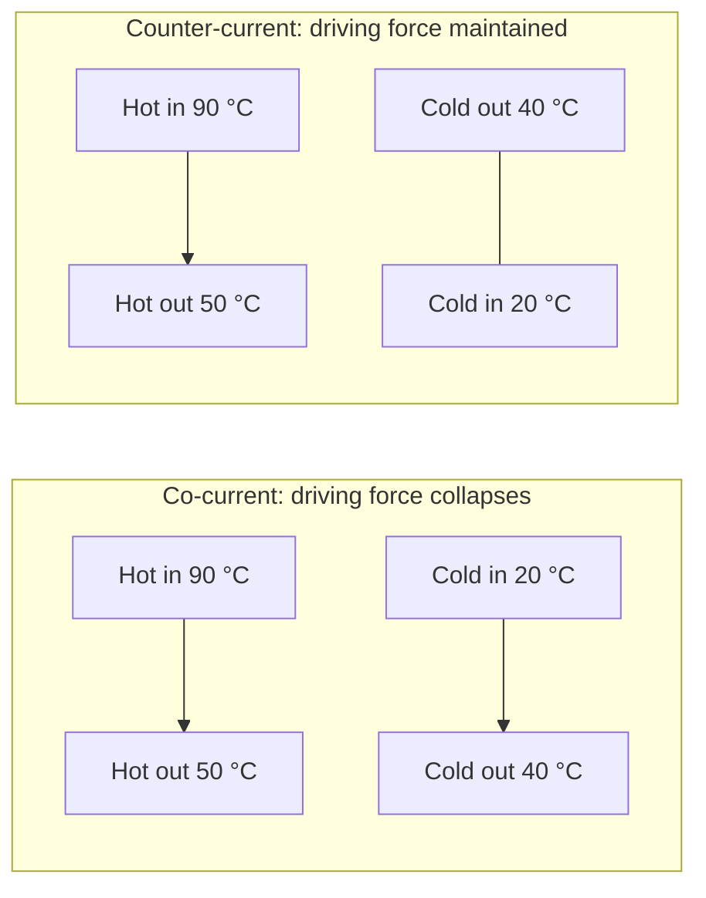

## Video Lecture

<div class="video-container">
  <iframe
    width="560"
    height="315"
    src="https://www.youtube.com/embed/fpjFV6KX1hc?start=778"
    title="Chemical Engineering Heat Transfer Ch.2: Heat Exchangers and the LMTD"
    allow="accelerometer; autoplay; clipboard-write; encrypted-media; gyroscope; picture-in-picture"
    allowfullscreen>
  </iframe>
</div>

> This video covers the same content as the text below. Choose your preferred learning format.

---

# Chapter 2: Heat Exchangers and the LMTD

[Chapter 1](chapter-1.html) built the overall heat-transfer coefficient $U$ — the number that collects film resistances, wall conduction and fouling. This chapter spends it: given two streams and a duty, how large an exchanger do you buy?

**Sizing the Workhorse of Process Heat**

## Learning Objectives

By completing this chapter, you will be able to:

  * ✅ Explain what a heat exchanger does for a flowsheet and why heat integration pays twice
  * ✅ Describe shell-and-tube construction and why it remains the standard
  * ✅ Put a number on what counter-current flow is worth against co-current
  * ✅ Compute the log-mean temperature difference and explain why the mean is logarithmic
  * ✅ Size an exchanger with $Q = U A F \Delta T_{lm}$, and say what kind of number the $U$ is
  * ✅ Compute $\varepsilon$, NTU and $C_r$, and choose between the LMTD and ε-NTU methods

**Reading Time**: 20-25 minutes **Code Examples**: 1 **Exercises**: 3

* * *

## 2.1 The Heat Exchanger's Job

**Diagnostic.** An exchanger is sized for 334.4 kW at $U =$ **500** W/(m²·K) and $\Delta T_{lm} =$ **39.2** K, giving **17.1** m², and ordered as a one-shell, two-tube-pass unit. On start-up day, perfectly clean, does it make its duty? Answer at Section 2.4.

An indirect-contact heat exchanger moves heat between two streams separated by a surface, without mixing them; direct-contact designs do mix them. That sounds like plumbing; the economics are not. A hot stream needing cooling usually costs cooling water or air, a cold stream needing heating usually costs steam or fired duty, and matching the two reduces both charges at once. That is **heat integration**, whose systematic form — pinch analysis, computing the minimum utility *before* any network is drawn — is [Introduction Chapter 4](../chemical-engineering-introduction/chapter-4.html).

Exchangers realize those targets, and the **shell-and-tube exchanger** is the process industries' workhorse: tubes carrying one fluid, sealed into a cylindrical shell carrying the other, with segmental baffles — the common arrangement — directing the shell stream across them. Properly designed it covers a broad range of pressures and temperatures, set by allowable stress, creep, corrosion, joints and code rather than by metal spend alone; it is robust; floating-head and U-tube configurations let the bundle pull for cleaning, while a fixed tubesheet does not; and its geometry is codified by the **TEMA** standards, so a sufficiently complete specification is read the same way by every fabricator. It is the default unless there is a reason for something else — and there are reasons. **Plate exchangers** often reach higher $U$ in far less volume for clean, moderate-pressure duties ([Chapter 5](chapter-5.html)); air coolers, double-pipe and spiral units each hold a niche. The heat-balance framework below carries over; $U$, the geometry, and often the hydraulic and configuration models change with it.

## 2.2 Flow Arrangements

The two streams can run the same direction or opposite, and the choice is not cosmetic. In **co-current** (parallel) flow both enter at the same end: the temperature difference starts large — hot inlet against cold inlet — and collapses as the streams converge on a common intermediate temperature. In **counter-current** flow they enter at opposite ends, the hot inlet facing the cold *outlet*, and the difference is far more uniform — whether it shrinks, grows or stays constant along a chosen direction depends on the two capacity rates, and it is exactly constant when they match.

| | Co-current | Counter-current |
|---|---|---|
| **Inlets** | Same end | Opposite ends |
| **Driving force along the length** | Large at inlet, collapses toward outlet | Maintained, more uniform |
| **Cold outlet vs hot outlet** | Cold outlet must stay below hot outlet | Cold outlet **may exceed** hot outlet |
| **Area for a given duty** | Larger — **27.0 %** more here (Section 2.3) | Smaller |
| **Fluid-temperature gradient along the length** | Sharp at the inlet end | Gentler, spread out (thermal stress needs its own thermomechanical assessment) |

The third row is the decisive one. Co-current flow can never lift the cold stream above the hot stream's exit temperature: the two approach from the same starting point, and once they meet heat stops flowing. Counter-current has no such limit — the cold outlet meets the hot *inlet*, so it can leave hotter than the hot stream leaves, a **temperature cross** unavailable in co-current. That, plus the more uniform driving force, is why counter-current is the thermal reference and is preferred wherever the mechanical and hydraulic arrangement allows; multipass and crossflow units are common in practice, and the following sections take pure counter-current as the reference case.



Read the counter-current block right to left for the cold stream: it enters at 20 °C where the hot stream is *leaving* at 50 °C and leaves at 40 °C where the hot stream is *entering* at 90 °C — approaches of 30 K and 50 K, not 70 K and 10 K.

## 2.3 The Log-Mean Temperature Difference

The sizing equation is a transport law in standard form — flux equals coefficient times driving force, integrated over area:

$$ Q = U A \Delta T_{lm} $$

with $Q$ the **duty** in W, $U$ the overall coefficient in W/(m²·K), $A$ the area in m², and $\Delta T_{lm}$ the effective average temperature difference. The trouble: that difference varies continuously along the exchanger. What average is correct?

Not the arithmetic one. Each stream's temperature changes in proportion to the heat it has absorbed or given up, so the gap between them shrinks — or grows — exponentially with area, not linearly. Integrating $dQ = U\,\Delta T\,dA$ at constant $U$, constant specific heats and negligible heat loss gives the **log-mean temperature difference**:

$$ \Delta T_{lm} = \frac{\Delta T_1 - \Delta T_2}{\ln(\Delta T_1 / \Delta T_2)} $$

with $\Delta T_1$ and $\Delta T_2$ the approaches at the two ends.

### Worked Example

Hot water cools from 90 °C to 50 °C against cold water heated from 20 °C to 40 °C, counter-current. Pair each end correctly — hot inlet with cold outlet:

$$ \Delta T_1 = 90 - 40 = 50\ \text{K}, \qquad \Delta T_2 = 50 - 20 = 30\ \text{K} $$

$$ \Delta T_{lm} = \frac{50 - 30}{\ln(50/30)} = \frac{20}{0.5108} = 39.2\ \text{K} $$

The arithmetic mean would be 40 K — about 2.2 % high, and since $A$ goes as $1/\Delta T$, using it undersizes the exchanger by about 2 %. Tolerable here; not constant. The log mean is never the larger **of the two means** — it equals the arithmetic mean only when the two end differences are equal — and the gap widens as the ends become unequal, while it still lies *between* the two end differences, here between 30 K and 50 K. At a 10:1 spread the arithmetic mean overshoots by more than 40 %, sizing an exchanger that is undersized for its assumed design conditions.

**What counter-current is worth, in area.** Run the same four terminals co-current and the ends pair the other way: $\Delta T_1 = 90 - 20 = 70$ K, $\Delta T_2 = 50 - 40 = 10$ K, so $\Delta T_{lm} = 60/\ln 7 =$ **30.83** K against **39.15** K counter-current. Same duty, same $U$, area as $1/\Delta T_{lm}$: $39.15/30.83 =$ **1.270**, so co-current needs **27.0 %** more surface — and still cannot cross. Row four of Section 2.2, with a number on it.

## 2.4 A Complete Sizing

Take 2 kg/s of water cooled by 40 K, with $c_p = 4.18$ kJ/(kg·K). The duty follows from an energy balance on one stream:

$$ Q = \dot{m} c_p \Delta T = 2 \times 4.18 \times 40 = 334.4\ \text{kW} $$

**The coefficient, and what kind of number it is.** This sizing **assumes** $U = 500$ W/(m²·K) as the example's **design (fouled) value** for a water-to-water shell-and-tube unit. Design tabulations of overall coefficients exist (McAdams, *Heat Transmission*, 3rd ed., 1954), but no table, service definition or fouling basis is pinned here, so the claim that 500 sits at the low end of a published range is not established: 500 is a *declared design input* for this example, not a measured or sourced typical value, and it is not put forward as the clean coefficient of this service. Chapter 1's films show how far above it a clean water-to-water pair sits: Dittus–Boelter with IAPWS-97 water at 40 °C in a 15.75 mm tube gives $h =$ **7,277** W/(m²·K) at 1.5 m/s and **9,160** at 2.0 m/s, so **assume** $h \approx$ **8,000** on both sides — an illustrative equal-film assumption, since a tube correlation says nothing about the shell side, whose crossflow, bypassing and leakage need their own model — across a 1.65 mm carbon-steel wall ($k = 45$ W/(m·K)), summed as a thin-wall plane approximation on a common area basis:

$$ \frac{1}{U_{\text{clean}}} = \frac{1}{8000} + \frac{0.00165}{45} + \frac{1}{8000} \;\Rightarrow\; U_{\text{clean}} = 3{,}488\ \text{W/(m²·K)} $$

and 0.0002 m²·K/W of fouling per side brings that to **1,456** — a fall of **58 %**. The **12.8 %** wall share belongs to the *clean* sum, against 6.9 % in Chapter 1's plane slab; adding the fouling terms leaves the wall resistance unchanged and so lowers its share further. Sizing at 500 therefore carries resistance and uncertainty allowances well beyond the fouling just computed — what they represent has to be declared, not inferred from the number's size. With the 39.2 K driving force:

$$ A = \frac{Q}{U \Delta T_{lm}} = \frac{334{,}400}{500 \times 39.2} = 17.1\ \text{m}^2 $$

**Wrong:** read 500 as the clean coefficient, then add a fouling allowance on top by re-sizing at 300 W/(m²·K) — 17.1 m² becomes 28.5 m², the same fouling paid for twice. **Right:** the allowance is already inside the 500, which sits below both computed coefficients. The correction still owed is the multi-pass $F$ below, taking 17.1 m² to **18.9** m², not to 28.5.

**Multi-pass geometry.** Many practical shell-and-tube units depart from ideal counter-current. A **multi-pass** exchanger routes the tube fluid up and back through the shell — two, four or six passes — for velocity and compactness, and some of those passes run co-current, degrading the driving force. The fix is a **correction factor** $0 < F \le 1$ — equal to 1 for ideal counterflow and for limiting cases such as an isothermal stream, and below 1 for the multipass case here: $Q = U A F \Delta T_{lm}$, with $\Delta T_{lm}$ the **counter-current** log mean above. For one shell pass and two tube passes $F$ has a closed form (Bowman, Mueller and Nagle, 1940) in $P = (t_2-t_1)/(T_1-t_1)$ and $R = (T_1-T_2)/(t_2-t_1)$:

$$ F = \frac{\sqrt{R^2+1}}{R-1}\cdot\frac{\ln\dfrac{1-P}{1-PR}}{\ln\dfrac{2/P - 1 - R + \sqrt{R^2+1}}{2/P - 1 - R - \sqrt{R^2+1}}} $$

For this chapter's terminals $P = 20/70 =$ **0.2857** and $R = 40/20 =$ **2.000**, giving $F =$ **0.9045**. Two things fall out that a chart hides. First, when the denominator's logarithm takes a non-positive argument there is **no $F$ at all**: the duty is not inefficient in one shell, it is unreachable for that flow arrangement, and one remedy is shells in series. Second, $F$ is not a grade of hardware: for a *specified flow arrangement* — here one shell pass and two tube passes — it is fixed by the four terminal temperatures through $P$ and $R$, so a round 0.85 read off a chart for a case whose $F$ is 0.9045 is an error, not a conservatism. Change the arrangement and the same terminals give a different $F$. Designers keep $F$ above roughly 0.8 — a working habit, not a computed threshold.

**The Diagnostic, answered.** Not as ordered. Order exactly 17.1 m² as a two-pass unit and evaluate $Q = UAF\Delta T_{lm}$ at the design $U$ of 500 and **at the assumed chart factor $F = 0.85$**, holding the target terminals fixed: $500 \times 17.1 \times 0.85 \times 39.2 = 284{,}886$ W $=$ **284.9** kW against the 334.4 kW required, **15 %** short. Read that for what it is — an **imposed-terminal check** on the area, not a rating of the clean unit. A rating would use the clean $U$ and the one-shell two-pass relation and solve the energy balances for the outlets, which would move $\Delta T_{lm}$ too; the check above instead asks whether the ordered surface is enough at the design coefficient and the terminals it was specified for. On that reading it is not: at the true $F$ of 0.9045 the duty needs **18.9** m². $F$ belongs inside the sizing, not in a margin bolted on afterwards.

```python
import math

CP_WATER = 4.18  # kJ/(kg*K)


def duty(m_dot, cp, delta_T):          # kW, from kg/s and K
    return m_dot * cp * delta_T


def lmtd(dT1, dT2):                    # K, from the two end approaches
    if abs(dT1 - dT2) < 1e-9:
        return dT1
    return (dT1 - dT2) / math.log(dT1 / dT2)


def area(Q_kW, U, dT_lm):              # m2, from Q = U * A * dT_lm
    return Q_kW * 1000.0 / (U * dT_lm)


# Hot water 90 -> 50 C against cold water 20 -> 40 C, counter-current
dT1, dT2 = 90 - 40, 50 - 20
dT_lm = lmtd(dT1, dT2)
Q = duty(2.0, CP_WATER, 40.0)

print(f"dT1 = {dT1} K, dT2 = {dT2} K")
print(f"LMTD          = {dT_lm:.2f} K")
print(f"co-current    = {lmtd(70.0, 10.0):.2f} K")
print(f"duty Q        = {Q:.1f} kW\n")

print(f"{'U [W/(m2.K)]':>13} {'area [m2]':>10}")
for U in (300, 500, 800):
    print(f"{U:>13} {area(Q, U, dT_lm):10.1f}")

# dT1 = 50 K, dT2 = 30 K
# LMTD          = 39.15 K
# co-current    = 30.83 K
# duty Q        = 334.4 kW
#
#  U [W/(m2.K)]  area [m2]
#           300       28.5
#           500       17.1
#           800       10.7
```

The sweep is the lesson, and its labels are the trap. Area is inversely proportional to $U$: 40 % down from the 500 used here and the surface grows to 28.5 m², 60 % up and it shrinks to 10.7 m². Read the three rows as **illustrative $U$ scenarios**, a sensitivity sweep rather than an evidenced uncertainty interval, and not as clean / fouled / high-performance grades — 300 sits below the design value already in use, and 800 is simply another assumed design coefficient. Uncertainty in $U$ goes straight into capital cost, which is why Chapter 1's estimate deserved its care.

The driving force is the other lever. Chase a tighter approach — recover more heat, shave the utility bill — and $\Delta T_{lm}$ shrinks while area climbs toward infinity as the approach goes to zero: heat recovery is bought with metal. Practice settles the argument with a **minimum approach temperature**, and Chapter 5 quotes illustrative, service-dependent choices of **5–10 K** for shell-and-tube liquid duties and **1–2 K** for plate units. Neither is sourced in this series, and neither is a standard or an equipment limit; both are stated as heuristics. That parameter is what pinch analysis takes as its input.

## 2.5 The ε-NTU Method

The sizing above worked because all four terminal temperatures were known. Asked instead "I have this exchanger and these two inlets — what comes out?", the LMTD method becomes awkward: $\Delta T_{lm}$ needs the outlets, and the outlets need the duty, so the usual route is to guess, solve and iterate.

For a constant-property exchanger model with known $UA$, capacity rates and configuration relation, the **effectiveness-NTU** method removes that iteration by rephrasing the question. **Effectiveness** $\varepsilon$ is the actual duty over the thermodynamic maximum — what an infinitely large counter-current exchanger would transfer, limited by the stream with the smaller heat capacity rate:

$$ \varepsilon = \frac{Q_{\text{actual}}}{Q_{\max}}, \qquad Q_{\max} = (\dot{m} c_p)_{\min} (T_{h,in} - T_{c,in}) $$

The **number of transfer units** is the exchanger's dimensionless size, with **capacity-rate ratio** $C_r = C_{\min}/C_{\max} \le 1$:

$$ \text{NTU} = \frac{UA}{C_{\min}}, \qquad \varepsilon = \frac{1 - e^{-\text{NTU}(1-C_r)}}{1 - C_r\,e^{-\text{NTU}(1-C_r)}} \quad (C_r < 1) $$

the second being the counter-flow relation (Kays and London) — the relation for the *ideal counter-current reference* exchanger, not for the one-shell two-pass unit Section 2.4 ends with, whose own effectiveness relation and $F$-corrected $UA$ would be needed to rate that hardware. Take the reference exchanger, then, on Section 2.4's stream data. The hot side carries $C_h = 2 \times 4.18 =$ **8.36** kW/K; the cold side takes the same duty over a 20 K rise, $C_c = 334.4/20 =$ **16.72** kW/K — fixing the cold flow the sizing needed and never stated, **4.00** kg/s. So $C_{\min} =$ 8.36 kW/K, $C_r = 8.36/16.72 =$ **0.500**, and

$$ Q_{\max} = 8.36 \times (90 - 20) = 585.2\ \text{kW}, \qquad \varepsilon = \frac{334.4}{585.2} = 0.5714 $$

From the uncorrected counter-current sizing instead — $F$ is deliberately omitted here, which is exactly why this checks the reference exchanger rather than the ordered hardware: the area having been sized from the same $U$, the coefficient cancels out of NTU — $\text{NTU} = Q/(C_{\min}\Delta T_{lm}) = 334.4/(8.36 \times 39.15) =$ **1.022**, equivalently $UA = 334.4/39.15 =$ **8.54** kW/K, the sized $U$ acting over the sized area. Substituting NTU = 1.022 and $C_r =$ 0.500 gives $\varepsilon =$ **0.5715**, the duty ratio's **0.5714** back again — the last digit differs only because NTU was rounded to four figures before substitution, and carried unrounded both routes give **0.5714**. Two readings of the same ideal counter-current model agreeing to four figures is an algebraic consistency check between equivalent formulations — useful, but not independent validation, since both routes rest on the same duty, terminals and balances.

| Situation | Use |
|---|---|
| All four terminal temperatures known; find area | **LMTD** |
| Design of a new unit to a specified duty | **LMTD** |
| Outlets unknown, hardware fixed — rating an existing unit on a new service | **ε-NTU** |
| Checking how close a unit is to its thermodynamic limit | **ε-NTU** |

$\varepsilon$ is also a performance score: this unit at **0.5714** has room left, while one at 0.9 already extracts 90 % of the available heat and will find little more in doubled area — a judgment nearly invisible in the LMTD framing.

## 2.6 Exit Check

Five readings a sizing owes before it becomes an order.

1. **Unit** — every coefficient in W/(m²·K), every capacity rate in kW/K, every duty in kW? The area line divides **334,400** W by $U\Delta T_{lm}$, not 334.4.
2. **Closure** — do both streams carry the same duty? Hot $2 \times 4.18 \times 40 =$ **334.4** kW, cold $4.00 \times 4.18 \times 20 =$ **334.4** kW.
3. **Physical range** — log mean between the two end differences, and $\varepsilon \le 1$, $C_r \le 1$, $F \le 1$ (equality is legitimate: $C_r = 1$ for matched capacity rates, $F = 1$ for counterflow)? **39.15** K between 30 and 50; **0.5714**, **0.500**, **0.9045**.
4. **Provenance** — does each coefficient say what kind of number it is? **500** is a declared *design (fouled)* input with no pinned table behind it, **3,488** and **1,456** are computed from Chapter 1's films, **0.85** is a wrong exercise premise.
5. **Reproducibility** — do two routes through the *same* model agree? $\varepsilon$ from the duty ratio **0.5714** against $\varepsilon$ from NTU **0.5714**, both for the ideal counter-current reference.

## 2.7 Chapter Summary

1. **Heat integration** — matching a hot process stream against a cold one — cuts the steam bill and the cooling-water bill at once; exchangers realize pinch targets
2. **Shell-and-tube** is the workhorse: broad (not unlimited) pressure capability, robust, cleanable depending on construction, standardized by TEMA. Plate units often give higher $U$ in less volume for suitable clean duties ([Chapter 5](chapter-5.html))
3. **Counter-current** beats co-current by **27.0 %** in area here — $\Delta T_{lm} =$ **39.15** K against **30.83** K on the same terminals — and reaches a temperature cross co-current cannot
4. That average is the **log mean**, the gap between streams varying exponentially with area — shrinking, growing, or constant when the capacity rates match: for 90→50 °C against 20→40 °C, $\Delta T_{lm} = 20/0.5108 =$ **39.2** K against an arithmetic mean of 40 K, 2.2 % high
5. **Sizing**: $Q = 2 \times 4.18 \times 40 =$ **334.4** kW, then $A = 334{,}400/(500 \times 39.2) =$ **17.1** m². The **500** W/(m²·K) is a declared illustrative *design (fouled)* value, with no table or fouling basis pinned behind it — these films give **3,488** clean and **1,456** fouled, a fall of **58 %** — so no second fouling allowance goes on top
6. The correction that does still apply is $F \le 1$, below 1 for multi-pass units: **0.9045** here from the closed form, while the ordered 17.1 m² evaluated at the assumed $F = 0.85$ and the target terminals gives **284.9** kW of the 334.4 kW duty — **15 %** short on that imposed-terminal check, not on a clean rating. The duty needs **18.9** m²
7. **ε-NTU** replaces LMTD when outlets are unknown: $C_r =$ **0.500**, $Q_{\max} =$ **585.2** kW, $\varepsilon =$ **0.5714** from the duty and **0.5714** from NTU **1.022** — the ideal counter-current reference model read two ways, with $F$ omitted, not the ordered two-pass unit

**Next chapter**: the worked sensible-heat balances above assumed each stream has a constant $c_p$ and changes temperature as it absorbs heat. Let a pure stream boil or condense at fixed pressure and that balance must be replaced by an enthalpy balance on that side — it absorbs large heat at essentially constant saturation temperature, and its coefficient can be far larger, though by how much depends on the regime. [Chapter 3](chapter-3.html) takes on **boiling, condensation, and evaporators**.

## Exercises

1. **Conceptual — why counter-current, and what one shell cannot do**: A process stream must be heated from 30 °C to 85 °C using a hot stream available at 95 °C and leaving at 60 °C. (a) Is the duty achievable co-current? (b) In pure counter-current? (c) What are the two end approaches and $\Delta T_{lm}$? (d) The unit on offer is one shell pass with two tube passes: compute $P$ and $R$ and try the closed form of Section 2.4.
   *Hint*: for (d), look at the argument of the denominator's logarithm before reaching for a chart.
   *Answer*: (a) **No.** Co-current streams converge, so the cold outlet can never exceed the hot outlet; here the cold stream must reach 85 °C while the hot one leaves at 60 °C — a **temperature cross** of 25 K. (b) **Yes**: the cold outlet meets the hot *inlet* at 95 °C, so 85 °C stays below the local hot temperature everywhere. (c) $\Delta T_1 = 95 - 85 =$ **10 K** and $\Delta T_2 = 60 - 30 =$ **30 K**, so $\Delta T_{lm} = 20/\ln 3 =$ **18.2 K**; the 10 K approach is the constraint, driving force sitting in the denominator of $A = Q/(U\Delta T_{lm})$. (d) $P = (85-30)/(95-30) =$ **0.846** and $R = (95-60)/(85-30) =$ **0.636**, whereupon the denominator's logarithm takes a **non-positive argument** and the closed form returns **no value**: there is no $F$, and for this one-shell, two-tube-pass arrangement a 25 K cross is infeasible *at any area* (an idealized single-pass counterflow shell is not bound the same way). Buy **shells in series**, each taking part of the cross — the escape Section 2.4 names. A chart shows this as a curve you fall off the end of; the formula refuses outright.

2. **Quantitative — LMTD and $F$ for an oil cooler**: Hot oil is cooled from **120 °C to 70 °C** against cooling water heated from **25 °C to 45 °C**, counter-current. (a) Both end approaches. (b) $\Delta T_{lm}$. (c) Compare with Section 2.3 and comment on $\ln(\Delta T_1/\Delta T_2)$. (d) One shell pass, two tube passes: compute $P$, $R$, $F$, and what that costs in area.
   *Hint*: hot inlet pairs with cold outlet; $P$ and $R$ come from the same four temperatures.
   *Answer*: (a) $\Delta T_1 = 120 - 45 =$ **75 K**, $\Delta T_2 = 70 - 25 =$ **45 K**. (b) $\Delta T_{lm} = 30/0.5108 =$ **58.7 K**. (c) The logarithm is **the same 0.5108** as in Section 2.3, and not by accident: $75/45$ and $50/30$ both reduce to $5{:}3$, and only the *ratio* enters it. The numerators differ (30 K against 20 K), so the LMTDs differ — 58.7 K against 39.2 K — while both arithmetic means sit about 2.2 % above their log means. The percentage gap is fixed by the ratio alone. (d) $P = 20/95 =$ **0.2105**, $R = 50/20 =$ **2.500**, and the closed form gives $F =$ **0.949**. Area scales as $1/F$, so $1/0.949 = 1.054$: about **5 %** more surface than pure counter-current. A real charge, and a small one. Higher $F$ is generally the more comfortable design; around 0.8 is a common guideline boundary rather than a verdict, and low-$F$ cases are judged on operating sensitivity and economics.

3. **Discussion — sizing and its corrections**: An engineer sizes a water-water exchanger for **334.4 kW** at the design $U =$ **500** W/(m²·K) and $\Delta T_{lm} =$ **39.2 K**, obtains **17.1 m²**, and orders that as a one-shell, two-tube-pass unit against a chart value $F = 0.85$. (a) What does it deliver, clean? (b) Compute $F$ from the closed form of Section 2.4, and the area that meets the duty. (c) A colleague proposes re-sizing at $U = 350$ W/(m²·K) "to allow for fouling". What is wrong with that, and what is the right protection?
   *Hint*: for (a), put the ordered area into $Q = UAF\Delta T_{lm}$ and solve for $Q$, not for $A$.
   *Answer*: (a) Evaluated at the design $U$, the assumed $F = 0.85$ and the target terminals, $Q = 500 \times 17.1 \times 0.85 \times 39.2 = 284{,}886$ W $=$ **284.9 kW** against the 334.4 kW required — about **15 % short** on that imposed-terminal check. It is a check on the ordered area at the design coefficient, not a clean rating: rating the clean unit would use the clean $U$ and the two-pass effectiveness relation and would move the outlets and $\Delta T_{lm}$ with the duty. The ordered area was the *pure counter-current* area, so ordering it for a two-pass unit spends an $F$ correction that was never applied. (b) $P = 20/70 =$ **0.2857**, $R = 40/20 =$ **2.000**, $F =$ **0.9045**, so $A = 334{,}400/(500 \times 0.9045 \times 39.2) =$ **18.9 m²**; at the assumed 0.85 it would be **20.1 m²**. The chart-rounded premise overstates the area by about 6 %, while omitting $F$ understated it by 10 %. (c) It **double-counts fouling**. The 500 W/(m²·K) is already declared as a design (fouled) value: this service's own films give **3,488** clean and **1,456** fouled, both far above 500. Dropping to 350 applies the allowance a second time and buys 28.7 m² of steel for an 18.9 m² duty. The protections that actually apply are the correction not yet made — the right $F$ — together with a justified design $U$ and fouling allowance, and a cleaning interval tied to the expected fouling behaviour, so the margin is a stated basis rather than an unexamined factor of two in capital cost.

## Sources

Every computed number above is a DISPLAY string of `projects/PI/chemical-engineering-heat-transfer/sources/calc/ch06_repair.py`, transcribed character for character, except the values the Number provenance section below identifies as locally formed or re-rounded; a value that no longer matches a re-run of that script is corrected there, never here.

| Source | Quoted basis |
|---|---|
| Dittus, F. W. and Boelter, L. M. K., *Univ. California Publ. Eng.* **2** (1930) 443; reprinted *Int. Comm. Heat Mass Transfer* **12** (1985) 3–22 | the original 1930 correlation, whose heating and cooling prefactors differ from the later textbook form; the $Nu = 0.023\,Re^{0.8}Pr^{0.4}$ (heating) form used here is that modification, commonly associated with McAdams, behind the film coefficients **7,277** and **9,160** W/(m²·K) |
| McAdams, W. H., *Heat Transmission*, 3rd ed. (McGraw-Hill, 1954), Ch. 9 | Applicability of that correlation: $Re > 10^4$, $0.7 < Pr < 160$, $L/D > 10$, fully developed turbulent flow |
| McAdams, W. H., *Heat Transmission*, 3rd ed. (McGraw-Hill, 1954) — published design tabulation of overall coefficients | Named as the kind of tabulation a design $U$ would normally be taken from. **Open citation debt**: no table, page, service definition or fouling basis is pinned, so the **500** W/(m²·K) is used as a declared illustrative design input and is *not* claimed to sit at the low end of any published range |
| IAPWS-97 (R7-97(2012), R12-08, R15-11) via the `iapws` Python package 1.5.5, accessed 2026-09-08 | Water $\rho$, $\mu$, $k$, $c_p$, $Pr$ at 40 °C and 2 bar behind the film coefficients; $c_p =$ **4.178** kJ/(kg·K), of which the chapter's 4.18 is the three-figure form |
| Bowman, R. A., Mueller, A. C. and Nagle, W. M., "Mean temperature difference in design", *Trans. ASME* **62** (1940) 283–294 | The closed form for $F$, one shell pass / two tube passes: **0.9045**, **0.949**, and the refusal on Exercise 1 |
| Kays, W. M. and London, A. L., *Compact Heat Exchangers*, 3rd ed. (McGraw-Hill, 1984) | The counter-flow $\varepsilon(\text{NTU}, C_r)$ relation and $\text{NTU} = UA/C_{\min}$ |
| Tubular Exchanger Manufacturers Association, *Standards of the TEMA* | Named in Section 2.1 as the shell-and-tube specification standard. No clause or number is quoted from it here |

## Number provenance

**Tier A — computed and asserted by `ch06_repair.py`**, transcribed here by DISPLAY key: `db_h_1p5_m_per_s_w_per_m2_k` **7277**, `db_h_2p0_m_per_s_w_per_m2_k` **9160**, `design_film_coefficient_w_per_m2_k` **8000**, `U_clean_water_water_w_per_m2_k` **3488**, `U_fouled_water_water_w_per_m2_k` **1456**, `wall_share_realistic_percent` **12.8**, `water_40c_cp_kj_per_kg_k` **4.178**, `F_1_2_ex3` **0.9045**, `F_1_2_ex2` **0.949**, `F_1_2_ex1_feasible` **infeasible** with `F_1_2_ex1_p` **0.846** and `F_1_2_ex1_r` **0.636**, `ex3_duty_kw` **334.4**, `ex3_lmtd_k` **39.2**, `ex3_area_ideal_m2` **17.1**, `ex3_UAFLMTD_kw` **284.9**, `ex3_area_at_f_0p85_m2` **20.1**, `ex3_area_at_correct_f_m2` **18.9**, `c_hot_kw_per_k` **8.36**, `c_cold_kw_per_k` **16.72**, `capacity_ratio` **0.500**, `qmax_kw` **585.2**, `eps_from_duty` **0.5714**, `ntu_counterflow` **1.022**, `eps_from_ntu` **0.5714**, `countercurrent_lmtd_k` **39.15**, `cocurrent_lmtd_k` **30.83**, `cocurrent_area_penalty_percent` **27.0**. The **58 %** fall is $1 - 1456/3488$ on two of those keys, and the 28.5 / 17.1 / 10.7 m² sweep is the code block's own arithmetic on 300 / 500 / 800.

**Tier B — cited, not computed here**: the Dittus–Boelter correlation and its applicability range; the Bowman–Mueller–Nagle $F$ relation; the Kays–London counter-flow $\varepsilon$ relation; the IAPWS-97 water properties — all in the Sources table. Two carry **open debt**. The **500** names a tabulation but pins no table, service definition or fouling basis, which is why the text calls 500 a declared illustrative design input and drops the published-range claim; and $k = 45$ W/(m·K) for carbon steel is transcribed from [Chapter 1](chapter-1.html), where its citation belongs and is being pinned.

**Tier C — declared illustrative inputs.** The fouling resistance of **0.0002** m²·K/W per side (`fouling_resistance_per_side_m2k_per_w`) is an example allowance with no source; it is used only to show how far a clean coefficient falls, never as a design recommendation. The stream data of Section 2.4 — **2** kg/s, 90→50 °C against 20→40 °C, and the **4.00** kg/s the cold side implies — are worked-example choices, not a plant. Exercise 2's oil-cooler temperatures are the same kind of choice.

**Rounded-operand note.** The $\varepsilon =$ **0.5715** of Section 2.5 is not a DISPLAY key: it is what the counter-flow relation returns when the *printed* NTU of **1.022** is substituted, and it is shown beside `eps_from_ntu` **0.5714** so that the rounding, not a disagreement, accounts for the last digit.

**One number is printed because it is wrong.** The $F = 0.85$ of Exercise 3 is a chart-rounded premise, not this case's factor: the closed form gives **0.9045**, and 0.85 is carried through only to show what the ordered 17.1 m² returns from $Q = UAF\Delta T_{lm}$ at the target terminals — **284.9** kW against a 334.4 kW duty. Every calculation that uses it, in the diagnostic answer, the summary and Exercise 3 alike, is a hypothetical evaluation on an assumed $F$ and an imposed set of terminals; none of them states actual clean performance.
