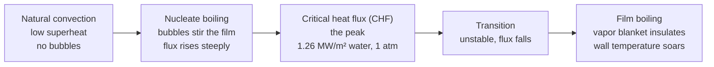
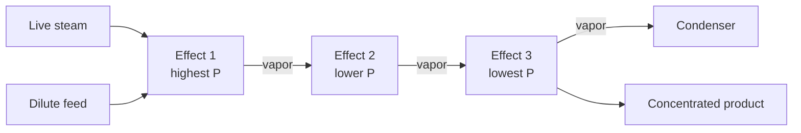

## Video Lecture

<div class="video-container">
  <iframe
    width="560"
    height="315"
    src="https://www.youtube.com/embed/fpjFV6KX1hc?start=1509"
    title="Chemical Engineering Heat Transfer Ch.3: Boiling, Condensation, and Evaporators"
    allow="accelerometer; autoplay; clipboard-write; encrypted-media; gyroscope; picture-in-picture"
    allowfullscreen>
  </iframe>
</div>

> This video covers the same content as the text below. Choose your preferred learning format.

---

# Chapter 3: Boiling, Condensation, and Evaporators

The first two chapters moved heat into and out of fluids that stayed liquid or stayed gas. Let them change phase and the coefficients can rise substantially while a new class of hazards — dryout, burnout, overheating — appears: nucleate boiling is exceptionally effective heat transfer under suitable conditions, right up to the point where it fails catastrophically.

**Phase Change: The Best and Most Dangerous Heat Transfer**

## Learning Objectives

By completing this chapter, you will be able to:

  * ✅ Explain why latent heat commonly dominates the duty of reboilers, condensers, and evaporators, alongside coefficients and driving forces
  * ✅ Order the boiling curve and anchor its critical heat flux for water at 1 atm from a cited correlation
  * ✅ Recognize burnout as a particular hazard where heat input is approximately imposed
  * ✅ Distinguish filmwise from dropwise condensation, size the penalty for booking dropwise as a design value, and explain why noncondensables cripple a condenser
  * ✅ Compute steam economy for a multiple-effect evaporator, tell its live-steam duty from its surface duty, and state which parts of the result are idealized
  * ✅ Identify a bottom reboiler as a boiling exchanger and name two of its classic failure modes

**Reading Time**: 20-25 minutes **Code Examples**: 1 **Exercises**: 3

* * *

## 3.1 Why Phase Change Dominates

**Diagnostic.** For a train boiling **10,000** kg/h of water, Section 3.4's table gives six effects a live-steam figure of **1,961** kg/h and **1.23** MW, against **11,765** kg/h and **7.38** MW for a single effect. An engineer sizes the six-effect exchangers for 1.23 MW. By what factor is the surface short, and which quantity did that column never measure? Answer at Section 3.4.

[Thermodynamics Chapter 1](../chemical-engineering-thermodynamics/chapter-1.html) supplied this chapter's arithmetic. Water's latent heat of vaporization at 101.325 kPa is **2256.5** kJ/kg and its saturation temperature there is **99.97** °C; its liquid specific heat, at 40 °C, is **4.178** kJ/(kg·K). All three are IAPWS-97 values, computed and asserted by this chapter's script rather than read off a table. Divide the first by the third and the ratio is a temperature: $2256.5 \div 4.178 =$ **540** K, an order-of-magnitude statement: the two are not at the same state. Condensing one kilogram of steam releases as much energy as cooling one kilogram of liquid water through 540 K — a swing no liquid water could survive. Latent heat often dominates these duties per unit mass, though whether a given service carries a plant's largest duty depends on the sensible temperature intervals involved.

It is also where the *coefficient* is. The same script computes a forced-convection water film inside a 15.75 mm tube from Dittus–Boelter (correlation and applicability range in the Sources table): **5,261** W/(m²·K) at 1.0 m/s, **9,160** at 2.0 m/s. Nucleate boiling and favourable condensation can give coefficients well above that, the ratio depending on regime and geometry: film condensation and film boiling can fall to or below these forced-water values. **This chapter quotes no band for them**: the figures in circulation carry no primary source in this repair's ledger, and nothing below is computed from one. Two mechanisms explain the leap: bubbles growing and detaching violently stir the thermal boundary layer that otherwise insulates the wall, and a pure vapor condensing at constant pressure gives up its latent heat at essentially constant temperature, so the condensing side does not cool along the surface — the local driving force still falls wherever the coolant warms, and a mixture condenses with a glide.

The design consequence is direct. In the overall coefficient from [Chapter 1](chapter-1.html),

$$ \frac{1}{U} = \frac{1}{h_i} + \frac{L}{k} + R_f + \frac{1}{h_o} $$

(the fouling resistances of both sides lumped into one $R_f$, on a common area basis or a thin-wall approximation), a phase-changing side often contributes a small resistance, so the *other* side — or the fouling layer — controls the exchanger. Often, not always: film condensation, film boiling, viscous or mixed liquids and gas-contaminated condensation can put the phase-changing side in control, so compare its coefficient with the others before neglecting it. Reboilers, condensers, and evaporators are built around phase change because it moves the most energy through the least area. Section 3.6 is what happens when a side is booked as vanishing before it has earned it.

## 3.2 The Boiling Curve

Immerse a heated surface in a pool of saturated liquid and raise the wall above the saturation temperature. That difference, the **wall superheat** $\Delta T_{\text{sat}} = T_{\text{wall}} - T_{\text{sat}}$, is the driving force; the heat flux $q''$ in W/m² is the response. Plot one against the other and you have the **boiling curve** — not monotonic, which is the entire point.



At low superheat nothing boils: liquid warms, rises, and circulates by **natural convection** alone. Raise the superheat and bubbles nucleate at scratches and cavities, grow, and detach. This is **nucleate boiling**, the sweet spot — bubble growth and departure drive liquid cooler than the wall back onto the surface, alongside evaporation and transient conduction, so the flux climbs steeply for a modest rise in superheat.

The climb ends. On one physical reading of pool-boiling CHF, bubbles become numerous enough to merge into sheets and fresh liquid can no longer reach the surface between them; the mechanism depends on geometry, flow, wetting and conditions. Either way the curve turns over at the **critical heat flux (CHF)** — the maximum flux nucleate boiling can sustain. In the hydrodynamic-stability family of correlations that begins with Zuber,

$$ q''_{\max} = 0.149\,h_{fg}\,\rho_v^{1/2}\,\bigl[\sigma g (\rho_l - \rho_v)\bigr]^{1/4} $$

evaluated with IAPWS-97 saturated-water thermodynamic properties and the separate IAPWS surface-tension release at 1 atm, gives **1.26** MW/m². The leading coefficient printed here is **0.149**, the value associated with the later Lienhard–Dhir modification for large flat horizontal heaters, not the classical Zuber–Kutateladze value of about 0.131; the classical coefficient, on the same properties, gives a peak lower in the same proportion. Either way the result is the prediction of one saturated-pool-boiling correlation for its own geometry, not a universal CHF for water at this pressure — orientation, size, surface condition, subcooling and flow all move it. The order-of-magnitude anchor this chapter carried before this revision, 1 MW/m², is $1 \div 1.26 =$ **0.79** of it — honest as a magnitude, low as an estimate. Past the peak lies **transition boiling**, where vapor patches form and collapse and the flux actually *falls* as superheat rises, and beyond it **film boiling**, a vapor blanket separating liquid from wall. Vapor conducts poorly, so the coefficient is far below the nucleate branch; but on the stable film-boiling branch the flux *rises* again with superheat, and radiation becomes substantial at high wall temperature. The falling branch is transition boiling, not film boiling.

**The superheat axis carries no numbers here, deliberately.** Placing the onset of nucleate boiling, the CHF peak and the Leidenfrost minimum on the abscissa needs measured wall superheats for a specified surface, geometry and experimental protocol — fluid and pressure alone do not fix them. They exist; no primary source for them was in hand at this revision, so they are omitted rather than estimated. Read the curve as *ordered* on the superheat axis and *anchored* on the flux axis — the one a designer holds a margin on anyway.

Whether the deterioration is survivable depends on what is controlled. A steam-heated exchanger approximates a **temperature-limited** source, the condensing steam fixing the heating-fluid temperature and, where the intervening resistances are small, nearly fixing the wall: past CHF the flux drops, the equipment underperforms, an operator notices. A fired heater tube, an electric immersion heater or a nuclear fuel rod approximates **imposed heat input**, at least until controls, feedback or protection respond — the burner keeps firing, the current keeps flowing, whatever the surface is doing. The free variable is then wall temperature, and it can rise rapidly and by hundreds of kelvin to force the same flux through an insulating vapor film. That is **burnout**: overheating damage, up to and including melted hardware. The design rule follows the mechanism — where heat input is approximately imposed, stay inside nucleate boiling with a margin against a CHF or dryout prediction *validated for the actual geometry and flow*. The 1.26 MW/m² above is a saturated-pool-boiling number and is not that limit for a fired tube or a fuel rod.

## 3.3 Condensation

Condensation runs the same physics backward, and its subdivision matters. In **filmwise condensation** the liquid wets the surface and drains as a continuous film. That film commonly supplies the major resistance — classical laminar-film theory has every joule conducting through it — so on a vertical surface the local coefficient falls as the film thickens downstream, though vapor shear, waves, turbulence and orientation change that trend. In **dropwise condensation** the surface is non-wetting, so droplets form, grow and roll off, renewing the exposed surface; no persistent macroscopic film establishes and the coefficient is higher, while droplets and any promoter layer still contribute some resistance. *How much* higher is not quoted here: the multiplier in circulation carries no source in this repair's ledger, and Section 3.6 shows the design argument does not need it.

Dropwise enhancement is not credited without service-relevant evidence of durability: sustaining it needs promoters or coatings that can erode, oxidize or wash away, after which the surface reverts to filmwise. Durability varies widely with chemistry, substrate and service, and no general lifetime is quoted here. **Design filmwise and treat any dropwise behavior as an unbooked bonus** — Section 3.6 sizes what booking it costs.

One contaminant destroys all of this: **noncondensable gases**, meaning any species that will not condense at the operating conditions — air leaking into a vacuum condenser, blanketing nitrogen, dissolved gases from the feed. Vapor flowing toward the wall carries them along, but only the vapor condenses, so they build up in a stagnant layer through which incoming vapor must then *diffuse* — and diffusion is slow. A small volume fraction of air can come to dominate the condensing resistance; sizing that effect is a mass-transfer calculation this chapter does not do, and no multiplier for it is quoted. Hence the provision for removing noncondensables wherever they can accumulate — a **vent**, and ejectors on vacuum service. A condenser that has quietly stopped performing may be air-bound rather than fouled, and performance can recover quickly once the gas is removed, provided the leak or failed extraction behind it is also dealt with.

## 3.4 Evaporators and Steam Economy

A steam-heated **evaporator** concentrates an aqueous solution by boiling water out of it, and it is both previous sections in one shell: steam condensing on one side, process liquor boiling on the other, separated by tube wall. (Other evaporators remove other solvents and are heated electrically, by hot fluid or by direct contact.) In the simplified model used here — feed entering at its boiling point, negligible heat of mixing, losses and flashing — there is no sensible term, so the duty is latent alone:

$$ Q = \dot{m}\lambda $$

with $\dot{m}$ the evaporation rate and $\lambda$ the latent heat of vaporization.

The economics reduce to one ratio. **Steam economy** is kilograms of vapor evaporated per kilogram of live steam consumed:

$$ \text{steam economy} = \frac{\text{kg vapor evaporated}}{\text{kg live steam consumed}} $$

A **single-effect** evaporator condenses one kilogram of steam to evaporate roughly one kilogram of water — economy ≈ 1, an idealization resting on the two latent heats being nearly equal and ignoring losses and feed preheating.

The improvement is to use that vapor twice. It still carries essentially all the latent heat that made it, so if the second effect is held at a **low enough pressure** that its liquor boils at a **lower temperature** — far enough below to clear the solution's boiling-point elevation and leave a usable driving force ([Thermodynamics Chapter 3](../chemical-engineering-thermodynamics/chapter-3.html): saturation temperature follows pressure) — the first effect's vapor is hot enough to heat it. Chain $N$ effects at falling pressures and, idealized, economy approaches $N$.



```python
LAMBDA = 2257.0      # kJ/kg, latent heat of water at 100 C, 1 atm; 4 s.f. form of IAPWS-97's 2256.5
EVAP = 10_000.0      # kg/h of water to be evaporated
ETA = 0.85           # ILLUSTRATIVE per-effect factor, NOT a measured constant

EVAP_DUTY = EVAP * LAMBDA / 3600.0 / 1000.0   # MW that must cross tube wall - the same for every N


def economy_ideal(n):
    """Idealized steam economy [kg vapor / kg steam]: N effects, N times the duty."""
    return float(n)


def economy_derated(n):
    """Same trend with an illustrative constant derating factor applied."""
    return ETA * n


def steam_demand(evap, economy):
    """Live steam required [kg/h] to evaporate `evap` kg/h at the given economy."""
    return evap / economy


print(f"{'effects':>7} {'ideal':>7} {'derated':>8} {'steam kg/h':>11} {'live steam MW':>14} {'evap duty MW':>13} {'vs 1-effect':>12}")
base = steam_demand(EVAP, economy_derated(1))
for n in range(1, 7):
    econ = economy_derated(n)
    steam = steam_demand(EVAP, econ)
    live = steam * LAMBDA / 3600.0 / 1000.0   # live steam into effect 1 ONLY, not the surface duty
    saving = (1.0 - steam / base) * 100.0
    print(f"{n:7d} {economy_ideal(n):7.2f} {econ:8.2f} {steam:11.0f} {live:14.2f} {EVAP_DUTY:13.2f} {saving:11.1f}%")

# effects   ideal  derated  steam kg/h  live steam MW  evap duty MW  vs 1-effect
#       1    1.00     0.85       11765           7.38          6.27         0.0%
#       2    2.00     1.70        5882           3.69          6.27        50.0%
#       3    3.00     2.55        3922           2.46          6.27        66.7%
#       4    4.00     3.40        2941           1.84          6.27        75.0%
#       5    5.00     4.25        2353           1.48          6.27        80.0%
#       6    6.00     5.10        1961           1.23          6.27        83.3%
```

**The two duty columns are different quantities — this is the Diagnostic's answer.** `live steam MW` is the heat the *live steam* delivers to effect 1, and it falls as $1/N$ because that is the whole purpose of the train. `evap duty MW` is the aggregate latent evaporation duty for 10,000 kg/h in this model, $10{,}000 \times 2257 \div 3600 =$ **6.27** MW, and it is the same at every $N$: a train re-uses the same latent heat $N$ times, it does not evaporate less water. Real trains also flash hot feed, liquor and condensate and carry sensible loads, which this model neglects. Size a six-effect train's surface on the 1.23 MW and the duty ratio is wrong by the derated economy, $0.85 \times 6 =$ **5.10**; that is an area shortfall only under the further assumption that every effect works at the same $U\Delta T$, and a real train is sized effect by effect. At $N = 1$ the columns read the other way round — 7.38 MW against 6.27 MW, the $7.38 - 6.27 =$ **1.11** MW difference being the 0.85 derating, an illustrative assumption and not a measured loss.

Capital moves opposite to steam. Split the available temperature difference evenly among $N$ effects and each gets $\Delta T_{\text{tot}}/N$ while carrying $Q_{\text{tot}}/N$ of duty, so each needs about the area the single-effect unit would: **total area grows roughly with $N$ while, in this simplified equal-latent-heat model, live steam falls about as $1/N$.** Read the rest of the table for its *shape*, not its digits. The 0.85 factor is an **illustrative overall derating factor, inserted to show that losses and feed heating commonly pull real economies below the ideal $N$** — not a measured constant, and not a model of a sequential per-effect loss, since the code applies it once to the ideal total. Economy can also exceed $N$ where hot feed flashes or additional heat is recovered. What survives it is the diminishing return: one effect to two saves 50% of the steam, five to six barely three points more. This chapter quotes no typical effect count for real trains, having no source for one; Exercise 3 works the economic trade-off that sets it.

A different route upgrades the vapor instead of cascading it. **Mechanical vapor recompression (MVR)** compresses the evaporated vapor until it can heat its own effect. The compressor consumes shaft work — the precious commodity of [Thermodynamics Chapter 2](../chemical-engineering-thermodynamics/chapter-2.html) — and for a modest temperature lift the pressure ratio is small, so that work can be a small fraction of the latent heat recycled. Boiling-point elevation, exchanger approach, pressure losses and compressor inefficiency all raise the ratio and the work.

## 3.5 The Reboiler Connection

Most conventional distillation columns end in a boiling exchanger, though some take vapor from direct steam injection or a vapor feed instead. The **reboiler** vaporizes liquid at the column base to generate the vapor traffic that reflux demands ([Introduction Chapter 4](../chemical-engineering-introduction/chapter-4.html)), so at otherwise comparable conditions a higher reflux ratio means a higher boilup and duty, and a column's energy bill is argued over it. Two configurations dominate. A **kettle** submerges a tube bundle in a liquid pool inside an oversized shell, boiling into the vapor space above: simple, tolerant, high vaporization per pass. A **thermosiphon** lets boiling itself lower the fluid's density and drive circulation from the column sump — no pump, and often less holdup and shorter residence time than a kettle, which can suit heat-sensitive material depending on the circulation system and layout.

Two failure modes recur, and they are distinct phenomena that can also occur separately. **Fouling** deposits a low-conductivity layer that raises the metal temperature needed for a given duty; where the deposit thermally degrades the product it can become a self-accelerating loop, while crystallization, particulate and corrosion fouling have no such feedback. **Boiling deterioration** follows when the superheat at the liquid-facing surface is pushed too far. Raising steam pressure to hold duty through a deposit does not by itself force that — most of the extra temperature drop falls across the deposit, and the flux is unchanged — so the coupling runs through altered local wetting and flux distribution, not through the steam pressure alone. Once past the peak the duty *falls* as superheat rises on the transition branch, and the instinct to add more steam makes it worse.

Fluid mechanics sets the last constraint. Column bottoms are commonly close to saturation at the column pressure, so the free surface itself gives the pump no margin between suction pressure and vapor pressure — the **NPSH** problem of [Fluid Mechanics Chapter 5](../chemical-engineering-fluid-mechanics/chapter-5.html). What margin there is comes from static head, less the suction-line losses. This is why column sumps sit high above their pumps: with a near-saturated liquid the available NPSH has to be designed for deliberately.

## 3.6 Where This Goes Wrong

**Booking a dropwise coefficient as a design value.** A condenser carries cooling water inside the tubes at a design film coefficient of **8,000** W/(m²·K) — between Section 3.1's computed **5,261** at 1.0 m/s and **9,160** at 2.0 m/s — and its condensing side runs dropwise on a clean test unit. The duty is Exercise 2's **626.8** kW across a 15 K driving force.

**Wrong:** book the dropwise behavior. The condensing resistance is negligible against the water side, so size on the water side alone — $U =$ **8,000** W/(m²·K), and $626{,}800 \div (8{,}000 \times 15) =$ **5.22** m².

**Right:** take the illustrative degradation scenario in which the promoter erodes, the surface reverts filmwise, and the condensing film is a resistance in series thereafter unless the surface is restored. With an illustrative filmwise coefficient of **5,000** W/(m²·K) — declared here with no source, used only to make the comparison concrete — $1/U = 1/8{,}000 + 1/5{,}000 = 0.000125 + 0.0002 =$ **0.000325** m²·K/W, so $U =$ **3,077** W/(m²·K) and the same duty needs $626{,}800 \div (3{,}077 \times 15) =$ **13.6** m².

The penalty is $8{,}000 \div 3{,}077 =$ **2.60**, and its structure survives any argument about the 5,000: the wrong sizing neglects the condensing resistance entirely, which is the limit of an *infinite* condensing coefficient and therefore an upper bound on $U$ that no finite dropwise coefficient reaches. The unit is left at $1 \div 2.60 \times 100 =$ **38.5** % of the area it needs, and the shortfall is least apparent at commissioning, while the dropwise coefficient is still high enough to hide it. That is the argument for designing filmwise.

## 3.7 Exit Check

Five readings a phase-change duty owes before the area is bought.

1. **Which heat** — latent, sensible, or both? Exercise 2's feed enters at its boiling point, so $Q = \dot{m}\lambda$ with no sensible term: $1{,}000 \times 2256.5 \div 3600 =$ **626.8** kW, kJ/kg against kg/s giving kW.
2. **Which duty** — does the number being sized on actually cross tube wall? Section 3.4's live-steam column falls to **1.23** MW at six effects; the surface duty is **6.27** MW at every $N$. Sizing on the wrong column is short by $0.85 \times 6 =$ **5.10**.
3. **Which variable is held** — approximately imposed flux, or a temperature-limited source? A steam coil past CHF underperforms; an imposed-power heater risks uncontrolled overheating. The margin to hold is a flux margin against a CHF or dryout prediction validated for the actual geometry and flow — **1.26** MW/m² is the saturated-pool-boiling correlation value, not that limit.
4. **Which resistances are in series** — is the phase-changing side booked at a coefficient the surface will still have in a year? 8,000 alone against 8,000 with 5,000 in series is $U =$ **8,000** against **3,077** W/(m²·K), a factor **2.60** in area.
5. **Provenance** — does every number name its source? $\lambda$, $T_{\text{sat}}$, $c_p$ and CHF from IAPWS-97 and Zuber through `ch06_repair.py`; $\eta = 0.85$, $U = 2{,}500$ and the 5,000 declared illustrative; **no superheat anchor quoted, because none is sourced**.

## 3.8 Chapter Summary

1. **Latent heat dwarfs a typical sensible interval**: **2256.5** kJ/kg equals **4.178** kJ/(kg·K) over $2256.5 \div 4.178 =$ **540** K, which is why phase-change equipment moves large energy per unit mass — though a furnace or other sensible service can still carry a plant's largest duty
2. Nucleate boiling and favourable condensation can sit **well above** the single-phase water films of **5,261**–**9,160** W/(m²·K) computed at 1.0–2.0 m/s, so the phase-changing side often does not control $U$ — compare the actual resistances for the regime at hand, because film boiling and film condensation can control it; no band is quoted, because none is sourced
3. The **boiling curve** runs natural convection → nucleate boiling → **critical heat flux** → transition → **film boiling**; the hydrodynamic-stability correlation, evaluated on IAPWS properties with the printed **0.149** coefficient (the large-flat-heater modification; the classical Zuber value near 0.131 gives a proportionally lower peak), puts the saturated-pool-boiling peak for water at 1 atm at **1.26** MW/m², against the **1** MW/m² this chapter used to carry. The superheat axis is ordered, not scaled — those anchors are unsourced, therefore absent
4. **Burnout** is the particular risk where heat input persists after heat-transfer deterioration: fired tubes, uncontrolled electric heaters and fuel rods do not shed the flux by themselves, so wall temperature rises sharply past CHF — design with margin inside nucleate boiling, against a configuration-specific limit
5. Condensers are designed **filmwise** unless dropwise durability is evidenced; neglecting the condensing resistance altogether is the upper bound on $U$ that the wrong sizing takes — **8,000** against **3,077** W/(m²·K), **2.60** times too little area, **38.5** % of what the duty needs
6. **Noncondensables** accumulate at the condensing surface and force vapor to diffuse through them — hence vents and ejectors
7. **Steam economy** is kg vapor per kg steam: ≈ 1 single-effect, approaching the ideal benchmark $N$ and commonly falling short of it once losses and feed heating count; area grows with $N$ while live steam falls about as $1/N$ in this simplified model, and **MVR** offers an alternative saving whose shaft work follows the temperature lift and compressor efficiency
8. **The live-steam duty is not the aggregate evaporation duty**: **7.38** MW down to **1.23** MW across one to six effects, against a constant **6.27** MW of latent evaporation at every $N$ in this model — size on the falling column and the duty ratio is wrong by **5.10**, with the individual effect areas still to be computed from their own duties and driving forces
9. **Reboilers** are boiling exchangers — **kettle** and **thermosiphon** are the common designs — with **fouling** and **boiling deterioration** as distinct possible problems that can couple, and near-saturated bottoms liquid an NPSH constraint

**Next chapter**: every mechanism so far — conduction, convection, boiling, condensation — has needed matter in contact with matter. [Chapter 4](chapter-4.html) takes up **radiation**, which needs nothing at all, crosses vacuum, and whose blackbody emissive power scales with the fourth power of absolute temperature — net exchange between real surfaces needing emissivities and view factors on top — the mechanism that dominates a fired heater's radiant section.

## Exercises

1. **Conceptual — the two ways to cross CHF**: An electric immersion heater and a steam-heated coil both boil water at 1 atm in the same vessel, and each is pushed past the critical heat flux. (a) What happens to the wall temperature of each? (b) Why is only one destroyed? (c) A reboiler is fouling and the operator raises steam pressure to hold the duty. What does the boiling curve predict?
   *Hint*: ask which variable each device holds fixed — heat flux or wall temperature — and then read the boiling curve for the one that is left free to move.
   *Answer*: (a) The **steam coil** limits the source temperature to roughly the condensing steam temperature, and where the intervening resistances are small the wall follows it. Past CHF the curve turns over, so the **flux falls**; the coil underperforms but the metal stays near steam temperature. Take the **electric heater** as an uncontrolled constant-power device — real electrical boundary conditions may be constant power, voltage, current or controlled temperature — so no point on the nucleate branch can pass the imposed flux, the operating point moves to the film-boiling branch, and **wall temperature can rise sharply, by hundreds of kelvin**, to drive that flux through an insulating vapor film. (b) In this idealized comparison the imposed-power device carries the greater risk of uncontrolled overheating: it does not shed the energy it is committed to delivering, while the temperature-limited device is **self-limiting** — which is why steam heating is generally the safer utility, provided the steam temperature itself is safe for the metal and the product. (c) Fouling raises the metal temperature needed for a given duty; more steam pressure restores the duty largely by raising the drop across the deposit, so it does not by itself raise the liquid-facing superheat. Separate metal, deposit and liquid-interface temperatures before claiming a march toward the peak, and check local flux and wetting. If the boiling side has deteriorated, duty **falls as superheat rises** on the transition branch and adding steam makes it worse. Restore safe operation first — reduce heat input, restore circulation or level — then diagnose, and clean when fouling is confirmed.

2. **Quantitative — evaporator duty and area**: An evaporator must vaporize **1,000 kg/h** of water at 1 atm from a feed already at its boiling point. Take $\lambda = 2256.5$ kJ/kg (IAPWS-97). (a) Compute the duty in kW. (b) With $U = 2{,}500$ W/(m²·K) — an illustrative premise, not a sourced coefficient — and $\Delta T =$ **15 K**, compute the heat-transfer area. (c) The steam supply degrades and $\Delta T$ falls to 10 K. What area would the same duty need?
   *Hint*: duty is $\dot{m}\lambda$ with units reconciled (kg/h → kg/s); then $A = Q/(U\,\Delta T)$ from [Chapter 1](chapter-1.html).
   *Answer*: (a) $Q = 1000 \times 2256.5 / 3600 =$ **626.8 kW ≈ 627 kW** — the feed enters at its boiling point, so there is no sensible term. (b) $A = 626{,}800 / (2500 \times 15) =$ **16.7 m²**. (c) $A = 626{,}800/(2500 \times 10) =$ **25.1 m²**, a 50% increase in surface for the same job. Area is inversely proportional to $\Delta T$, which is why losing driving force is expensive — and why multiple-effect trains, which divide the available $\Delta T$, pay for their steam savings in steel.

3. **Discussion — how many effects, and when to recompress**: A plant evaporating 10,000 kg/h of water is choosing between a single effect, a four-effect train, and MVR. (a) Using the Section 3.4 output, what steam saving does four effects buy, and why is ten effects rarely built? (b) What does the 0.85 factor represent, and what may it not be used for? (c) When does MVR beat a multiple-effect train? (d) The four-effect row reads 1.84 MW of live steam and 6.27 MW of evaporation duty. Which sizes the exchangers, and what is each effect's share?
   *Hint*: for (a) compare the steam trend against how total area behaves as $N$ grows; for (c) compare a kilowatt-hour of electricity against one of steam; for (d) ask what the vapor leaving effect 1 is used for.
   *Answer*: (a) Four effects cut live steam by **75%** (11,765 → 2,941 kg/h in the table). Two effects push back against very large $N$: the *marginal* saving shrinks — five to six effects saves only 3.3 further percentage points — while total area keeps growing roughly in proportion to $N$, since each effect receives only $\Delta T_{\text{tot}}/N$ of driving force and so needs about the area of the single-effect unit. Where that makes an extra effect uneconomic depends on energy prices, capital costs and the available temperature span; there is no universal prohibition at ten, and this chapter quotes no typical count. There is also a hard floor: the total $\Delta T$ between supply steam and the final condenser is fixed, and boiling-point elevation eats part of it in every effect. (b) It is an **illustrative derating assumption**, inserted only to show that real economies fall below the ideal $N$. It is not measured and must **not** be used to size equipment or to quote a guaranteed economy. The effects it stands in for are of different kinds: heat losses through insulation, sensible enthalpy terms such as feed heating and condensate subcooling, and boiling-point elevation, which consumes driving force rather than heat. (c) MVR is favoured where **electricity is cheap relative to steam**, where boiling-point elevation is small (the compressor then needs only a small pressure ratio, hence little work), and where fewer thermal effects are worth having — though the compressor, vapor ducts, separators and surface can still be large. Compare annualized costs from the actual compressor work and the avoided steam. It is disfavoured where power is expensive, where compressor maintenance in a fouling or corrosive service is a liability, or where the site has surplus low-pressure steam a train can absorb at low marginal cost. (d) The **6.27 MW** of aggregate latent evaporation, not the 1.84 MW of live steam, is the quantity the surface must deliver: every kilogram of the 10,000 kg/h is boiled across a tube wall somewhere in the train, while 1.84 MW is only what live steam brings into effect 1 — effects 2 to 4 are heated by the vapor their predecessors made. In this equal-share model each effect carries about $6.27 \div 4 =$ **1.57** MW across about a quarter of the driving force, which is why four effects need roughly four times the area of one, not a quarter. A real train divides the duty unequally, flashes some of it, and is sized effect by effect from each effect's own balance.

## Sources

Every number above is a DISPLAY string of `calc/ch06_repair.py` in the *Heat Transfer* sources directory, transcribed character for character, or is arithmetic performed here on those strings and shown in full. A value that no longer matches a re-run of that script is corrected in the script, never here. The external formulations and references the script takes from outside are listed below:

| Source | Quoted basis |
|---|---|
| IAPWS-97 (IAPWS R7-97(2012), with R12-08 viscosity, R15-11 conductivity, R1-76 surface tension), evaluated through the `iapws` Python package 1.5.5, [github.com/jjgomera/iapws](https://github.com/jjgomera/iapws) (accessed 2026-09-08) | $\lambda =$ **2256.5** kJ/kg and $T_{\text{sat}} =$ **99.97** °C at 101.325 kPa; $c_p =$ **4.178** kJ/(kg·K); the saturated liquid and vapor densities and the surface tension that enter the CHF evaluation; the water properties behind the Dittus–Boelter films of **5,261** and **9,160** W/(m²·K) |
| Zuber, N. (1958), "On the stability of boiling heat transfer", *Trans. ASME* **80**, 711–720 | The hydrodynamic-stability form of the critical-heat-flux correlation for saturated pool boiling. The leading coefficient printed in this chapter, **0.149**, is not Zuber's classical value (about 0.131) but the later large-flat-horizontal-heater modification associated with Lienhard and Dhir, for which no separate citation is pinned here — an open citation debt. The **1.26** MW/m² is this script's evaluation of the printed form on IAPWS properties (thermodynamics from IF97, surface tension from the separate IAPWS release), not a value read from any paper |
| Dittus, F. W. and Boelter, L. M. K. (1930), *Univ. California Publ. Eng.* **2**, 443; applicability range from McAdams, W. H., *Heat Transmission*, 3rd ed. (McGraw-Hill, 1954), Ch. 9 | the original 1930 work, which used separate prefactors for heating and cooling; the $\mathrm{Nu} = 0.023\,\mathrm{Re}^{0.8}\mathrm{Pr}^{0.4}$ form used here is the later textbook modification commonly associated with McAdams, its **Pr exponent 0.4 applying to a fluid being heated** (0.3 for cooling), with the stated range $\mathrm{Re} > 10^4$, $0.7 < \mathrm{Pr} < 160$, $L/D > 10$, fully developed turbulent flow in smooth circular tubes at modest property variation — the correlation behind the single-phase films quoted in Section 3.1 |
| BIPM, *SI Brochure*, 9th ed. (2019), Table 8 | 1 h = 3600 s, the unit conversion in every duty above |

## Number provenance

**Tier A — computed and asserted by `ch06_repair.py`**, quoted here by DISPLAY key: `latent_heat_100c_kj_per_kg` **2256.5**, `saturation_temperature_1atm_c` **99.97**, `water_40c_cp_kj_per_kg_k` **4.178**, `db_h_1p0_m_per_s_w_per_m2_k` **5261**, `db_h_2p0_m_per_s_w_per_m2_k` **9160**, `db_correlation` and `db_validity_range`, `db_tube_inside_diameter_mm` **15.75**, `design_film_coefficient_w_per_m2_k` **8000**, `chf_zuber_mw_per_m2` **1.26**, `chf_textbook_anchor_mw_per_m2` **1**, `total_evaporator_duty_mw` **6.27**, `live_steam_duty_effect1_mw_n1` **7.38**, `live_steam_duty_effect1_mw_n6` **1.23**, `water_property_source`.

Everything else numeric in this chapter is arithmetic on those strings, written out where it appears: $2256.5 \div 4.178 =$ **540** K; $1 \div 1.26 =$ **0.79**; the six rows of the Section 3.4 table, which the code block reproduces from `LAMBDA`, `EVAP` and `ETA` alone; $0.85 \times 6 =$ **5.10** and $7.38 - 6.27 =$ **1.11** MW; $1/8{,}000 + 1/5{,}000 =$ **0.000325** m²·K/W with $U =$ **3,077** W/(m²·K), $8{,}000 \div 3{,}077 =$ **2.60**, $1 \div 2.60 \times 100 =$ **38.5** %, and the areas **5.22** and **13.6** m²; Exercise 2's **626.8** kW, **16.7** and **25.1** m²; Exercise 3's **1.57** MW. `chf_textbook_anchor_mw_per_m2` is carried as the **superseded** value and is labelled as such wherever it appears.

**Tier B — cited, not measured**: the IAPWS-97 formulation, Zuber's correlation *form*, the Dittus–Boelter correlation and its McAdams applicability range, and 1 h = 3600 s. All four are in the Sources table. The correlations are published algebra: the citation supports the form, and every number quoted from them is this script's evaluation of that form at these conditions.

**Tier C — four illustrative inputs, said plainly.** None is a measurement, and every numerical equipment outcome derived from them — the train's area ratio, the condenser's area penalty, the commissioning argument — is a conditional illustration rather than a prediction for actual equipment.

| Input | Value | Status |
|---|---|---|
| Per-effect derating $\eta$ | **0.85** | Declared ILLUSTRATIVE in the code comment, in Section 3.4 and in Exercise 3(b). Inserted only to show that real economies fall below $N$; it may not be used to size equipment or to quote a guaranteed economy |
| Evaporator $U$ (Exercise 2) | **2,500** W/(m²·K) | An exercise premise with no source; the exercise teaches $A = Q/(U\Delta T)$, and every answer scales with it |
| Filmwise condensing coefficient (Section 3.6) | **5,000** W/(m²·K) | Chosen only to make the series-resistance comparison concrete. The **2.60** moves with it; what does not move is that the "wrong" sizing is the infinite-coefficient limit, hence an upper bound on $U$ |
| Example flows and driving forces | **10,000** and **1,000** kg/h; **15** K and **10** K | Problem statements, chosen for round arithmetic |

**Removed at this revision rather than sourced.** Six unsourced values the published chapter carried are deleted, and none is replaced by an estimate: the **2,500–100,000** W/(m²·K) phase-change coefficient band; the **5,000–15,000** W/(m²·K) steam-condenser design range; the "severalfold" multiplier for noncondensable air; the "several times higher" multiplier for dropwise against filmwise; the **two to six** effects a train settles at; and the wall-superheat anchors for the onset of nucleate boiling, the CHF peak and the Leidenfrost minimum. The last of these is why Section 3.2 says outright that its abscissa carries no numbers: such anchors have been measured, but only for particular surfaces and protocols, and a number without a source is not written here. For the same reason the order-of-magnitude comparison between phase-change and single-phase coefficients in Sections 3.1 and 3.8 is now stated as a regime-dependent tendency rather than a fixed ratio, and no coating lifetime is quoted in Section 3.3.
