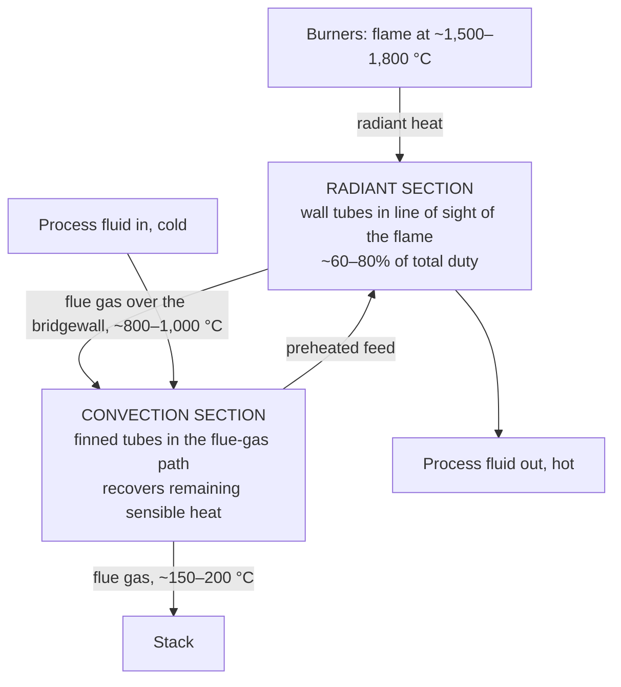

## Video Lecture

<div class="video-container">
  <iframe
    width="560"
    height="315"
    src="https://www.youtube.com/embed/fpjFV6KX1hc?start=2311"
    title="Chemical Engineering Heat Transfer Ch.4: Radiation and Furnaces"
    allow="accelerometer; autoplay; clipboard-write; encrypted-media; gyroscope; picture-in-picture"
    allowfullscreen>
  </iframe>
</div>

> This video covers the same content as the text below. Choose your preferred learning format.

---

# Chapter 4: Radiation and Furnaces

This chapter takes up the third mechanism of heat transfer — the one that needs no material to travel through. Radiation is a substantial term even on a warm pipe in still air — this chapter's own model gives it **36.4%** of the loss at 60 °C — and it is the central consideration in a fired heater's radiant section; how its share climbs with temperature is the story here.

**Heat That Needs No Medium**

## Learning Objectives

By completing this chapter, you will be able to:

  * ✅ Explain why radiation, unlike conduction and convection, crosses a vacuum
  * ✅ Apply the Stefan–Boltzmann law $E = \varepsilon \sigma T^4$ and justify the use of absolute temperature
  * ✅ Estimate net exchange from emissivity, choosing the small-object or two-surface form by the geometry
  * ✅ Judge radiation's relative importance from temperature together with emissivity, surroundings, geometry and the convective coefficient
  * ✅ Describe the radiant and convection sections of a process fired heater and what limits each
  * ✅ Name view factor and tube-skin temperature and say what each one governs

**Reading Time**: 20-25 minutes **Code Examples**: 1 **Exercises**: 3

* * *

## 4.1 The Third Mechanism

**Diagnostic.** A vacuum-jacketed cryogenic line has no gas between its walls, and the inner one is wrapped in aluminized foil at $\varepsilon \approx 0.05$ facing an outer wall near $\varepsilon \approx 0.8$. By what factor does the foil cut the radiant leak?

The ratio of the emissivities, $0.8/0.05 =$ **16**, is the tempting answer and the wrong one — right for a pipe in a large room, wrong for two walls that see only each other, where the real factor is **13.5**, or **26.0** with both foiled. Radiation is where the *geometry* picks the equation, with the radiative properties of the surfaces deciding which idealization — gray, diffuse, opaque, participating gas — is admissible; Section 4.3 draws the boundary.

[Chapter 1](chapter-1.html) built the overall heat transfer coefficient out of two mechanisms. **Conduction** passes energy through a material by microscopic interaction — molecular collisions, lattice vibrations, and in metals mobile electrons; **convection** carries it away in moving fluid. Both need matter; take it away and both stop.

Radiation does not stop. Every surface with nonzero emissivity emits electromagnetic waves once it is above absolute zero, and those travel through nothing at all. The proof arrives every morning: sunlight crosses 150 million kilometers of vacuum to warm a rooftop. Nothing conducts and nothing convects across that gap, and at the standard terrestrial reference condition roughly a kilowatt per square meter arrives (the ASTM G173-03 global-tilt AM1.5 reference spectrum integrates to 1,000.4 W/m²; an actual rooftop depends on orientation, atmosphere and weather).

The awkward part is that radiation's importance varies with the surface, the temperatures, the geometry and what competes with it. A vessel wall at 60 °C radiates, and in still air that term is already a substantial part of the loss — Section 4.4 computes **36.4%** of it on this chapter's assumptions — while forced convection would cut the share. At 1,200 °C in a fired heater radiation dominates outright. This chapter locates the crossover.

## 4.2 The Stefan–Boltzmann Law

The emissive power of a surface — energy radiated per unit area per unit time, W/m² — is

$$ E = \varepsilon \sigma T^4 $$

where $\sigma = 5.670374 \times 10^{-8}$ W/(m²·K⁴) is the **Stefan–Boltzmann constant**, $\varepsilon$ is the surface's **emissivity** (next section — for now, a number from 0 to 1 measuring how good a radiator it is), and $T$ its **absolute** temperature in kelvin. That constant is not measured: since the 2019 SI redefinition it follows exactly from the defining constants $h$, $k_B$, $c$ as $\sigma = 2\pi^5 k_B^4/(15 h^3 c^2)$, so it carries no experimental uncertainty. The exactness belongs to that expression, not to any finite decimal: **5.670374 × 10⁻⁸ is already a rounded representation of it**, and the arithmetic below uses the coarser three-figure $5.67 \times 10^{-8}$, which changes nothing at the precision printed.

(This $\varepsilon$ is emissivity, unrelated to [Chapter 2](chapter-2.html)'s exchanger effectiveness; the collision is standard.)

Everything unusual about radiation lives in that exponent. With constant properties and a fixed coefficient, the elementary conduction and convection formulas are linear in temperature difference. Emission is quartic in *absolute* temperature, so at fixed emissivity doubling $T$ multiplies emitted power by $2^4 = 16$.

### Worked Example: 300 K Against 1,000 K

Take a **blackbody** ($\varepsilon = 1$) at room temperature, 300 K:

$$ E = 5.67 \times 10^{-8} \times 300^4 = 459\ \text{W/m}^2 $$

The same surface in a furnace at 1,000 K:

$$ E = 5.67 \times 10^{-8} \times 1000^4 = 56{,}700\ \text{W/m}^2 \approx 56.7\ \text{kW/m}^2 $$

The temperature rose by a factor of 3.3, the emitted power by **123**. High temperature raises the potential for radiative transfer enormously — though what a warm tank or a flame actually exchanges still needs emissivities, view and the competing mechanisms, which is the rest of this chapter.

### Kelvin Is Not Optional

The temperature in that fourth power is **absolute**; no version of the calculation accepts Celsius. Substitute 300 °C as "300" instead of 573 K and the answer is wrong by $(573/300)^4 = 13$. Substitute 25 °C as "25" and the surroundings vanish from the equation. Worse, a surface at 0 °C entered as "0" radiates nothing, which is nonsense — a blackbody there emits 316 W/m², and a real surface $\varepsilon$ times that.

This is the error of reading a gauge pressure as an absolute one, amplified by the exponent. A 50% error in absolute pressure stays a 50% error; a 50% *overestimate* of absolute temperature becomes $1.5^4 =$ **5.06** in *emitted power at fixed emissivity* — the factor in a net exchange $\varepsilon\sigma(T_s^4-T_{sur}^4)$ differs — and it takes a factor-of-2 error to reach the factor of 16. Write kelvin into every radiation calculation first.

## 4.3 Emissivity and Real Surfaces

Real surfaces are not blackbodies. **Emissivity** $\varepsilon$ is the fraction of blackbody emission a surface achieves at the same temperature, from 0 — a perfect reflector, for an opaque surface — to 1 (a blackbody). The values below are **round teaching figures with no source claimed** — the ordering and the ratios this chapter reasons with, not data for any surface. A design takes emissivity appropriate to the actual surface condition and temperature, from a measurement where one is needed and otherwise from qualified data or a conservative bound:

| Surface | Emissivity $\varepsilon$ used here |
|---|---|
| **Oxidized carbon steel** | ≈ 0.8 |
| **Refractory brick** | ≈ 0.9 |
| **Most paints, any color** | ≈ 0.9 |
| **Polished steel** | ≈ 0.1 |
| **Polished aluminum / bright foil** | ≈ 0.05 |

Two deserve comment. Oxidized steel sits near 0.8 but *clean, polished* steel around 0.1, so oxidation or weathering can raise a pipe's emissivity, and with it its radiant loss at a fixed surface temperature. And the gap between bright foil at 0.05 and everything else at 0.8–0.9 is a design tool: **low-emissivity foil** over insulation is not insulation in the conductive sense, it simply refuses to radiate, cutting the radiant term by the emissivity ratio $0.8/0.05 =$ **16** — *provided the wrapped surface radiates to a large room*. In a narrow gap that factor is wrong, for the reason the end of this section makes precise. Visible color is an unreliable guide: ordinary white and black paints sit near the same infrared emissivity.

### Net Exchange with the Surroundings

A hot surface both emits and absorbs, and only the difference matters. For a **small object in large surroundings** — a pipe or vessel inside an effectively isothermal enclosure large enough to supply approximately blackbody irradiation and to return a negligible share of what the object emits — the net flux simplifies to

$$ q = \varepsilon \sigma (T_1^4 - T_2^4) $$

with $T_1$ the surface and $T_2$ the surroundings, both in kelvin. Outdoors the sky is not a blackbody at air temperature, so an effective sky temperature and the other surfaces in view are needed instead. The form also assumes the surface is **gray**, so absorptivity equals emissivity (Kirchhoff's law) — good for oxidized industrial surfaces, poor for selective coatings and solar input. The small-object assumption does real work too: it holds for a pipe in a large room and fails wherever the object is a substantial part of its own enclosure, as a furnace coil commonly is. Section 4.5 names the bookkeeping for the general case.

### When the Object Is Its Own Enclosure

That boundary excludes a common geometry. Two surfaces that see almost nothing but each other — the nearly concentric walls of a vacuum jacket, $A_1 \approx A_2$ — exchange

$$ q = \frac{\sigma\,(T_1^4 - T_2^4)}{\dfrac{1}{\varepsilon_1} + \dfrac{1}{\varepsilon_2} - 1} $$

The denominator is a resistance network in series: $(1-\varepsilon)/\varepsilon$ at each wall plus a space resistance of 1, since each sees only the other. Whatever multiplies $\sigma(T_1^4 - T_2^4)$ is the number to compare:

| $\varepsilon_1$, $\varepsilon_2$ | factor | reduction vs bare |
|---|---|---|
| 0.8, 0.8 — bare | **0.6667** | — |
| 0.05, 0.8 — inner wall foiled | **0.04938** | **13.5×** |
| 0.05, 0.05 — both foiled | **0.02564** | **26.0×** |

**Wrong:** treat the jacket as a small object in large surroundings, write $q = \varepsilon\sigma(T_1^4 - T_2^4)$ with the foiled wall's emissivity, and report the gain as the emissivity ratio, **16×**. **Right:** the two-surface form — **13.5×** with one wall foiled, **26.0×** with both. The wrong answer is not absurd; it lands *between* the two correct ones, which is why it survives a sanity check. It is off by up to **1.6×** on a boil-off estimate whose entire heat leak is radiation.

Back to the large room. The code below applies the small-object form to a bare pipe at three temperatures, with convection at $h = 10$ W/(m²·K), an illustrative figure for still air.

```python
SIGMA = 5.67e-8  # W/(m^2*K^4), 3 s.f. of the exact 5.670374e-8
EPS = 0.8        # oxidized steel, round figure, no source claimed
H_CONV = 10.0    # W/(m^2*K), still air, illustrative order of magnitude
T_SURR_C = 25.0


def q_radiation(t_surface_c, t_surround_c=T_SURR_C, eps=EPS):
    """Net radiative flux [W/m^2] from a small hot surface to large surroundings."""
    t_s = t_surface_c + 273.15
    t_a = t_surround_c + 273.15
    return eps * SIGMA * (t_s**4 - t_a**4)


def q_convection(t_surface_c, t_surround_c=T_SURR_C, h=H_CONV):
    """Convective flux [W/m^2] from the same surface."""
    return h * (t_surface_c - t_surround_c)


print(f"{'T_surf [C]':>11} {'q_rad':>9} {'q_conv':>9} {'rad/conv':>9} {'total':>9}")
for t in (150.0, 300.0, 600.0):
    qr = q_radiation(t)
    qc = q_convection(t)
    print(f"{t:11.0f} {qr:9.0f} {qc:9.0f} {qr/qc:9.2f} {qr+qc:9.0f}")

#  T_surf [C]     q_rad    q_conv  rad/conv     total
#         150      1096      1250      0.88      2346
#         300      4536      2750      1.65      7286
#         600     26007      5750      4.52     31757
```

Read the fourth column, the ratio. At 150 °C radiation is slightly *below* convection — real, not dominant. By 300 °C it is 1.65 times convection and by 600 °C 4.5 times: convection grew linearly (4.6 times over that span) while radiation grew nearly 24-fold. The crossover falls near **180 °C** on these assumptions, and anyone estimating a hot line's losses by convection alone is more wrong the hotter it runs.

## 4.4 When Radiation Matters in a Plant

That calculation supports a working **guideline** — a habit of thought, not a law, and sensitive to the convective coefficient assumed:

- **Below about 100 °C**: radiation is a real but secondary term — on the $h = 10$ basis it still carries **33–41%** of the loss, and less under forced convection. Include it in a careful heat-loss estimate; do not build the design around it.
- **100–500 °C**: radiation and convection are comparable, with the crossover near 180 °C sitting in this band. Neither can be dropped.
- **Above about 500–600 °C**: radiation dominates on these assumptions. Omitting it is not a conservatism but a large error whose direction depends on what is being designed.

That band is computed, not asserted: with $\varepsilon = 0.8$, $h = 10$ W/(m²·K) and surroundings at 25 °C, the radiant share $q_r/(q_r + q_c)$ is **32.6%** at 26 °C, **36.4%** at 60 °C and **41.0%** at 100 °C — past 40% at the boundary the bullet names.

Two consequences follow. The first is **personnel protection**: a surface hot enough to radiate strongly is hot enough to burn on contact, and radiant flux is what makes an open furnace door uncomfortable at a distance no convection reaches. Radiative exposure is one of the things guarding, shielding and time limits are chosen for, alongside contact burns and hot gases.

The second is money. A bare pipe at 200 °C sheds roughly 1.9 kW/m² by radiation alone, as Exercise 2 works out — every square meter, every operating hour; converting that to purchased fuel takes the actual operating schedule, heat source and marginal delivered-heat cost. **Insulation pays twice**: it adds conductive resistance in series and, by presenting a cool outer surface, collapses the $T^4$ term. An insulated line whose skin sits at 50 °C radiates about 136 W/m², under a tenth of the bare figure; [Chapter 5](chapter-5.html)'s economic thickness counts both.

## 4.5 Furnaces and Fired Heaters

A **fired heater** — the workhorse that brings crude to distillation temperature, drives a reformer, or supplies reboiler duty too hot for steam — burns fuel and hands the heat to process fluid inside tubes. Many process heaters do this in two stages, exploiting the different ranges where radiation and convection dominate; other arrangements exist.



The **radiant section** is the firebox: refractory-lined walls with process tubes in line of sight of the flame, heated mainly by $T^4$ from flame and glowing refractory. Radiation usually dominates the gas-side transfer here, but it does not remove the convective coefficients: the tubes also exchange convectively with the furnace gases, and the process-side film inside them is as essential as anywhere else. (Radiant-firebox methods such as Lobo–Evans define an effective radiant quantity; it is simply not a convective correlation.) This section carries **60–80%** of the heater's duty, a practice range quoted without a source and used for nothing below. The **convection section** sits above in the common arrangement — side-mounted layouts exist — and takes flue gas that is cooler but still hot: convection becomes increasingly the dominant mode through it, while radiation can remain significant at its hot end, around the shield or shock tubes. Finned tubes recover the sensible heat, preheating the feed before the radiant coil. The arrangement is counter-current: cold feed in at the convection section, hot product out of the radiant.

Three points complete it. **The hot gas radiates too.** Nitrogen and oxygen are effectively transparent, but the combustion products **carbon dioxide and water vapor** emit and absorb strongly in the infrared, so the flue gas is itself a radiating body, not a transparent window onto the flame. (Quantifying it needs gas-emissivity correlations or charts, or a spectral or weighted-sum-of-gray-gases radiation model — beyond our scope.)

**View factor** is the geometry bookkeeping. Radiation travels in straight lines, so how much of what one surface emits lands on another depends on their relative size, spacing and orientation. The **view factor** is the dimensionless fraction capturing it for surface-to-surface geometry — small for a tube shadowed behind a row, larger for one with an unobstructed view — while a flame or a radiating gas volume is a participating medium and needs its own treatment rather than a surface view factor. It makes furnace design a layout exercise, and the closed forms of Section 4.3 the special cases where the view factor is effectively 1.

**Tube-skin temperature** is a critical integrity constraint, distinct from the process outlet temperature. The metal wall runs hotter than the fluid inside, and that metal temperature is one of several limits on a heater, alongside process chemistry, coking, pressure drop, burner capacity, draft and emissions. Higher metal temperature accelerates **creep** — slow permanent deformation under stress, whose damage accumulates with temperature, stress and time — and shortens rupture life, so an excursion is judged against all three rather than against a single rating. With susceptible hydrocarbon feeds, high interfacial temperatures promote **coke** deposition, laying down a deposit whose resistance forces the metal hotter still to pass the same duty — progressive coking that, uncontrolled, can force a decoking shutdown or threaten tube integrity. Tube-skin thermocouples and infrared surveys exist for exactly this.

## 4.6 Exit Check

Five readings a radiation calculation owes before the answer leaves the page.

1. **Unit** — is every temperature in the fourth power *absolute*? 0 °C entered as "0" radiates **316** W/m², not nothing.
2. **Closure** — do the parts reproduce the printed total? At 200 °C, $1{,}913 + 1{,}750 =$ **3,663** W/m², radiation **52%**.
3. **Geometry** — is the case inside the model's boundary? $q = \varepsilon\sigma(T_1^4 - T_2^4)$ needs a small object in large surroundings; the nearly concentric, nearly equal-area walls of a vacuum jacket need the two-surface form, factors **0.6667** bare, **0.04938** and **0.02564** foiled. A general annulus needs the area ratio in that denominator, and a firebox needs a multi-surface enclosure model with view factors and participating gas — neither is the printed equal-area formula.
4. **Provenance** — does every number name its source? $\sigma$ from BIPM; every computed value a DISPLAY key of `ch06_repair.py`; the emissivities, $h = 10$ and the heater ranges declared unsourced below.
5. **Reproducibility** — does the arithmetic reproduce from the printed operands? $146.5 \times 3.1536 \times 10^7 \div 10^{6} =$ **4,620** GJ; the 4,615 GJ published earlier used two other operands.

## 4.7 Chapter Summary

1. **Radiation needs no medium**: every surface above absolute zero emits electromagnetic energy, which crosses a vacuum. It is the third mechanism.
2. **Stefan–Boltzmann**: $E = \varepsilon \sigma T^4$, with $\sigma = 2\pi^5 k_B^4/(15h^3c^2)$ exact by the 2019 SI definitions and $\sigma \approx 5.670374 \times 10^{-8}$ W/(m²·K⁴) its rounded decimal. A blackbody emits 459 W/m² at 300 K and 56,700 W/m² at 1,000 K — 123 times more for 3.3 times the temperature.
3. **Temperature must be absolute.** Kelvin, never Celsius: 0 °C entered as "0" gives zero instead of 316 W/m², a 50% overestimate multiplies flux by **5.06**, a factor-of-2 error by 16.
4. **Emissivity** $\varepsilon$ runs 0 to 1 — oxidized steel ≈ 0.8, brick and paint ≈ 0.9, bright foil ≈ 0.05, round figures with no source claimed. Visible color is an unreliable guide; at these temperatures the emission is infrared.
5. **Geometry picks the equation.** A small object in large surroundings gives $q = \varepsilon\sigma(T_1^4 - T_2^4)$, where foil buys the emissivity ratio, 16×. Two walls seeing only each other give $\sigma(T_1^4-T_2^4)/(1/\varepsilon_1 + 1/\varepsilon_2 - 1)$, where the same foil buys **13.5×**, or **26.0×** on both. **Multilayer** insulation adds the shield count: for $N$ identical shields in ideal identical gaps, with matched surface properties and no conductive coupling, a further $1/(N+1) =$ **0.0909** at $N = 10$; unequal emissivities need the full resistance network.
6. **Crossover**: for a pipe at $\varepsilon = 0.8$ with $h = 10$ W/(m²·K), radiation matches convection near 180 °C and is 4.5 times it at 600 °C. Guideline: **33–41%** of the loss below ~100 °C, comparable over 100–500 °C, dominant above ~500–600 °C.
7. **Fired heaters** commonly split into a **radiant section** (tubes see the flame, 60–80% of duty, with gas-side convection still present) and a **convection section** (finned tubes recover flue-gas sensible heat, radiation still counting at its hot end). CO₂ and H₂O radiate; **view factor** handles surface-to-surface geometry; **tube-skin temperature** is a critical integrity constraint through creep and coking.
8. **Insulation pays twice**, adding conductive resistance and dropping the outer-surface $T^4$ term at once.

**Next chapter**: four chapters have supplied the three transfer modes — conduction, convection, radiation — plus heat transfer involving phase change. [Chapter 5](chapter-5.html) assembles them into **heat-transfer design and intensification**: equipment that survives fouling, meets the economics and gets more duty from less hardware.

## Exercises

1. **Conceptual — where radiation hides**: (a) A vacuum-jacketed cryogenic line has essentially no gas between its walls. Which mechanisms remain, and why is the inner wall wrapped in aluminized foil? (b) Two identical steel pipes run at 400 °C, one freshly polished and one long oxidized. Which loses more heat, and roughly by what factor on the radiant term? (c) Why does painting a hot vessel white do almost nothing for its radiant loss, though white paint is visibly reflective?
   *Hint*: ask which term in $q = \varepsilon\sigma(T_1^4 - T_2^4)$ each part changes — and for (c), what wavelength the vessel emits at.
   *Answer*: (a) Evacuation suppresses gas conduction and convection, leaving solid conduction through supports, penetrations and residual gas alongside **radiation**, which commonly becomes the major remaining path — compare them rather than assume it — so the radiative fix attacks $\varepsilon$. But the jacket is **not** a small object in large surroundings: its walls are nearly concentric, $A_1 \approx A_2$, so the factor is Section 4.3's, $1/(1/\varepsilon_1 + 1/\varepsilon_2 - 1)$. Bare at 0.8 on both walls, $1/(1.25 + 1.25 - 1) =$ **0.6667**; foiling the inner wall at 0.05, $1/(20 + 1.25 - 1) =$ **0.04938**, a reduction of $0.6667/0.04938 =$ **13.5×**; foiling both, $1/(20 + 20 - 1) =$ **0.02564**, or **26.0×**. The emissivity ratio $0.8/0.05 =$ **16** answers a different problem and lands between the two real cases. And **multilayer** insulation does not work by emissivity alone: in the idealization of $N$ identical floating shields in identical gaps, the exchange falls by a further $1/(N+1)$, an extra **0.0909** for ten layers. MLI works by combining many low-$\varepsilon$ shields with limited conductive coupling in a good vacuum — shield count, spacer conduction, compression and installation together, not one low-$\varepsilon$ surface. (b) The **oxidized pipe**, by about $0.8/0.1 =$ **8 times** on the radiant term, taking polished steel at $\varepsilon \approx 0.1$ from the Section 4.3 table — the same steel at the same temperature, with a different skin. (c) Comparing ordinary white paint with ordinary black paint, because emissivity at process temperatures is an **infrared** property and many conventional non-metallic paints sit near $\varepsilon \approx 0.9$ there. (Painting an initially bright metal surface white would *raise* its radiant loss substantially.) Visible color concerns visible wavelengths, while moderate-temperature emission is predominantly infrared; low emissivity needs suitable infrared optical properties, of which a clean metallic finish is the common example — selective and engineered dielectric coatings can also achieve it.

2. **Quantitative — the cost of a bare pipe**: A bare, oxidized steel pipe sits at **200 °C (473 K)**, emissivity **0.8**, radiating to surroundings at **25 °C (298 K)**. (a) Compute the net radiative flux in W/m². (b) Adding convection at $h = 10$ W/(m²·K), what is the total loss per square meter, and what fraction is radiant? (c) The pipe has 40 m² of surface and runs continuously. At 8 USD per GJ, what does leaving it bare cost per year, counting both mechanisms?
   *Hint*: use $q = \varepsilon\sigma(T_1^4 - T_2^4)$ in kelvin; for (c) multiply W by the seconds in a 365-day year ($365 \times 86{,}400 = 3.1536 \times 10^7$ s).
   *Answer*: (a) $q = 0.8 \times 5.67 \times 10^{-8} \times (473^4 - 298^4) = 0.8 \times 5.67 \times 10^{-8} \times 4.217 \times 10^{10} =$ **1,913 W/m² ≈ 1.9 kW/m²** (using 473 K/298 K; with 473.15/298.15 as in the code, 1,915 W/m² — a 0.1% difference). (b) Convection contributes $10 \times (200 - 25) = 1{,}750$ W/m², so the total is **3,663 W/m²**, radiation $1913/3663 =$ **52%** of it — near parity at 200 °C, consistent with the ~180 °C crossover of Section 4.3. (c) Total loss $= 3{,}663 \times 40 = 146{,}520$ W, or **146.5** kJ/s to four figures. Over a year, $146.5 \times 3.1536 \times 10^7 = 4.620 \times 10^9$ kJ $=$ **4,620 GJ**, costing $4{,}620 \times 8 =$ **36,960 USD**, call it **37,000 USD per year**. The chain is the printed one: 146.5 kJ/s times an exact 365-day year, then the price on the rounded 4,620 GJ. An earlier printing gave 4,615 GJ from an unrounded 146,511 W and a truncated $3.15 \times 10^7$ s — operands that never appeared on the page. Whether insulation pays here cannot be read off this figure: the payback needs the installation cost, the residual loss through the insulation and the maintenance and discount assumptions, none of which are supplied. What the exercise does show is that a convection-only model would have missed the **52%** radiant share of the bare-pipe loss; the saving itself must be computed by comparing complete bare and insulated models.

3. **Discussion — reading a fired heater**: A refinery fired heater at design duty: tube-skin thermocouples in the radiant section have drifted 40 °C higher over several months, while process outlet temperature and fuel firing rate are unchanged. (a) What is the most likely cause? (b) Why is the trend self-reinforcing? (c) Why is tube-skin temperature, rather than process outlet temperature, the variable the heater is limited by? (d) What does the stack temperature over the same period tell you if it has also risen?
   *Hint*: what could add resistance between tube wall and process fluid without changing the duty delivered — and what must the wall do to keep that duty constant across it?
   *Answer*: (a) **Coke laydown inside the radiant tubes** is the leading hypothesis. A carbon deposit adds a fouling resistance between metal and process fluid; to push the same local duty through a larger resistance the metal must sit hotter — consistent with the observed drift if the local duty and the other operating conditions are comparable. (b) Because the deposit raises the *metal* temperature, and where that also raises the temperature at the deposit–fluid interface, coking rates climb steeply with it and a positive feedback can follow, ending in a planned decoke or an unplanned tube failure. The feedback has to be argued at the surface where deposition happens: at fixed heat flux, bulk temperature and film coefficient, the fluid-facing temperature need not rise with the deposit, so metal, deposit and interface temperatures must be separated before the loop is asserted. (c) Because the tube metal, not the process fluid, is the pressure-containing element. Above its alloy rating it undergoes **creep** — slow permanent deformation under stress, accelerating sharply with temperature — and ruptures. Outlet temperature can be held on target while a local hot spot develops, so it cannot on its own assure tube integrity; representative skin measurements, combined with other operating and inspection evidence, are what does — no single thermocouple samples every hot spot. (d) At otherwise comparable flue-gas flow, composition and inlet conditions, a higher stack temperature indicates more sensible heat leaving in the exhaust. Gas-side fouling on the **convection section** tubes is one hypothesis for that, not a unique diagnosis: changed excess air, load, bypassing, process-side fouling or altered heat recovery produce the same symptom. And note the tension with the premise: with firing rate and useful duty both assumed unchanged, overall efficiency cannot have fallen unless one of those assumptions or another loss term has moved. Close the heat balance and test the alternatives before setting a cleaning scope beyond the radiant coil.

## Sources

URLs fetched 2026-09-08. Every computed value printed in bold above is a DISPLAY string of `ch06_repair.py` in the *Heat Transfer* sources directory, transcribed character for character; a value that no longer matches a re-run of that script is corrected there, never here.

| Source | Quoted basis |
|---|---|
| [BIPM, *The International System of Units (SI)*, 9th ed. (2019), V4.01 (June 2026), DOI 10.59161/AUEZ1291, Table 1](https://www.bipm.org/en/publications/si-brochure) | $\sigma = 2\pi^5 k_B^4 / (15 h^3 c^2)$, a **derived quantity that is exact as that expression** in the defining constants $h$, $k_B$, $c$ of Table 1 — not a measurement, though the printed decimal $5.670374 \times 10^{-8}$ W/(m²·K⁴) is a rounding of it. The day of 86 400 s behind the $3.1536 \times 10^7$ s year is a separate citation: it is an accepted non-SI unit, listed in Table 8 of the same brochure, not a defining constant of Table 1 |
| [ASTM G173-03(2020), *Standard Tables for Reference Solar Spectral Irradiances: Direct Normal and Hemispherical on 37° Tilted Surface*](https://store.astm.org/g0173-03r20.html) | The global-tilt (AM1.5) reference spectrum integrates to **1,000.4 W/m²**, the "roughly a kilowatt per square meter" of Section 4.1 |
| `ch06_repair.py` (*Heat Transfer* sources, this repair) | `sigma_w_per_m2_k4`, `seconds_per_year_s`, `emissivity_bare`, `emissivity_foil`, `two_surface_factor_bare`, `two_surface_factor_inner_foil`, `two_surface_factor_both_foil`, `radiation_reduction_inner_foil`, `radiation_reduction_both_foil`, `naive_emissivity_ratio`, `mli_shield_count_n10`, `mli_factor_n10`, `still_air_h_w_per_m2_k`, `radiant_fraction_percent_26c`, `radiant_fraction_percent_60c`, `radiant_fraction_percent_100c`, `radiant_fraction_band`, `T_error_factor_plus50`, `annual_loss_kj_per_s`, `annual_loss_gj`, `annual_loss_usd`, `annual_loss_rounding_chain`, `steam_price_usd_per_gj` |

The two-surface enclosure result $q = \sigma(T_1^4 - T_2^4)/(1/\varepsilon_1 + 1/\varepsilon_2 - 1)$ is stated in Section 4.3 as a resistance network, rather than quoted from a text; no page citation is claimed for it. The $1/(N+1)$ radiation-shield factor is **not derived in Section 4.3** — it first appears in Exercise 1(a), quoted for the idealization of $N$ identical shields in identical gaps, and its derivation is outstanding work.

## Number provenance

**Tier A — computed and asserted by `ch06_repair.py`.** $\sigma$ **5.670374 × 10⁻⁸** W/(m²·K⁴) and the year **3.1536 × 10⁷** s ($365 \times 86{,}400$, exact); the enclosure factors **0.6667** / **0.04938** / **0.02564** with their reductions **13.5×** and **26.0×**; the shield factor **0.0909** at $N =$ **10**; the radiant shares **32.6%** / **36.4%** / **41.0%** and the band **33–41%**; the temperature-error factor **5.06**; and the annual chain **146.5** kJ/s → **4,620** GJ → **36,960** USD. One value carries two roles and is labelled at each: `naive_emissivity_ratio` **16** is the correct factor for foil on a small object in large surroundings (Section 4.3's insulation wrap) and the **wrong answer** for a jacket, where the enclosure form governs. The script asserts it falls strictly between **13.5** and **26.0** — the reason the error survived publication.

**Tier B — cited, not measured**: $\sigma$ as a quantity derived from the defining constants of Table 1, and the day from Table 8 (BIPM, 9th ed.); the ~1 kW/m² AM1.5 global-tilt reference irradiance (ASTM G173-03(2020)). The BIPM entry names its edition and the tables each quantity comes from; the ASTM entry names the standard and its edition but no particular table within it.

**Tier C — declared, with no source claimed.** These are round figures chosen to carry an ordering or to make an arithmetic point, and **none of them is data for a particular surface or plant**: the emissivities of Section 4.3 (**0.8** oxidized steel, **0.9** brick and paint, **0.1** polished steel, **0.05** bright foil); $h =$ **10** W/(m²·K) for still air, on which the whole guideline of Section 4.4 depends, as that section says; the heat price of **8 USD/GJ** in Exercise 2(c); and the fired-heater ranges of Section 4.5 — flame **1,500–1,800 °C**, radiant duty **60–80%**, bridgewall **800–1,000 °C**, stack **150–200 °C**. Nothing in this chapter is computed from that last group; they set the picture and are quoted as practice, not as measurements. Changing the emissivities moves the factors in Section 4.3 but not the conclusion, which is that a jacket is not a small object; changing $h$ moves the 33–41% band, which is why the band is stated with the $h$ it came from.

**Rounding.** Every displayed arithmetic reproduces from the operands printed beside it. Two places state their chain explicitly rather than leave it to be reconstructed: Exercise 2(a) discloses the 473/298 K versus 473.15/298.15 K difference (**1,913** against **1,915** W/m², 0.1%), and Exercise 2(c) discloses that **4,620** GJ comes from the printed **146.5** kJ/s and an exact 365-day year — the earlier 4,615 GJ having mixed an unrounded 146,511 W with a truncated $3.15 \times 10^7$ s. **Keep enough precision through the calculation, and disclose any intermediate you deliberately round** — as Exercise 2(c) does.
