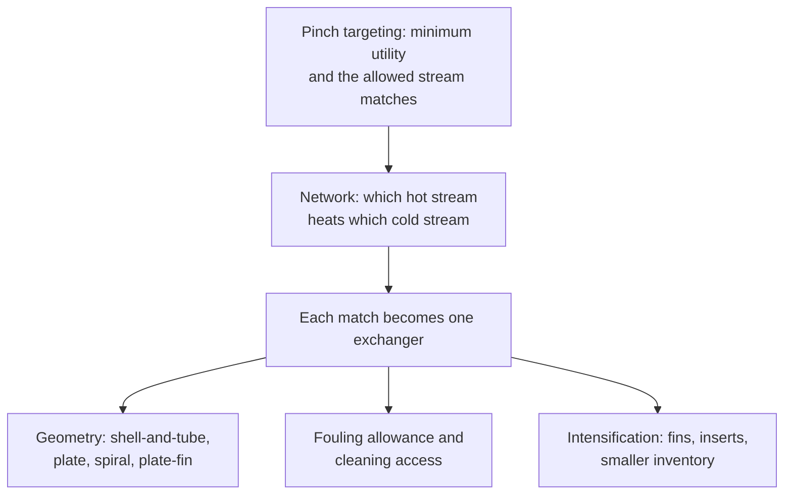

## Video Lecture

<div class="video-container">
  <iframe
    width="560"
    height="315"
    src="https://www.youtube.com/embed/fpjFV6KX1hc?start=3091"
    title="Chemical Engineering Heat Transfer Ch.5: Heat-Transfer Design and Intensification"
    allow="accelerometer; autoplay; clipboard-write; encrypted-media; gyroscope; picture-in-picture"
    allowfullscreen>
  </iframe>
</div>

> This video covers the same content as the text below. Choose your preferred learning format.

---

# Chapter 5: Heat-Transfer Design and Intensification

This chapter closes the series by zooming out. Chapters 1 through 4 sized one exchanger at a time; a real plant runs dozens of them as a single heat economy. Here we meet the equipment that makes each match compact, the fouling that taxes all of it, the intensification that shrinks it, and the digital layer that keeps it honest.

**From Single Exchangers to the Plant's Heat Economy**

## Learning Objectives

By completing this chapter, you will be able to:

  * ✅ Explain how pinch targets set the duty that exchanger design must then deliver economically
  * ✅ Describe plate-and-frame, spiral, and plate-fin exchangers and state where shell-and-tube still wins
  * ✅ Treat fouling as an added resistance in series and compute the resulting loss of duty
  * ✅ Choose design and operating responses to fouling, including velocity discipline and cleaning scheduling
  * ✅ Explain why fins belong on the gas side and how intensification connects to inherently safer design
  * ✅ State what a digital twin adds to exchanger management — and what thermodynamics forbids it from beating

**Reading Time**: 20-25 minutes **Code Examples**: 2 **Exercises**: 3

* * *

**Diagnostic.** An exchanger runs at a clean $U$ of **600** W/(m²·K), so its own resistance is $1/600 =$ **0.001667** m²K/W. It picks up a fouling film of $R_f =$ **0.0005** m²K/W — three-tenths of that — taking the total to **0.002167** m²K/W. A colleague books three-tenths off the duty. The duty actually falls by **23.1 %**. Which denominator did the colleague divide by, and which one does the duty divide by? Section 5.3 answers it; Section 5.6 asks the same kind of question of all five chapters.

## 5.1 From One Exchanger to a Network

Every previous chapter looked through a keyhole at one piece of equipment. Step back and the plant looks different: a refinery crude unit carries dozens of exchangers, and each is a decision about which hot stream heats which cold one. Those decisions are not made exchanger by exchanger. **Pinch analysis** ([Introduction Chapter 4](../chemical-engineering-introduction/chapter-4.html)) computes the *minimum* hot and cold utility for a specified set of streams, utilities and minimum approach temperature, before any network is drawn, and the three golden rules — no heat across the pinch, no cold utility above it, no hot utility below it — are what a network must obey to reach that target. Break one and the utility demand rises; the match is not thereby physically forbidden.

Targeting constrains the network; network synthesis, not targeting, fixes which matches exist and what each one carries. Turning an allowed match into hardware is where this chapter lives — and a match becomes *hardware*, which may be several shells in series or parallel, or a share of a multistream unit, rather than automatically one exchanger. The questions are practical: how much surface, in what geometry, at what capital cost, surviving what fouling, cleaned how often.



The economics rhyme with the pipe sizing of *Fluid Mechanics* [Chapter 4](../chemical-engineering-fluid-mechanics/chapter-4.html): more surface costs capital once, too little costs utility every hour for twenty years, and area near $\Delta T_{lm} \to 0$ grows without bound — the wall [Chapter 2](chapter-2.html) put in front of us.

## 5.2 Compact Exchangers

The shell-and-tube exchanger of [Chapter 2](chapter-2.html) is the industry's default, not its optimum. Its rival in clean liquid service is the **plate-and-frame** exchanger: thin corrugated plates clamped in a frame, the two streams in alternating narrow channels.

Four properties follow from that geometry. The corrugations trip the flow into **turbulence at low Reynolds numbers**, so the film coefficients of [Chapter 1](chapter-1.html) are high — at a pressure-drop cost the same corrugations impose, which is a design trade rather than a free gain. **Area density** — heat-transfer surface packed into a cubic meter of equipment — is far higher than a conventional shell-and-tube bundle reaches, so the same duty arrives in a fraction of the floor space; the figures belong on a vendor's data sheet and this page quotes none. A **single-pass** channel arrangement gives essentially counter-current flow, so the correction factor $F$ of [Chapter 2](chapter-2.html) stays near one — multipass plate arrangements and maldistribution do not — and close temperature approaches are a frequent practical advantage of the type rather than a ratio fixed by equipment class. The bands the trade quotes — **1–2 K for plates against 5–10 K for shell-and-tube** — are unsourced on this page, and are written down only to settle an apparent contradiction: [Chapter 2](chapter-2.html)'s "around 10 K" is a **shell-and-tube liquid-duty** figure at the loose end of that band, not a floor every geometry obeys. Naming the equipment class is the whole reconciliation. And the frame simply **unbolts**: plates come out for inspection or mechanical cleaning, on a timescale set by the unit's size, its gaskets and the maintenance procedure, and area can be added by inserting more plates.

The limits are in the seals. A **gasketed** unit — plates sealed by elastomer strips rather than welded — is only as good as its elastomer where temperature and chemical compatibility are concerned, and those ceilings are gasket-limited; its **pressure** rating is set by the whole mechanical design — plate thickness and strength, the support pattern, the frame and closure — with the gasket one element of it. Both are properties of the specific compound and plate design, read off the vendor's data sheet rather than off this page: a number quoted here would be used as a specification, which is exactly what it cannot be. Semi-welded, fully welded, and brazed variants can extend particular limits — semi-welded designs keep some gasket constraints, and brazing brings its own — at the cost of the easy opening that made the type attractive. Two relatives fill niches: **spiral** exchangers, two long channels coiled around a center, tolerate slurries and fibrous fluids because each stream has one unobstructed path; **plate-fin** blocks in brazed aluminum reach extreme area density and tiny approaches in cryogenic duty such as air separation and LNG.

**Standard practice** still sends whole classes of service to shell-and-tube: high pressures and temperatures, heavily fouling streams needing straight tubes rodded out, vacuum and condensing duties with large vapor volumes, and services where mature standardized shell-and-tube practice shortens the project, though coded and standardized compact equipment also exists. Compact does not mean better — it means better *when the service allows it*.

## 5.3 Fouling Management

Fouling is the silent tax on every heat-transfer design. Scale, coke, corrosion products, biofilm and settled particulate build a layer on the wall, and [Chapter 1](chapter-1.html) already says what a layer does: it adds a resistance in series.

$$ \frac{1}{U_{\text{fouled}}} = \frac{1}{U_{\text{clean}}} + R_f $$

Because the resistances add, the damage a given $R_f$ does depends entirely on how good the clean exchanger was. A superb $U$ has little resistance of its own, so a fouling film dominates it quickly; a mediocre one barely notices.

**Model boundary.** Everything below treats $R_f$ as **growing linearly with time**, which assumes an approximately constant net rate of resistance growth — accumulation alone does not guarantee that, since deposition rate and deposit conductivity can both change. Real services leave that regime in two directions: where removal by the flow catches up with deposition, the resistance approaches an asymptote — the Kern–Seaton picture — and reaction fouling such as coking can show an induction period followed by acceleration, one trajectory among several. Linear growth is the middle case, conservative against an asymptotic curve of the same initial rate, and the one whose arithmetic closes in five lines. A cleaning interval is only as good as that shape.

```python
U_CLEAN = 600.0   # W/(m2 K), clean overall coefficient
AREA = 120.0      # m2, fixed once the exchanger is built
DT_LM = 30.0      # K, log-mean temperature difference held constant

R_FOUL = [0.0, 0.0001, 0.00025, 0.0005, 0.00075, 0.001]  # m2 K/W


def fouled_U(u_clean, r_f):
    """Overall coefficient after adding a fouling resistance in series."""
    return 1.0 / (1.0 / u_clean + r_f)


def duty(u, area=AREA, dt_lm=DT_LM):
    """Q = U A dT_lm, in kW."""
    return u * area * dt_lm / 1000.0


q_clean = duty(U_CLEAN)

print(f"{'R_f [m2K/W]':>12} {'U [W/m2K]':>10} {'Q [kW]':>9} {'duty loss':>10}")
for r_f in R_FOUL:
    u = fouled_U(U_CLEAN, r_f)
    q = duty(u)
    print(f"{r_f:12.5f} {u:10.0f} {q:9.1f} {1 - q / q_clean:9.1%}")

r_half = 1.0 / U_CLEAN
print()
print(f"fouling resistance that halves the duty: {r_half:.5f} m2K/W")

#  R_f [m2K/W]  U [W/m2K]    Q [kW]  duty loss
#      0.00000        600    2160.0      0.0%
#      0.00010        566    2037.7      5.7%
#      0.00025        522    1878.3     13.0%
#      0.00050        462    1661.5     23.1%
#      0.00075        414    1489.7     31.0%
#      0.00100        375    1350.0     37.5%
#
# fouling resistance that halves the duty: 0.00167 m2K/W
```

Read the last line first. The clean exchanger's own resistance is $1/600 = 0.00167$ m²K/W, so a fouling film of exactly that size halves the duty — and a film three-tenths of it already costs 23%. Fouling factors are quoted in tables in units small enough to look negligible; they are not.

[Chapter 1](chapter-1.html) runs the same arithmetic on a computed pair rather than this section's round **600**: with a film coefficient of **8000** W/(m²·K) on each side, a clean **3488** W/(m²·K) falls to **1456** under an allowance of **0.0002** m²K/W per side — $1 - 1456/3488 =$ **58 %** gone, for a total film smaller than this section's **0.0005**. The better the clean exchanger, the more of it a given film takes.

Design responses come first. **Velocity discipline** is an important, service-dependent one — water chemistry, wall temperature, biocide dosing or feed treatment can matter more: too slow and particulate settles and biofilm establishes, too fast and erosion and pumping cost take over, which is the economic-velocity trade of *Fluid Mechanics* [Chapter 4](../chemical-engineering-fluid-mechanics/chapter-4.html) wearing a fouling hat. Then **material and surface choice** against corrosion and adhesion, and **geometry that can be cleaned** — straight tubes with removable heads, or a plate frame that unbolts. The traditional response, adding surface as a fouling allowance, has a trap: where the extra area is extra parallel flow area at unchanged throughput, start-up velocity falls and the wall may run cooler, and in services whose fouling is aggravated by low shear that can foul the unit faster than the allowance covers. Added length, or a compensating pass arrangement or control strategy, need not do this, and a cooler wall reduces coking and some scaling.

Operationally, fouling is *monitored*. Where flows and the four temperatures are measured reliably — many exchangers are not so instrumented — $U$ can be back-computed and trended from routine instrumentation. That is a textbook **soft sensor** ([Introduction Chapter 5](../chemical-engineering-introduction/chapter-5.html)): the quantity you want is not measurable directly, so you infer it from cheap measurements you already have. Its failure modes are the usual ones — a drifting flow meter or a fouled thermowell biases the inferred $U$, in either direction, and can imitate real fouling.

The trend then feeds a genuine optimization. Cleaning too often wastes production time and labor; cleaning too rarely burns extra fuel and can force a throughput cut. The optimum is where the *average* cost per day of a cycle stops falling — where its derivative with respect to cycle length is zero. Written out for the model below, that condition is not "marginal energy penalty equals the amortized shutdown cost": it is that the instantaneous energy penalty on the last day of the cycle equals the cycle's **total** average cost per day, which is the amortized cleaning cost *plus* the average energy penalty accumulated over the cycle. It is a scheduling calculation informed by a cost model — model uncertainty, inspection findings and outage coordination still take judgment — and it is five lines of arithmetic on the exchanger above.

```python
import math

# ILLUSTRATIVE INPUTS, NOT PLANT DATA. Neither the fouling rate nor the
# shutdown cost has a source; they are declared here so the method can be
# shown. The day this returns is the answer to these two numbers.
RATE = 2.0e-6      # m2K/W per day, linear fouling growth (ILLUSTRATIVE)
SHUTDOWN = 5000.0  # USD per cleaning shutdown (ILLUSTRATIVE)
PRICE = 8.0        # USD/GJ, the heat price used in Chapter 4


def cycle_cost_per_day(days):
    """Shutdown amortized over the cycle, plus the energy fouling costs you."""
    grown = 1.0 + U_CLEAN * RATE * days
    integral = U_CLEAN * days - math.log(grown) / RATE   # int (U_clean - U)
    energy_gj = AREA * DT_LM * integral * 86400.0 / 1e9
    return (SHUTDOWN + energy_gj * PRICE) / days


best = min(range(1, 3651), key=cycle_cost_per_day)
print(best, round(cycle_cost_per_day(best)))

#  79 130
```

On those two illustrative numbers the total cost per day bottoms out at **79** days and **130** USD/day. It is an interior minimum — a day either side costs more — and it is the best whole-day interval from a scan, which the continuous stationarity condition stated in words above (the next day's energy penalty equal to the cycle's average cost per day, amortized shutdown and accumulated energy together) need not satisfy exactly at an integer day. Two routes, one day — an optimum, not an artefact of the scan. Say what it is: **79 days is the answer to this whole set of inputs** — the fouling rate of 2.0×10⁻⁶ m²K/W per day and the 5,000 USD shutdown, but also the clean $U$ of 600, the 120 m², the 30 K driving force, the 8 USD/GJ heat price and the linear fouling law — and to no other. A plant's own rate and shutdown cost go in alongside its own equipment and energy figures, and the model's assumptions have to be checked before its answer is used.

**Wrong:** clean on the calendar *unexamined* — every turnaround, every six months, whenever the crew is free — because the interval is a habit rather than a number. **Right:** clean where the next day's energy penalty crosses the cycle's average daily cost. A calendar interval can turn out to be the economic one once outage coordination, reliability and inspection needs are counted; what is wrong is not knowing which side of the crossing it sits on, and both errors hide: cleaning early wastes shutdowns no meter records, cleaning late burns fuel that looks like ordinary fuel. The cost curve, built on the trended $U$ above, is what tells them apart — alongside pressure drop, reliability and product quality, which can govern the decision on their own.

## 5.4 Intensification

**Process intensification** asks, among other things, not how big this must be but how small it could be — smaller equipment is one of its outcomes, alongside integration, enhanced transport and better energy use. In heat transfer that question starts with the lesson of [Chapter 1](chapter-1.html): the largest thermal resistance on a common area basis dominates the overall coefficient, and on a conventional clean gas–liquid exchanger that is commonly the gas side, by a margin wide enough that the liquid-side film barely enters the sum.

So put the extra surface where the resistance is. **Fins** — extended metal surfaces on the gas side — multiply the area facing the weak coefficient, which is why air coolers, radiators and air-conditioning coils commonly carry their extended surface on the air side, whatever the internal geometry and whatever fluid — water or refrigerant — runs inside. **Low-fin tubes** carry short integral fins inside conventional bundles. A **turbulator** — a twisted strip or wire coil inside a tube — swirls the flow to raise the tube-side coefficient, paying in pressure drop; it is one retrofit option, appropriate once the tube side is confirmed as the limiting resistance and the pressure-drop allowance permits. A **heat pipe** moves substantial heat along a sealed passive tube with a small temperature drop, on [Chapter 3](chapter-3.html)'s phase-change coefficients, within its capillary, boiling and entrainment limits.

The payoff is not only capital. Smaller equipment holds **less inventory**, and less inventory of a hot, flammable, or toxic fluid is a hazard removed rather than controlled — Trevor Kletz's inherently safer design ([Introduction Chapter 4](../chemical-engineering-introduction/chapter-4.html)), "what you don't have, can't leak", arriving as a side effect of good heat-transfer engineering. The catch is symmetrical: narrow passages can be the least tolerant of the fouling of Section 5.3 — though some enhancements raise shear or avoid narrow passages altogether — so an intensification decision has to be checked against the fouling behaviour of the specific method and service.

## 5.5 The Digital Layer

An exchanger network is not a static object. Streams foul at different rates, feeds change, ambient temperature swings, and changing conditions move a network away from the optimum it was designed for. The response is to **re-rate** the exchangers — recompute what an existing unit achieves under today's conditions, instead of trusting its datasheet — at a frequency the process dynamics and the value of the information justify, rather than only at turnaround.

That is a **digital twin** in the sense of [Introduction Chapter 5](../chemical-engineering-introduction/chapter-5.html): a model kept aligned with the plant by live data, answering questions the instruments do not. Fed the soft-sensed $U$ of Section 5.3, and given a condition-adjusted clean baseline to separate flow, property and phase effects from deposits, it estimates the fouling state of the units it has data for, projects it forward, and prices the alternatives — which exchanger to clean at the next opportunity, how to split flow between parallel units, where to open a bypass. When each trial on a running plant is expensive, the sample-efficient methods of our *Bayesian Optimization* series ([series index](../bayesian-optimization/index.html)) are one candidate, to be weighed against model-based and scheduling methods on the problem's dimension, constraints and available physics.

None of this repeals anything. A twin can find the cleaning schedule and the best bypass split, but it cannot transfer heat across a zero temperature difference, and it cannot recover the work destroyed when a 400 °C stream heats a 50 °C one. That destruction is the entropy generation of *Thermodynamics* [Chapter 2](../chemical-engineering-thermodynamics/chapter-2.html), the minimum-work argument in heat-transfer clothing. Software optimizes within the floor that a *fixed* problem statement sets; changing utility levels, targets or operating conditions can move attainable performance without redrawing the flowsheet, while exergy already destroyed is not recoverable by any change at all.

## 5.6 Series Exit Check

Six questions, each with a computed answer in this series' calculation script. If you cannot get within the digits shown, the chapter named is where to go back to.

1. **Resistances in series.** Water-water, film coefficient **8000** W/(m²·K) both sides, 1.65 mm carbon-steel wall: $U$, and the metal's share of the resistance? (**3488** W/(m²·K); **12.8 %** — Chapter 1.)
2. **A correlation with a range.** Cooling water at 1.5 m/s in a **15.75** mm tube: what does Dittus–Boelter give, and at what velocity must you refuse to use it? (**7277** W/(m²·K); at 0.2 m/s, Re **4788**, below the 10⁴ the correlation is stated for — Chapter 1.)
3. **Configuration.** A 1-shell-pass, 2-tube-pass unit, duty **334.4** kW at LMTD **39.2** K: what is $F$, and what does assuming 0.85 cost? (**0.9045**; **20.1** m² specified against the **18.9** m² the real $F$ needs — Chapter 2.)
4. **Phase change.** Heat from condensing one kilogram of steam at 1 atm, and the flux at which nucleate boiling breaks down in *saturated pool boiling* of water at 1 atm on the geometry the correlation is for? (**2256.5** kJ/kg; **1.26** MW/m² from the hydrodynamic-stability correlation with the 0.149 coefficient — Chapter 3.)
5. **Radiation.** A hot surface exchanging with a cooler enclosure; add bright foil on the hot side, then on both: by what factor does the exchange fall? (**13.5**, then **26.0** — not the **16.0** an emissivity ratio alone suggests — Chapter 4.)
6. **The plant.** An exchanger fouls at a known rate and a shutdown costs a known sum: when do you clean it? (Where the next day's energy penalty meets the cycle's average cost per day — amortized shutdown plus accumulated energy — **79** days on Section 5.3's complete set of illustrative inputs, a different day on yours.)

## 5.7 Series Summary

The six questions above are the five chapters: the overall coefficient from resistances in series, the coefficient turned into hardware through $Q = UAF\,\Delta T_{lm}$, phase change with the high coefficients of nucleate boiling and favourable condensation and the burnout that imposed heat input risks, radiation and its fourth-power emission law, and finally the network, the fouling and the cleaning interval.

The larger arc is the transport table from [Introduction Chapter 1](../chemical-engineering-introduction/chapter-1.html): *flux = coefficient × driving force*, three times over. **Momentum transfer** is our *Chemical Engineering Fluid Mechanics* series, **heat transfer** is this one, and **mass transfer**, which introductory models drive with a concentration difference, completes the set in [Chemical Engineering Mass Transfer and Separation](../chemical-engineering-mass-transfer/index.html) — where the film coefficients, resistances in series and driving forces will already look familiar.

Where to go next: *Chemical Engineering Introduction* for the unit operations these duties serve, *Chemical Engineering Thermodynamics* for the second-law floor, *Process Informatics Introduction* for the data layer.

Thank you for learning with us.

## Exercises

1. **Conceptual — choosing the geometry**: Specify an exchanger type for each service, with reasons. (a) 200 m³/h of clean process water cooled from 85 °C to 40 °C by cooling water, 6 barg, approach 3 K, in a plant short of floor space. (b) A 45 barg hydrocarbon stream at 320 °C that lays down coke, in continuous service between turnarounds. (c) Which choice is the more exposed to the fouling arithmetic of Section 5.3, and why?
   *Hint*: check each service against the sealing and code limits of Section 5.2 before considering performance.
   *Answer*: (a) **Plate-and-frame.** A clean liquid–liquid duty at 85 °C and 6 barg is within the ratings of many suitable industrial plate exchangers and sits inside the gasket ceiling a vendor will quote for them, and the 3 K approach is where the type excels: true counter-current flow keeps $F$ near one, high area density fits the duty into little floor space, and the frame unbolts for cleaning and accepts extra plates if duty grows. (b) **Shell-and-tube**, straight tubes with a removable head. At 320 °C and 45 barg the elastomer strip is the binding constraint and it excludes a gasketed plate unit outright — the check is against the vendor's data sheet, not against a remembered number, and a coking service is commonly cleaned mechanically, with the method chosen for the actual deposit and equipment — chemical and controlled oxidative or steam decoking exist — while rodding straight tubes is routine and coke in narrow plate channels can be very difficult to remove at all once the channel has plugged. (c) **The plate unit is more exposed in principle**: its clean $U$ is high, so its own resistance is small and a given film destroys a larger fraction of it. The $1 - 1456/3488 =$ **58 %** of Section 5.3 against that section's **23.1 %** illustrates that sensitivity; the two cases carry different fouling allowances and neither is the clean $U$ or the fouling loss of the equipment selected here. It is nonetheless right in (a) because the service is clean and the frame opens; (b) fouls far harder but goes in the geometry that can be cleaned.

2. **Quantitative — the cost of a fouling film**: An exchanger is designed for $U_{\text{clean}} = 600$ W/(m²·K). In service it accumulates a fouling resistance $R_f = 0.0005$ m²K/W. (a) Compute $U_{\text{fouled}}$. (b) By what percentage does the duty fall, at fixed area and fixed $\Delta T_{lm}$? (c) How much extra area would have been needed at the design stage to still deliver the clean duty in the fouled state?
   *Hint*: resistances add, so work with $1/U$; duty is $Q = UA\,\Delta T_{lm}$, so at fixed $A$ and $\Delta T_{lm}$ the duty ratio is just the $U$ ratio.
   *Answer*: (a) $1/U_{\text{fouled}} = 1/600 + 0.0005 = 0.001667 + 0.0005 = 0.002167$ m²K/W, so $U_{\text{fouled}} = \mathbf{462\ W/(m^2 \cdot K)}$ (461.5 before rounding to a whole number). (b) With $A$ and $\Delta T_{lm}$ fixed, $Q \propto U$, so the loss is $1 - 462/600 = \mathbf{23\%}$ — 23.1% carrying the coefficient to one decimal place, matching the $R_f = 0.0005$ row of the Section 5.3 output. (c) Restoring the duty needs the area scaled by the inverse ratio, $600/461.5 = 1.30$, i.e. **about 30% more surface**. That is what a fouling allowance buys, and Section 5.3's warning applies where the surface is added as parallel flow area at unchanged throughput: the unit then runs slower, and possibly cooler, on day one, which in a shear-sensitive service can accelerate the very fouling it was sized for.

3. **Discussion — when to clean**: An exchanger's back-computed $U$ has fallen 18% over eight months. Cleaning it costs a two-day shutdown of the unit. (a) What data would you need to decide when to clean? (b) Why is the back-computed $U$ a soft sensor, and how could it mislead you? (c) Where does a digital twin add value here, and what can it not do?
   *Hint*: frame it as a cost balance per day, then ask what could make the measured decline not be fouling.
   *Answer*: (a) The extra utility cost per day at the degraded $U$ (heat price times the added duty, or the value of any throughput cut it forces), the total cost of the shutdown including lost production, and the shape of the fouling curve — still climbing steeply, or asymptoted. Clean when the next day's energy penalty exceeds the cycle's average cost per day — the amortized shutdown cost *plus* the energy penalty accumulated over the cycle, which is the stationarity condition for the average-cycle-cost model, not the shutdown term alone. The five lines of Section 5.3 implement that for one linear-growth, fixed-LMTD case: they take no arbitrary or asymptotic fouling curve and do not represent the two-day cleaning duration or its lost production, so the model has to be adapted before it answers here. Its **79** days is what it returns for *its* complete illustrative inputs, not for yours. A network makes this harder, because cleaning one unit shifts duty onto others. (b) It infers an unmeasured quantity, the fouling state, from cheap routine measurements — flows and four temperatures — through a model, $U = Q/(A\,\Delta T_{lm})$. It estimates $U$, not fouling as such: separating the two needs a clean baseline adjusted for current conditions, and for non-countercurrent hardware the right $F$. It misleads when the inputs drift — a miscalibrated flow meter, a thermowell in a stagnant pocket, or a lower feed rate bias the computed $U$, upward or downward depending on which measurement is wrong, and can imitate a decline with no deposit present. Read trend shape as one clue among several: drift can be gradual and deposit detachment abrupt. Cross-check pressure drop, remembering that it depends on flow and properties too, and that a thermally significant deposit need not raise it measurably. (c) A validated twin re-rates units against current conditions, helps separate fouling from feed and ambient effects where the data and models support it, projects the trend with a stated uncertainty, and prices cleaning schedules and bypass splits before committing. What it cannot do is beat the thermodynamic floor: no schedule recovers heat across a vanishing temperature difference, and no model undoes the work destroyed by a large-$\Delta T$ match. Work already destroyed cannot be recovered by anything; *future* losses of that kind fall with better-matched temperatures, which operating and utility changes can sometimes deliver and a network redesign can deliver more of — a pinch question as much as a modeling one.

## Sources

Bibliographic details checked 2026-09-08. Every computed number in this chapter is either a DISPLAY string of the series' calculation script, transcribed character for character, or — where the Number provenance section says so — arithmetic formed here on those strings and reformatted for display; none is estimated at the keyboard.

| Source | Quoted basis |
|---|---|
| Linnhoff, B. and Hindmarsh, E., "The pinch design method for heat exchanger networks", *Chemical Engineering Science* **38** (1983) 745–763, DOI [10.1016/0009-2509(83)80185-7](https://doi.org/10.1016/0009-2509(83)80185-7) | The pinch target and the three golden rules of Section 5.1. Cited, not fetched: no number here rests on it |
| Kern, D. Q. and Seaton, R. E., "A theoretical analysis of thermal surface fouling", *British Chemical Engineering* **4** (1959) 258–262 | The asymptotic fouling regime, named in Section 5.3 as the boundary of the linear model used there. Cited, not fetched: no number here rests on it |
| Kletz, T. A., "What you don't have, can't leak", *Chemistry and Industry*, 6 May 1978, 287–292 | The inherently-safer-design argument quoted in Section 5.4 |
| `sources/calc/ch06_repair.py` (this series' calculation script, Lecture Maker repository) | Every Tier A value listed below, printed under its DISPLAY key and asserted there |

## Number provenance

**Tier A — computed and asserted in `ch06_repair.py`**, each transcribed from its DISPLAY key: `ch5_clean_resistance_m2k_per_w` **0.001667**, `ch5_fouled_resistance_m2k_per_w` **0.002167**, `U_fouled_ch5_unrounded_w_per_m2_k` **461.5**, `ch5_duty_loss_percent` **23.1**, `cleaning_optimum_days` **79**, `cleaning_optimum_cost_usd_per_day` **130**; and, in the Exit Check, `design_film_coefficient_w_per_m2_k` **8000**, `U_clean_water_water_w_per_m2_k` **3488**, `U_fouled_water_water_w_per_m2_k` **1456**, `fouling_resistance_per_side_m2k_per_w` **0.0002**, `wall_share_realistic_percent` **12.8**, `db_tube_inside_diameter_mm` **15.75**, `db_h_1p5_m_per_s_w_per_m2_k` **7277**, `db_re_0p2_m_per_s` **4788**, `F_1_2_ex3` **0.9045**, `ex3_duty_kw` **334.4**, `ex3_lmtd_k` **39.2**, `ex3_area_at_f_0p85_m2` **20.1**, `ex3_area_at_correct_f_m2` **18.9**, `latent_heat_100c_kj_per_kg` **2256.5**, `chf_zuber_mw_per_m2` **1.26**, `radiation_reduction_inner_foil` **13.5**, `radiation_reduction_both_foil` **26.0**, and `naive_emissivity_ratio` **16.0**, which is printed as a *wrong* answer and labelled as one wherever it appears. The **58 %** of Section 5.3 and Exercise 1(c) is formed here from two of those strings, $1 - 1456/3488$.

**The one rounding this chapter argues about.** Exercise 2 prints $U_{\text{fouled}} =$ **462** W/(m²·K) and keeps "461.5 before rounding" beside it. 462 is the exact quotient, 461.538…, rounded once at the end; the script also prints **461**, which is what rounding the *operand* to 0.002167 first and then dividing gives. Keep the precision through the division and round once at the end — so 462 stands, with the longer value printed next to it so the chain is visible rather than argued about. The **23 %** of Exercise 2(b) is that same loss at two significant figures, **23.1 %** to one decimal place; both are rounded representations, and the script holds the longer value.

**Tier B — cited, not computed here**: the three references in the Sources table. The physics this chapter leans on is inherited from Chapters 1–4, where the material properties and correlations behind it carry their own citations.

**Tier C — declared illustrative, not plant data**: the cleaning-cycle **fouling rate, 2.0×10⁻⁶ m²K/W per day**, and the **5,000 USD shutdown cost** of Section 5.3. Both were chosen with no source and are labelled as such at the point of use; the rate only so that a year of fouling lands inside the $R_f$ sweep the section already tabulates. The **8 USD/GJ** heat price is transcribed from Chapter 4's Exercise 2(c), illustrative there too, and reused rather than reinvented so that the two chapters cannot disagree. The worked exchanger's own premises — $U_{\text{clean}}$ **600** W/(m²·K), $A$ **120** m², $\Delta T_{lm}$ **30** K, $R_f$ **0.0005** m²K/W — are this chapter's published example inputs, kept unchanged so the sweep and Exercise 2 stay comparable with the published version; they describe no particular exchanger. **`cleaning_optimum_days` 79 therefore inherits Tier C**: it is the answer to those inputs and to no plant, and Section 5.3 says so where it is printed.

**Numbers deliberately not printed.** The gasketed plate's temperature and pressure ceilings, the area density of plates against tube bundles, and the exchanger count on a crude unit were all quoted in the published version with no source. They are qualitative here, because each would otherwise be read as a specification, and the first two are properties of a specific product that belong on a vendor's data sheet. The approach bands **1–2 K** (plate) and **5–10 K** (shell-and-tube) are kept, unsourced and declared so at the point of use: their only job is the comparison and the reconciliation with Chapter 2's shell-and-tube figure, and nothing in this chapter is computed from them.
