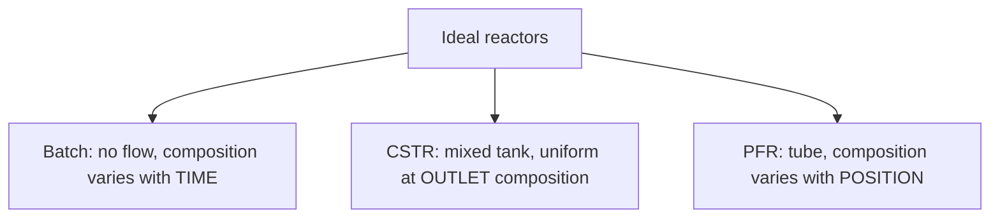
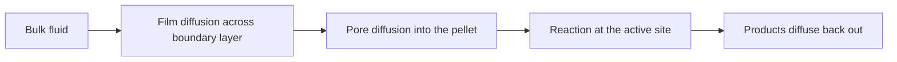

# Chapter 2: Reaction Engineering Fundamentals

This chapter introduces the reactor — the one unit where molecules actually change identity — and the handful of quantities engineers use to describe it: conversion, selectivity, yield, reaction rate, and residence time.

**Rates, Reactors, and Conversion**

## Learning Objectives

By completing this chapter, you will be able to:

  * ✅ Define conversion, selectivity, and yield, and explain why selectivity often matters more
  * ✅ Write a power-law rate law and explain reaction order
  * ✅ Use the Arrhenius equation to explain why rates are so temperature-sensitive
  * ✅ Compare batch, CSTR, and PFR reactors and their mixing assumptions
  * ✅ Size a simple first-order reactor using residence time
  * ✅ Describe why real catalytic reactors deviate from ideal behavior

**Reading Time**: 20-25 minutes **Code Examples**: 1 **Exercises**: 3

* * *

## 2.1 The Reactor is the Heart of the Process

Chapter 1's unit operations — mixing, heating, separating, pumping — all move material around or change its physical state. The **reactor** is the unit designed specifically to change what the molecules *are*.

Here is the surprise for newcomers: the reactor is often **not** the most expensive equipment in a plant; separation trains, heat exchangers, and compressors frequently cost more. Yet it governs much of the rest, because **the reactor effluent strongly influences the duty and size of every unit downstream**. A reactor that leaves half the feed unreacted calls for a substantial recovery and recycle loop whenever recovering that feed is worthwhile. One that makes an unwanted byproduct adds separation, treatment, or disposal requirements, often for the life of the plant.

Three numbers describe reactor performance. Take a reactant **A** that can go two ways: A → **P** (desired) or A → **W** (byproduct). We label the byproduct W so that the letter S is reserved for selectivity below.

| Quantity | Definition | Meaning |
|---|---|---|
| **Conversion** (X) | moles A reacted ÷ moles A fed | How much feed was used up |
| **Selectivity** (S) | moles P formed ÷ moles A reacted | Where the reacted A went |
| **Yield** (Y) | moles P formed ÷ moles A fed | Overall usefulness; **Y = X · S** (exact for one-to-one stoichiometry, A → P, as assumed here) |

Feed 100 mol of A to two candidate reactors:

- **Reactor 1**: 90 mol reacted, 63 mol P, 27 mol W → X = 90%, S = 70%, Y = 63%
- **Reactor 2**: 60 mol reacted, 57 mol P, 3 mol W → X = 60%, S = 95%, Y = 57%

Reactor 1 has the higher yield, yet Reactor 2 may well be preferable:

1. **Unconverted feed can often be recovered; feed turned into byproduct usually cannot.** The 40 mol of A leaving Reactor 2 can be separated and recycled where separation and reuse are practical. The 27 mol converted to W in Reactor 1 is raw material diverted from the product; unless W carries sale, fuel, or recovery value, that is money that never comes back.
2. **Byproducts generally have to be removed** when product specifications or downstream constraints demand it. That W must then be separated, purified or disposed of, and often treated as waste — capital and operating cost for the life of the plant.

Hence the standard engineering instinct: **kinetically limited conversion can be bought with more residence time, and overall conversion with recovery and recycle; selectivity is usually harder to buy.** Neither a bigger reactor nor a recycle loop moves a single pass past equilibrium at fixed conditions (Section 2.2), and selectivity depends on the chemistry — catalysts, temperature, concentration — as well as on reactor type, mixing, residence-time distribution, feed staging, and product removal.

## 2.2 Reaction Rates

The **reaction rate** is how fast a reaction consumes reactant per unit volume per unit time (e.g. mol L⁻¹ s⁻¹). For introductory work we use a **power-law rate law**:

$$ r = k \cdot C_A^{\,n} $$

where $C_A$ is the concentration of A, $k$ is the **rate constant**, and $n$ is the **reaction order**.

Order is fitted to data, not read off the stoichiometry. **First order** ($n = 1$): doubling concentration doubles the rate. **Second order** ($n = 2$): doubling it quadruples the rate. **Zero order** ($n = 0$): the rate is independent of concentration — common when a catalyst surface is saturated. First order is the workhorse of introductory design because it has clean closed-form answers, used below.

### Temperature: The Arrhenius Equation

The rate constant depends on temperature through the **Arrhenius equation**:

$$ k = A \cdot \exp\!\left(\frac{-E_a}{RT}\right) $$

Here $A$ is the pre-exponential factor, $E_a$ the activation energy (50–100 kJ/mol for the illustrative reactions used here; real activation energies span a much wider range, including small and sometimes negative apparent values), $R$ = 8.314 J mol⁻¹ K⁻¹, and $T$ the **absolute** temperature in kelvin.

The exponential dominates: at fixed composition, and where an Arrhenius model with positive activation energy applies, raising the temperature raises $k$ steeply. (The observed *rate* also depends on composition, mechanism, catalyst state, and transport.) A well-known rule of thumb says that **near room temperature a 10 °C rise roughly doubles the rate**. Treat it as the rough heuristic it is — the doubling corresponds to $E_a \approx 53$ kJ/mol. From 298 K to 308 K:

| Activation energy | Rate increase for +10 °C |
|---|---|
| 50 kJ/mol | ≈ 1.9× |
| 75 kJ/mol | ≈ 2.7× |
| 100 kJ/mol | ≈ 3.7× |

So the honest version is: *near room temperature, and for these illustrative activation energies, +10 °C multiplies the rate constant by roughly two to four.* There is no universal multiplier for a 10 °C rise — the factor depends on the activation energy and on the starting temperature.

Rate is only half the story: thermodynamics adds a second, independent limit — no rate law and no catalyst changes the equilibrium composition of a given system at fixed conditions, so equilibrium caps the conversion attainable in one pass, and for an exothermic reaction a higher temperature actually *lowers* the equilibrium conversion, so speed and attainable conversion pull in opposite directions.

This makes temperature **an unusually powerful operating variable, and in strongly exothermic systems a dangerous one**. Many industrial reactions are exothermic. If cooling cannot remove heat as fast as the reaction generates it, temperature rises, which raises the rate exponentially, which releases heat faster still. That feedback loop is a **thermal runaway**, behind many of the industry's worst accidents. Holding a reactor at temperature is a **control** problem (Chapter 3); designing it so runaway cannot occur is a **safety and design** problem (Chapter 4).

## 2.3 The Three Ideal Reactors

Reaction engineering tames real reactors with three idealizations:



| | **Batch** | **CSTR** | **PFR** |
|---|---|---|---|
| **Flow** | None (closed vessel) | Continuous in and out | Continuous through a tube |
| **Mixing** | Perfectly mixed | Perfectly mixed | None along the flow |
| **Concentration** | Falls with time | Uniform, equal to outlet | Falls along the tube |
| **Typical use** | Pharmaceuticals, specialty chemicals | Liquid-phase reactions, fermentation | Gas-phase, packed catalyst beds |

The key design variable for continuous reactors is the **residence time**:

$$ \tau = \frac{V}{v} $$

with $V$ the reactor volume and $v$ the volumetric feed rate (for constant-density systems) — the average time a fluid element spends inside.

### The Key Insight: PFR Beats CSTR

At the same temperature and target conversion, and for the isothermal, constant-density, positive-order kinetics used throughout this section, **a PFR needs less volume than a CSTR**, entirely because of concentration. A PFR sees the full range: reactant concentration is high at the inlet, so the local rate there is high, and both fall toward the outlet. A CSTR is perfectly mixed, so **its entire volume sits at the low outlet concentration**, and therefore at the relatively low outlet rate. The advantage is not universal: with the zero-order kinetics mentioned above the two volumes are equal, and autocatalytic or otherwise rate-increasing kinetics can favour a CSTR.

For a first-order reaction the penalty has a closed form:

$$ \frac{V_{CSTR}}{V_{PFR}} = \frac{X/(1-X)}{\ln\!\big(1/(1-X)\big)} $$

At 90% conversion this is $9/\ln 10 = 9/2.303 \approx \mathbf{3.9}$ — nearly four times larger. The penalty grows sharply with conversion, which is why tubular reactors are volume-efficient at high conversion under these kinetics — industrial reactor selection also weighs mixing, heat removal, phase behaviour, viscosity, selectivity, and operability — and why CSTRs are often placed in series to approximate a PFR.

## 2.4 Designing a Simple Reactor

A first-order liquid-phase reaction has $k = 0.5$ min⁻¹. We want **95% conversion** from a **100 L/min** feed.

**Option A — PFR**:

$$ \tau = \frac{\ln\!\big(1/(1-X)\big)}{k} = \frac{\ln 20}{0.5} = \frac{2.996}{0.5} \approx 6.0\ \text{min} \quad\Rightarrow\quad V \approx \mathbf{600\ L}\ \text{(599.1 L to the printed precision)} $$

**Option B — a single CSTR**:

$$ \tau = \frac{X}{k(1-X)} = \frac{0.95}{0.5 \times 0.05} = 38\ \text{min} \quad\Rightarrow\quad V = 38 \times 100 = \mathbf{3800\ L} $$

The CSTR needs **more than six times the volume** for the same job. The penalty at 95% (6.3×) is far worse than at 90% (3.9×): the last few percent of conversion in a well-mixed tank are brutally expensive.

```python
import math

k = 0.5    # 1/min, first-order rate constant
v = 100.0  # L/min, volumetric feed rate

print(f"{'X':>6} {'tau_PFR':>9} {'V_PFR':>9} {'tau_CSTR':>10} {'V_CSTR':>10} {'ratio':>7}")
for X in [0.50, 0.80, 0.90, 0.95, 0.99]:
    tau_pfr  = math.log(1.0 / (1.0 - X)) / k    # PFR, first order
    tau_cstr = X / (k * (1.0 - X))              # CSTR, first order
    print(f"{X:6.2f} {tau_pfr:9.2f} {tau_pfr*v:9.1f} "
          f"{tau_cstr:10.2f} {tau_cstr*v:10.1f} {tau_cstr/tau_pfr:7.2f}")

#      X   tau_PFR     V_PFR   tau_CSTR     V_CSTR   ratio
#   0.50      1.39     138.6       2.00      200.0    1.44
#   0.80      3.22     321.9       8.00      800.0    2.49
#   0.90      4.61     460.5      18.00     1800.0    3.91
#   0.95      5.99     599.1      38.00     3800.0    6.34
#   0.99      9.21     921.0     198.00    19800.0   21.50
```

The last row is the lesson: at 99% conversion the CSTR needs over **twenty times** the PFR volume.

## 2.5 Catalysis and Real Reactors

Everything above assumed a clean single-phase reaction; industrially that is the exception. Catalysis is used extensively in industrial chemical manufacture — a textbook figure of **roughly 90% of industrial chemical processes** is often quoted, though the population it counts (processes, products, production volume, new processes) varies between sources. A **catalyst** speeds up a reaction by lowering its activation energy without being consumed.

| | **Homogeneous** | **Heterogeneous** |
|---|---|---|
| **Phase** | Same phase as reactants (dissolved) | A different phase from the reacting medium; commonly a solid catalyst with fluid reactants |
| **Advantage** | Highly accessible molecular sites; often high, tunable selectivity | When the catalyst is immobilized, separation is often easy — the fluid flows past |
| **Drawback** | Removal or recovery can be difficult where specifications require it | Reactants must reach the surface |
| **Example** | Acid catalysis in solution | Ammonia synthesis, catalytic cracking |

That last drawback changes the *effective* rate in a real **packed-bed reactor**: before reacting on a solid catalyst, a molecule must complete extra transport steps. (Departure from ideal plug *flow* is a separate matter, caused by axial dispersion, channelling, and cross-sectional nonuniformity.)



If **film diffusion** or **pore diffusion** is slower than the chemistry, transport resistance substantially reduces the observed rate and changes its apparent kinetics. The reactor then runs slower than predicted and often responds more weakly to temperature, since external mass transfer is far less temperature-sensitive than an Arrhenius rate constant — although a pore-diffusion-limited rate retains substantial temperature dependence. A reactor that stops speeding up when you raise the temperature may be transport-limited, but equilibrium, already-high conversion, deactivation, and inhibition have to be ruled out as well.

Real reactors also drift. **Catalyst deactivation** — coking (carbon deposits), poisoning (impurities such as sulfur binding to active sites), or sintering (active particles fusing at high temperature) — steadily reduces activity. Operators compensate by slowly raising the temperature setpoint to hold conversion constant, until the catalyst must be regenerated or replaced. Monitoring and control help detect and compensate for that drift within operational limits.

## 2.6 Chapter Summary

- The reactor is not necessarily the plant's largest equipment cost, but its **conversion and selectivity strongly influence the size of everything downstream**
- **Y = X · S**: unconverted feed can often be recycled; feed turned into byproduct is generally lost to the desired product — so selectivity often outranks conversion
- Power-law rate law $r = k C_A^n$; the order $n$ is fitted to data, not read from stoichiometry
- Arrhenius makes rate constants **exponentially** temperature-sensitive: near room temperature, and for the illustrative activation energies above, +10 °C multiplies the rate constant by roughly 2–4×, making temperature an unusually powerful operating variable and, in exothermic systems, a dangerous one
- Three ideal reactors — **batch** (varies with time), **CSTR** (uniform at outlet conditions), **PFR** (varies with position); residence time $\tau = V/v$ is the design variable
- For these isothermal first-order kinetics a CSTR runs its whole volume at the low outlet concentration: ≈3.9× the PFR volume at 90% conversion, ≈6.3× at 95%
- Catalysis is used extensively in industrial processes; film and pore diffusion plus deactivation make real reactors deviate from ideal models

**Next chapter**: a reactor only performs as intended if its temperature, pressure, and flow rate are held where the operation requires — which, as the catalyst deactivates, can mean deliberately moving a setpoint rather than freezing it. Holding the process where it should be, against disturbances and drift, is **process control**.

## Exercises

1. **Conceptual — conversion vs. selectivity**: Design 1 gives X = 95%, S = 60%; Design 2 gives X = 70%, S = 92%. (a) Compute each yield. (b) Which would you recommend, and what could change your answer?
   *Hint*: Y = X · S. Think about the fate of the unreacted A and of the byproduct W.
   *Answer*: (a) Design 1: Y = 0.95 × 0.60 = **57%**; Design 2: Y = 0.70 × 0.92 = **64.4%**. (b) Design 2 is attractive on both yield and selectivity, though a recommendation also needs reactor cost, productivity, catalyst cost, energy, safety, and waste handling. On the figures given it is the stronger candidate — unless unreacted A cannot be separated from P economically, in which case Design 2's recycle loop becomes expensive and Design 1's higher single-pass conversion gains value.

2. **Quantitative — reactor sizing**: A first-order liquid-phase reaction has k = 0.2 min⁻¹ with a 50 L/min feed, targeting 80% conversion. Compute (a) the PFR volume, (b) the single-CSTR volume, (c) the ratio.
   *Hint*: τ_PFR = ln(1/(1−X))/k, τ_CSTR = X/(k(1−X)), then V = τ · v.
   *Answer*: (a) τ_PFR = ln 5 / 0.2 = 8.05 min → V ≈ **402 L**. (b) τ_CSTR = 0.8/(0.2 × 0.2) = 20 min → V = **1000 L**. (c) Ratio ≈ **2.5** — far smaller than the 6.3× penalty at 95%, showing how steeply the CSTR penalty grows near 100%.

3. **Discussion — temperature and diffusion**: An engineer raises a packed-bed reactor's temperature by 10 °C but conversion rises only ~3%, far less than the intrinsic kinetics alone would suggest. Give two explanations and one experiment to distinguish them.
   *Hint*: Consider what limits the rate besides the chemistry.
   *Answer*: (1) The reactor is **diffusion-limited** — film or pore diffusion controls the observed rate, and diffusion is only weakly temperature-dependent. (2) The reaction is near **equilibrium**, so higher conversion is thermodynamically blocked (and for an exothermic reaction, higher temperature actually lowers equilibrium conversion). Distinguishing experiment: measure rates over a controlled variation in particle size, holding catalyst amount, composition, temperature, and flow conditions comparable — note that crushing also changes external area, pressure drop, packing, and heat transfer. A rate that rises as the particles get smaller supports a transport explanation; establishing *internal* pore diffusion specifically requires excluding external mass transfer, heat transfer, and changes to the catalyst itself. For the equilibrium explanation, compute the equilibrium conversion independently and compare fresh with aged catalyst under controlled conditions far from equilibrium — a fresh charge alone does not separate the two.
