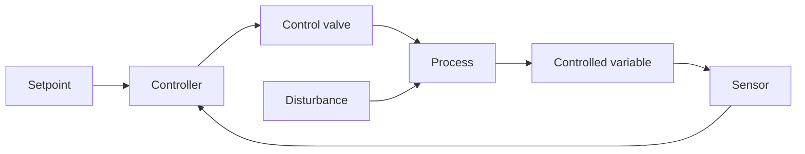

# Chapter 3: Process Control Fundamentals

This chapter explains why a chemical plant needs automatic control, how the feedback loop works, what the P, I, and D terms of a PID controller do, and why process dynamics make control harder than it looks.

**Keeping the Plant Where You Want It**

## Learning Objectives

By completing this chapter, you will be able to:

  * ✅ Explain why a plant does not stay at steady state, and rank control objectives from safety to profit
  * ✅ Trace a feedback loop from sensor through controller to control valve
  * ✅ Describe what P, I, and D contribute, and why most industrial loops run as PI
  * ✅ Explain how time constants and dead time limit how tightly a loop can be tuned
  * ✅ Recognize cascade, feedforward, and ratio control, and where MPC sits above them

**Reading Time**: 20-25 minutes **Code Examples**: 1 **Exercises**: 3

* * *

## 3.1 Why Control?

Chapter 1's balances assumed steady state — nothing changing with time. That is a convenient fiction. A real plant is disturbed continually: **feed composition drifts**, **ambient conditions change**, **catalysts deactivate**, exchangers foul, and **demand changes** week to week. Even an intrinsically stable process settles wherever those disturbances leave it, which is generally not the design point. **Process control** measures what the plant is doing and continuously adjusts it back. Its objectives are conventionally prioritized in this order, highest first — safety and mandatory operating constraints taking precedence over economic optimization, though several can bind at the same time:

| Objective | Example |
|---|---|
| **Safety** | Stay below runaway temperature |
| **Environmental compliance** | Stay within emission permits |
| **Equipment protection** | Avoid cavitation (vapor bubbles collapsing in pumps), compressor surge (unstable oscillation of compressor flow and pressure, which can include flow reversal), thermal shock |
| **Product quality** | Hold purity in specification |
| **Profit** | Run near the limiting constraint |

When objectives conflict, a properly designed control and protection system gives up profit before it gives up safety. That is a design requirement met through architecture, constraints, interlocks, and protective functions — not an automatic property of any control system.

### The motivating example: an exothermic reactor

Chapter 2 gave a rule of thumb from the Arrhenius equation — near room temperature a 10 °C rise roughly **doubles the rate constant** (2–4× for the activation energies tabulated there). Put an exothermic reaction in a cooled reactor: a temperature rise speeds the reaction, which releases heat faster, which raises the temperature further. Jacket cooling, meanwhile, grows only in rough proportion to the temperature difference. So near any given operating point the question is which of the two rises faster with temperature. In a simplified single-state thermal balance, if heat generation rises with temperature faster than heat removal does, that point is locally unstable: the temperature moves away from it instead of settling, which is the route to **thermal runaway**. The full reactor dynamics — concentration, jacket, and flow as well as temperature — have to be checked before a point is judged safe or unsafe. Whether it can happen is not decided by the chemistry alone — it depends on the design and on the operating point chosen, which is exactly what makes exothermic reactors demanding to design (Chapter 4) and to control (this chapter).

## 3.2 The Feedback Loop

A **sensor** measures the controlled variable. A **controller** compares it with the **setpoint** and computes the **error**. A **final control element** — often an actuated **control valve**, though variable-speed drives, electric heaters, and dampers are also widespread — changes a manipulated variable such as cooling-water or steam flow. The process responds, and the cycle repeats.



The disturbance enters the process directly, not through the controller. This gives feedback two jobs: **disturbance rejection** (setpoint fixed, loop fights off upsets — what most loops do most of the time) and **setpoint tracking** (the target moves during a rate or grade change). Feedback has one defining limitation: **it cannot begin correcting an unmeasured disturbance until that disturbance shows up in the measurement.** It generally reacts after the upset has moved the controlled variable rather than heading it off — the gap feedforward (Section 3.5) attacks.

### The 80/20 reality

A large plant may run several thousand loops, and the overwhelming majority are simple **single-input, single-output (SISO) feedback loops**: one controlled output, one setpoint, one manipulated input. Multivariable schemes get the conference papers, but plants run on ordinary flow, level, pressure, and temperature loops, and a control valve is the final control element in many of them. Valves also carry the **fail-safe** philosophy — but the failure action is a design choice made service by service: a valve can be specified to fail open, fail closed, or fail in place, and which of those is safe depends on the actuator and on what losing that valve would do to the process.

## 3.3 PID Control

The workhorse of industry is the **PID controller**: the great majority of plant loops are PID-type, and most run as **PI**, with derivative switched off. PID computes its output from the error *e = setpoint − measurement* using three terms — responding to the **current error, the accumulated error, and the error trend**:

| Term | Reads | Effect |
|---|---|---|
| **P** (proportional) | The error *now* | Bigger error, bigger correction |
| **I** (integral) | Accumulated *past* error | Keeps changing its contribution while error persists |
| **D** (derivative) | The *trend* | Reacts to the current rate of change |

In the standard (ISA) form:

$$ u(t) = K_c \left[ e(t) + \frac{1}{\tau_I} \int e\,dt + \tau_D \frac{de}{dt} \right] $$

where **Kc** is the controller gain, **τI** the integral (reset) time, and **τD** the derivative time. Read ∫ e dt as the running total of past error and de/dt as how fast the error is currently changing — you never need to evaluate either by hand; the controller does it for you.

**P alone generally leaves offset** in a self-regulating process: a proportional controller moves its output away from a fixed bias only in proportion to the error, so whenever the output required at the target differs from that bias, a steady gap remains. **I removes it** because the integral keeps accumulating while any error remains, then holds that value as the new steady output — which is why integral action is used in most industrial loops, especially where steady offset is unacceptable. It drives a constant offset to zero when the closed loop is stable, the target is reachable, and the actuator has the authority to get there. **D is often off** because differentiating a noisy measurement hammers the valve; it earns its place mainly on slow temperature loops.

The simulation below puts a PI controller on a first-order process (time constant 5 min) and steps the setpoint at *t* = 0:

```python
# PI control of a first-order process, integrated with explicit Euler
tau, K = 5.0, 1.0        # process: time constant 5 min, steady-state gain 1
Kc, tauI = 2.0, 5.0      # PI tuning (lambda/IMC rule, explained in Section 3.4; lambda = 2.5 min)
dt, t_end = 0.01, 30.0   # Euler step must be much smaller than tau
setpoint = 1.0           # unit step in setpoint applied at t = 0

y, integral = 0.0, 0.0   # process output, and running integral of the error
for step in range(int(t_end / dt)):
    t = step * dt
    e = setpoint - y                    # where I want it minus where it is
    integral += e * dt                  # accumulated past error
    u = Kc * (e + integral / tauI)      # PI control action (valve signal)
    dydt = (-y + K * u) / tau           # first-order process dynamics
    y += dydt * dt                      # explicit Euler step
    if step % 500 == 0:                 # report every 5 minutes
        print(f"t = {t:4.1f} min   y = {y:5.3f}   u = {u:5.3f}")

# t =  0.0 min   y = 0.004   u = 2.004
# t =  5.0 min   y = 0.866   u = 1.134
# t = 10.0 min   y = 0.982   u = 1.018
# t = 15.0 min   y = 0.997   u = 1.002
# t = 20.0 min   y = 1.000   u = 1.000
# t = 25.0 min   y = 1.000   u = 1.000
```

The output converges on the setpoint with no steady-state offset, reaching it **to the three decimals printed** — integral action doing its job. Read the trace carefully: each line pairs the time at the *start* of the step with the output *after* that step's update, so the first row is not the initial process state. Delete the `integral / tauI` term to make it P-only and the output stalls at 0.667: a 33% offset.

## 3.4 Process Dynamics: Why Control is Hard

If processes responded instantly, control would lose much of its difficulty — though uncertainty, nonlinearity, interaction, noise, and constraints would remain. Two of the most common sources of dynamic difficulty are these.

**Inertia (time constant, τ).** A stirred tank full of liquid has thermal mass; open the steam valve and the temperature climbs gradually. A first-order process covers about 63% of its change in one time constant and is essentially finished after four or five.

**Dead time (θ).** After the valve moves, *nothing happens at the measured output* for a while — fluid must travel down a pipe, a composition change must reach the analyzer. During this **transport delay** the controller is blind, pushing on stale information; push too hard and the correction that finally arrives is far too large, so the loop oscillates.

Combining the two gives the **first-order-plus-dead-time (FOPDT)** model, a common low-order approximation for many self-regulating process responses: three numbers from a step test — gain *K*, time constant *τ*, dead time *θ*. The key rule of thumb is the **dead-time ratio θ/τ**:

| θ/τ | Difficulty | Typical example |
|---|---|---|
| < 0.1 | Often permits faster tuning | Many flow loops |
| 0.1 – 1 | Moderate — normal tuning | Most temperature loops |
| > 1 | Hard — must be gentle | Analyzer composition loops |

How fast a loop can actually be tuned also depends on measurement noise, actuator limits, unmodelled dynamics, and interactions; and integrating processes — many level loops among them — have no finite self-regulating time constant, so the ratio does not apply to them directly.

**The larger the dead-time ratio, the more sluggish the controller must be** — you cannot correct information you do not yet have.

**Ziegler and Nichols published the classic tuning heuristics in 1942**, deriving *Kc*, *τI*, and *τD* from a simple plant test; they remain the standard entry point. Their settings are aggressive and tend to oscillate, so modern practice prefers gentler model-based rules — **lambda tuning** or **IMC (Internal Model Control) tuning** — where the engineer sets the closed-loop response speed directly, as with the `Kc = 2`, `τI = 5` above.

## 3.5 Beyond Single Loops

Three simple structures address several common limitations of a single loop.

**Cascade control** nests one loop inside another. On a jacketed reactor, a *master* controller on reactor temperature does not move the valve — it sets the **setpoint of a slave controller** on jacket temperature, which does. The fast inner loop reduces the effect of cooling-water disturbances before they significantly change reactor temperature, and works when the inner loop is much faster than the outer one.

**Feedforward control** measures the *disturbance itself* and acts before its effect appears: if the feed to a heater turns colder, feedforward raises the steam flow the moment the cold feed is detected, rather than waiting for the outlet temperature to fall. It needs a measurement of the disturbance and a model, and in practice both are imperfect, so it is usually paired with feedback.

**Ratio control** holds one flow in fixed proportion to another — classically **fuel/air ratio** on a fired heater, where air tracks fuel to support efficient combustion. Safe fired-heater operation needs more than the ratio itself: suitable air margins, cross-limiting, sequencing, and burner safeguards.

Those loops are hosted by the plant-wide platform: a **DCS (distributed control system)** executes thousands of regulatory loops, drives operator graphics, and runs the **alarm system**. Above them, **Advanced Process Control (APC)** — usually **Model Predictive Control (MPC)** — optimizes many interacting variables at once under constraints using a dynamic model, issuing setpoints down to the PID loops, which is what lets a plant run deliberately close to a constraint. This layer exists because loops interact: the **recycle streams** of Chapter 1 carry disturbances from the back of the plant round to the front again, so an upset corrected in one unit can return later through the recycle — one reason plant-wide control is more than the sum of its individual loops. For depth, see the **Introduction to Process Monitoring and Control** and **Process Informatics Introduction** series.

## 3.6 Chapter Summary

- A plant does not hold steady on its own, and an exothermic reactor can run away when heat generation rises with temperature faster than heat removal does, leaving the operating point unstabilized; control objectives are conventionally ranked safety → environment → equipment → quality → profit
- The feedback loop — sensor → controller → valve → process — rejects disturbances and tracks setpoints; most loops are SISO and end in a control valve
- PID reads the current error (P), the accumulated error (I), and the error trend (D): P alone generally leaves offset in a self-regulating process, I removes it, D amplifies noise — so most loops run as PI
- Dead time is often the main limit on a loop's achievable speed, alongside other process and actuator dynamics; FOPDT is the common self-regulating process model and θ/τ a useful tuning indicator, with Ziegler–Nichols (1942) the classic tuning heuristic
- Cascade, feedforward, and ratio control extend the single loop; the DCS hosts those loops and MPC supplies setpoints to them

**Next chapter**: process design — and the link runs both ways, because **good process design accounts for controllability and avoids unnecessary control difficulty.**

## Exercises

1. **Conceptual**: A control valve admits cooling water to an exothermic reactor's jacket. On loss of instrument air, should it fail open or fail closed, and which Section 3.1 objectives does that trade off?
   *Hint*: ask what happens if cooling stops, then apply the priority ranking.
   *Answer*: **Fail open**, for this assumed pneumatic actuator without backup: losing air prevents normal valve positioning, and loss of cooling can cause dangerous heating or runaway in an exothermic reactor. This serves **safety** and **equipment protection** at the cost of **product quality** and **profit** — overcooling may cut productivity or spoil the batch, and that is the correct trade.

2. **Quantitative**: For the code example (*K* = 1, setpoint step 1.0), a P-only controller settles at *y* = *Kc*·*K* / (1 + *Kc*·*K*) with zero bias. Compute the offset for *Kc* = 2 and *Kc* = 9. Why is raising the gain not the practical fix?
   *Hint*: the offset is the gap between setpoint and settled value.
   *Answer*: *Kc* = 2 gives *y* = 0.667, offset **0.333**; *Kc* = 9 gives *y* = 0.900, offset **0.100**. Offset shrinks with gain but never vanishes, and on a real process with dead time a high-gain loop turns oscillatory and eventually unstable. Appropriately tuned **integral action** removes the constant steady offset without a large proportional gain, provided the closed loop is stable and the target is reachable.

3. **Discussion**: Loop A has *τ* = 20 min, *θ* = 1 min; Loop B has *τ* = 4 min, *θ* = 4 min. Compute θ/τ — which is harder to tune tightly? For a reactor whose main upset is a cooling-water temperature swing, would you add cascade or feedforward?
   *Hint*: use the θ/τ table, then ask whether a fast inner loop already sees the disturbance.
   *Answer*: Loop A: θ/τ = 0.05 (easy). Loop B: θ/τ = 1.0 — blind for a full time constant, so it must be detuned, making it **much harder**. For the cooling-water upset, **cascade** is the natural choice provided the jacket measurement responds early enough and the inner loop can act much faster than the reactor loop: the jacket-temperature slave then detects and attenuates the swing before reactor temperature deviates substantially. Feedforward is a valid supplement, but it needs a disturbance model.
