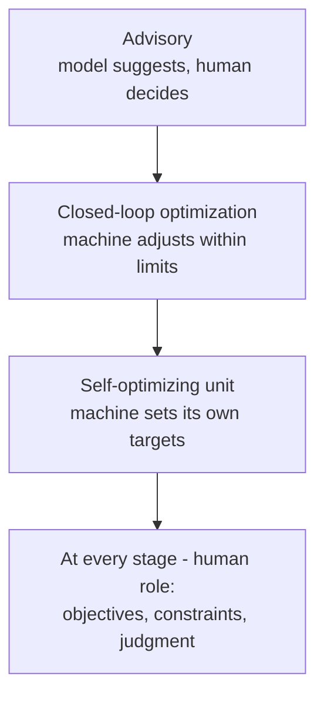

# Chapter 5: AI and the Future of Chemical Engineering

This final chapter connects Chapters 1–4 to the data-driven methods now entering industrial practice: soft sensors, Bayesian optimization, digital twins, and the road toward autonomous plants.

**Process Informatics and the Intelligent Plant**

## Learning Objectives

By completing this chapter, you will be able to:

  * ✅ Explain the three forces driving AI adoption in the process industries
  * ✅ Describe what a soft sensor is, what it buys you, and how it fails
  * ✅ Explain why Bayesian optimization suits expensive experiments
  * ✅ Distinguish first-principles, hybrid, and ML models, and define a digital twin
  * ✅ Identify the real barriers to autonomous operation
  * ✅ Summarize how the fundamentals make AI trustworthy

**Reading Time**: 20-25 minutes **Code Examples**: 0 **Exercises**: 3

* * *

## 5.1 Why AI, and Why Now

Chemical plants have been computerized since the 1960s, so "AI in chemical engineering" is no sudden arrival. What changed is a combination of three contributing factors — alongside advances in computing, algorithms, connectivity, and data infrastructure.

**Plants are already heavily instrumented.** Many large plants collect thousands of measurement tags — temperatures, pressures, flows, levels, valve positions — at regular intervals through the DCS of Chapter 3, and archive selected tags in a process historian for years, though tag counts, sampling rates, retention, and data quality vary from site to site. The process industries often have substantial measurement infrastructure predating modern machine learning; here much of the data was collected long before anyone planned to model it.

**Classical models are expensive to build and maintain.** A rigorous simulation of the flowsheets of Chapters 1 and 4 encodes balances, thermodynamics, and the appropriate kinetic or equipment models, with detailed hydraulics and geometry where the purpose demands them. Building and validating one can take an experienced engineer anywhere from days to months, depending on scope, available models, and parameter data, and keeping it faithful as the plant fouls and ages takes ongoing effort.

**The industry faces demographic knowledge loss.** Some organizations report difficulty replacing retiring operators and transferring what they know — which unit runs hot in summer, which alarm is usually spurious — because much of it was never written down. This is a reported motivation rather than a measured statistic, and it is one reason cited for investment in decision support: some operational expertise can be captured in documentation, decision-support systems, and models, alongside training, procedures, and process redesign.

The umbrella term is **Process Informatics (PI)**: using data together with models to design, operate, and optimize processes — the subject of our *Process Informatics Introduction* series, to which this chapter is the bridge.

## 5.2 Soft Sensors: The Entry Point

Among the most established industrial applications of data-driven modelling in the process industries is the **soft sensor** (or virtual sensor).

> **A soft sensor is a model that infers a hard-to-measure variable from easy-to-measure ones.**

Product-**quality** variables — composition, polymer melt index, biomass concentration, impurity levels — are important control objectives and common soft-sensor targets, though safety, inventory, pressure, temperature, environmental performance, and equipment protection set control priorities as well. They can be difficult or costly to measure directly, needing a laboratory sample or an online analyzer whose speed and maintenance burden vary widely with the variable and the process — while plants commonly collect temperature, pressure, and flow frequently and cheaply at instrumented locations. A supervised data-driven soft sensor learns the relationship between the cheap measurements and the expensive one from historical process data paired with laboratory or other reference measurements, then estimates it continuously.

| | Laboratory analysis | Soft sensor |
|---|---|---|
| Update rate | Hourly to daily in this example; intervals vary by application | Each suitable measurement or control interval |
| Delay | Sampling, transport, analysis | Usually far less reporting delay, though sensor response, filtering, and communication latency remain |
| Accuracy | Reference quality | Approximate, model-dependent |

The idea is not new: **inferential control** — controlling composition through a proxy such as a distillation tray temperature — predates machine learning. Modern soft sensors often combine many measurements using statistical, mechanistic, or hybrid estimators; multivariable inferential estimators are not themselves a modern invention.

Chapter 3 explains why this matters. A feedback loop needs a measurement or estimate that reveals the relevant error, and dead time blinds it. An hour of reporting delay can make laboratory-only feedback inadequate for a rapidly varying process, and can let off-spec production continue before corrective action is taken. **A soft sensor can close a loop that laboratory analysis never could.**

The classic failure is **model drift**. A soft sensor is fitted to a particular operating region — a feedstock, a catalyst age, a season. Outside it the predictions can become unreliable, and unless the deployment detects unfamiliar inputs or reports its uncertainty, the model keeps producing numbers as though nothing had changed. Deployments therefore retain lab samples, monitor prediction error against them, and define a retraining procedure. A soft sensor is not a device you install; it is a model you maintain.

## 5.3 Optimization When Experiments Are Expensive

Chapter 4 framed process design as a search over decisions — operating conditions, equipment sizes, recycle configurations — against an objective. When a simulator evaluates that objective cheaply, ordinary optimization applies. The hard case is when **each evaluation is expensive**: a pilot-plant run taking a shift, a batch experiment consuming costly reagents, a catalyst needing days to test. You may afford only tens of evaluations, so the question becomes: given everything measured so far, which experiment next?

**Bayesian optimization** answers this in three moves. First, fit a *surrogate* — a cheap statistical model of the objective over the decision variables. Second, require that surrogate to report **uncertainty**, not just a prediction, so it carries an explicit estimate of where it is guessing — an estimate whose own reliability depends on the model's assumptions and calibration. Third, use an *acquisition function* to combine predicted performance and uncertainty into one score, and run the experiment maximizing it — balancing **exploitation** (test where results look good) against **exploration** (test where you know least).

This spends a small budget deliberately rather than uniformly — the situation in many pilot campaigns, catalyst screenings, and formulation efforts. Our *Introduction to Bayesian Optimization* series develops the mathematics; here it suffices that **when experiments are expensive, choosing the next one well is itself an engineering problem.**

## 5.4 Digital Twins and Model Predictive Control

Process modelling approaches offer different trade-offs and are often combined rather than ranked against one another:

| Model type | Built from | Strength | Weakness |
|---|---|---|---|
| **First-principles** | Balances, thermodynamics, kinetics | Supports mechanistic interpretation and extrapolation while its assumptions hold; explains *why* | Expensive to build and maintain |
| **Hybrid** | Mechanistic core plus a learned component (a learned residual is one option; others learn constitutive relations, parameters, or closures) | Physical structure improves consistency where the relevant constraints are actually enforced; the learned part approximates selected unresolved effects | Needs both skill sets |
| **Purely data-driven surrogate** | Data only (physics-informed variants sit between this row and the one above) | Fast to evaluate, after potentially substantial data preparation, training, and validation | Reliability must be validated; extrapolation adds uncertainty |

First-principles models come in two flavors. **Steady-state flowsheeting** answers "what is the converged operating point?" — the question behind Chapter 4's design decisions. **Dynamic simulation** answers "how does the plant get there, and respond to a disturbance?" — the process dynamics of Chapter 3, and the kind control and operator training need.

A **digital twin** is not simply a simulation. It is a model **kept synchronized with the operating plant** — updated from the physical asset at a frequency suited to its purpose, through state or parameter estimation, so it tracks the real unit. That synchronization enables what-if analysis on the current state ("raise feed rate 5% now — does the column flood?"), operator training on scenarios too dangerous to stage, and optimization reflecting today's plant rather than the design day's.

The established industrial success story of model-based operation is **model predictive control (MPC)**, met at the top of Chapter 3's control hierarchy. An MPC controller holds an internal model, predicts the process response over a future horizon, and at each control interval solves an optimization for the moves that best meet targets while respecting constraints — then applies the first and repeats. It handles the multivariable, interacting, constrained problems that defeat single PID loops, and has been standard practice in refining and petrochemicals since roughly the 1980s–90s — the best evidence that model-based operation pays.

An honest caveat belongs here. Algorithm development receives substantial attention, but much of the practical difficulty lies elsewhere: plants drift — exchangers foul, catalysts deactivate, instruments lose calibration, feedstocks change — so an initially accurate model can lose fidelity as the plant and its operating conditions change. Maintaining fidelity is unglamorous, continuous work, and an important source of deployment difficulty. **Model maintenance is often a major lifecycle bottleneck, alongside model building.**

## 5.5 Toward Autonomous Plants

The trajectory parallels our *Self-Driving Labs Introduction* series, on labs that plan, run, and analyze their own experiments.

Among recent AI deployments, advisory systems — recommending setpoints for an operator to accept — are the common case; how large that majority is would need survey evidence, and counting conventional automatic control and MPC changes the comparison entirely. The second stage, closed-loop optimization within a bounded envelope, is what MPC already does in mature sectors. The third — a unit that autonomously changes its own objective function or its priorities, as distinct from optimizing targets under a fixed, human-set objective — is genuinely experimental.

Progress is held back by both technical capability and institutional requirements. On the institutional side: **safety certification** (a plant holds enormous stored energy and hazardous inventory, and assuring a controller whose behavior is learned rather than specified is difficult, requiring application-specific evidence and compliance assessment) and **accountability** (when an autonomous decision contributes to an incident, responsibility becomes harder to assign, and the applicable duties and liability arrangements need explicit assessment). On the technical side: **verification of learned models** (proving one behaves acceptably outside its training data is unsolved in general), together with robustness, learning from limited data, safe exploration, and uncertainty estimation. Institutional change can also take substantial time and may proceed at a different pace from technical development.

One active bridge from lab to plant is **continuous-flow chemistry with automated experimentation**. Small flow reactors with short residence and equilibration times reach steady operation quickly, use little material, and integrate readily with computer-controlled pumps, heaters, valves, and analyzers — well suited to closed-loop optimization where analysis speed, fouling, and solids handling permit. The conditions found are already in continuous form rather than a batch recipe needing translation, though scale-up or numbering-up still has to be validated: heat and mass transfer, mixing, residence-time distribution, pressure drop, and separation all change with scale.

The human role does not disappear; it moves up, exactly as in the SDL series. Machines hold setpoints, search bounded spaces, and never get bored. People remain responsible for **framing objectives** (what are we optimizing, at what cost in safety, emissions, and equipment life?), **judging anomalies** (real upset, or failed transmitter?), and **owning the consequences**. The machine runs the loop; the engineer decides what it is for.

## 5.6 Series Summary

Chapter 1 established that any process decomposes into **unit operations**, with **mass and energy balances** as the accounting holding across every one. Chapter 2 opened the reactor, where **kinetics** sets the speed and **thermodynamics** the limit. Chapter 3 made the plant hold still through **feedback control** against disturbances. Chapter 4 assembled the pieces into a **design** — flowsheet, heat integration, economics, safety embedded rather than appended. Chapter 5 added the data layer.

The closing message is worth remembering. **AI does not replace the classical fundamentals — they are one essential part of what makes AI in a plant trustworthy, alongside empirical validation, uncertainty assessment, software assurance, monitoring, and suitable operating procedures.** A mass-balance check can reject a soft sensor's physically impossible outputs, while its credibility still rests on independent validation and continued monitoring. A digital twin is worth synchronizing when its representation — mechanistic, data-driven, or hybrid — is accurate and appropriate enough for the decisions it supports. An optimizer's recommendation becomes safe to act on when the constraints an engineer identifies as hard are complete, correctly implemented, robust to uncertainty, and backed by the plant's safety systems and review.

Next: *Process Informatics Introduction* for the data layer, *Introduction to Bayesian Optimization* for the methods, *Digital Twin Construction Introduction* for models, and *Self-Driving Labs Introduction* for autonomy.

Thank you for learning with us.

## Exercises

1. **Conceptual**: A column's overhead purity is measured by a gas chromatograph reporting every 30 minutes, while the column responds to feed disturbances within about 10 minutes. Explain why feedback on the GC reading alone performs poorly, and what inputs a soft sensor would need.
   *Hint*: compare the measurement interval with the process response time and dead time of Chapter 3, and recall what the column already measures continuously.
   *Answer*: The column responds in about 10 minutes but is measured every 30, so **significant process changes — and possibly whole short transients — can occur between samples** (a persistent disturbance simply carries on unseen), and each GC reading additionally carries sampling and analysis **dead time**, so the loop is correcting a purity that existed some minutes ago. Sparse, delayed measurements limit the achievable feedback bandwidth and usually force conservative tuning or explicit prediction, and the loop responds to delayed information about the plant. A **soft sensor** would infer purity continuously from the measurements actually available, at their real update rates: **tray and overhead temperatures**, column **pressure** (temperature indicates composition only once pressure and a valid, sufficiently identifiable phase-equilibrium relationship are accounted for), **reflux flow**, and **feed flow** — with **feed composition** added only where an analyzer or estimator supplies it, since Section 5.2 makes composition exactly the hard measurement. The GC is retained as the reference for monitoring drift and retraining.

2. **Judgment**: Two models of one reactor are offered: (a) a first-principles kinetic model predicting yield within ±3% across all tested conditions, and (b) an ML surrogate trained on two years of plant data predicting within ±1% on that same period. The plant is about to switch feedstock. Which do you trust, and why?
   *Hint*: the question is extrapolation, not accuracy — which model contains information absent from the data?
   *Answer*: Lean toward **(a), the first-principles model** — but validate before trusting either. The surrogate's ±1% was measured on the same two years it was trained on, so it is not yet an independent estimate of generalization, let alone a demonstrated interpolation accuracy; specify the validation set, the error metric, and the validation distribution before reading it that way. Then check whether the new feedstock actually falls outside the surrogate's validated input and process domain: if it does, the model may become inaccurate or overconfident unless unfamiliar conditions are detected and handled. Model (a) should carry mechanistic structure — balances, rate laws, thermodynamics — prior scientific information rather than a fit to the history, which can improve generalization while its assumptions remain valid. Inspect its species, mechanism, thermodynamic assumptions, and validated operating range, because a mechanistic model can also fail abruptly when new reactions, catalyst poisons, or phase behaviour appear, and Section 5.4's warning about drifting first-principles models applies here too; graceful degradation is not guaranteed. Best practice is not to choose once: **run (a) through the transition** under conservative operating limits with an appropriate fallback, collect data at the new conditions, then **retrain and independently validate (b)** before deciding whether it again offers an accuracy advantage.

3. **Discussion**: Argue in roughly 200 words whether the main obstacle to autonomous plants is technical or institutional. Use at least two barriers from Section 5.5, and state what evidence would change your mind.
   *Hint*: MPC's adoption since the 1980s–90s shows closed-loop model-based operation is already accepted — so what differs about the next step?
   *Answer* (model answer, arguing **institutional**): MPC has run refineries in closed loop for over thirty years, so industry plainly accepts a computer holding the setpoints — conventional automatic control is mature in well-characterized applications. Less settled are **safety certification** and **accountability**. Industrial MPC models are themselves often identified from plant data, so the useful contrast is not model-free against model-based but fixed against adaptive behaviour, the scope of verification, and the safeguards around it; approval pathways for controllers whose behaviour adapts from data are far less established, and responsibility becomes more complex to assign — though existing organizational duties, contracts, and liability frameworks still apply, and the answer is jurisdiction-dependent. **Verification of learned models** compounds this: proving acceptable behavior outside the training data is unsolved in general, so an assurance case has to rest on a bounded operating domain, hazard-derived requirements, testing, runtime monitors, and independent protection rather than on an unrestricted guarantee. Calling the obstacle institutional means that the missing artifacts are largely standards, approval pathways, and liability rules — though technical assurance capability is limiting too. Evidence that would change the verdict: if a regulator-approved certification pathway for learned controllers existed and sat **unused for years**, that would point to a technical binding constraint — but only after ruling out cost, incentives, demand, and impractical requirements as explanations for the non-use — as would a record of certified autonomous units failing in service through genuine model inadequacy.
