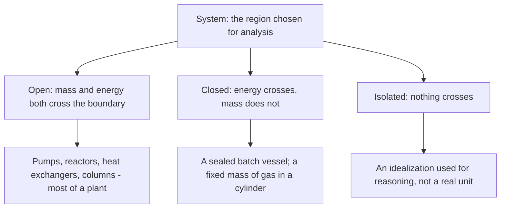
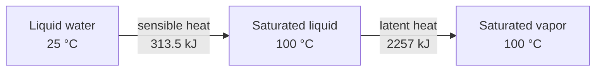

## Video Lecture

<div class="video-container">
  <iframe
    width="560"
    height="315"
    src="https://www.youtube.com/embed/tGOpNey5U9E"
    title="Chemical Engineering Thermodynamics Ch.1: Energy and the First Law"
    allow="accelerometer; autoplay; clipboard-write; encrypted-media; gyroscope; picture-in-picture"
    allowfullscreen>
  </iframe>
</div>

> This video covers the same content as the text below. Choose your preferred learning format.

---

# Chapter 1: Energy and the First Law

This chapter builds the foundation of chemical engineering thermodynamics: what a system is, why state functions make energy bookkeeping tractable, and how the First Law turns into the energy balances that decide what a process costs to run.

**State Functions, Balances, and Why Thermodynamics Runs the Plant**

## Learning Objectives

By completing this chapter, you will be able to:

  * ✅ Explain the three questions thermodynamics answers that kinetics alone does not settle
  * ✅ Define a system, its boundary, and the difference between open, closed, and isolated systems
  * ✅ Distinguish state functions from path functions and explain why the distinction is practically useful
  * ✅ Apply the First Law in its closed-system ($\Delta U = Q - W$) and steady-flow ($\Delta H = Q - W_s$) forms
  * ✅ Separate sensible heat from latent heat and estimate the magnitude of each
  * ✅ Compute a heat-exchanger or reboiler duty from a flow rate and a temperature or phase change

**Reading Time**: 20-25 minutes **Code Examples**: 1 **Exercises**: 3

* * *

## 1.1 Why a Chemical Engineer Needs Thermodynamics

The *Chemical Engineering Introduction* series ended twice at the same wall. Its Chapter 1 wrote balances of the form *accumulation = in − out + generation − consumption* and observed that the **energy** balance is essential to feasibility and can be decisive for energy-intensive processes — without saying where stream energies come from. Its Chapter 2 warned that no catalyst can push a reactor past **chemical equilibrium** — without saying what sets that limit. Thermodynamics is what lies on the other side of both.

It supplies the general energy and equilibrium constraints that any rate law must be consistent with, and answers three questions kinetics alone does not settle:

1. **How much energy does a transformation require or release?** Kinetics tells you how fast a reaction runs; thermodynamic properties and an energy balance tell you how much heat must be added or removed once the conversion and the work interactions are specified.
2. **How far can it go?** Equilibrium is a thermodynamic limit for the stated conditions. A better catalyst reaches it sooner but cannot move it; only changing the constraints — removing product, adding work, coupling another reaction — changes the attainable conversion.
3. **Which direction is spontaneous?** Whether a process runs by itself or has to be driven — and at what minimum cost — is decided by the Second Law ([Chapter 2](chapter-2.html)).

That is the division of labor worth memorizing: **kinetics governs rate, thermodynamics governs possibility and price.** A viable design has to satisfy both: ignoring rates can leave a process slow, unselective, or unsafe, while a design that violates thermodynamics cannot be built at all, and no amount of engineering effort will rescue it.

## 1.2 The System and Its State

Every thermodynamic statement begins with a choice: **what are we accounting for?** The region selected is the **system**, everything else the **surroundings**, and the real or imaginary surface between them the **boundary**. That boundary is chosen by the engineer, not given by nature — draw it around one side of a heat exchanger and you get that stream's duty; draw it around the plant and you get the site utility requirement, which becomes a bill once utility prices are applied.

Systems are classified by what the boundary lets through:



Continuous process equipment is almost always **open**: material carries energy across the boundary, and heat and shaft work may cross it as well — though some units, such as a nearly adiabatic valve, exchange neither appreciably. A sealed batch vessel is modelled as **closed** over intervals in which no material is added, vented, or sampled.

### State Functions and Path Functions

Energy bookkeeping uses two different kinds of quantity: **state properties**, which describe a system's condition, and **process quantities** such as heat and work, which describe what crossed the boundary along a particular path. Heat and work are not properties of the system at all, and telling the two kinds apart is the most useful skill in this chapter.

| | **State functions** | **Path functions** |
|---|---|---|
| **Examples** | Internal energy $U$, enthalpy $H$, temperature $T$, pressure $P$, volume $V$, entropy $S$ | Heat $Q$, work $W$ |
| **Depend on** | The current state only | *How* the system got there |
| **Notation** | Changes written $\Delta U$, $\Delta H$ | Amounts, never "$\Delta Q$" |

A **state function** has a value fixed by the present condition of the system: liquid water at 100 °C and 1 atm has a particular enthalpy whether it was heated from ice or condensed from steam. A **path function** has no such value — you cannot ask how much heat a system "contains," only how much crossed its boundary during a specified process.

Properties also split by size. **Extensive** properties scale with the amount of material (total volume, total enthalpy, mass); **intensive** properties do not (temperature, pressure, density, and any extensive property divided by mass, such as specific enthalpy in kJ/kg). Throughout this chapter, $h$ denotes **specific** enthalpy in kJ/kg and $H = m\,h$ the total enthalpy of a mass $m$. Stream energy rates are then obtained by multiplying a specific property by a mass flow rate — a stream's enthalpy rate is $\dot{m}\,h$.

The distinction matters commercially because **a change in a state function can be computed from tables without knowing the path**. To find the **enthalpy change** between water at 25 °C and steam at 200 °C, 10 bar you need only the two end states; the route between them is irrelevant. The heat the boiler must supply equals that change only under the steady-flow assumptions used below — negligible shaft work, negligible losses, negligible kinetic- and potential-energy changes. That single fact is what makes **steam tables** and **process simulators** possible — a simulator does not model the physics inside every pipe; it evaluates property differences between states from a thermodynamic model and uses them inside its material-balance, energy-balance, and equipment equations.

## 1.3 The First Law

The First Law of Thermodynamics is conservation of energy with heat and work counted honestly. For a **closed system**:

$$ \Delta U = Q - W $$

More generally the left-hand side is $\Delta(U + \mathrm{KE} + \mathrm{PE})$; the form above applies when changes in bulk kinetic and potential energy are negligible.

The sign convention must be stated explicitly, because textbooks differ. Both conventions are in use; this chapter adopts: **$Q$ is positive when heat flows *into* the system, and $W$ is positive when work is done *by* the system on the surroundings.** Heat in raises $U$; work out lowers it.

Most plant equipment is not closed, though — it flows. For an **open system at steady state** with one inlet and one outlet, with kinetic- and potential-energy terms neglected — usually small at typical process velocities and elevations, but worth checking against the other terms, since elevation can dominate a pumping duty and velocity changes matter in nozzles and some gas flows — the working form is:

$$ \Delta H = Q - W_s $$

for the material passing through, where $W_s$ is the **shaft work** exchanged with a pump, compressor, or turbine. Per unit mass the same balance reads $\Delta h = q - w_s$, and on a rate basis $\dot{Q} - \dot{W}_s = \dot{m}\,(h_{\text{out}} - h_{\text{in}})$, where a dot marks a **rate**: $\dot{Q}$ and $\dot{W}_s$ are in kW, against the amounts $Q$ and $W_s$ in kJ.

The reason enthalpy appears instead of internal energy is that flowing material carries its own pressure-volume energy across the boundary. Enthalpy bundles that in by definition:

$$ H = U + PV $$

so that $H$ becomes the natural energy currency of flow processes. For a heat exchanger, a reboiler, or a condenser — no shaft work at all — the equation collapses to the most-used expression in process engineering: $Q = \Delta H$.

### Worked Example: Heating One Kilogram of Water

Take 1 kg of liquid water at **25 °C** and turn it into saturated steam at **100 °C**, 1 atm. The path splits into two physically distinct steps:



**Step 1 — sensible heat**, warming the liquid, using $c_p \approx 4.18$ kJ/(kg·K) for liquid water:

$$ Q_1 = m\,c_p\,\Delta T = 1 \times 4.18 \times (100 - 25) = 313.5\ \text{kJ} $$

**Step 2 — latent heat**, boiling it at constant temperature, using $\lambda \approx 2257$ kJ/kg at 100 °C and 1 atm:

$$ Q_2 = m\,\lambda = 1 \times 2257 = 2257\ \text{kJ} $$

$$ Q_{\text{total}} = 313.5 + 2257 = 2570.5\ \text{kJ} $$

The vaporization step costs about **7.2 times** as much as heating the liquid through 75 °C — and it happens at constant temperature, so a thermometer reports nothing at all while the great majority of the energy goes in. Latent duties of that size are a large part of why **evaporation and distillation can be major energy consumers**: boiling is where the money tends to go.

```python
CP_WATER = 4.18    # kJ/(kg K), liquid water
LAMBDA_100C = 2257 # kJ/kg, latent heat of vaporization at 100 C, 1 atm
T_BOIL = 100.0     # C

print(f"{'T_feed':>7} {'sensible':>9} {'latent':>8} {'total':>8} {'latent_pct':>11} {'ratio':>7}")
for t_feed in [20, 25, 40, 60, 80]:
    sensible = CP_WATER * (T_BOIL - t_feed)   # kJ/kg
    total = sensible + LAMBDA_100C            # kJ/kg
    print(f"{t_feed:7.0f} {sensible:9.1f} {LAMBDA_100C:8.0f} {total:8.1f} "
          f"{100*LAMBDA_100C/total:11.1f} {LAMBDA_100C/sensible:7.2f}")

#  T_feed  sensible   latent    total  latent_pct   ratio
#      20     334.4     2257   2591.4        87.1    6.75
#      25     313.5     2257   2570.5        87.8    7.20
#      40     250.8     2257   2507.8        90.0    9.00
#      60     167.2     2257   2424.2        93.1   13.50
#      80      83.6     2257   2340.6        96.4   27.00
```

Note what the table says about **feed preheating**: raising the feed from 20 °C to 80 °C removes 250.8 kJ/kg from the boiler's job, but 2257 kJ/kg of it never goes away. Preheat all you like — the phase change is untouched.

## 1.4 Heat Capacity and Sensible vs Latent Heat

**Specific heat capacity** $c_p$ is the energy needed to raise one kilogram of a substance by one kelvin at constant pressure. It is a state-dependent material property — it varies with temperature, and also with pressure, phase, and composition — so its variation across the operating range has to be assessed. A representative mean value is normally good enough for hand calculations over a modest single-phase interval; otherwise integrate a property correlation.

| Material class | Typical $c_p$ [kJ/(kg·K)] | Typical latent heat [kJ/kg] |
|---|---|---|
| **Liquid water** | ≈ 4.18 | 2257 (at 100 °C, 1 atm) |
| **Organic liquids** | ≈ 1.5–2.5 | ≈ 300–900 |
| **Gases** | of order 1 | — |

Liquid water is a conspicuous outlier: roughly twice the heat capacity of a typical organic liquid, which is why it is an excellent coolant — and its unusually large mass-specific latent heat, a separate property, is what makes it expensive to boil.

The pattern across the table is the practical rule of this chapter:

> **At ordinary conditions, vaporizing a stream usually costs far more heat than a modest single-phase temperature change.**

Heating an organic liquid through a large 50 K span costs perhaps 75–125 kJ/kg. Boiling it costs several hundred. Whenever an energy estimate looks surprisingly large, the first thing to check is whether something is being vaporized.

## 1.5 Energy Balances in Practice

On a flowsheet, the First Law becomes an arithmetic you can do on the back of an envelope. For a stream of mass flow rate $\dot{m}$, writing $\dot{Q}$ for the heat **rate** (kW) as distinct from the amount $Q$ (kJ) used in the worked example above:

$$ \dot{Q} = \dot{m}\,c_p\,\Delta T \quad \text{(no phase change)} \qquad\qquad \dot{Q} = \dot{m}\,\lambda \quad \text{(phase change)} $$

Both are shortcuts to $\dot{Q} = \dot{m}\,\Delta h$: the first needs a representative mean $c_p$, no shaft work, and no other significant energy change; the second needs the mass rate actually undergoing the stated isothermal transition and its latent enthalpy. The result, the **duty**, is the required heat rate in kW or MW. It is an input to exchanger sizing, to the utility-flow calculation, and — once utility prices are applied — to the operating-cost estimate.

This is why a **distillation column's reboiler and condenser are often the largest utility consumers on a separation-intensive flowsheet**. A column does not merely warm its feed — it boils a stream at the bottom and condenses it again at the top, because the reflux returned to the column sustains an internal liquid circulation that generally raises the vapour the reboiler has to generate. Multiply a latent heat of hundreds or thousands of kJ/kg by that reflux-amplified internal flow, and the column can dwarf the pumps, the preheaters, and often the reactor itself — though the ordering follows only from the actual duties of a given flowsheet.

An obvious question follows: for a simple column whose net feed and product enthalpy flows are small, the condenser rejects nearly as much energy as the reboiler supplies, so why not feed one with the other? Sometimes you can — heat integration and multi-effect evaporation do exactly that. But the First Law alone does not set the limit on how much can be recovered. The First Law counts energy and finds it conserved; it never says that heat rejected at 40 °C is worth less than heat supplied at 150 °C. That accounting requires **entropy**.

## 1.6 Chapter Summary

- Thermodynamics answers three questions kinetics alone does not settle: **how much energy**, **how far** (equilibrium), and **which direction** (spontaneity); kinetics governs rate, thermodynamics governs possibility and price, and the two must be consistent
- Analysis starts by drawing a **boundary**: open systems exchange mass and energy, closed ones only energy, isolated ones neither; plant equipment is overwhelmingly open
- **State properties** ($U$, $H$, $T$, $P$, $V$) depend only on the current state; **process quantities** ($Q$, $W$) are not properties of the system and depend on the route — which is why enthalpy changes can be read from steam tables without modeling the path
- First Law, closed system: $\Delta U = Q - W$ when kinetic and potential energy changes are negligible, with $Q$ positive **into** the system and $W$ positive **by** the system; steady flow: $\Delta H = Q - W_s$, or per unit mass $\Delta h = q - w_s$ and on a rate basis $\dot{Q} - \dot{W}_s = \dot{m}\,\Delta h$, where $H = U + PV$ makes enthalpy the currency of flow processes
- Heating 1 kg of water from 25 °C to saturated steam at 100 °C takes **313.5 kJ sensible + 2257 kJ latent = 2570.5 kJ**, the latent term being about **7.2×** the sensible one
- **At ordinary conditions vaporization usually costs far more than a modest temperature change** — water $c_p \approx 4.18$, organics ≈ 1.5–2.5 kJ/(kg·K), against latent heats of hundreds to thousands of kJ/kg
- Duties follow as $\dot{Q} = \dot{m} c_p \Delta T$ or $\dot{Q} = \dot{m}\lambda$ under their respective assumptions; reboilers and condensers are therefore often the dominant utility loads on a separation-intensive flowsheet

**Next chapter**: the First Law says energy is conserved, so in principle no energy is ever lost. Yet real plants still lose energy across practical boundaries and destroy useful-work potential through irreversibility. **Entropy and the Second Law** ([Chapter 2](chapter-2.html)) explain why energy has quality as well as quantity, and set the real limit on what can be recovered.

## Exercises

1. **Conceptual — state vs. path**: Two engineers take 1 kg of water from 25 °C, 1 atm to saturated steam at 100 °C, 1 atm. Engineer A heats the liquid, then boils it. Engineer B first pressurizes and superheats the water, then throttles and cools it back to the same final state. (a) Do they obtain the same $\Delta H$? (b) Do they require the same $Q$? (c) What does this tell you about tabulating thermodynamic data?
   *Hint*: sort the quantities into state functions and path functions before answering.
   *Answer*: (a) **Yes.** $H$ is a state function, so $\Delta H$ depends only on the initial and final states, which are identical — 2570.5 kJ/kg in both cases under the constant-$c_p$, constant-$\lambda$ assumptions used above. (b) **Not necessarily, and not here.** $Q$ is a path function, so the endpoints do not fix it; on a common steady-flow basis, B's route involves a net shaft-work input to pressurize, so its heat requirement differs. (c) State properties can be tabulated without specifying a path, whereas heat and work can be tabulated only for a specified process. A steam table lists specific $h$, $u$, $s$, and $v$ for fully specified states — saturated-liquid and saturated-vapour entries, with quality fixing two-phase mixtures — because those are path-independent; there could never be a table of "the heat contained in steam," because heat is not a property a system holds.

2. **Quantitative — heat duty**: A plant vaporizes **500 kg/h** of water fed at **20 °C** into saturated steam at **100 °C**, 1 atm. Using $c_p = 4.18$ kJ/(kg·K) and $\lambda = 2257$ kJ/kg, compute (a) the sensible and latent duties per kilogram, (b) the total heat rate in kJ/h and GJ/h, (c) the equivalent power in kW.
   *Hint*: work per kilogram first, then multiply by the flow rate; 1 kW = 1 kJ/s, and there are 3600 s in an hour.
   *Answer*: (a) Sensible = 4.18 × (100 − 20) = **334.4 kJ/kg**; latent = **2257 kJ/kg**; total = **2591.4 kJ/kg**. (b) 500 × 2591.4 = **1,295,700 kJ/h ≈ 1.30 GJ/h**. (c) 1,295,700 / 3600 = **≈ 360 kW**. Note that the latent term supplies 2257/2591.4 = **87.1%** of the duty — the phase change, not the 80 K temperature rise, is what the boiler is really paying for.

3. **Discussion — where the energy goes**: A colleague proposes cutting a distillation column's steam bill by installing a large feed preheater that raises the feed from 25 °C to 90 °C. Explain (a) what this saves, (b) why the saving is smaller than they expect, and (c) what the First Law alone cannot tell you about recovering the condenser's heat to run the reboiler.
   *Hint*: split the reboiler's job into sensible and latent parts, then ask what distinguishes 40 °C heat from 150 °C heat.
   *Answer*: (a) It shifts sensible duty off the reboiler — for water, 4.18 × 65 ≈ **272 kJ/kg**. Note that at 1 atm water is still **subcooled** at 90 °C (it boils near 100 °C), so the preheater brings the feed closer to, not up to, its bubble point. Under otherwise fixed column conditions the reboiler duty falls whatever the preheat source; whether the *total* utility bill falls depends on where the preheat comes from — a hot process stream rather than fresh steam. (b) The **latent** duty of the vapour traffic inside the column is the far larger term (of order 2257 kJ/kg for water, regenerated on every pass). Preheating does change the feed's thermal condition — its feed-quality parameter $q$ — and so does alter the internal vapour and liquid flows and the required boil-up; but the shift is a second-order correction to the latent term, so the saving should be estimated from a column balance rather than assumed to be either zero or large. (c) The First Law says only that energy is conserved: the condenser rejects nearly as much as the reboiler absorbs, so on paper the recovery looks free. It cannot express the fact that the condenser's heat leaves at a **lower temperature** than the reboiler needs, and so cannot flow there unaided. Quantifying that quality gap — and the minimum work to bridge it, as a heat pump would — requires **entropy** and the Second Law.
