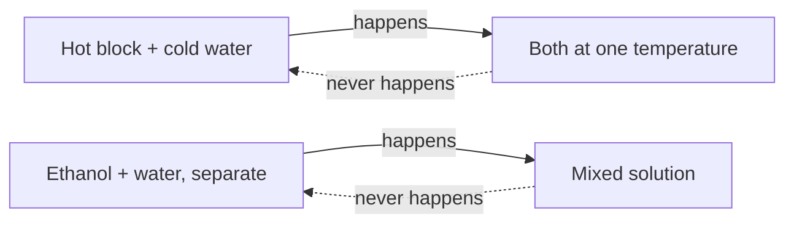
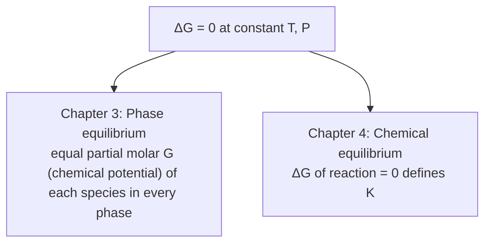

## Video Lecture

<div class="video-container">
  <iframe
    width="560"
    height="315"
    src="https://www.youtube.com/embed/tGOpNey5U9E?start=739"
    title="Chemical Engineering Thermodynamics Ch.2: Entropy and the Second Law"
    allow="accelerometer; autoplay; clipboard-write; encrypted-media; gyroscope; picture-in-picture"
    allowfullscreen>
  </iframe>
</div>

> This video covers the same content as the text below. Choose your preferred learning format.

---

# Chapter 2: Entropy and the Second Law

Chapter 1 gave us a ledger: energy is conserved, and we can count it. This chapter gives us a **compass**. The Second Law tells us which way a process will go on its own, how much work we can possibly extract from heat, and why separating a stable mixture always costs an input of free energy.

**Direction, Limits, and the Price of Separation**

## Learning Objectives

By completing this chapter, you will be able to:

  * ✅ Explain why energy conservation alone cannot predict the direction of a process
  * ✅ Define entropy as a state function and state the Second Law as $\Delta S_{universe} \geq 0$
  * ✅ Compute the Carnot efficiency and explain why work is thermodynamically more valuable than heat
  * ✅ Calculate the minimum work of separation for an ideal binary mixture
  * ✅ Compare that minimum with real distillation energy use and interpret the gap
  * ✅ Use Gibbs energy as the criterion for spontaneity and equilibrium in a closed system at fixed T and P

**Reading Time**: 20-25 minutes **Code Examples**: 1 **Exercises**: 3

* * *

## 2.1 The Question the First Law Cannot Answer

Drop a hot steel block into cold water. Heat flows from the block into the water until both reach the same temperature, and energy is conserved. Now imagine the reverse: the water spontaneously cools while the block heats up. Energy would be conserved just as exactly. Nothing in the First Law forbids it — and yet it never happens.

The same asymmetry is everywhere in a plant. Stir ethanol into water and you get a solution; the solution never separates itself back into two layers. A gas leaks from a cylinder into a room, but never crowds back in.



Every one of these processes conserves energy in **both** directions, yet only one direction is ever observed. The First Law is a bookkeeper: it audits quantity but says nothing about direction. Something else is doing the choosing.

That something is the **Second Law of Thermodynamics**, and the quantity it tracks is **entropy**.

## 2.2 Entropy

**Entropy**, symbol $S$, is a state function with units of J/K — like internal energy or enthalpy, it depends only on the current state of a system, not on how the system got there. For a reversible transfer of heat at constant absolute temperature $T$:

$$ \Delta S = \frac{Q_{rev}}{T} $$

The temperature in the denominator carries the physical meaning. The *same* joule of heat produces a *larger* entropy change when it enters a cold body than a hot one. That is why the hot block heats the water and not the reverse: the entropy the block loses at high $T$ is smaller than the entropy the water gains at low $T$, so the transfer increases the total.

Statistically, entropy counts possibilities. When the accessible molecular arrangements (**microstates**) are equally probable, a macroscopic state realizable in an enormous number of ways is overwhelmingly more probable than one realizable in only a few. Astronomically more arrangements have a gas spread through a vessel than crowded into its left half, so the gas fills the vessel — not because a force pushes it, but because spreading out is what nearly all arrangements look like. For equally probable microstates, entropy is $S = k_B \ln \Omega$, the logarithm of that count scaled by Boltzmann's constant.

The Second Law then says:

$$ \Delta S_{universe} = \Delta S_{system} + \Delta S_{surroundings} \geq 0 $$

The entropy of a system can certainly fall — a refrigerator freezes water every day — but only if the surroundings gain at least as much as the system loses, and strictly more when the overall process is irreversible. Equality holds only for a **reversible** process, an idealization run so slowly and so free of friction, unrestrained expansion, finite temperature differences, and *uncontrolled* mixing across finite chemical-potential differences that it could be retraced exactly. (Mixing itself is not inherently irreversible: with selective membranes and infinitesimal driving forces it too can be idealized as reversible, which is exactly the limit §2.4 uses to price separation.) No real process qualifies. **Every real process generates entropy**, and relative to an environment at $T_0$ that generated entropy measures destroyed work potential, $X_{destroyed} = T_0 S_{gen}$ — the thermodynamic account of what irreversibility costs a plant in useful work, and, once energy prices are applied, in money.

## 2.3 The Carnot Limit

The most consequential result of the Second Law concerns converting heat into work. A heat engine takes heat from a hot reservoir at $T_h$, produces work, and must reject some heat to a cold reservoir at $T_c$. That rejection is not an engineering failure to be designed away — it is what keeps total entropy from decreasing. Requiring $\Delta S_{universe} \geq 0$ gives a hard ceiling on efficiency:

$$ \eta_{max} = 1 - \frac{T_c}{T_h} $$

with both temperatures **absolute**, in kelvin. Take a steam power plant with a boiler at 500 °C and cooling water at 25 °C:

$$ T_h = 773\ \text{K},\quad T_c = 298\ \text{K} \quad\Rightarrow\quad \eta_{max} = 1 - \frac{298}{773} = 0.614 \approx 61.4\% $$

No boiler design, working fluid, or turbine metallurgy can beat 61.4% for those two temperatures. Real steam plants land well below it — typically in the 35–45% range — because real expansion, heat transfer across finite temperature differences, and friction all generate entropy.

The engineering lesson runs deeper than power generation. Heat and work are both measured in joules, but **they are not interchangeable**. Work converts to heat completely and freely; heat converts to work only partially, and the fraction shrinks as the source gets colder:

| | Thermodynamic value | Practical consequence |
|---|---|---|
| **Work** (electricity, shaft power, compression) | High — fully convertible | Usually the costliest energy input; minimize total cost, not work alone |
| **High-temperature heat** (fired heater, HP steam) | Moderate | Worth cascading down to lower-temperature duties |
| **Low-temperature heat** (LP steam, warm water) | Low | Little work potential once close to ambient; still useful for heating |

Two plant realities follow directly. First, **heat integration matters** — pinch analysis (Introduction series, Chapter 4) targets and designs process heat recovery from the stream heat balances subject to a chosen minimum temperature approach, the effect being that each parcel of heat is used at the highest temperature where it is still useful rather than having its work potential destroyed in one step. Second, **compression can be a major operating cost wherever gas throughputs or pressure ratios are large**: it consumes work, generally the most expensive form of energy. Waste heat is not automatically a substitute — but it is not excluded either, since heat can drive a power cycle that turns a compressor, and absorption, adsorption, or ejector arrangements can replace some mechanical compression duties, subject to temperature, efficiency, and cost.

## 2.4 Why Separation Costs Energy

Now apply the same logic to the plant's other great energy consumer. Ideal mixing is spontaneous because it increases entropy — a mixture has vastly more microstates available than the separated components. (In general, spontaneity at fixed $T$ and $P$ is decided by $\Delta G_{mix}$, which is why some mixtures demix instead.) Separating an ideal mixture back into pure components at the same $T$ and $P$ **reverses that positive mixing entropy**, and by the Second Law the entropy has to be exported somewhere: the separation needs an adequate source of free energy. That can be shaft work, but it can equally be heat supplied across a temperature difference — as in distillation — or another available potential.

For an **ideal binary mixture** of mole fraction $x$, the entropy of mixing per mole is $\Delta S_{mix} = -R\,[x \ln x + (1-x)\ln(1-x)]$, and the minimum reversible work to undo it at temperature $T$ is that entropy times $T$ (quoted as the magnitude of the work input; under Chapter 1's sign convention it would carry a negative sign):

$$ w_{min} = -RT\,\big[\,x \ln x + (1-x)\ln(1-x)\,\big] $$

For an equimolar mixture at 298 K, with $R = 8.314$ J/(mol·K):

$$ w_{min} = -(8.314)(298)\,(0.5\ln 0.5 + 0.5\ln 0.5) = (8.314)(298)(0.693) = 1717\ \text{J/mol} \approx 1.72\ \text{kJ/mol} $$

```python
import math

R = 8.314      # J/(mol K)
T = 298.0      # K

def w_min(x, T=T):
    """Minimum reversible work to separate 1 mol of an ideal binary
    mixture of composition x into two pure streams, in J/mol."""
    if x <= 0.0 or x >= 1.0:
        return 0.0
    return -R * T * (x * math.log(x) + (1 - x) * math.log(1 - x))

print(f"{'x_A':>6} {'w_min (J/mol)':>15} {'w_min (kJ/mol)':>16}")
for x in [0.01, 0.05, 0.10, 0.25, 0.50, 0.75, 0.90, 0.99]:
    w = w_min(x)
    print(f"{x:6.2f} {w:15.1f} {w/1000:16.3f}")

w50 = w_min(0.50)
print(f"\nEquimolar mixture at {T:.0f} K: w_min = {w50:.0f} J/mol = {w50/1000:.2f} kJ/mol")

#    x_A   w_min (J/mol)   w_min (kJ/mol)
#   0.01           138.7            0.139
#   0.05           491.8            0.492
#   0.10           805.4            0.805
#   0.25          1393.2            1.393
#   0.50          1717.3            1.717
#   0.75          1393.2            1.393
#   0.90           805.4            0.805
#   0.99           138.7            0.139
#
# Equimolar mixture at 298 K: w_min = 1717 J/mol = 1.72 kJ/mol
```

The curve is symmetric and peaks at $x = 0.5$: an equimolar (50/50) ideal mixture has the largest reversible separation work *per mole of mixture* at a given temperature, while dilute mixtures cost little per mole of mixture — though a great deal per mole of the trace component recovered. Actual separation difficulty depends on more than this number: relative volatility, purity and recovery targets, phase behaviour, and the equipment all enter.

Now the comparison that should stay with you. That equimolar separation has a thermodynamic price of about **1.7 kJ per mole of mixture**. Real distillation is far less efficient than that floor, and this chapter uses **10 to 100 times the thermodynamic minimum** as an illustrative order-of-magnitude range only: it is quoted here without a traceable source, and no energy-versus-exergy basis, system, or product specification is attached to it. Note also that it compares a reboiler *heat* duty with a minimum reversible *work* — different thermodynamic resources — so it is a rough energy ratio, not a measure of irreversibility. A defensible figure for a given separation comes from a specified process, purities, pressure, thermodynamic model, and utility temperatures.

That the gap between real and minimum separation energy is large is why separation is such an active research target. Each major alternative can reduce energy or exergy consumption for suitable separations — **heat pumps** and vapor recompression that reuse condenser duty in the reboiler, **dividing-wall columns** (two separations in one shell) that consolidate equipment and reduce intermediate-component remixing through thermal coupling, **membranes** and adsorption that avoid vaporizing the whole feed, though some still need phase change or thermal regeneration. None of them improves every case; the benefit depends on the feed, the product targets, and the utility conditions.

## 2.5 Gibbs Energy: The Engineer's Compass

Tracking $\Delta S_{universe}$ means accounting for the surroundings, which is awkward. Fortunately, the equilibrium calculations chemical engineers run are usually posed at a **specified temperature and pressure** — even though the processes themselves routinely change both — and for those conditions the Second Law repackages into a property of the system alone: the **Gibbs energy**,

$$ G = H - TS $$

Its power is the criterion it yields. For a closed system held at fixed $T$ and $P$, with only pressure-volume work and the relevant amounts conserved:

| Condition | Meaning |
|---|---|
| $\Delta G < 0$ | Process is **spontaneous** in the direction written |
| $\Delta G = 0$ | No driving force for that change; stable **equilibrium** is the state that minimizes $G$ over all allowed changes |
| $\Delta G > 0$ | Process is thermodynamically **unfavourable** as written; the reverse change lowers $G$ |

Read the definition as a competition. The $H$ term rewards lowering energy — forming bonds, condensing, and, in familiar molecular solids, ordering. The $-TS$ term rewards raising entropy — vaporizing, mixing, and dissociations that create more independently moving species. Temperature is the referee, and raising it strengthens the entropy side, which is why a liquid boils when hot and freezes when cold, and why raising the temperature can make an entropy-increasing reaction favourable. (A reaction that needs heating merely to run at a measurable rate is a kinetic matter, not this one.)

Everything that follows in this series is this one criterion applied twice:



In **Chapter 3**, minimizing $G$ across a vapor-liquid boundary gives the condition that each species has the same chemical potential in both phases — the basis of every VLE calculation and column design. In **Chapter 4**, setting the Gibbs energy change of a reaction to zero gives the equilibrium constant $K$; combined with thermochemical data and the van 't Hoff relation it also gives $K(T)$, and together with the material balances and the operating constraints it sets the equilibrium conversion no catalyst can exceed.

## 2.6 Chapter Summary

- The First Law audits energy quantity but permits both directions; the **Second Law supplies direction**
- **Entropy** $S$ is a state function; $\Delta S = Q_{rev}/T$ for isothermal reversible heat transfer, and statistically it counts the microstates available to a state
- $\Delta S_{universe} \geq 0$, with equality only for idealized reversible processes — **every real process generates entropy**, destroying work potential $X_{destroyed} = T_0 S_{gen}$
- **Carnot**: $\eta_{max} = 1 - T_c/T_h$ with absolute temperatures; 500 °C/25 °C gives 61.4%, while real steam plants reach roughly 35–45%
- Work is thermodynamically precious and heat is comparatively cheap — hence heat integration, and hence compression being a major operating cost in gas-handling processes
- Ideal mixing raises entropy, so **separation must be paid for out of some free-energy source — work or heat across a temperature difference**: $w_{min} = -RT[x\ln x + (1-x)\ln(1-x)]$, which is **1.72 kJ/mol** for an equimolar mixture at 298 K
- Real distillation uses far more than that minimum; the **10–100×** figure used here is an unsourced illustrative range, but the headroom it points at is what motivates heat pumps, dividing-wall columns, and membranes
- **Gibbs energy** $G = H - TS$ converts the Second Law into a system-only test for a closed system at fixed $T$ and $P$: a change is spontaneous when $\Delta G < 0$, and equilibrium is where $G$ is minimized, so every allowed change has $\Delta G = 0$ or $> 0$

**Next chapter**: we apply the minimum-$G$ criterion to coexisting phases. Vapor-liquid equilibrium, Raoult's law, activity coefficients, and azeotropes — the thermodynamics that decides whether a distillation column can make the separation at all.

## Exercises

1. **Conceptual — direction and the two laws**: A vendor claims a device that takes in 100 kW of waste heat at 60 °C and delivers 30 kW of shaft work while rejecting 70 kW to cooling water at 25 °C. (a) Does the claim violate the First Law? (b) Does it violate the Second Law? (c) What is the largest work output physically possible from that heat stream?
   *Hint*: Check the energy balance first, then compare the claimed efficiency with the Carnot limit using absolute temperatures.
   *Answer*: (a) **No** — 30 + 70 = 100 kW, so energy is conserved. (b) **Yes**. The claimed efficiency is 30/100 = 30%, but $T_h$ = 333 K and $T_c$ = 298 K give $\eta_{max}$ = 1 − 298/333 = 0.105, i.e. **10.5%**. (c) Treating the 100 kW as supplied isothermally at 60 °C, at most 0.105 × 100 kW ≈ **10.5 kW**, and a real device would deliver appreciably less; a stream that cools as it gives up heat yields less still. The small Carnot factor is why low-temperature waste heat has limited work potential, which often makes power recovery hard to justify economically — where a matching heat demand exists at the right temperature, place, and time, using the stream directly for heating is usually preferable.

2. **Quantitative — Carnot efficiency of a geothermal plant**: A geothermal resource supplies heat at 150 °C and the plant rejects heat to the environment at 25 °C. (a) Compute the maximum thermodynamic efficiency. (b) If the plant actually achieves 12%, what fraction of the ideal is that? (c) Comment on why geothermal plants have low efficiency yet can still be economic.
   *Hint*: Convert to kelvin first: 150 °C = 423 K, 25 °C = 298 K. Then $\eta_{max}$ = 1 − $T_c/T_h$.
   *Answer*: (a) $\eta_{max}$ = 1 − 298/423 = 0.2955 ≈ **29.6%**. (b) 12/29.6 = **0.41**, about 41% of the Carnot limit — a normal fraction for a low-temperature binary-cycle plant. (c) Efficiency measures how much of the heat becomes work, but **no fuel is purchased**: the resource is renewable at the geological scale, though an individual reservoir can cool and lose pressure if extraction outruns heat and fluid recharge, which is why reinjection and reservoir management matter. So the economics are dominated by capital cost per kW installed and by lifetime net generation — well productivity, resource decline, capacity factor, pumping, and financing — rather than by fuel efficiency. Contrast a fired boiler, where every point of efficiency is fuel purchased.

3. **Quantitative — minimum work of separation**: A stream contains 10 mol% ethanol in water and must be separated into pure components at 298 K. Treating it as an ideal binary mixture, (a) compute $w_{min}$ per mole of mixture, (b) express it per mole of ethanol recovered, and (c) apply §2.4's illustrative 10–100× range to it, and say what such an estimate can and cannot mean.
   *Hint*: $w_{min}$ = −RT[x ln x + (1−x) ln(1−x)] with x = 0.10, R = 8.314 J/(mol·K), T = 298 K. For (b), divide by 0.10 mol of ethanol per mole of mixture.
   *Answer*: (a) x ln x = 0.10 × ln 0.10 = −0.2303 and (1−x)ln(1−x) = 0.90 × ln 0.90 = −0.0948; the sum is −0.3251, so $w_{min}$ = 8.314 × 298 × 0.3251 = **805 J/mol ≈ 0.81 kJ/mol of mixture**. (b) Per mole of ethanol: 805/0.10 = **8.05 kJ/mol of ethanol** — dilution is expensive, even though the per-mole-of-mixture figure looks small. (c) *If* the illustrative 10–100× range of §2.4 applied to this separation, it would give ≈ **8–81 kJ per mole of mixture** — but the range is unsourced, and it compares a heat duty with a minimum work, so this is an order-of-magnitude illustration and not a design duty. It is doubly conditional here: ethanol-water is strongly non-ideal and forms an azeotrope at about 95.6% ethanol by mass, so ordinary distillation cannot reach the pure ethanol the question specifies at all — a limit Chapter 3 explains. A real duty would have to come from a feasible process with stated purities, recovery, pressure, and utility temperatures.
