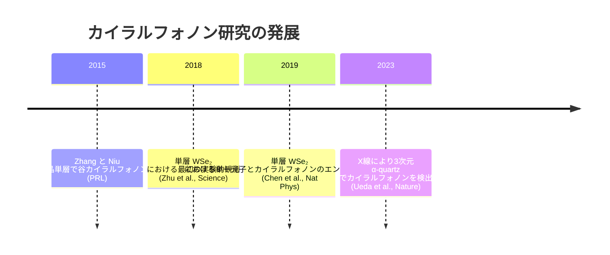
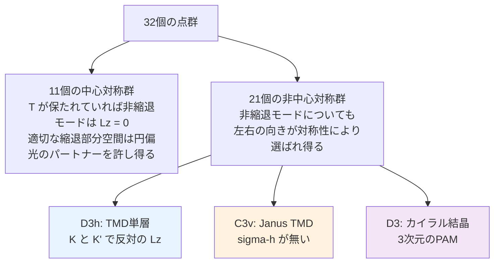

## ビデオ講義

<div class="video-container">
  <iframe
    width="560"
    height="315"
    src="https://www.youtube.com/embed/6BFGvrQna9s"
    title="カイラルフォノン 第1章: 理論的基礎"
    allow="accelerometer; autoplay; clipboard-write; encrypted-media; gyroscope; picture-in-picture"
    allowfullscreen>
  </iframe>
</div>

> このビデオは以下のテキストと同じ内容をカバーしています。お好みの学習形式をお選びください。

---

[🌐 EN](../../../en/MS/chiral-phonons/chapter-1.md) | 🇯🇵 JP | Last sync: 2025-12-19

[材料科学道場](../index.html) > [カイラルフォノン](index.md) > 第1章

---

**読了時間:** 50-60分 | **難易度:** 上級 | **コード例:** 1 | **演習:** 5問

---

本章では、カイラルフォノンの理論的基礎を確立します。フォノン角運動量（PAM）、カイラリティに対する対称性の要件、ベリー位相との関係、そして群論解析を扱います。フォノン円偏光の数学的定式化を検討し、フォノン固有ベクトルから PAM を計算する計算手法を実装します。

---

## 学習目標

本章を修了すると、以下のことができるようになります。

- ✅ フォノン角運動量（PAM）を定義し、その物理的起源を理解する
- ✅ 左巻きのカイラルフォノンと右巻きのカイラルフォノンを区別する
- ✅ モードの角運動量が 0 でなければならない対称性の条件を述べる
- ✅ 群論を適用してフォノンモードを分類し、離散的な擬角運動量ラベルと力学的な角運動量とを区別して扱う
- ✅ フォノンのカイラリティとベリー位相の関係を理解する
- ✅ Python を用いてフォノン固有ベクトルから PAM を計算する
- ✅ カイラルフォノン励起の選択則を解析する
- ✅ 結晶構造から材料のカイラリティを予測する

---

## 1.1 導入: 発見と歴史的背景

### カイラルフォノン物理の誕生

格子振動が担う角運動量と、その背後にある原子の円運動は、2015年より前にも解析されていました——Zhang と Niu 自身による、フォノン角運動量についての先行研究を含めてです。2015年の *Physical Review Letters* 論文で Zhang と Niu が新たに加えたのは、**谷カイラルフォノン**という具体的な予言でした。すなわち、単層六方格子の高対称点 \\(K\\)/\\(K'\\) にあって、谷に結びついた角運動量を担うモードです。本章が土台とするのはこの予言です。2次元物質における最初の広く引用される実験的観測は、その後2018年に単層 WSe₂ について報告されました。

> **📚 歴史的マイルストーン**
>
> • **Zhang, L. & Niu, Q. (2015)**. "Chiral Phonons at High-Symmetry Points in Monolayer Hexagonal Lattices." *Physical Review Letters*, 115, 115502. — 単層六方格子の K/K' 谷におけるカイラルフォノンと、その角運動量の性質に関する理論的予言。
>
> • **Zhu, H. et al. (2018)**. "Observation of chiral phonons." *Science*, 359(6375), 579–582. — 単層 WSe₂ におけるカイラルフォノンの実験的観測（この実験が扱ったのは WSe₂ のみ）。
>
> • **Chen, X. et al. (2019)**. "Entanglement of single-photons and chiral phonons in atomically thin WSe₂." *Nature Physics*, 15, 221. — 放出された単一光子とカイラルフォノンとのエンタングルメント。エンタングルする自由度は光子とフォノンであって、「谷とフォノン」ではありません。
>
> • **Ueda, H. et al. (2023)**. "Chiral phonons in quartz probed by X-rays." *Nature*, 618, 946. — 3次元のカイラル結晶である α-quartz におけるカイラルフォノン。

### カイラルフォノンが重要な理由

カイラルフォノンは、いくつかの理由から格子動力学におけるパラダイムシフトを意味します。

- **谷-フォノン結合**: 谷が十分に分離した適切な六方晶単層では、時間反転で結ばれた \\(K\\) 点と \\(K'\\) 点のモードが互いに反対の角運動量を担い、フォノンを介した谷の操作への道が開ける。2次元であること自体は、谷の存在も非ゼロのフォノン角運動量も保証しない
- **角運動量輸送**: カイラルフォノンは電荷を伴わずに角運動量を担い輸送でき、フォノンに基づくスピントロニクスへの道を開く
- **バンドトポロジーとの接点**: 一部のフォノン系では、円偏光的な偏極と、独立に確立されたバンドトポロジーとが併存する。円偏光的な偏極それ自体は、トポロジカル不変量も保護された境界状態も確立しない（§1.5.3）
- **偏光分解分光**: 偏光分解したラマン測定は適切なカイラルモードを調べ得るが、選択則を決めるのはラマンテンソルと、入射光・散乱光*両方*の偏光である。通常の1次ラマン散乱が到達できるのはゾーン中心のモードであり、個々の \\(K\\) 谷フォノンは一般にその方法では到達できず、運動量を供給する過程を必要とする（§1.4.2）
- **量子情報**: カイラルフォノンは、固体系における量子状態操作のプラットフォーム候補となる



---

## 1.2 フォノン角運動量（PAM）

### 1.2.1 定義と物理的起源

周波数 \\(\omega\\)、波数ベクトル \\(\mathbf{q}\\) をもつフォノンモードについて、**フォノン角運動量（PAM）**とは、格子振動における原子変位が担う時間平均された角運動量のことです。

位置 \\(\mathbf{R}_i\\) にある質量 \\(m_i\\) の原子が変位 \\(\mathbf{u}_i(t)\\) をもつとき、全角運動量は \\(\sum_i m_i (\mathbf{R}_i + \mathbf{u}_i) \times \dot{\mathbf{u}}_i\\) です。ここでは振動部分のみを残します。

> **定義: フォノン角運動量（PAM）**
>
> \\[
> \mathbf{L}_{\text{phonon}} = \sum_{i} m_i \left( \mathbf{u}_i \times \dot{\mathbf{u}}_i \right)
> \\]
>
> 変位パターン \\(\mathbf{u}_i = \text{Re}\left[ \mathbf{e}_i e^{-i\omega t} \right]\\)（\\(\mathbf{e}_i\\) は複素固有ベクトル）をもつフォノン固有モードについて、時間平均された PAM は次のようになります。
>
> \\[
> \langle \mathbf{L} \rangle = \frac{\omega}{2} \sum_{i} m_i \, \text{Im}\left( \mathbf{e}_i^* \times \mathbf{e}_i \right)
> \\]

### 1.2.2 2つの角運動量ラベルと円偏光基底

フォノンの「角運動量」と呼ばれる量は、日常的に2つあります。本章ではこの2つを区別し、以降のすべての節でその区別を一貫して用います。

**力学的角運動量 \\(L_z\\)** は §1.2.1 で定義した量、すなわち偏極固有ベクトルから計算される期待値です。これは一般に \\(\hbar\\) の整数倍では*ありません*。モードの楕円率とともに連続的に変化する（§1.6）ので、整数 \\(s\\) を用いて \\(L_z = s\hbar\\) と書くことは一般のモードについて誤りです。正しいのは極限としての言明です。

\\[
L_z = \pm \hbar \qquad \text{(完全な円運動の面内モード、1フォノン量子に規格化された固有ベクトル)}
\\]

こうした完全な円偏光モードは教科書でおなじみの例であり、「カイラルフォノン」という言葉で通常意味されるものです。楕円偏光したモードはその中間の非ゼロの値を担います。カイラルであるためにモードが \\(\pm\hbar\\) に達する必要はありません。

**擬角運動量 \\(m\\)** はこれとは別のもの、すなわち力学的な量ではなく*離散的な対称性ラベル*です。\\(n\\) 回回転で不変に保たれる波数ベクトルにおいて、非縮退モードはその回転の固有ベクトルであり、固有値は \\(e^{-2\pi i m/n}\\) です。縮退した部分空間の中では、その回転を対角化する基底を選ぶことができます（同じ部分空間の実基底では対角化されません）。そして \\(m\\) は \\(n\\) を**法としてのみ**定義されます——§1.4 の3回回転の場合には \\(m = 0, \pm 1\\)（3 を法として）です。重要なのは、\\(m\\) が記述するのはブロッホ変位*パターン*全体が回転の下でどう回るか（回転が原子をどう置換するかを含む）であるのに対し、\\(L_z\\) は各原子の局所的な円運動についての重み付き和だという点です。**\\(m\\) は \\(L_z/\hbar\\) ではありません**。本章では両者を別々に報告し、一方から他方を推論することはしません。（また、§1.5.2 の谷ごとに分解されたベリー流束とも別物です。こちらは部分積分であり、一般に量子化されません。）

> **記法について。** 本シリーズでは **PAM** はつねに *phonon angular momentum*（フォノン角運動量）、すなわち §1.2.1 の力学的な量 \\(L_z\\) の略です。回転のラベルはつねに*擬角運動量* \\(m\\) と書き下します。文献によっては後者も PAM と略すことがあるので、読む際はどちらの意味かを確認してください。

### 左巻きフォノンと右巻きフォノン

> **🧭 左右の規約（本シリーズで一度だけ宣言し、以降すべてに用いる）**
>
> \\(L_z = +\hbar\\) ⇔ \\(+z\\) 方向から見て反時計回り ⇔ **左巻き**。本シリーズにおける「左巻き」「右巻き」というラベルはすべて、この唯一の定義を指します。
>
> これは*命名*の規約であって、それ以上のものではありません。どの光のヘリシティがあるモードを励起あるいは検出するかは、別個の、過程ごとに固有の問題です（§1.4.2）。それは相互作用、物質、散乱配置、運動量移行、そして関与する他の状態に依存します。規約が選択則を定めることはできません。

フォノンの左右の向きは \\(L_z\\) の符号によって決まります。

| 性質 | 左巻き（L） | 右巻き（R） |
|----------|-----------------|------------------|
| **角運動量** | \\(L_z > 0\\)、完全な円運動で規格化されたモードでは \\(+\hbar\\) に達する | \\(L_z < 0\\)、完全な円運動で規格化されたモードでは \\(-\hbar\\) に達する |
| **回転方向** | 反時計回り（+z 方向から見て） | 時計回り（+z 方向から見て） |
| **円偏光基底の成分** | \\(c_+\\) が優勢（§1.2.3） | \\(c_-\\) が優勢（§1.2.3） |
| **複素固有ベクトル（完全な円運動の場合）** | \\(\mathbf{e} \propto (1, i, 0)\\) | \\(\mathbf{e} \propto (1, -i, 0)\\) |
| **光学的な励起・検出** | 過程に依存する（§1.4.2）。左右のラベルによって定まるものではない | 過程に依存する（§1.4.2）。左右のラベルによって定まるものではない |

> **例: 2次元における円運動**
>
> 質量 \\(m\\) の1個の原子が xy 平面内で円運動している場合を考えます。
>
> \\[
> \mathbf{u}(t) = A \left( \cos(\omega t), \sin(\omega t), 0 \right)
> \\]
>
> 速度は次のようになります。
>
> \\[
> \dot{\mathbf{u}}(t) = A\omega \left( -\sin(\omega t), \cos(\omega t), 0 \right)
> \\]
>
> 角運動量は次のようになります。
>
> \\[
> \mathbf{L} = m \mathbf{u} \times \dot{\mathbf{u}} = m A^2 \omega \left( 0, 0, \cos^2(\omega t) + \sin^2(\omega t) \right) = m A^2 \omega \, \hat{\mathbf{z}}
> \\]
>
> 時間平均をとると \\(\langle L_z \rangle = m A^2 \omega > 0\\)（左巻きのカイラリティ）となります。
>
> 逆向きの回転 \\(\mathbf{u}(t) = A(\cos(\omega t), -\sin(\omega t), 0)\\) では \\(\langle L_z \rangle = -m A^2 \omega < 0\\)（右巻き）が得られます。

### 1.2.3 複素表記による数学的定式化

複素固有ベクトルの基底で扱うと便利です。円偏光の基底ベクトルを次のように定義します。

\\[
\hat{\mathbf{e}}_+ = \frac{1}{\sqrt{2}} \left( \hat{\mathbf{x}} + i \hat{\mathbf{y}} \right), \quad
\hat{\mathbf{e}}_- = \frac{1}{\sqrt{2}} \left( \hat{\mathbf{x}} - i \hat{\mathbf{y}} \right)
\\]

任意の面内変位は次のように分解できます。

\\[
\mathbf{e} = c_+ \hat{\mathbf{e}}_+ + c_- \hat{\mathbf{e}}_-, \qquad
c_\pm = \hat{\mathbf{e}}_\pm^* \cdot \mathbf{e} = \frac{e_x \mp i e_y}{\sqrt{2}}
\\]

\\(c_+\\) における**マイナス**符号に注意してください。\\(\mathbf{e} = (1, i)\\) に対しては \\(c_+ = \sqrt{2}\\)、\\(c_- = 0\\) が得られます。

このとき1個の原子の PAM は次のようになります。

\\[
L_z = \frac{\omega m}{2} \left( |c_+|^2 - |c_-|^2 \right)
\\]

> **定理: 固有ベクトル分解による PAM**
>
> 原子 \\(i\\)（質量 \\(m_i\\)）について複素固有ベクトル \\(\mathbf{e}_i\\) をもつフォノンモードでは、PAM の z 成分は次で与えられます。
>
> \\[
> L_z = \frac{\omega}{2i} \sum_{i} m_i \left( e_{i,x}^* e_{i,y} - e_{i,x} e_{i,y}^* \right)
> = \omega \sum_{i} m_i \, \text{Im}\left( e_{i,x}^* e_{i,y} \right)
> \\]
>
> ここで \\(e_{i,x}, e_{i,y}\\) は複素固有ベクトルの x 成分と y 成分です。括弧の中は純虚数なので、\\(L_z\\) を実数にしているのは \\(1/i\\) です。
>
> **完全に円運動する**面内モードで、**かつ固有ベクトルが1フォノン量子に規格化されている**場合、この式は \\(L_z = \pm \hbar\\) に帰着し、符号が左右の向きを与えます。任意にスケールした固有ベクトルでも、この表式は符号を定めますし、*物理的な*変位振幅が与えられれば大きさも定めます——ただし規格化されていない固有ベクトルはそれを与えません。したがってそのような固有ベクトルは、規格化されるか、\\(\chi\\) のような規格化に依存しない比として用いられるまで、物理的な振幅も1フォノンあたりの角運動量も定めません。§1.7 のコードが \\(L_z\\) を任意単位で出力するのはそのためです。

---

## 1.3 カイラルフォノンに対する対称性の要件

### 1.3.1 反転、時間反転、そして \\(L_z\\) が 0 でなければならない場合

カイラルフォノンは**反転対称性の破れを必要とする**としばしば言われます。無条件の言明としてはこれは誤りであり、正しい言明を導いておく価値があります。というのも、PAM は軸性（擬）ベクトルであり、以下の変換が示すとおり空間反転に対して**偶**だからです。この制約は、反転だけの下での符号の変化からではなく、縮退についての議論から導かれます。

反転操作 \\(\mathcal{I}: \mathbf{r} \to -\mathbf{r}\\) の下で：

- 変位: \\(\mathbf{u} \to -\mathbf{u}\\)（極性ベクトル）
- 速度: \\(\dot{\mathbf{u}} \to -\dot{\mathbf{u}}\\)（極性ベクトル）
- 角運動量: \\(\mathbf{L} = \mathbf{u} \times \dot{\mathbf{u}} \to (-\mathbf{u}) \times (-\dot{\mathbf{u}}) = \mathbf{u} \times \dot{\mathbf{u}} = \mathbf{L}\\)（擬ベクトル、不変）

したがって反転は \\(+L_z\\) を保ったまま \\(\mathbf{q} \to -\mathbf{q}\\) と写し、一方で時間反転（§1.3.2）は \\(\mathbf{q} \to -\mathbf{q}\\) かつ \\(L_z \to -L_z\\) と写します。**両方**の対称性が存在する場合、複合操作 \\(\mathcal{PT}\\) は \\(\mathbf{q} \to \mathbf{q}\\) かつ \\(L_z \to -L_z\\) となります。ここから条件つきの制限が得られ、その条件が重要です。

> **🔑 \\(\mathcal{PT}\\) による制限（無条件の要件ではなく、条件つき）**
>
> 反転対称性と時間反転対称性を**ともに**保つ結晶では、**非縮退**のフォノンモードは自分自身の \\(\mathcal{PT}\\) 像なので、その力学的角運動量は 0 でなければなりません（\\(L_z = 0\\)）。
>
> 例外は2つあり、いずれも実在の系で起こります。
>
> - **縮退した部分空間。** 縮退した多重項の中では、\\(\mathcal{PT}\\) は \\(+L_z\\) を担う組み合わせを \\(-L_z\\) を担うパートナーに写します。多重項に射影した角運動量演算子が 0 でない場合、反転対称性と時間反転対称性が保たれていても、2つの円偏光の組み合わせはいずれも定まった非ゼロの \\(L_z\\) をもつ正当な固有モードです。縮退はこれを許すのであって、保証するのではありません。ここで対称性が果たせないのは、一方の向きを優先的に*選ぶ*ことであって、円偏光モードを禁じることではありません。
> - **\\(\mathcal{P}\\) あるいは \\(\mathcal{T}\\) を破る。** 反転対称性を取り除く（下に挙げる非中心対称な物質）か、時間反転対称性を取り除く（格子と結合した磁気秩序あるいは磁場下の背景、回転系）と、非縮退モードについてもこの制限が解け、対称性によって定まった左右の向きが選ばれ得ます。

したがって非中心対称な構造は、左右の向きが*対称性によって選ばれる*モードへの通常の経路ではありますが、原子の円運動そのものの前提条件ではありません。この目的で一般に用いられる材料は次のとおりです。

- **2次元**: 1H 相の単層 TMD（MX₂、M = Mo, W、X = S, Se, Te）。化学式だけでは構造は定まりません——1H 単層は非中心対称ですが、他の多形は反転中心をもち得るので、相を明示する必要があります。
- **3次元**: α-quartz（SiO₂）、テルル（Te）、セレン（Se）。
- **ヘテロ構造**: 積層のしかたによって反転中心が残らない2層系、例えば 3R 型の TMD 2層系。よく用いられる 2H ホモ2層系は中心対称*です*し、「AB 積層」は規約によって指すものが異なるので、レジストリ・層の組成・規約のすべてを明示しなければなりません。

### 1.3.2 時間反転対称性

反転とは異なり、**本章で用いるモデルでは時間反転対称性は保たれます**。通常の調和的・非磁性の格子動力学モデルには、それを破る項がそもそも含まれていないからです。これはモデルの性質であって、自然の性質ではありません。時間反転対称性が破れた背景——磁気秩序、あるいは荷電した構成要素に作用する磁場——がスピン-格子結合を介して格子に伝わる場合や、回転系におけるジャイロスコープ項・コリオリ項がある場合には、時間反転対称性を破るフォノン動力学が生じ得ます。スピン-格子結合それ自体は時間反転対称性を保つので、この機構が働くためには、そこから生じる実効的な項が時間反転に対して奇である必要があります。これらはここで省略されているのであって、排除されているのではありません。時間反転 \\(\mathcal{T}: t \to -t\\) の下で：

- 変位: \\(\mathbf{u}(t) \to \mathbf{u}(-t)\\)（偶）
- 速度: \\(\dot{\mathbf{u}}(t) \to -\dot{\mathbf{u}}(-t)\\)（奇）
- 角運動量: \\(\mathbf{L} \to -\mathbf{L}\\)（時間反転に対して奇）

時間反転は \\(\mathbf{q}\\) のモードを \\(-\mathbf{q}\\) のパートナーと結びつけます。前者がどんな角運動量を担っていても、後者はその反対を担います。これが谷を作り出すわけではありませんし、その値が非ゼロであることを要求するわけでもありません——\\(L_z = 0\\) のモードについては、この関係は内容をもちません。六方晶単層において実際に非ゼロの角運動量を担うモードについては、これが次の谷の関係を与えます。

\\[
L_z(\mathbf{K}) = -L_z(-\mathbf{K}) = -L_z(\mathbf{K}')
\\]

ここで \\(\mathbf{K}\\) と \\(\mathbf{K}'\\) はブリルアンゾーン内の非等価な谷の点です。

### 1.3.3 カイラルフォノンを許す結晶クラス

32 個の結晶点群のうち、21 個が非中心対称です。これらは*非縮退*のモードが対称性によって選ばれた左右の向きをもち得る群です。§1.3.1 のとおり、残る 11 個でも*適切な*縮退部分空間の中では円偏光の組み合わせが許されます——ただしそのうちのいくつかは1次元既約表現しかもちませんし、縮退だけでは射影された角運動量が非ゼロであることは保証されません。現在の研究に最も関係が深い群は次のものです。

| 点群 | 次元性 | 代表的な材料 | 主な特徴 |
|-------------|----------------|-------------------|--------------|
| **D<sub>3h</sub>** | 2D | 1H-MoS₂, 1H-WSe₂, 単層 h-BN | 六方晶。K と K′ のモードは時間反転で結ばれ、互いに反対の \\(L_z\\) を担う |
| **C<sub>3v</sub>** | 2D | Janus TMD（MoSSe） | 水平鏡映 \\(\sigma_h\\) が無いため、D<sub>3h</sub> では純粋に面内であったモードに面直方向の変位成分が混ざり得る |
| **D<sub>3</sub>** | 3D | α-quartz（SiO₂）、Te、Se | 構造的にカイラル（エナンチオモルフ）。鏡映が無いので、左右の向きは結晶そのものの性質 |
| **C<sub>6v</sub>** | 3D | ウルツ鉱型 GaN、ウルツ鉱型 ZnO | 極性の六方晶軸をもち、バルクが非中心対称（注: 閃亜鉛鉱型 GaN は代わりに T<sub>d</sub>） |



---

## 1.4 群論による解析

### 1.4.1 既約表現とフォノンモード

群論は、どのフォノンモードが角運動量を担い*得る*かを系統的に判定する方法を与えます。点群 \\(G\\) をもつ結晶では、波数ベクトル \\(\mathbf{q}\\) のモードは **\\(\mathbf{q}\\) の小余群**——逆格子ベクトルを法として \\(\mathbf{q}\\) を不変に保つ \\(G\\) の部分群——の既約表現（irrep）に従って変換します。\\(\Gamma\\) では小余群はつねに点群 \\(G\\) 全体です。他の高対称点では、再び群全体になることもあれば（不変性は逆格子ベクトルを法としてのみ成り立つので、正方格子の M 点や単純立方の R 点がそうです）、真部分群になることもあります。ここで論じる単層の K 点では真部分群になるので、そこでは \\(G\\) のラベルは適用できません。（非共型な空間群の場合、分類には点群だけでは足りず、分数並進を含む空間群の小群が必要です。）

### ケーススタディ: D<sub>3h</sub> 点群（TMD 単層）

D<sub>3h</sub> 点群は以下の既約表現をもちます。

| 既約表現 | 次元 | 基底関数 | 円偏光の組み合わせは許されるか |
|-------|-----------|-----------------|-----|
| A'<sub>1</sub> | 1 | x² + y² | 不可（実の1次元既約表現） |
| A'<sub>2</sub> | 1 | R<sub>z</sub> | 不可（実の1次元既約表現） |
| **E'** | 2 | (x, y), (x² - y², xy) | 可 |
| A''<sub>1</sub> | 1 | — | 不可（実の1次元既約表現） |
| A''<sub>2</sub> | 1 | z | 不可（実の1次元既約表現） |
| **E''** | 2 | (R<sub>x</sub>, R<sub>y</sub>), (xz, yz) | 可 |

最後の列は注意して読んでください。D<sub>3h</sub> の4つの1次元既約表現は*実*なので、その固有ベクトルは実に選ぶことができ、\\(L_z = 0\\) を担います。これはこれら特定の既約表現の性質であって、1次元であること自体の性質ではありません——K における C<sub>3h</sub> の**複素**1次元既約表現は、まさに以下で論じる \\(m = \pm 1\\) のラベルです。2次元既約表現は縮退部分空間を張り、その部分空間の*どの*基底も等しく正当な固有モードの組です——\\(L_z = 0\\) をもつ実の直線偏光の対も含めてです。このラベルは円偏光の組み合わせを**許す**のであって、\\(L_z\\) を定めるものではありませんし、ましてや \\(\pm\hbar\\) に定めるものでもありません。実際の値は*規格化された変位固有ベクトル*から計算しなければなりません。§1.7 のコードはその計算を行いますが、意図的に任意の振幅を与えているので、そこで出力されるのは任意単位の値であって、1フォノンあたりの値ではありません。2次元の E 型既約表現は中心対称な群にも現れ、これは §1.3.1 の縮退の例外と整合しています。

これらは \\(\Gamma\\) 点のラベルです。\\(\Gamma\\) では **E'** あるいは **E''** の2重項の2つの円偏光パートナーは縮退しているので、それぞれが個別には非ゼロの \\(L_z\\) を担い得る一方で、対称性は左右いずれの向きも選びません。**K** 点では D<sub>3h</sub> 単層の小余群が C<sub>3h</sub> に下がり（面内の \\(C_2\\) 軸と \\(\sigma_v\\) は K を不変にしません）、その既約表現はすべて1次元なので、そこでは対称性が縮退を強制しません（偶発的な縮退は排除されません）。そして K 点の各モードは \\(C_3\\) の固有ベクトルであり、明確な擬角運動量 \\(m = 0, \pm 1\\)（3 を法として）をもちます。

§1.2.2 のとおり、\\(m\\) は対称性ラベルであって \\(L_z/\hbar\\) では**ありません**。\\(m\\) が記述するのは、ブロッホ変位パターン全体が \\(C_3\\) の下でどう回るか（原子の置換を含む）であり、一方 \\(L_z\\) は各原子の局所的な円運動についての重み付き和です。したがって \\(m = \pm 1\\) のモードは、対称性によって左右の向きが選ばれる自然な候補ではありますが、その \\(L_z\\) の符号*も*大きさも固有ベクトルから計算しなければなりません。また \\(m = 0\\) はそれ自体で \\(L_z = 0\\) を意味しませんし、局所的な円運動が無いことも意味しません。2つの量は並べて報告してください。

**K 点のモードの呼び方。** E' と E'' は D<sub>3h</sub> の \\(\Gamma\\) 点ラベルなので、K のモードに用いてはいけません。K 点のモードは、その C<sub>3h</sub> 既約表現と \\(m\\) の値で呼ぶか、あるいはブランチを指す場合には「\\(\Gamma\\) 点の E' モードにつながるブランチ」と呼んでください。この規約は §1.4.2、§1.7、および演習問題で用います。

### 1.4.2 対称性から導かれる選択則

円偏光した光 \\(\mathbf{E}^{\pm} \propto \hat{\mathbf{x}} \pm i\hat{\mathbf{y}}\\) は D<sub>3h</sub> の E' 既約表現として変換するので、群論的な選択則は次のように書けます。

\\[
\Gamma_{\text{initial}} \otimes \Gamma_{\text{light}} \ni \Gamma_{\text{final}}
\\]

\\(C_3\\) の下では擬角運動量は **3 を法としてのみ**保存されます。

\\[
m_{\text{initial}} + m_{\text{light}} \equiv m_{\text{final}} + m_{\text{phonon}} \ (\text{mod } 3)
\\]

これは電子の始状態と終状態、そしてフォノンをあわせてとったものです。この式が制約するのは*どの遷移が許されるか*です。谷の関係の起源ではありません。2つの谷が**反対の** \\(L_z\\) を担うことは、時間反転（§1.3.2）から別個に導かれますし、その値がそもそも非ゼロかどうかは関与するモードに依存します。選択則は励起と検出の仕方を述べ、時間反転は2つの谷の関係を述べます。この2つを混同しないでください。

K 点のフォノン（\\(q \approx 1.3\\) Å⁻¹）は、可視光や赤外光の光子によって直接生成することはできません。それらの波数は桁違いに小さいからです（可視光で \\(q \sim 10^{-3}\\) Å⁻¹、赤外ではさらに小さい）。Zhu *et al.*（2018）における手順は2段階です。σ⁺ のポンプ光が K に谷偏極したホールを生成し、続いて赤外のプローブ光が谷間の K → K′ 遷移を駆動して、カイラルフォノンを放出させます。下の表はこの2段階過程の帳簿であって、1光子のフォノン選択則では**ありません**。そのヘリシティの列が指すのは**第1段階のみ**——ポンプ光がどの電子の谷を用意するか——です。

| 占有される谷（第1段階） | ポンプ光のヘリシティ（第1段階） | 放出されるフォノン（第2段階） | 力学的角運動量 |
|--------|-------------------|----------------|-----|
| K | σ⁺（LCP） | \\(\Gamma\\) 点の E' モードにつながる K 点のブランチ | \\(L_z(K)\\) |
| K' | σ⁻（RCP） | K' における同じブランチ | \\(-L_z(K)\\) |

この表には3つの但し書きが付きます。第一に、谷とヘリシティの対応はその実験で報告されたものを §1.2 の符号規約で読んだものであり、実験的な入力であって、左右の規約から導かれる帰結ではありません。第二に、第3列がブランチを名指ししているのは、E' が \\(\Gamma\\) 点の D<sub>3h</sub> ラベルであって K 点のモードを分類しないからです（§1.4.1）。第三に、時間反転が定めるのは最後の列の2つの値が大きさ等しく符号が反対だということだけであり、その大きさは定めませんし、ましてやそれを \\(\hbar\\) にするわけでもありません。それには同定されたブランチの規格化された固有ベクトルが必要です。

---

## 1.5 ベリー位相との関係

### 1.5.1 フォノンのベリー曲率

電子系のトポロジーで広く用いられるベリー位相の形式は、フォノン系にも自然に拡張されます。波数ベクトル \\(\mathbf{q}\\) において固有ベクトル \\(|\mathbf{u}_n(\mathbf{q})\rangle\\) をもつフォノンバンド \\(n\\) について、**ベリー接続**は次で与えられます。

\\[
\mathbf{A}_n(\mathbf{q}) = i \langle \mathbf{u}_n(\mathbf{q}) | \nabla_{\mathbf{q}} | \mathbf{u}_n(\mathbf{q}) \rangle
\\]

**ベリー曲率**はベリー接続の回転です。

\\[
\mathbf{\Omega}_n(\mathbf{q}) = \nabla_{\mathbf{q}} \times \mathbf{A}_n(\mathbf{q})
\\]

2次元物質では、z 成分が最も重要です。

\\[
\Omega_n^z(\mathbf{q}) = \frac{\partial A_n^y}{\partial q_x} - \frac{\partial A_n^x}{\partial q_y}
\\]

### 1.5.2 フォノン角運動量との関係

非縮退バンドのベリー曲率は、標準的な状態和（摂動論）の形で書けます。

\\[
\Omega_n^z(\mathbf{q}) = -2 \text{Im} \sum_{m \neq n} \frac{\langle \mathbf{u}_n | \hat{v}_x | \mathbf{u}_m \rangle \langle \mathbf{u}_m | \hat{v}_y | \mathbf{u}_n \rangle}{\left( \omega_m(\mathbf{q}) - \omega_n(\mathbf{q}) \right)^2}
\\]

ここで \\(\hat{v}_\alpha = \partial H(\mathbf{q})/\partial q_\alpha\\) であり、\\(H(\mathbf{q})\\) はその固有値が周波数 \\(\omega_n(\mathbf{q})\\) そのものになる形に整えられています（固有値が \\(\omega_n^2\\) である動力学行列の場合には、分母を書き換える必要があります）。

縮退点では分母が 0 になり、この表式は*無効*です——縮退部分空間としての取り扱いが必要になります。この議論で通常用いられるギャップの開いた2バンドの谷モデルでは、K で分裂する2つのブランチの曲率が K の近傍で鋭いピークをもちます。そのピークはそれらのモデルの性質であって、K 近傍のフォノンバンドに普遍的な特徴ではありません。そうしたモデルの枠内で、**K のまわりの小さな円板 \\(D_K\\) の上だけ**で積分すると、谷ごとに分解された量が定義されます。

\\[
n_w^{K} = \frac{1}{2\pi} \int_{D_K} \Omega_n^z(\mathbf{q}) \, d^2\mathbf{q}
\\]

これらの積分が実際に計算され非ゼロであることが確かめられたバンド構造では、\\(n_w^{K}\\) と \\(n_w^{K'}\\) は**互いに反対の符号**をもちます。時間反転が一方の円板を他方に写し、曲率の符号を反転させるからです。ここから導かれ*ない*ことが2つあり、本書ではいずれも主張しません。非ゼロの \\(L_z\\) は非ゼロのベリー曲率も非ゼロの谷積分も含意しませんし、同じ谷における \\(n_w^{K}\\) の*符号*と \\(L_z\\) の符号を結びつける一般法則もありません。両方の量は時間反転に対して奇であり、それは2つの谷にまたがって各々を別々に制約しますが、1つの谷における両者の相対的な符号や大きさについては何も述べません。そうした相関があるとすれば、それは特定のモデルの性質です。大きさはモデルと選んだ円板 \\(D_K\\) に依存するため、ここでは数値を挙げません。また \\(n_w^{K}\\) はチャーン数では**ありません**。チャーン数は同じ被積分関数を*ブリルアンゾーン全体*にわたって積分したものであり（§1.5.3）、厳密に量子化され、時間反転対称性の下では 0 になります。

### 1.5.3 トポロジカル保護

K で分裂する2つのブランチについて*特定された*ギャップの開いたバレーホール型モデルの枠内では、ベリー曲率は谷の近傍に集中し、谷ごとに分解された積分は非ゼロで互いに反対になります。そのモデルの K におけるギャップが開いたままで、かつ谷間の混成を無視するかぎり、谷のラベル——そしてそれとともに谷積分の符号——はモデルの滑らかな変形の下で保たれます。

これはモデルについての言明であり、その但し書きは飾りではありません。力学的角運動量はトポロジカル不変量では**ありません**。その符号と大きさは、モードの組成が変化するにつれて連続的に変わり、それを妨げる普遍的なギャップ閉塞条件はありません。また*境界*モードの近似的で谷ごとの保護——バレーホール界面状態のフォノン版——には、さらに特定された界面、特定されたブランチの対、そして谷間散乱についての明示的な仮定が必要です。局所的な円運動と谷にピークをもつ曲率だけでは、界面状態もその保護も確立されません。バルクの不変量は下に示すチャーン数であり、それは 0 になります。

> **定理: チャーン数とフォノンのカイラリティ**
>
> 2次元ブリルアンゾーンにおいてベリー曲率 \\(\Omega_n^z(\mathbf{q})\\) をもつフォノンバンドについて、チャーン数は次で与えられます。
>
> \\[
> C_n = \frac{1}{2\pi} \int_{\text{BZ}} \Omega_n^z(\mathbf{q}) \, d^2\mathbf{q}
> \\]
>
> 時間反転の下では \\(\Omega_n^z(-\mathbf{q}) = -\Omega_n^z(\mathbf{q})\\) なので、非磁性のフォノンスペクトルの*孤立した*各バンドについて——あるいは時間反転で自分自身に写る孤立したバンドの組について（バンドが接する場所では個別のチャーン数は定義されません）——次が成り立ちます。
>
> \\[
> C_n = 0 \quad \text{(time-reversal symmetry)}
> \\]
>
> これは谷の円板からではなく、被積分関数の対称性から直接導かれます。2つの小さな円板はブリルアンゾーンの分割ではありません。分割として書くなら、残りすべてを含めなければなりません。
>
> \\[
> C_n = n_w^K + n_w^{K'} + n_w^{\text{rest}}
> \\]
>
> 時間反転対称性があり、円板が時間反転で対応づけられていれば \\(n_w^K + n_w^{K'} = 0\\) となり、残りの領域——それ自体が時間反転で自分自身に写る——も別個に \\(n_w^{\text{rest}} = 0\\) を与えます。部分積分であるため \\(n_w^K\\) と \\(n_w^{K'}\\) は厳密には量子化されませんし、それらが非ゼロであることはモデルに固有の結果であって（§1.5.2）、カイラリティが谷に依存することの定義ではありません。\\(L_z\\) の谷依存性は時間反転だけから導かれます。

---

## 1.6 フォノン円偏光の数学的定式化

### 1.6.1 円偏光の度合い

フォノンモードにおける円偏光の度合いを定量化するために、**円偏光率** \\(\chi\\) を定義します。

\\[
\chi = \frac{|c_+|^2 - |c_-|^2}{|c_+|^2 + |c_-|^2}
\\]

ここで \\(c_\pm\\) は円偏光基底による分解 \\(\mathbf{e} = c_+ \hat{\mathbf{e}}_+ + c_- \hat{\mathbf{e}}_-\\) における係数です。

- \\(\chi = +1\\): 完全な左円偏光（L フォノン）
- \\(\chi = -1\\): 完全な右円偏光（R フォノン）
- \\(\chi = 0\\): 直線偏光（カイラリティなし）

これらの読み方が成り立つのは、**1つの**変位ベクトル \\(\mathbf{e}\\) についてです。多原子のモードでは、§1.7 のコードは \\(|c_\pm|^2\\) を原子について足し合わせるので、そこでの \\(\chi\\) は*正味の*面内円偏光性を測る集約量になります。集約量が 0 になる仕方は3通りあります。各原子の寄与が個別に 0 である（各原子が直線上を運動している）場合、非ゼロの寄与が打ち消し合う（原子が互いに反対向きに回っている）場合、そして面内振幅がそもそも無い場合です。集約量だけではどれなのか分かりません。原子ごとに分解した偏光を別途調べる必要があります。

### 1.6.2 フォノンのストークスパラメータ

光のストークスパラメータと同様に、フォノンの偏光パラメータを定義できます。

\\[
S_0 = |e_x|^2 + |e_y|^2, \quad
S_1 = |e_x|^2 - |e_y|^2
\\]

\\[
S_2 = 2 \text{Re}(e_x^* e_y), \quad
S_3 = 2 \text{Im}(e_x^* e_y)
\\]

このとき円偏光率は次のようになります。

\\[
\chi = \frac{S_3}{\sqrt{S_1^2 + S_2^2 + S_3^2}}
\\]

### 1.6.3 フォノンの偏光楕円

一般の複素固有ベクトル \\(\mathbf{e} = (e_x, e_y)\\) では、軌跡は楕円を描きます。ここで2つの異なる量を混同してはいけません。**符号つきの楕円率**が左右の向きを担います。

\\[
\epsilon = \frac{|c_+| - |c_-|}{|c_+| + |c_-|} \in [-1, +1]
\\]

一方、**幾何学的な軸比**は定義上つねに非負です。

\\[
\frac{\text{minor axis}}{\text{major axis}} = \frac{\bigl| |c_+| - |c_-| \bigr|}{|c_+| + |c_-|} = |\epsilon| \in [0, 1]
\\]

長軸の向きには2引数の逆正接が必要です。

\\[
\theta = \frac{1}{2} \, \text{atan2}\left( S_2, S_1 \right)
\\]

\\(\frac{1}{2}\arctan(S_2/S_1)\\) は象限の情報を失い、\\(S_1 < 0\\) のときに 90° ずれます（\\(\mathbf{e} = (0.5, 1)\\) では 63.43° ではなく −26.57° になります）。円運動では \\(S_1 = S_2 = 0\\) となり、\\(\theta\\) は定義されません。円偏光したフォノンは \\(\epsilon = \pm 1\\) をもちます。一般の \\(\mathbf{q}\\) 点では \\(0 \le |\epsilon| \le 1\\) です。対称性による偏光の制約から離れたところでは楕円運動が許され、実際によく起こりますし、\\(\epsilon = 0\\)（直線偏光）も許されます。ただし高対称点から離れたところでも完全な円運動が*禁じられている*わけではありません——単に対称性によって強制されないだけであり、偶発的に、あるいは特定のモデルにおいて生じ得ます。

---

## 1.7 計算機による実装

### コード例1: フォノン固有ベクトルからの PAM 計算

コードの前に読み方の注意が2つあります。出力される \\(L_z\\) が任意単位なのは、固有ベクトルが1フォノン量子に規格化されていないからであり（§1.2.3）、\\(\hbar\\) の倍数として読んではいけません。また出力される円偏光率 \\(\chi\\) は**原子についての質量重み付き和**です。これはモードの*正味の*面内円偏光性を測るので、値が 0 であることは、各原子の寄与が個別に消えたか、非ゼロの寄与が打ち消し合ったか、あるいは面内振幅が無いかのいずれかを意味します。`handedness()` が運動を直線偏光と呼ばずに「zero net in-plane circularity」と報告するのはそのためです（§1.6.1）。例4 が例示用の3原子パターンとして意図的にラベルされているのは、それが MoS₂ の組成式1単位分の質量を担ってはいるものの、手で作ったものであり、対称性で分類された K 点の固有ベクトルではないからです——E' は \\(\Gamma\\) 点の D<sub>3h</sub> ラベルであり、K では適用できません（§1.4.1）。

**💻 コード例1: フォノン角運動量（PAM）の計算**

```python
# Requirements:
# - Python 3.9+
# - numpy>=1.24.0
# - matplotlib>=3.7.0

"""
Calculate Phonon Angular Momentum (PAM) from Complex Eigenvectors
Purpose: Demonstrate qualitative PAM calculation for 2D phonon modes
Target: Graduate students and researchers
Runtime: the computation is trivial, but with a GUI backend plt.show()
normally blocks until the figure windows are closed (behaviour depends on the
backend and on the interactive state), so no wall-clock time is promised here.

Important notes on units/normalization:
- The eigenvectors below are plain displacement amplitudes, NOT the
  mass-weighted eigenvectors of a dynamical matrix. The masses therefore
  appear explicitly; with mass-weighted eigenvectors they must not be
  multiplied in again.
- This example uses arbitrary eigenvector amplitudes and does not enforce
  one-phonon normalization. As such, the printed "PAM" value is in
  unnormalized arbitrary units and should NOT be interpreted as ±ħ.
- The circularity χ in [-1, 1] is a dimensionless, mass-weighted measure of
  the NET in-plane circularity summed over all atoms. As a ratio it is
  independent of the overall amplitude, EXCEPT that the fixed 1e-10 cutoff
  in calculate_pam() reports χ = 0 for any input scaled below it — including
  a perfectly circular one — so the reported χ is amplitude-dependent at very
  small amplitudes. χ = 0 means that each atomic contribution vanishes
  individually, that non-zero contributions cancel, or that there is no
  in-plane amplitude at all — it does not mean that every atom moves along a
  straight line. Atom-resolved polarization has to be inspected separately.
"""

import numpy as np
import matplotlib.pyplot as plt

def calculate_pam(eigenvector, masses, omega):
    """
    Calculate phonon angular momentum (PAM) from eigenvector.

    Parameters:
    -----------
    eigenvector : ndarray, shape (N_atoms, 3)
        Complex eigenvector with (ex, ey, ez) for each atom
    masses : ndarray, shape (N_atoms,)
        Mass of each atom in atomic mass units (amu)
    omega : float
        Angular frequency ω = 2πf in rad/ps (f in THz)

    Returns:
    --------
    L_z : float
        z-component of PAM (unnormalized, arbitrary units)
    circularity : float
        Circularity parameter χ ∈ [-1, 1]
    """
    N_atoms = len(masses)
    L_z_total = 0.0

    for i in range(N_atoms):
        ex, ey, ez = eigenvector[i]
        # L_z = (ω/2) Σ m Im(e_x* e_y - e_x e_y*) = ω Σ m Im(e_x* e_y)
        L_z_i = masses[i] * (ex.conjugate() * ey - ex * ey.conjugate()).imag
        L_z_total += L_z_i

    # Factor of 0.5 from time-averaging, times the angular frequency ω.
    # No division by ℏω and no one-phonon normalization: arbitrary units.
    L_z_unnormalized = 0.5 * omega * L_z_total

    # Calculate circularity parameter
    # χ = (|c+|² - |c-|²) / (|c+|² + |c-|²)
    c_plus_sq = 0.0
    c_minus_sq = 0.0

    for i in range(N_atoms):
        ex, ey = eigenvector[i][:2]
        # Circular basis ê± = (x̂ ± i ŷ)/√2, so c± = ê±* · e = (ex ∓ i*ey)/√2
        c_plus = (ex - 1j * ey) / np.sqrt(2)
        c_minus = (ex + 1j * ey) / np.sqrt(2)
        # Mass weighting matches the mass weighting of L_z above
        c_plus_sq += masses[i] * np.abs(c_plus)**2
        c_minus_sq += masses[i] * np.abs(c_minus)**2

    if c_plus_sq + c_minus_sq > 1e-10:
        circularity = (c_plus_sq - c_minus_sq) / (c_plus_sq + c_minus_sq)
    else:
        circularity = 0.0

    return L_z_unnormalized, circularity


def handedness(chi, tol=1e-9):
    """Return the interpretation implied by the aggregate circularity χ.

    χ is a sum over atoms, so |χ| <= tol says only that the NET in-plane
    circularity vanishes: every atom may move along a straight line, opposite
    circular motions of different atoms may cancel, and the |c+|²+|c-|² cutoff
    in calculate_pam() also returns 0 whenever the in-plane amplitude falls
    below 1e-10, a perfectly circular one included. None of these cases is
    established by the value of χ alone.
    """
    if chi > tol:
        return 'Left-handed phonon'
    if chi < -tol:
        return 'Right-handed phonon'
    return 'Zero net in-plane circularity'


def visualize_phonon_mode(eigenvector, title="Phonon Mode"):
    """
    Visualize atomic trajectories for a phonon mode.

    Parameters:
    -----------
    eigenvector : ndarray, shape (N_atoms, 3)
        Complex eigenvector
    title : str
        Plot title
    """
    N_atoms = len(eigenvector)
    fig, ax = plt.subplots(1, 1, figsize=(6, 6))

    # Plot circular trajectories
    theta = np.linspace(0, 2*np.pi, 100)
    colors = plt.cm.viridis(np.linspace(0, 1, N_atoms))

    for i in range(N_atoms):
        ex, ey = eigenvector[i][:2]
        # Real displacement: u(t) = Re[e * exp(-iωt)]
        x_traj = np.real(ex * np.exp(-1j * theta))
        y_traj = np.real(ey * np.exp(-1j * theta))

        ax.plot(x_traj, y_traj, color=colors[i], linewidth=2,
                label=f'Atom {i+1}')
        ax.arrow(0, 0, x_traj[0], y_traj[0], head_width=0.05,
                 head_length=0.05, fc=colors[i], ec=colors[i], alpha=0.6)

    ax.set_xlabel('x displacement (arb. units)', fontsize=12)
    ax.set_ylabel('y displacement (arb. units)', fontsize=12)
    ax.set_title(title, fontsize=14, fontweight='bold')
    ax.grid(True, alpha=0.3)
    ax.set_aspect('equal')
    ax.legend(fontsize=10)
    plt.tight_layout()
    plt.show()


def main():
    # ============================================================
    # Example 1: Perfectly Chiral Left-Handed Phonon (L mode)
    # ============================================================
    print("=" * 60)
    print("Example 1: Left-Handed Chiral Phonon (L mode)")
    print("=" * 60)

    # Single atom, circular motion (1, i, 0)
    eigenvector_L = np.array([
        [1.0 + 0j, 0.0 + 1j, 0.0 + 0j]
    ])
    masses = np.array([32.0])   # S atom mass (amu)
    f = 10.0                    # cyclic frequency (THz)
    omega = 2 * np.pi * f       # angular frequency (rad/ps)

    L_z, chi = calculate_pam(eigenvector_L, masses, omega)
    print(f"Eigenvector: {eigenvector_L[0]}")
    print(f"PAM (unnormalized): {L_z:.4f}")
    print(f"Circularity χ: {chi:.4f}")
    print(f"Interpretation: {handedness(chi)}\n")

    visualize_phonon_mode(eigenvector_L, "Left-Handed Chiral Phonon (L)")

    # ============================================================
    # Example 2: Right-Handed Chiral Phonon (R mode)
    # ============================================================
    print("=" * 60)
    print("Example 2: Right-Handed Chiral Phonon (R mode)")
    print("=" * 60)

    eigenvector_R = np.array([
        [1.0 + 0j, 0.0 - 1j, 0.0 + 0j]
    ])

    L_z, chi = calculate_pam(eigenvector_R, masses, omega)
    print(f"Eigenvector: {eigenvector_R[0]}")
    print(f"PAM (unnormalized): {L_z:.4f}")
    print(f"Circularity χ: {chi:.4f}")
    print(f"Interpretation: {handedness(chi)}\n")

    visualize_phonon_mode(eigenvector_R, "Right-Handed Chiral Phonon (R)")

    # ============================================================
    # Example 3: Linear Polarization (No Chirality)
    # ============================================================
    print("=" * 60)
    print("Example 3: Linear Polarization (No Chirality)")
    print("=" * 60)

    eigenvector_linear = np.array([
        [1.0 + 0j, 0.0 + 0j, 0.0 + 0j]
    ])

    L_z, chi = calculate_pam(eigenvector_linear, masses, omega)
    print(f"Eigenvector: {eigenvector_linear[0]}")
    print(f"PAM (unnormalized): {L_z:.4f}")
    print(f"Circularity χ: {chi:.4f}")
    print(f"Interpretation: {handedness(chi)}\n")

    # ============================================================
    # Example 4: Illustrative Three-Atom Circular Displacement Pattern
    # ============================================================
    print("=" * 60)
    print("Example 4: Illustrative Three-Atom Circular Pattern")
    print("=" * 60)

    # Three atoms carrying the masses of an MoS2 formula unit. The pattern
    # below is hand-made for illustration: it is NOT a symmetry-classified
    # K-point eigenvector, and E'/E" are Gamma-point D3h labels that do not
    # apply at K (see section 1.4.1).
    eigenvector_3atom = np.array([
        [0.0 + 0j,     0.0 + 0j,     0.0 + 0j],     # heavy atom (stationary)
        [1.0 + 0j,     0.0 + 1j,     0.0 + 0j],     # light atom 1 (left circular)
        [1.0 + 0j,     0.0 + 1j,     0.0 + 0j]      # light atom 2 (left circular)
    ])
    masses_3atom = np.array([95.94, 32.06, 32.06])  # Mo, S, S (amu)
    f_3atom = 12.5                                  # THz (illustrative value)
    omega_3atom = 2 * np.pi * f_3atom               # rad/ps

    L_z, chi = calculate_pam(eigenvector_3atom, masses_3atom, omega_3atom)
    print(f"PAM (unnormalized): {L_z:.4f}")
    print(f"Circularity χ: {chi:.4f}")
    print(f"Interpretation: {handedness(chi)}\n")

    visualize_phonon_mode(eigenvector_3atom,
                          "Illustrative Three-Atom Circular Pattern")

    print("=" * 60)
    print("All examples completed successfully!")
    print("=" * 60)


if __name__ == "__main__":
    main()
```

**期待される出力（PAM は任意単位）:**

```
============================================================
Example 1: Left-Handed Chiral Phonon (L mode)
============================================================
Eigenvector: [1.+0.j 0.+1.j 0.+0.j]
PAM (unnormalized): 2010.6193
Circularity χ: 1.0000
Interpretation: Left-handed phonon

============================================================
Example 2: Right-Handed Chiral Phonon (R mode)
============================================================
Eigenvector: [1.+0.j 0.-1.j 0.+0.j]
PAM (unnormalized): -2010.6193
Circularity χ: -1.0000
Interpretation: Right-handed phonon

============================================================
Example 3: Linear Polarization (No Chirality)
============================================================
Eigenvector: [1.+0.j 0.+0.j 0.+0.j]
PAM (unnormalized): 0.0000
Circularity χ: 0.0000
Interpretation: Zero net in-plane circularity

============================================================
Example 4: Illustrative Three-Atom Circular Pattern
============================================================
PAM (unnormalized): 5035.9730
Circularity χ: 1.0000
Interpretation: Left-handed phonon

============================================================
All examples completed successfully!
============================================================
```

---

## 1.8 まとめと要点

本章では、カイラルフォノンの理論的基礎を次の内容にわたって確立しました。

> **📌 扱った主要概念**
>
> - **フォノン角運動量（PAM）**: 偏極固有ベクトルから計算される力学的な \\(L_z\\)。1フォノン量子に規格化された**完全な円運動の**モードは \\(L_z = \pm\hbar\\) に達し、一般の楕円モードはその中間の連続的に変化する値を担う（§1.2.2、§1.2.3）
> - **擬角運動量**: 3 を法として定義される離散的な \\(C_3\\) 回転ラベル \\(m\\) は対称性ラベルであって、\\(L_z/\hbar\\) ではない。両者は別々に報告すること（§1.2.2、§1.4.1）
> - **対称性の要件**: 反転対称性*と*時間反転対称性がともに存在する場合、**非縮退**モードは \\(L_z = 0\\) をもつ。適切な縮退部分空間は依然として円偏光のパートナーを許し、\\(\mathcal{P}\\) か \\(\mathcal{T}\\) を破ればこの制限は解ける。時間反転は、時間反転で結ばれた谷にある非ゼロの \\(L_z\\) をもつ対応モードに、互いに反対の角運動量を与える（§1.3）
> - **群論**: モードは波数ベクトルの小余群によって分類されるので、E' や E'' のような \\(\Gamma\\) 点ラベルは K 点のモードを名指ししない。適切な縮退した E 型部分空間は角運動量を担う円偏光の組み合わせを*許す*が、ラベルだけでは \\(L_z\\) は定まらない（§1.4.1）
> - **ベリー位相との関係**: 適切なギャップの開いた谷モデルは、非ゼロで谷にピークをもつベリー曲率を示し得る。力学的なカイラリティはそれ自体で非ゼロの曲率を含意せず、バルクのチャーン数は時間反転対称性の下で 0 になる（§1.5）
> - **円偏光**: 円偏光した光との結合は、物質ごと・過程ごとの選択則に支配される。光学的に不活性なモードもあり、K 点のフォノンには適切な運動量供給機構が必要である（§1.4.2）
> - **計算手法**: \\(L_z\\) は複素フォノン固有ベクトルから計算できる（§1.7）

### 今後の展望

第2章では、実際の材料におけるカイラルフォノンを探究します。

- 2次元遷移金属ダイカルコゲナイド（MoS₂、WSe₂）
- 谷-フォノン結合の機構
- 3次元のカイラル結晶（α-quartz、テルル）
- 鏡映対称性が破れた Janus 材料

---

## 演習問題

> **演習 1.1: PAM の計算（概念）**
>
> **問題:** 質量 \\(m = 50\\) amu の原子が、半径 \\(A = 0.1\\) Å、循環周波数 \\(f = 15\\) THz で円運動しています。古典的な角運動量 \\(L_z\\) を計算し、\\(\hbar\\) を単位として表してください。
>
> **ヒント:** \\(L_z = m A^2 \omega\\) を、**角**周波数 \\(\omega = 2\pi f\\) とともに用いてください——\\(e^{-i\omega t}\\) が角周波数を要求するので、\\(2\pi\\) は省略できません。\\(\hbar = 1.055 \times 10^{-34}\\) J·s とします。単位換算: 1 amu = \\(1.66 \times 10^{-27}\\) kg、1 THz = \\(10^{12}\\) Hz、1 Å = \\(10^{-10}\\) m。

> **演習 1.2: 固有ベクトルの分解**
>
> **問題:** あるフォノン固有ベクトルが \\(\mathbf{e} = (1, i/2, 0)\\) であるとします。これを円偏光基底 \\(\hat{\mathbf{e}}_\pm\\) に分解し、円偏光率 \\(\chi\\) を計算してください。
>
> **ヒント:** \\(\mathbf{e} = c_+ \hat{\mathbf{e}}_+ + c_- \hat{\mathbf{e}}_-\\) を用いてください。ここで \\(\hat{\mathbf{e}}_\pm = (\hat{\mathbf{x}} \pm i\hat{\mathbf{y}})/\sqrt{2}\\) です。

> **演習 1.3: 対称性の解析**
>
> **問題:** 無垢のグラフェン（D<sub>6h</sub>、中心対称、非磁性）は \\(\mathcal{P}\\) と \\(\mathcal{T}\\) をともに保ちます。(a) そのような結晶の**非縮退**のフォノンモードが \\(L_z = 0\\) をもたねばならないことを示してください。(b) 縮退した E 型2重項がなぜ例外なのか、またそれでも対称性が果たせないことは何かを説明してください。(c) 反転対称性を破る基板が状況をどう変えるか、そしてモードの*左右の向き*について何が変わるのか——円運動が可能かどうかという問いとは区別して——を述べてください。
>
> **ヒント:** §1.3.1 の複合操作 \\(\mathcal{PT}\\) と、基板との相互作用が点群をどう変えるかを考えてください。「角運動量を担うモードが無い」ことと「対称性によって左右の向きが選ばれない」こととを注意深く区別してください。

> **演習 1.4: 谷へのロック**
>
> **問題:** 単層 1H-WSe₂ について、\\(\Gamma\\) 点の E' モードにつながる K 点のブランチを考え、§1.2 の規約の下でそれが K において \\(L_z = +\hbar\\) を担うと**仮定**してください（確立された値としてではなく、この演習のための仮定です）。(a) 時間反転を用いて、K' におけるその角運動量を決定してください。(b) §1.4.2 の2段階過程を用いて、K' でそのモードを放出する谷間遷移につながる電子の谷を用意するのは、どちらの*ポンプ光*のヘリシティかを述べてください。(c) (b) が「どの光子がこのフォノンを直接励起するか」という問いと同じではない理由、および E' が K のモードのラベルとして誤りである理由を説明してください。
>
> **ヒント:** 時間反転では \\(L_z(\mathbf{q}) \to -L_z(-\mathbf{q})\\) であり、K' = -K + 逆格子ベクトルです。(c) については、光子の運動量と K 点の波数ベクトルを比較し、小余群についての §1.4.1 を読み返してください。

> **演習 1.5: Python による実装**
>
> **問題:** 提示した Python コードを修正して、固有ベクトル \\(\mathbf{e} = (1, 0.5i, 0)\\) をもつ楕円偏光したフォノンの PAM を計算してください。このモードが左巻きと右巻きのどちらのカイラリティに近いかを判定してください。
>
> **提出物:** 円偏光率 \\(\chi\\) を報告し、原子の軌跡の可視化を作成してください。

---

[← シリーズトップ](index.md) [第2章 →](chapter-2.md)

---

## 免責事項

本教育コンテンツは、橋本研究室のナレッジベースのために AI の補助を受けて作成されました。理論的な正確さ、および最新の研究（例: Zhang & Niu 2015, PRL 115, 115502; Zhu et al. 2018, Science 359, 579）との整合には努めていますが、読者は重要な情報を一次文献および査読済みの文献で確認してください。計算例は教育目的のものであり、研究用途では検証と適切な規格化が必要となる場合があります。

---

© 2025 Hashimoto Lab, Tohoku University. All rights reserved.
