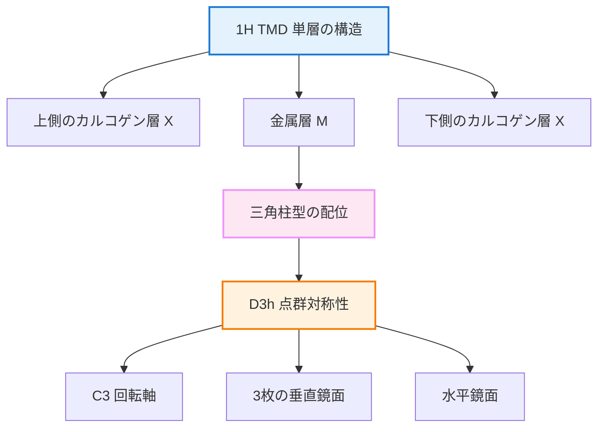
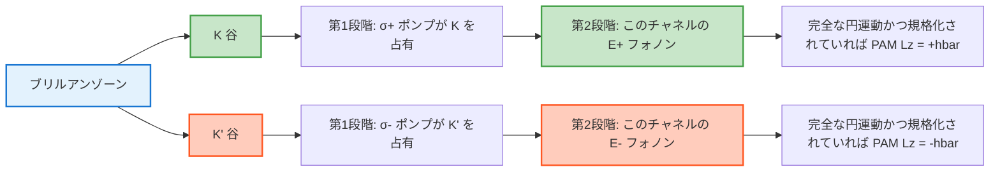
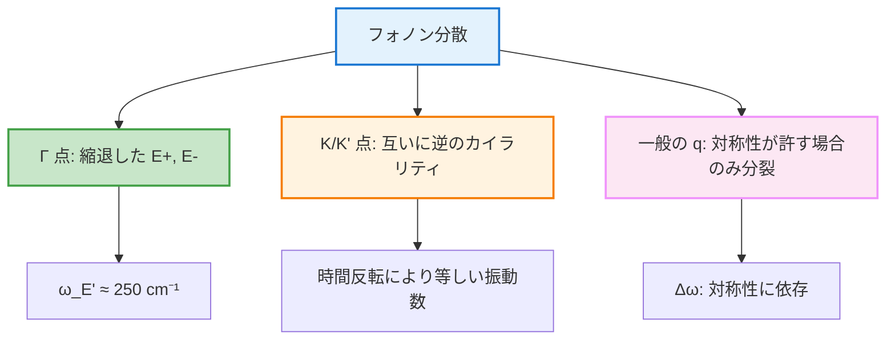

## ビデオ講義

<div class="video-container">
  <iframe
    width="560"
    height="315"
    src="https://www.youtube.com/embed/6BFGvrQna9s?start=626"
    title="カイラルフォノン 第2章: 材料"
    allow="accelerometer; autoplay; clipboard-write; encrypted-media; gyroscope; picture-in-picture"
    allowfullscreen>
  </iframe>
</div>

> このビデオは以下のテキストと同じ内容をカバーしています。お好みの学習形式をお選びください。

---

[🌐 EN](../../../en/MS/chiral-phonons/chapter-2.md) | 🇯🇵 JP | Last sync: 2025-12-19

[材料科学道場](../index.html) > [カイラルフォノン](index.md) > 第2章

---

単層六方格子における谷カイラルフォノンは、2015年に理論的に予言されました（Zhang & Niu）——格子の円運動やフォノン角運動量そのものにはより古い前史があります——そしてカイラルフォノンは2018年に単層 WSe₂ について初めて広く実験的に報告されました。本章では、カイラルフォノンを担う材料を、単層 WSe₂ および MoS₂ における谷と結合したフォノンから、α-石英やテルルのような3次元結晶における固有のカイラリティまで探索します。これらの材料をフォノン角運動量を探究するためのプラットフォームたらしめている、対称性の要件、実験的シグネチャ、そして温度依存の振る舞いを検討します。

**📖 読了時間:** 30-40分 | **📊 難易度:** 上級 | **💻 コード例:** 2 例

## 学習目標

本章を読むことで、以下のことができるようになります。

- ✅ TMD 単層（WSe₂、MoS₂、MoSe₂）の結晶構造と対称性を理解する
- ✅ 谷–フォノン結合と、それがカイラルフォノン物理で果たす役割を説明する
- ✅ 谷選択的な励起に対する光学選択則を記述する
- ✅ 3次元カイラル結晶とその対称性の要件を同定する
- ✅ カイラリティを伴うフォノン分散関係を解析する
- ✅ 計算手法を用いて谷–フォノン結合をモデル化する
- ✅ カイラルフォノンの温度依存の振る舞いを評価する

---

## 2.1 2次元遷移金属ダイカルコゲナイドにおけるカイラルフォノン

### 結晶構造と対称性

組成式 MX₂（M = Mo, W; X = S, Se, Te）をもつ遷移金属ダイカルコゲナイド（TMD）の半導体的な **1H** 単層は、金属の配位が三角柱型であり、**D₃ₕ 点群**に属します。この但し書きは飾りではありません。同じ組成は八面体型（1T）や歪んだ（1T'）多形——テルル化物に多く見られます——も作り、それらの対称性は異なりますし、中には中心対称なものもあります。本節の内容はすべて 1H 相を指します。

**1H TMD 単層の構造**

1H TMD 単層は次の要素から構成されます。

- 遷移金属原子（M）の1つの層が、カルコゲン原子（X）の2つの層に挟まれている
- 三角柱型の配位をもつ X-M-X の積層
- 六方格子。1H 単層は反転中心をもたない（他の多形はもち得る）
- 点群: D₃ₕ（3回回転軸、面内の3本の2回軸、および水平鏡面）



### 主要な TMD 材料

| 材料 | 格子定数 (Å) | 光学ギャップ (eV) | Γ 点の二重縮退モード |
|----------|---------------------|--------------|-------------------|
| **WSe₂** | 3.28 | 1.65（直接、励起子） | Γ 点の E', E'' |
| **MoS₂** | 3.16 | 1.88（直接、励起子） | Γ 点の E', E'' |
| **MoSe₂** | 3.29 | 1.55（直接、励起子） | Γ 点の E', E'' |
| **WS₂** | 3.15 | 2.05（直接、励起子） | Γ 点の E', E'' |

4つの項目はいずれも半導体的な 1H 単層です。格子定数は通常引用される代表的な単層の値であり、掲げたギャップは準粒子ギャップではなく光学（励起子）ギャップです。

### Γ 点における E' および E'' フォノンモード

TMD 単層の E' および E'' モードは、ブリルアンゾーン中心（Γ 点）で二重に縮退しています。これらの2次元既約表現は円偏光基底で表すことができますが、Γ における縮退は、互いに逆向きの円偏光成分の間に固有のエネルギー分裂が存在しないことを意味します。

**E モードと円偏光基底**

D₃ₕ 対称性のもとでは、二重に縮退した E モードは円偏光した固有状態として表現できます。以下に書く \\(L_z = \pm\hbar\\) という値は、**1フォノン量子に規格化された、完全に円運動する面内固有ベクトル**について成り立つものです。対称性ラベルだけでは力学的角運動量は定まりません（第1章 §1.2.2）。

\\[
|\text{E}^+\rangle = \frac{1}{\sqrt{2}}(|E_x\rangle + i|E_y\rangle), \quad L_z = +\hbar
\\]

\\[
|\text{E}^-\rangle = \frac{1}{\sqrt{2}}(|E_x\rangle - i|E_y\rangle), \quad L_z = -\hbar
\\]

ここで上付きの ± は、選んだ基底における互いに逆向きの円偏光成分を表します。あるモードが0でない正味のフォノン角運動量（PAM）を担うかどうかは、対称性と波数ベクトルに依存します。谷にロックされたカイラルフォノンは、通常 K/K' 点で議論されます。

**物理的な特徴（材料に依存）**:

- **E' モード（単層 WSe₂ で約 250 cm⁻¹）**: 主として面内の光学的な運動
- **E'' モード（単層 WSe₂ で約 176 cm⁻¹）**: これも**面内**の運動であり、2つのカルコゲン原子が互いに逆向きに動き、\\(\sigma_h\\) に対して反対称です（D₃ₕ の基底 \\((R_x, R_y)\\)、\\((xz, yz)\\)）。真に面外の Γ モードは A₁' と A₂'' です
- 円偏光基底は便利な表現であり、正味の PAM と選択則は K/K' で最も顕著になります

### K 点および K' 点における谷–フォノン結合

TMD 単層の最も注目すべき特徴は、**谷の自由度**と**カイラルフォノン**の間の結合です。

**谷の自由度**

これら半導体的な 1H 単層の六方ブリルアンゾーンでは、直接ギャップのバンド端の極値が、互いに等価でない K 点と K' 点にあります。これは上の表に挙げた4つの材料についての標準的な描像であって、あらゆる TMD 相の性質ではありません。歪み、誘電的な環境、層数はバンドの順序を入れ替え、Q 伝導帯谷（Γ と K の間）や Γ 価電子帯谷を競合させ得ます。

- **K 谷**: 逆格子空間の +K 点に位置する
- **K' 谷**: -K 点に位置する（時間反転の相手）
- 時間反転対称性によって結ばれるが、空間的には区別される
- K 谷と K' 谷のキャリアは、互いに逆符号のベリー曲率と磁気モーメントをもつ



本節を通じて **E⁺ / E⁻** は、議論しているフォノン分枝の2つの円偏光成分を表します。Γ ではそれは E' 二重項の円偏光の組み合わせであり、谷間過程においては同じ*分枝*をその過程が要求する有限の波数ベクトルで評価したものであって、文字どおりの Γ 点モードではありません。

**谷の準備と、それに続くフォノン**（以下の左右の表記はすべて、第1章 §1.2 で宣言した唯一の規約に従います: \\(L_z = +\hbar\\) ⇔ \\(+z\\) 方向から見て反時計回り ⇔ 左巻き ⇔ \\(\sigma^+\\)）。以下の2行は、第1章 §1.4.2 の**2段階**過程の帳簿です——円偏光したポンプ光がどの谷を占有するかを選び、ここに書いた*1つの*谷間チャネルについて、カイラルフォノンの左右の向きがそれに従います。ある過程がどの分枝とどちらの向きを伴うかは、電子の始状態と終状態、スピン、そして行列要素によって決まるのであって、占有された谷だけによって決まるのではありません。これらは、σ⁺ の光子が Γ 点の E⁺ フォノンを生成するという1光子の規則では**ありません**。可視光の光子は運動量をほとんど担わない一方、K → K' 過程におけるフォノンは \\(q \approx K - K'\\) を担うからです。

\\[
\text{K valley} \xrightarrow{\sigma^+} |\text{E}^+\rangle \quad (L_z = +\hbar \ \text{for a fully circular normalised mode})
\\]

\\[
\text{K' valley} \xrightarrow{\sigma^-} |\text{E}^-\rangle \quad (L_z = -\hbar \ \text{for a fully circular normalised mode})
\\]

この結合は次に由来します。

1. **擬角運動量の mod 3 の勘定**: \\(C_3\\) のもとで擬角運動量は 3 を法としてのみ保存され、\\(m_{\text{initial}} + m_{\text{light}} \equiv m_{\text{final}} + m_{\text{phonon}}\ (\text{mod } 3)\\) が電子の**始状態と終状態**について成り立ちます（第1章 §1.4.2）。光子・谷・フォノンのラベルを普通に足し合わせても閉じませんが、mod 3 の規則なら閉じます
2. **対称性による制約**: K と K' で互いに逆のヘリシティになることは、関与するバンド端の電子状態の \\(C_3\\) 固有値と、K を K' に写す時間反転対称性とを*あわせて*用いることで導かれます。D₃ₕ 点群だけでは、あらゆる電子–フォノンのヘリシティチャネルが定まるわけではありません
3. **電子–フォノン行列要素**: 対称性で分解されるものであり、フォノン分枝と電子の波動関数に依存します。以下のモデルで用いる谷に依存した変形ポテンシャルは、それらに対する1つの近似であって、結合の全体ではありません

### 谷選択的な光励起

谷の自由度は、円偏光した光を用いて選択的に操作できます。

**光学選択則**

この表は第1章 §1.4.2 の**谷の準備**についての規約であって、普遍的なフォノン生成の規則ではありません。偏光の列は谷を選ぶポンプ光を指し、最後の列は、続く谷間の段階に関与するカイラルフォノンの左右の向きを指します。

| ポンプ光の偏光（第1段階） | 占有される谷 | バンド端遷移の \\(C_3\\) ラベル \\(m\\)（mod 3） | このチャネルの第2段階におけるカイラルフォノン |
|-------------------|----------------|------------------|----------------|
| σ⁺（左円偏光） | K 谷 | +1 | E⁺（完全な円運動で規格化されたモードなら \\(L_z = +\hbar\\)） |
| σ⁻（右円偏光） | K' 谷 | −1 | E⁻（完全な円運動で規格化されたモードなら \\(L_z = -\hbar\\)） |

ここで \\(m\\) は、その谷における**電子のバンド端遷移**の \\(C_3\\) 擬角運動量ラベル（終状態から始状態を引いたもの）であり、3 を法としてのみ定義されます。これは指定された伝導帯・価電子帯の状態とその回転固有値の性質であって、バンド・スピンの扱い・回転中心と無関係に谷に付随する固有の数ではありません。

**実験的な現れ方**:

- **偏光分解ラマン分光**: E' 二重項の選択則は、入射偏光と検出偏光の**組**（共円偏光チャネルか交差円偏光チャネルか）によって決まるのであって、入射光のヘリシティだけによって決まるのではありません。ポンプされていない、非磁性の理想的な単層では、縮退した対の全体について σ⁺/σ⁻ の強度非対称は現れません。非対称が生じるには、谷偏極か、他の何らかの対称性の破れが必要です（第3章）
- **谷のフォトルミネッセンス**: 偏光励起のもとで一方の谷から優先的に発光する
- **谷間散乱**: カイラルフォノンが K ↔ K' の谷間遷移を仲介する

### カイラルフォノンを介した谷間散乱

カイラルフォノンは、谷間散乱の機構の1つを与えます——欠陥、他のフォノンチャネル、そして励起子については電子–正孔交換相互作用も寄与します。

\\[
|K, n\rangle + |\text{E}^+\rangle \longrightarrow |K', n-1\rangle
\\]

\\[
|K', n\rangle + |\text{E}^-\rangle \longrightarrow |K, n-1\rangle
\\]

ここで \\(n\\) は**そのカイラルフォノンモードの占有数**です。電子はフォノンを1個吸収するので、そのモードの占有数は \\(n\\) から \\(n-1\\) へ減ります。1行目を mod 3 の規則で帳簿として確かめると——\\(m_K = +1\\) と \\(m_{K'} = -1\\) は各谷における**バンド端遷移**の \\(C_3\\) ラベル（§2.1）であって、個々の電子状態に固有のラベルではありません——\\(m_K + m_{E^+} = 1 + 1 = 2 \equiv -1 \equiv m_{K'}\ (\text{mod } 3)\\) となり、2行目は \\(-1 + (-1) = -2 \equiv +1 \equiv m_K\\) を与えます。実際の遷移に適用する際には、指定された始状態と終状態の電子状態について、そのバンド・スピン・回転中心の規約とともに \\(C_3\\) 固有値が必要になります。この過程は次の性質をもちます。

- 擬角運動量を 3 を法として保存する（電子の始状態 + フォノン ≡ 電子の終状態）
- ~K - K' の運動量移行を必要とする（大きな運動量移行）。したがって、ここに書いたチャネルで吸収されるフォノンは、Γ 点の E' モードにつながる分枝の有限 \\(q\\) の成員であって、その運動量を供給できない文字どおりの Γ 点モードでは決してありません。音響分枝を含む他の分枝も谷間散乱を仲介し得ます（§2.3）。どれが支配的かは、分散と行列要素の計算から決まります
- さらに、対応するエネルギーに利用可能な電子の終状態が存在することを必要とする。mod 3 のラベルが一致することは、そのチャネルにとって必要条件であって十分条件ではありません
- 温度に依存する（カイラルフォノンの占有数）
- 谷の脱偏極、ひいては谷の寿命に寄与し、谷ホール輸送を変化させる。ただし固有の谷ホール応答そのものは、電子バンドのベリー曲率に由来します

---

## 2.2 3次元カイラル結晶

2次元材料にとどまらず、カイラルフォノンは特定の対称性をもつ3次元結晶にも存在します。

### α-石英: 3次元結晶におけるカイラルフォノン

3次元結晶——**α-石英（SiO₂）**——におけるカイラルフォノンは、Ueda *et al.*, *Nature* **618**, 946 (2023) によって X 線で検出されました。2018年の Zhu *et al.* による測定は石英ではなく単層 WSe₂ に対するものです。

**α-石英の構造とカイラリティ**

**結晶構造**:

- 空間群: P3₁21（3₁ らせん、左旋性の「左水晶」）または P3₂21（3₂ らせん、右旋性の「右水晶」）
- らせん軸: 3₁ または 3₂（3回回転 + c 軸に沿った並進）
- 三方晶系、点群 32（D₃）
- 天然に産出するエナンチオモルフ（構造的カイラリティ）

> **⚠️ 2つの「利き手」、逆のラベル。** 3₁ 軸は**右巻きの構造的ならせん**です（IUCr の定義: +120° と +c/3 の組み合わせ）が、それから組み上がる結晶は**左旋性**です。すなわち光学的な呼称は、空間群記号に現れるらせんの向きとは逆向きに走ります。右巻き（右旋性）の低温石英は **P3₂21**、左巻き（左旋性）の低温石英は **P3₁21** です（Donnay & Le Page, *Acta Cryst.* **A34**, 584 (1978); Glazer, *J. Appl. Cryst.* **51**, 915 (2018)）。「右巻きの石英」という語を用いるときは、この2つの規約のどちらを指しているのかを必ず明示してください。

**カイラルフォノンの特徴**:

- Γ では、二重に縮退した **E** 光学フォノンは円偏光した（±）の対に組み替えられますが、1次元表現の A₁ モードと A₂ モードは組み替えられません。Γ から離れると小群は小さくなり、そこでのカイラルな固有モードは2次元表現に属する必要すらありません
- 単一の円偏光成分は、単位胞にわたって足し合わせたフォノン角運動量が0でない値を担い**得ます**が、その値は規格化されたモード固有ベクトルからのみ決まります。多原子の結晶では、原子ごとの寄与が楕円的であったり、部分的に打ち消し合ったりし得ます。0でない場合でも、熱的な占有は両方の相手を等しく満たすため、平衡状態にある結晶の正味の PAM は0です
- 2つのエナンチオモルフについて、対応するモードは互いに逆のカイラリティをもちます——ただしこの言明が内容をもつのは、モードどうしの対応づけ、伝播方向、座標系の規約が固定されてからです（演習 4）

**探すべきシグネチャ**:

- **円偏光散乱**: 特定のモードについての強度差 \\(I_{R} - I_{L} \neq 0\\)——これは Ueda *et al.* (2023) が X 線で分解した量です
- **モードごとのカイラリティ**: すべてのフォノンがカイラルなわけではなく、対称性の表現に依存します
- **構造上の上限**: α 相そのものは、約 573 °C の α–β 転移までしか存在しません（§2.4）

### らせん軸の対称性

3次元結晶におけるフォノンのカイラリティへの1つの経路が、**らせん軸**です。これは以下の例に特徴的な要素ではありますが、原子の円運動に必要なものでもなければ、構造的にカイラルなあらゆる結晶に存在するものでもありません。

**らせん軸**

らせん軸 nₘ は次の2つを組み合わせたものです。

- ある軸まわりの n 回回転
- その軸に沿った、格子定数の m/n だけの並進

カイラルフォノンについては次のとおりです。

- **3₁ らせん軸**: 120° 回転 + c 軸方向へ 1/3 の並進——**右巻きのらせん**であり、左旋性（「左」）の石英に見られます
- **3₂ らせん軸**: 120° 回転 + c 軸方向へ 2/3 の並進——**左巻きのらせん**であり、右旋性（「右」）の石英に見られます

らせん軸のラベルだけではカイラリティは確定しません。それには完全な空間群が必要です。ここで挙げた石英の群 P3₁21 と P3₂21 については、その確認は明示的に行えます——すべての操作が真性回転またはらせん操作であり、鏡映も反転も回反も含みません——したがって両者は **Sohncke 群**であり、いずれかに属する構造はカイラルです。この性質は非真性操作が無いことだけに関わります。この2つの群型が互いに鏡像である（鏡映の下で 3₁ ↔ 3₂）こと、したがって**エナンチオモルフの対**をなすことは、それとは別の事実です。

### テルルとセレン

**三方晶テルル**と**三方晶セレン**は、c 軸に沿ったらせん鎖から組み上がる単体結晶であり、その形態においてカイラルです。（セレンには単斜晶の環状分子の同素体や非晶質形もありますが、ここで言っているのはそれらではありません。）

| 性質 | テルル（Te） | セレン（Se） |
|----------|---------------|---------------|
| **空間群** | P3₁21 または P3₂21 | P3₁21 または P3₂21 |
| **構造** | c 軸に沿ったらせん鎖 | c 軸に沿ったらせん鎖 |
| **格子** | a = 4.46 Å, c = 5.93 Å | a = 4.37 Å, c = 4.95 Å |
| **円偏光（±）モード対** | E モード（92, 141 cm⁻¹） | E モード |
| **主な特徴** | 強いスピン軌道結合 | Te と類似、より軽い質量 |

Γ において、円偏光した対に組み合わせられるのは二重に縮退した E モードだけであり、Te の1次元表現の A₁ モード（121 cm⁻¹）は組み合わせられません。Te の振動数は Pine & Dresselhaus, *Phys. Rev. B* **4**, 356 (1971) による。

**物理的な現れ方**:

- **円偏光ガルバノ効果**: 光電流の向きが光のヘリシティに依存する——三方晶 Te において確立されています

これらの材料について、フォノン熱ホール効果や、カイラルフォノンとワイル擬スピンの結合が持ち出されることがあります。本書ではそのいずれも主張しませんし、いずれについても出典を挙げません。熱ホール応答は熱伝導率の*反対称*部分であり、その種の線形な平衡応答には時間反転対称性の破れの源を明示する必要があります。また常温常圧の Te と Se は一般的なワイル半金属ではありません——文献で論じられるワイル的な特徴には、それぞれ固有の材料条件・圧力条件が伴います。

### カイラル有機結晶

カイラル分子から組み上がる分子結晶は、**候補**となる母体です。エナンチオ純粋な分子は結晶を Sohncke 空間群に制限しますが、分子の左右の向きだけでは、ある特定のモードが円運動することも、正味の角運動量を担うことも示されません。それには計算あるいは測定されたモードが必要です。以下の例は候補として挙げたものであり、ここではそれらについてカイラルフォノンの結果を主張しません。

**カイラル有機結晶の候補**

- **エナンチオ純粋なアミノ酸結晶（L 体または D 体）**: エナンチオ純粋性は結晶を Sohncke 空間群に制限しますが、晶族・パッキング・多形——そしてそれらとともに振動の選択則——は実際の構造から決まります。どの格子モードが角運動量を担うかは、モードごとに確かめる必要があります
- **ヘリセン類**: らせん状にねじれた多環芳香族炭化水素——見込みのある例にすぎず、ここでは特定のヘリセン結晶やモードを挙げてはいません
- **核酸の結晶**: DNA の二重らせんは*分子の*らせんであり、そのらせん周期は結晶学的な3回らせんではありません。ある結晶の空間群は、分子の左右の向きから推論するのではなく、その構造から読み取らなければなりません
- **カイラル金属有機構造体（MOF）**: これらは Sohncke 群で結晶化し、らせん軸を含むこともありますが、特定のらせん対称性も、カイラルフォノンの証拠も、この分類名から導かれるものではありません。どちらも個々の骨格に依存します

**特有の側面**:

- 分子の回転と格子振動の両方に由来するフォノン角運動量
- 分子間力が弱いため、外部（格子）モードは低振動数に位置し、その範囲は材料に依存する
- カイラリティを化学的に調整できる可能性

---

## 2.3 カイラリティを伴うフォノン分散

### カイラリティによるバンド分裂

互いに逆のカイラリティをもつフォノン分枝は、対称性が許す特定の方向に沿って分裂し得ます——ブリルアンゾーン全体にわたってではありません。本章で扱う**非磁性で時間反転対称性をもつ**系では、Γ 点の E 二重項は結晶対称性によって保護され、縮退したままです。この保護は条件つきであって普遍的ではありません。時間反転対称性が破れれば——磁気秩序、印加磁場、あるいはジャイロスコープ的（コリオリ的）な結合によって——Γ における円偏光パートナーの分裂も許され得ますし、実際に許されるかどうかは残る磁気（あるいは動力学）対称群から決まります。2次元既約表現が残っていれば縮退は依然として保護されるからです。

\\[
\omega_+(\mathbf{q}) \neq \omega_-(\mathbf{q})
\\]

ここで \\(\omega_{\pm}\\) は、波数ベクトル \\(\mathbf{q}\\) において互いに逆のカイラリティをもつフォノンの振動数です。

**電子バンド構造との比較**

これは電子バンドにおけるラシュバ分裂やドレッセルハウス分裂に類似していますが、対象はフォノンです。

- **電子**: スピン軌道結合と反転対称性の破れ（ラシュバ、ドレッセルハウス）を**あわせて** → スピン分裂したバンド。スピン軌道結合だけではスピン縮退は解けません
- **フォノン**: 解析が行われたモデル系においては、動力学行列における回転自由度と並進自由度の間の結合が、互いに逆のカイラリティの分枝を分裂させ得ます。どの結合が担っているかは系ごとに異なるので、これは類推であって、普遍的な微視的機構ではありません

### WSe₂ におけるフォノン分散

単層 WSe₂ について、しばしば議論される代表的な特徴には次のものがあります。

1. **Γ 点**: E' モードと E'' モードは二重に縮退している（円偏光成分は基底の選び方である）
2. **K 点と K' 点**: 谷ごとに分解されたカイラルな性格が現れ、互いに逆の谷は**同じ振動数で**互いに逆の巻き方を担う。これはその対について時間反転対称性が要求することである
3. **一般の q 点**: 波数ベクトルに依存する小さな効果が現れ得るが、詳細は材料と計算に依存する



### 音響モードと光学モードに関する考察

- 音響分枝も光学分枝も、ゾーン境界の波数ベクトルを含めて円偏光を担い得ます。そのどちらが観測可能かは系とプローブに依存するのであって、両者の間の一般的な序列に依存するのではありません。
- 2次元 TMD において、Γ 点の E'/E'' 二重項と K/K' の谷フォノンは別のものです。E のラベルはゾーン中心の小群に属する一方、谷の物理に関わるのは K/K' における有限運動量の音響・光学分枝であり、そこでは小群は小さくなります。「カイラルな E モード」を論じるときは、そのどちらを指しているのかを述べるべきです。
- 分子結晶におけるリブレーション（秤動）モード、すなわち外部モードは円運動を示し得ます。これらが内部（分子内）モードと区別されるのは、その**変位パターン**——分子全体が剛体として互いに逆向きに回転するのか、分子内の結合が伸縮・変角するのか——によるのであって、振動数の境界によるのではありません。リブレーションは材料に依存する範囲の低振動数側に位置しますが、内部の変角・ねじれ・骨格モードもそこに重なるほど低く落ちることがあります。定量的な PAM には、適切な規格化を伴う個別の解析が必要です。

---

## 2.4 温度依存性

### カイラルフォノンの熱的な占有

カイラルフォノンの占有数は、ボース・アインシュタイン分布に従います。

\\[
n(\omega, T) = \frac{1}{e^{\hbar\omega / k_B T} - 1}
\\]

有限温度では次のようになります。

- **低温 (kᵦT << ℏω)**: フォノンの占有数は指数関数的に抑制される
- **高温 (kᵦT >> ℏω)**: 古典極限 \\(n \approx k_B T / \hbar\omega\\)

**谷のダイナミクスへの含意**:

- 谷間散乱率 \\(\Gamma_{KK'} \propto 2n(\omega_E) + 1\\): 放出が \\(n+1\\) を、吸収が \\(n\\) を担うので、2つのチャネルに**等しい行列要素と等しい利用可能な位相空間**を割り当てる*ならば*、その和は \\(2n+1\\) になります。この2つの仮定はどちらも必要であり、どちらも自明ではありません——2つのチャネルは異なる終状態に達し、異なる電子の占有因子を見るからです——ので、これはおもちゃの速度モデルです。本文、§2.5 のコード、および演習 2(c) では、この1つの選択を用います
- 谷の寿命 \\(\tau_v \propto 1/\Gamma_{KK'}\\)。ただし同じ2谷の速度モデルの枠内であり、かつこの谷間チャネルが緩和を支配しているあいだに限ります
- 室温（300 K）では、E' モード（約 250 cm⁻¹ ≈ 360 K）は部分的に占有されています: \\(n = 0.4315\\)、したがって \\(2n+1 = 1.863\\)

### 非調和効果

フォノン–フォノン相互作用は、高温でカイラルフォノンの性質を変化させます。

1. **振動数シフト**:
   \\[
   \omega(T) = \omega_0 + \Delta\omega_{\text{anharmonic}}(T)
   \\]
   ここで扱う材料の Γ 点の光学モードについては、極低温から室温へ昇温すると、振動数は通常数 cm⁻¹ 程度**軟化**します。符号も大きさも普遍的ではありません。材料・モード・温度区間を特定して引用する必要があります

2. **線幅の広がり**:
   \\[
   \Gamma(T) = \Gamma_0 + \Gamma_{\text{anharmonic}}(T)
   \\]
   フォノンの寿命 \\(\tau = \hbar/\Gamma\\) を決めます。ここでのこの \\(\Gamma\\) はモードの半値全幅の**エネルギー線幅**であり、§2.4 の谷間散乱率 \\(\Gamma_{KK'}\\) ではありません

3. **角運動量の緩和**: 3フォノン過程は、一方の円偏光成分の非平衡な*占有*を、対称性の許す崩壊チャネルを通じて平衡へと緩和させます。これは固有モードそのものの変化とは別のことです。対称性はモードの表現ラベルを定め、その詳細な偏光——楕円率、原子ごとの振幅——は温度依存の動力学行列の固有ベクトルから決まります。非調和散乱がそれ自体でラベルを壊したり、互いに逆向きのあらゆる対を混合したりするわけではありません

### 相転移

材料によっては、カイラルフォノンに影響する構造相転移を起こすものがあります。

**α-石英 → β-石英 転移（573°C）**

- **α 相**: P3₁21 または P3₂21——点群 32、カイラル
- **β 相**: P6₂22 または P6₄22——点群 622 であり、**これもカイラル**です。622 は11個のエナンチオモルフ点群の1つで、明示的に生成すると 12 個の操作が得られ、そのすべてが真性回転であって、鏡映も反転も回反も含みません
- **転移が行うこと**: 対称性を 32 → 622 へ高める一方で、結晶の巻き方は**保たれます**（P6₄22 ⊃ P3₁21 および P6₂22 ⊃ P3₂21 で、いずれも指数 2。\\((6_4)^2 \equiv 3_1\\) および \\((6_2)^2 \equiv 3_2\\) だからです）。記号に現れるらせんの向きは転移をまたいで反転しますが、光学的な巻き方は反転しません
- **フォノンへの帰結**: モードのラベルと選択則は、32 → 622 の表現の対応関係を通じて転移をまたいで割り当て直されます。どちらの点群も Γ で2次元 E 表現をもつので、Γ 点の二重項は縮退度の変化を期待すべき場所ではありません。どの波数ベクトルと分枝が実際に縮退度を変えるかは、その対応関係から読み取る必要があります。カイラリティが失われるわけではありません
- **機構**: この転移はソフトモード的な性格をもちます——α 相の A₁ モードが転移に近づくにつれて軟化します——が、単純な連続的ソフトモード転移ではありません。弱い1次転移であり、α 相と β 相の間に狭いインコメンシュレート相が存在します

---

## 2.5 計算機によるモデリング: 谷–フォノン結合

ここでは、TMD 単層の谷–フォノン結合に着想を得た、抽象的な2セクター混合モデルを Python で実装します。これはおもちゃのモデルであってフォノン分散ではありません。異なる2つの結晶運動量 K と K' をコヒーレントに混合するには、運動量を供給する摂動（あるいは拡大された単位胞）が必要ですが、このモデルはそのいずれも備えていないので、得られるのは材料のフォノンバンドではなく抽象的なモデル固有値です。

**コード例 1: TMD の谷–フォノン結合モデル**

```python
# Requirements:
# - Python 3.9+
# - numpy>=1.24.0
# - matplotlib>=3.7.0
# - scipy>=1.10.0

"""
TMD Valley-Phonon Coupling Model
Purpose: toy model of valley-phonon coupling in a TMD monolayer
Target: Graduate students and researchers
Execution time: the numerical work is small, but the two plt.show() calls can
block until the figure windows are closed, so no wall-clock bound is promised.

Model choices, stated explicitly so that every printed number is reproducible:
- Frequencies are converted with 1 cm^-1 = 0.124 meV.
- The k-path runs Gamma -> K. |K| = 4*pi/3 in units of 1/a, so the path
  endpoint is the K point itself; the coupling is scaled by |k|/|K|.
- The intervalley scattering rate is modelled as Gamma ~ 2n + 1, that is
  emission (n + 1) plus absorption (n) with equal matrix elements AND equal
  accessible phase space. Both are assumptions of this toy rate model; the same
  choice is used in the text and in Exercise 2(c).
- The + and - helicity blocks of the 4x4 Hamiltonian are identical, so this
  model does NOT split opposite helicities. Its four eigenvalues are pairwise
  degenerate and the splitting is between the valley combinations (K +/- K').
- The two valley sectors are mixed coherently by hand. In a crystal, that would
  require a momentum-supplying perturbation (or an enlarged unit cell); neither
  is included here, so the eigenvalues printed below are abstract model
  eigenvalues, not the phonon dispersion of a material.
"""

import numpy as np
import matplotlib.pyplot as plt
from scipy.linalg import eigh

CM1_TO_MEV = 0.124   # 1 cm^-1 in meV
K_MAG = 4 * np.pi / 3   # |K| of a hexagonal BZ, in units of 1/a


# Parameters for WSe2 monolayer
class TMDParameters:
    def __init__(self):
        # Lattice constant (angstrom, representative monolayer value)
        self.a = 3.28
        # Phonon frequencies (cm^-1)
        self.omega_E_prime = 250.0  # E' mode (E_2g in bulk notation)
        self.omega_E_double_prime = 176.0  # E'' mode (E_1g in bulk notation)
        # Valley coupling strength at the K point (meV)
        self.g_valley = 5.0
        # Temperature (K)
        self.T = 300
        # Boltzmann constant (meV/K)
        self.k_B = 0.0861733

def bose_einstein(omega_cm, T, k_B=0.0861733):
    """
    Bose-Einstein distribution
    omega_cm: phonon frequency in cm^-1
    T: temperature in K
    k_B: Boltzmann constant in meV/K
    """
    omega_meV = omega_cm * CM1_TO_MEV
    if T == 0:
        return 0
    x = omega_meV / (k_B * T)
    return 1.0 / (np.exp(x) - 1)

def valley_phonon_hamiltonian(k_vec, params):
    """
    Construct valley-phonon coupled Hamiltonian
    k_vec: momentum vector [kx, ky] in units of 1/a
    params: TMDParameters object

    Returns 4x4 Hamiltonian in basis |K,+>, |K,->, |K',+>, |K',->
    where +/- denote E+ and E- chiral phonon states (phonon helicity,
    NOT spin: this model contains no spin-orbit term).

    The + and - blocks are identical by construction, so the eigenvalues come
    in degenerate pairs E_phonon +/- g: the model splits the symmetric and
    antisymmetric valley combinations, not the two helicities.
    """
    kx, ky = k_vec
    k_norm = np.sqrt(kx**2 + ky**2)

    # Phonon energies (in meV)
    E_phonon = params.omega_E_prime * CM1_TO_MEV

    # Valley-phonon coupling, growing linearly with |k| and reaching
    # g_valley at the K point (k_norm / K_MAG is dimensionless)
    g = params.g_valley * (k_norm / K_MAG)

    # Hamiltonian matrix
    H = np.array([
        [E_phonon, 0, g, 0],           # |K,+>
        [0, E_phonon, 0, g],           # |K,->
        [g, 0, E_phonon, 0],           # |K',+>
        [0, g, 0, E_phonon]            # |K',->
    ])

    return H

def k_point_on_path(fraction):
    """Momentum vector (units of 1/a) a given fraction of the way Gamma -> K."""
    direction = np.array([0.5, np.sqrt(3) / 2])   # unit vector towards K
    return fraction * K_MAG * direction

def plot_valley_phonon_dispersion():
    """
    Plot the eigenvalues of the toy Hamiltonian along Gamma -> K.

    These are abstract model eigenvalues, NOT the phonon dispersion of a
    material: the two valley sectors are mixed by hand (see module docstring).
    """
    params = TMDParameters()

    # Define k-path: Gamma -> K
    n_k = 100
    k_fraction = np.linspace(0, 1.0, n_k)  # fraction of the Gamma->K distance

    eigenvalues = np.zeros((n_k, 4))

    for i, frac in enumerate(k_fraction):
        k_vec = k_point_on_path(frac)
        H = valley_phonon_hamiltonian(k_vec, params)
        eigvals, eigvecs = eigh(H)
        eigenvalues[i, :] = eigvals

    # Convert to cm^-1
    eigenvalues_cm = eigenvalues / CM1_TO_MEV

    plt.figure(figsize=(10, 6))
    for band in range(4):
        plt.plot(k_fraction, eigenvalues_cm[:, band], linewidth=2)

    plt.xlabel('k along Γ→K (fraction of |K| = 4π/3a)', fontsize=12)
    plt.ylabel('Phonon Energy (cm⁻¹)', fontsize=12)
    plt.title('Valley-Coupled Phonon Bands in WSe₂ (toy model)', fontsize=14)
    plt.axhline(y=params.omega_E_prime, color='gray', linestyle='--',
                alpha=0.5, label='Uncoupled E\' mode')
    plt.legend(['Band 1', 'Band 2', 'Band 3', 'Band 4', 'Uncoupled'],
               fontsize=10)
    plt.grid(True, alpha=0.3)
    plt.tight_layout()
    plt.savefig('valley_phonon_dispersion.png', dpi=300)
    plt.show()

def plot_temperature_dependent_scattering():
    """
    Plot the illustrative 2n + 1 thermal factor of a fixed-energy mode.

    The mode energy is the Gamma-point E' frequency; the factor is the toy
    rate model of the module docstring, not a calculated intervalley rate.
    """
    params = TMDParameters()
    temperatures = np.linspace(10, 500, 100)

    # Scattering rate proportional to 2n+1 (emission + absorption)
    scattering_rates = np.zeros_like(temperatures)

    for i, T in enumerate(temperatures):
        n_phonon = bose_einstein(params.omega_E_prime, T, params.k_B)
        # Simplified scattering rate (arbitrary units):
        # emission (n+1) + absorption (n), equal matrix elements
        scattering_rates[i] = 2 * n_phonon + 1

    plt.figure(figsize=(10, 6))
    plt.plot(temperatures, scattering_rates, linewidth=2, color='darkblue')
    plt.xlabel('Temperature (K)', fontsize=12)
    plt.ylabel('Thermal factor 2n+1 (arb. units)', fontsize=12)
    plt.title('Illustrative 2n+1 Thermal Factor for a 250 cm⁻¹ Mode',
              fontsize=14)
    plt.axvline(x=300, color='red', linestyle='--', alpha=0.5,
                label='Room Temperature')
    plt.grid(True, alpha=0.3)
    plt.legend(fontsize=10)
    plt.tight_layout()
    plt.savefig('temperature_scattering.png', dpi=300)
    plt.show()

# Execute visualizations
if __name__ == "__main__":
    print("=== TMD Valley-Phonon Coupling Simulation ===\n")

    params = TMDParameters()
    print(f"Material: WSe₂ monolayer")
    print(f"E' phonon frequency: {params.omega_E_prime} cm⁻¹")
    print(f"Valley coupling at K: {params.g_valley} meV")
    print(f"Temperature: {params.T} K\n")

    # Calculate phonon population at room temperature
    n_300K = bose_einstein(params.omega_E_prime, 300)
    print(f"Phonon population at 300K: {n_300K:.4f}")
    print(f"This means ~{n_300K:.1f} phonons per mode on average")
    print(f"Scattering rate 2n+1 at 300K: {2 * n_300K + 1:.3f} (arb. units)\n")

    # What the 4x4 model actually splits
    for label, frac in (("Γ", 0.0), ("K", 1.0)):
        eigvals = eigh(valley_phonon_hamiltonian(k_point_on_path(frac), params))[0]
        print(f"Eigenvalues at {label} (meV): " +
              ", ".join(f"{e:.3f}" for e in eigvals))
    print("Pairwise degenerate: the + and - helicity blocks are identical,")
    print("so the splitting is between valley combinations, not helicities.\n")

    print("Generating plots...")
    plot_valley_phonon_dispersion()
    plot_temperature_dependent_scattering()
    print("Done!")
```

**期待される出力（コード例 1）:**
```
=== TMD Valley-Phonon Coupling Simulation ===

Material: WSe₂ monolayer
E' phonon frequency: 250.0 cm⁻¹
Valley coupling at K: 5.0 meV
Temperature: 300 K

Phonon population at 300K: 0.4315
This means ~0.4 phonons per mode on average
Scattering rate 2n+1 at 300K: 1.863 (arb. units)

Eigenvalues at Γ (meV): 31.000, 31.000, 31.000, 31.000
Eigenvalues at K (meV): 26.000, 26.000, 36.000, 36.000
Pairwise degenerate: the + and - helicity blocks are identical,
so the splitting is between valley combinations, not helicities.

Generating plots...
Done!
```

### コードの解説

1. **TMDParameters クラス**: WSe₂ に固有の材料パラメータを保持します
2. **bose_einstein 関数**: 熱的なフォノン占有数を計算します
3. **valley_phonon_hamiltonian**: 基底 |K,±⟩、|K',±⟩ における 4×4 ハミルトニアンを構成します。ここで ± はスピンの添字ではなく**フォノンのヘリシティ**（E⁺/E⁻）です——このモデルはスピン軌道項を含まず、`g_valley` は測定値ではなく例示のためのパラメータです
4. **plot_valley_phonon_dispersion**: Γ→K に沿った4つの固有値を示します。それらは**2個ずつ縮退**しており、\\(E_{\text{phonon}} \pm g\\) です。行列の + と − のヘリシティのブロックが同一であるため、このモデルが分裂させるのは2つのヘリシティではなく、対称および反対称の**谷**の組み合わせです
5. **plot_temperature_dependent_scattering**: \\(\Gamma \propto 2n+1\\) を用いて、谷間遷移に対する温度の効果を示します

---

## 2.6 さまざまな材料クラスにおけるフォノンのカイラリティ

**コード例 2: 材料間でのカイラルフォノンの比較**

```python
# Requirements:
# - Python 3.9+
# - numpy>=1.24.0
# - matplotlib>=3.7.0
# - pandas>=2.0.0

"""
Comparing Chiral Phonons Across Materials
Purpose: tabulate and plot the doubly degenerate modes that can be combined
         into circular (+/-) pairs in four host materials
Execution time: the numerical work is small, but plt.show() can block until
the figure window is closed, so no wall-clock bound is promised.

At the Gamma point, only the doubly degenerate E representations can be
recombined into a circular (+/-) pair, so the one-dimensional A representations
are deliberately absent from the database (Te A1 = 121 cm^-1, for instance, is
non-degenerate). Away from Gamma the restriction does not apply: a chiral
eigenmode there need not belong to a two-dimensional representation.

The +1 / -1 stored with each entry is a CIRCULAR SYMMETRY LABEL - which member
of the +/- combination it is - and NOT a mechanical angular momentum. A symmetry
label does not fix L_z: in a multi-atom crystal the atomic contributions can be
elliptical, mixed, or cancel, and L_z can only be obtained from normalized mode
eigenvectors, which this database does not carry.

Measured frequencies (E_2g / E_1g are the corresponding bulk-mode notation):
- WSe2 monolayer: E' ~250 cm^-1, E'' ~176 cm^-1
- MoS2 monolayer: E' ~383 cm^-1
- alpha-quartz E modes: 128 and 265 cm^-1
  (Scott & Porto, Phys. Rev. 161, 903 (1967))
- trigonal Te E modes: 92 and 141 cm^-1; the 121 cm^-1 line is A1
  (Pine & Dresselhaus, Phys. Rev. B 4, 356 (1971))
"""

import numpy as np
import matplotlib.pyplot as plt
import pandas as pd

class ChiralPhononMaterial:
    """Base class for materials hosting chiral phonons"""
    def __init__(self, name, dimension, symmetry):
        self.name = name
        self.dimension = dimension  # '2D' or '3D'
        self.symmetry = symmetry
        self.chiral_modes = []

    def add_chiral_mode(self, frequency, circular_label, symmetry_label):
        """Add one circular component of a doubly degenerate mode.

        circular_label is +1 or -1: a symmetry label saying which member of the
        circular (+/-) combination this is.  It is NOT a mechanical angular
        momentum - L_z would require normalized mode eigenvectors, which this
        database does not carry - so nothing here is quoted in units of hbar.
        """
        self.chiral_modes.append({
            'frequency': frequency,  # cm^-1
            'circular_label': circular_label,  # +1 / -1 symmetry label, not L_z
            'label': symmetry_label
        })

    def get_summary(self):
        """Return summary of material properties"""
        return {
            'Name': self.name,
            'Dimension': self.dimension,
            'Symmetry': self.symmetry,
            'Num_Modes': len(self.chiral_modes)
        }

# Define materials database
def create_materials_database():
    materials = []

    # WSe2 monolayer
    wse2 = ChiralPhononMaterial('WSe₂', '2D', 'D₃ₕ')
    wse2.add_chiral_mode(176, +1, 'E\'\'+')
    wse2.add_chiral_mode(176, -1, 'E\'\'-')
    wse2.add_chiral_mode(250, +1, 'E\'+')
    wse2.add_chiral_mode(250, -1, 'E\'-')
    materials.append(wse2)

    # MoS2 monolayer
    mos2 = ChiralPhononMaterial('MoS₂', '2D', 'D₃ₕ')
    mos2.add_chiral_mode(383, +1, 'E\'+')
    mos2.add_chiral_mode(383, -1, 'E\'-')
    materials.append(mos2)

    # α-Quartz (E modes only; A1 modes are non-degenerate)
    quartz = ChiralPhononMaterial('α-SiO₂', '3D', 'P3₁21')
    quartz.add_chiral_mode(128, +1, 'E(128)+')
    quartz.add_chiral_mode(128, -1, 'E(128)-')
    quartz.add_chiral_mode(265, +1, 'E(265)+')
    quartz.add_chiral_mode(265, -1, 'E(265)-')
    materials.append(quartz)

    # Tellurium (E modes only; the 121 cm^-1 A1 mode is non-degenerate)
    te = ChiralPhononMaterial('Te', '3D', 'P3₁21')
    te.add_chiral_mode(92, +1, 'E(92)+')
    te.add_chiral_mode(92, -1, 'E(92)-')
    te.add_chiral_mode(141, +1, 'E(141)+')
    te.add_chiral_mode(141, -1, 'E(141)-')
    materials.append(te)

    return materials

def plot_chiral_mode_comparison(materials):
    """Plot comparison of chiral phonon frequencies across materials"""
    fig, ax = plt.subplots(figsize=(12, 8))

    colors_2d = '#e74c3c'
    colors_3d = '#3498db'

    y_positions = []
    y_labels = []

    for i, mat in enumerate(materials):
        y_pos = i * 2
        y_positions.append(y_pos)
        y_labels.append(f"{mat.name}\n({mat.dimension})")

        # Get frequencies of the degenerate pairs
        frequencies = [mode['frequency'] for mode in mat.chiral_modes]
        unique_freqs = sorted(list(set(frequencies)))

        for freq in unique_freqs:
            color = colors_2d if mat.dimension == '2D' else colors_3d
            ax.scatter(freq, y_pos, s=150, c=color, alpha=0.7,
                      edgecolors='black', linewidth=1.5, zorder=3)

    ax.set_yticks(y_positions)
    ax.set_yticklabels(y_labels, fontsize=11)
    ax.set_xlabel('Phonon Frequency (cm⁻¹)', fontsize=13)
    ax.set_title('Degenerate Mode Frequencies Across Materials', fontsize=15,
                 fontweight='bold')
    ax.grid(True, alpha=0.3, axis='x')

    # Legend
    ax.scatter([], [], c=colors_2d, s=150, label='2D Materials')
    ax.scatter([], [], c=colors_3d, s=150, label='3D Materials')
    ax.legend(fontsize=11, loc='upper right')

    plt.tight_layout()
    plt.savefig('chiral_phonon_comparison.png', dpi=300)
    plt.show()

def create_materials_table(materials):
    """Create summary table of materials"""
    data = []
    for mat in materials:
        freqs = [mode['frequency'] for mode in mat.chiral_modes]
        data.append({
            'Material': mat.name,
            'Dimension': mat.dimension,
            'Symmetry': mat.symmetry,
            'Circular Components': len(mat.chiral_modes),
            'Degenerate Pairs': len(set(freqs)),
            'Freq Range (cm⁻¹)': f"{min(freqs):.0f}-{max(freqs):.0f}"
        })

    df = pd.DataFrame(data)
    print("\n=== Chiral Phonon Materials Database ===\n")
    print(df.to_string(index=False))
    print("\nThe +1 / -1 attached to each circular component is a symmetry")
    print("label, not an angular momentum: L_z follows from normalized mode")
    print("eigenvectors, which this database does not carry.")
    print("\n")

    return df

# Execute
if __name__ == "__main__":
    materials = create_materials_database()
    df = create_materials_table(materials)
    plot_chiral_mode_comparison(materials)
```

**期待される出力（コード例 2）:**
```

=== Chiral Phonon Materials Database ===

Material Dimension Symmetry  Circular Components  Degenerate Pairs Freq Range (cm⁻¹)
    WSe₂        2D      D₃ₕ                    4                 2           176-250
    MoS₂        2D      D₃ₕ                    2                 1           383-383
  α-SiO₂        3D    P3₁21                    4                 2           128-265
      Te        3D    P3₁21                    4                 2            92-141

The +1 / -1 attached to each circular component is a symmetry
label, not an angular momentum: L_z follows from normalized mode
eigenvectors, which this database does not carry.


```

---

## 演習問題

### 演習 1: 谷の選択則

**問題**: K 谷において σ⁺ 円偏光で励起された単層 WSe₂ を考えます。伝導帯の底より数十 meV 高い**ホット**な電子をとり、適切なエネルギーの終状態が存在するようにしたうえで、その電子が、Γ 点の E' モードにつながる分枝のカイラルフォノンを——その過程が要求する波数ベクトル（谷内なら \\(q \approx 0\\)、谷間なら \\(q \approx K - K'\\)）で評価して——放出して緩和するとします。伝導帯の底にちょうど位置する電子は、有限のエネルギーのフォノンをそもそも放出できませんし、放出にはさらに当該分枝について0でない行列要素が必要です。

(a) 電子が K 谷に留まる場合、放出されるフォノンはどの擬角運動量を担わなければならないでしょうか——また \\(C_3\\) ラベルが \\(m = \pm 1\\) のフォノンはそれを満たせるでしょうか。
(b) 電子が K' 谷へ散乱される場合、放出されるのはどちらのカイラルフォノン（E⁺ か E⁻ か）でしょうか。
(c) mod 3 の規則を用いて、解答を説明してください。

**ヒント**: K で \\(m = +1\\)、K' で \\(m = -1\\) を、その谷における**バンド端遷移**の \\(C_3\\) ラベル（§2.1）としてとり、この理想化された演習のための帳簿として用いてください。電子に固有の量子数としてではありません。これは 3 を**法として**のみ定義されます（第1章 §1.4.2）。放出については \\(m_{\text{initial}} \equiv m_{\text{final}} + m_{\text{phonon}}\ (\text{mod } 3)\\) です。\\(m = 2\\) と \\(m = -1\\) は同じ \\(C_3\\) の固有値を表すことに注意してください。

### 演習 2: 温度効果

**問題**: WSe₂ の E' フォノンモードは振動数 ω = 250 cm⁻¹ をもちます。

(a) T = 100 K、300 K、500 K におけるフォノン占有数 n(ω,T) を計算してください。
(b) n(ω,T) = 1 となるのはどの温度でしょうか。
(c) 本章の単一の散乱モデル \\(\Gamma_{KK'} \propto 2n(\omega,T) + 1\\) を用いて、比 \\(\Gamma(500\ \text{K})/\Gamma(100\ \text{K})\\) を計算してください。

**有用な換算**: 1 cm⁻¹ ≈ 0.124 meV ≈ 1.44 K（エネルギー単位で）。

### 演習 3: 対称性の解析

**問題**: ある材料が点群 C₃ᵥ（3回回転軸 + 垂直鏡面）をもつとします。

(a) この対称性は*構造的な*カイラリティを許すでしょうか。また、あらゆる波数ベクトルでフォノンの円運動を禁じるでしょうか。この2つの問いを区別してください。
(b) 構造的なカイラリティを可能にするには、どの対称要素を取り除かなければならないでしょうか。
(c) TMD 単層の D₃ₕ 対称性と比較してください。鍵となる違いは何でしょうか。

### 演習 4: α-石英のカイラリティ

**問題**: α-石英は2つのエナンチオモルフの形態で存在します: P3₁21（3₁ らせん、左旋性）と P3₂21（3₂ らせん、右旋性）です。光学的な呼称が、記号に現れるらせんの向きとは逆であることを思い出してください。

(a) この2つの形態の間で、らせん軸の操作がどう異なるかを述べてください。
(b) 2つのエナンチオモルフの対応するモードについて、フォノン角運動量の**符号**はどう比較されるでしょうか。また、そのような比較が意味をもつために、なぜ伝播方向と座標系の規約を先に固定しておく必要があるのでしょうか。
(c) この2つの形態を区別し得る実験手法は何でしょうか。

### 演習 5: コーディング課題 - 3次元カイラル結晶

**問題**: `valley_phonon_hamiltonian` 関数を修正し、2次元 TMD の代わりに3次元カイラル結晶（例: テルル）をモデル化してください。

(a) ハミルトニアンの構造はどう変わるでしょうか。
(b) c 軸に沿ったらせん軸の結合を表す項を加えてください。
(c) Γ-A 方向（c 軸に平行）に沿ったフォノン分散をプロットしてください。

**ヒント**: 3次元では kᵤ 依存性を含め、E の二重項が Γ から離れてどのように分裂するかを考えてください。これは定性的な演習です——要求を満たす修正は複数あり得るので、自分の仮定を明示してください（唯一の数値解はありません）。

---

## まとめ

本章では、カイラルフォノンを担う材料の全体像を探索しました。

- **半導体的な 1H TMD 単層（WSe₂、MoS₂、MoSe₂）**: D₃ₕ 対称性は、円偏光基底で書ける Γ 点の E' および E'' 二重項と、K/K' における谷–フォノン結合を与えます
- **谷の自由度**: K と K' における時間反転で対応する、対称性が許す谷–フォノンのチャネルは、互いに逆のフォノンのカイラリティを伴います。光のヘリシティは、2段階過程の谷の**準備**の段階として入ってくるのであって、光子 → フォノンの直接的な規則としてではありません
- **3次元カイラル結晶**: α-石英と三方晶の Te/Se は P3₁21 または P3₂21 で結晶化し、3₁ または 3₂ らせんをもちます。カイラルな*有機*結晶は多くの Sohncke 空間群にわたり、そのいずれのらせんも含まないことがあります。石英の光学的な呼称はその空間群記号に現れるらせんの向きとは逆であり、573 °C を超える β 相もまたカイラルです
- **フォノン分散**: 対称性が許す場合、カイラリティは特定の方向に沿ってバンドを分裂させ得ますが、非磁性で時間反転対称性をもつ場合には E の二重項は Γ では縮退したままです
- **温度効果**: ボース・アインシュタイン統計が、フォノンの占有数と散乱率を支配します

次章では、円偏光ラマン分光や超高速手法を含む、カイラルフォノンの検出と特性評価のための実験手法に焦点を当てます。

---

[← 第1章](chapter-1.md) [第3章 →](chapter-3.md)

---

## 免責事項

本教育コンテンツは、橋本研究室のナレッジベースのために AI の補助を受けて作成されました。正確さを期すよう努めていますが、読者は重要な情報を一次文献および査読済みの文献で確認してください。主要な文献は次のとおりです。

- Zhang, L. & Niu, Q. (2015). Chiral phonons at high-symmetry points in monolayer hexagonal lattices. *Physical Review Letters*, 115(11), 115502.
- Zhu, H. et al. (2018). Observation of chiral phonons. *Science*, 359(6375), 579-582.（単層 WSe₂）
- Chen, X. et al. (2019). Entanglement of single-photons and chiral phonons in atomically thin WSe₂. *Nature Physics*, 15, 221-227.
- Ueda, H. et al. (2023). Chiral phonons in quartz probed by X-rays. *Nature*, 618, 946.
- Donnay, J. D. H. & Le Page, Y. (1978). The vicissitudes of the low-quartz crystal setting. *Acta Crystallographica A*, 34, 584.
- Glazer, A. M. (2018). Confusion over the description of the quartz structure yet again. *Journal of Applied Crystallography*, 51, 915.
- Pine, A. S. & Dresselhaus, G. (1971). Raman spectra and lattice dynamics of tellurium. *Physical Review B*, 4, 356.
- Scott, J. F. & Porto, S. P. S. (1967). Longitudinal and transverse optical lattice vibrations in quartz. *Physical Review*, 161, 903.
