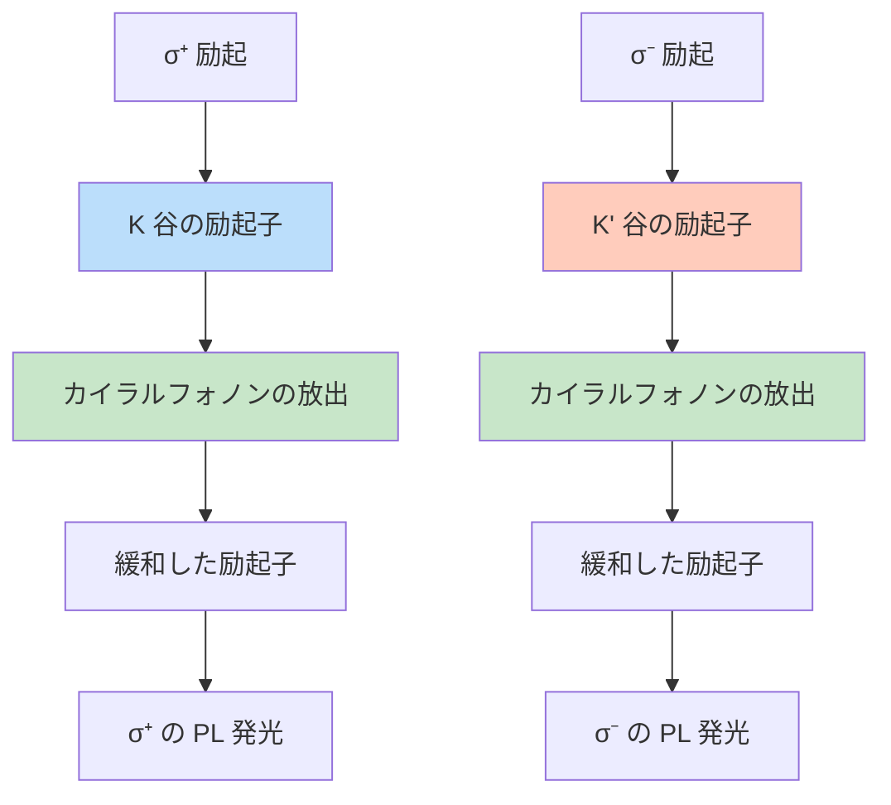

## ビデオ講義

<div class="video-container">
  <iframe
    width="560"
    height="315"
    src="https://www.youtube.com/embed/6BFGvrQna9s?start=1278"
    title="カイラルフォノン 第3章: 実験的検出"
    allow="accelerometer; autoplay; clipboard-write; encrypted-media; gyroscope; picture-in-picture"
    allowfullscreen>
  </iframe>
</div>

> このビデオは以下のテキストと同じ内容をカバーしています。お好みの学習形式をお選びください。

---

[🌐 EN](../../../en/MS/chiral-phonons/chapter-3.md) | 🇯🇵 JP | Last sync: 2025-12-19

[材料科学道場](../index.html) > [カイラルフォノン](index.md) > 第3章

---

# 第3章: カイラルフォノンの実験的検出

**円偏光ラマンから超高速分光まで**

⏱️ 読了時間: 40-45分 | 💻 コード例: 3 | 📊 難易度: 上級 | 🔬 実践演習: 5問

---

本章では、カイラルフォノンを検出し特性評価するための実験技術を扱います。円偏光ラマン分光、円二色性の手法、超高速分光、そして物質中でカイラルフォノンの存在を確証した主要な実験結果について学びます。

## 学習目標

本章を修了すると、以下のスキルと知識が身につきます。

- ✅ 円偏光ラマン分光の実験セットアップを理解する
- ✅ カイラルフォノンのラマン選択則と、円偏光コントラストが測るもの・測らないものを説明する
- ✅ フォノン吸収における円二色性と、それを角運動量に結びつける前にモデルが与えねばならないものを理解する
- ✅ ヘリシティ分解フォトルミネッセンスと谷分極の検出を記述する
- ✅ 時間分解によるカイラルフォノン検出のための超高速分光技術を説明する
- ✅ WSe₂ と α-石英における主要な実験結果を解析する
- ✅ Python を用いてラマンの偏光依存性をシミュレーションする

## 3.1 円偏光ラマン分光

### 3.1.1 ラマン散乱の基礎

**ラマン散乱**は、入射光子が物質中のフォノン（格子振動）と相互作用する非弾性光散乱過程です。散乱光の振動数シフトがフォノンのエネルギーを明らかにします。

\\[
\omega_{\text{scattered}} = \omega_{\text{incident}} \pm \omega_{\text{phonon}}
\\]

カイラルフォノンにとっての鍵となる工夫は、**円偏光**です。ここでは3つの量を区別しておく必要があり、本章では一貫して区別します。*光学選択則*は、あるモードがどの円偏光チャネルに散乱し得るかを述べます。*擬角運動量* \\(m\\) は、その選択則が制約する離散的な回転ラベルであり、回転の位数を法としてのみ定義されます（第1章 §1.2.2）。*力学的角運動量* \\(L_z\\) は、モードの変位固有ベクトルから計算される期待値です。偏光測定が直接与えるのは1番目であり、それを3番目についての言明に変換するには、モードを同定し、その固有ベクトルを計算あるいは測定する必要があります。この実験配置により、同一偏光散乱と交差偏光散乱を区別します。

> **💡 偏光配置**
>
> 以下の \\(\sigma^{\pm}\\) は、実験室系の \\(z\\) 軸を基準にした**固定軸**の円偏光ベクトル \\((\hat{\mathbf{x}} \pm i\hat{\mathbf{y}})/\sqrt{2}\\) です——§3.7 のコードが用いる基底です。これらは伝播方向を基準としたヘリシティでは*ありません*。後方散乱では集光されるビームは \\(-z\\) 方向に進むので、同じ固定軸ラベルは逆のヘリシティに対応します。2つの規約を混ぜてはいけません。
>
> **同一偏光（\\(\sigma^+/\sigma^+\\) または \\(\sigma^-/\sigma^-\\)）**
> - 入射光と散乱光が同じ固定軸の円偏光ラベルをもつ
> - 後方散乱配置と §3.1.3 の \\(D_{3h}\\) Γ 点チャネルにおいては、これが全対称モードが現れるチャネルである
> - 例: 理想的な 1H 単層の \\(A_1'\\) モード。同一円偏光で散乱することはそのチャネルについての言明であって、その励起が力学的角運動量を担わないことの証明ではありません
>
> **交差偏光（\\(\sigma^+/\sigma^-\\) または \\(\sigma^-/\sigma^+\\)）**
> - 入射光と散乱光が互いに逆の固定軸の円偏光ラベルをもつので、実験室系の \\(z\\) 軸への光の角運動量の射影は、入射光子と出射光子の間で \\(2\hbar\\) だけ異なる
> - \\(C_3\\) 軸は擬角運動量を **3 を法として**のみ保存し、\\(\pm 2 \equiv \mp 1\ (\text{mod } 3)\\) なので、その差を受け取るモードは回転ラベル \\(m = \mp 1\\) を担います（第1章 §1.4.2）。これは 3 を法として定義される対称性ラベル \\(m\\) の上での帳簿であって、フォノンに \\(\pm 2\hbar\\) や特定の \\(L_z\\) を割り当てるものでは**ありません**。また他の自由度が収支に加わることもあります
> - 例: 理想的な 1H 単層の \\(E'\\) 二重項を円偏光基底で読んだもの

### 3.1.2 1/4波長板を用いた実験セットアップ

円偏光ラマン分光の実験セットアップでは、光学素子を用いて光の偏光を精密に制御する必要があります。


**主要な構成要素:**

1. **1/4波長板（QWP）:** 直交する成分の間に 90° の位相差を導入し、直線偏光を円偏光に変換する
2. **直線偏光子:** 特定の直線偏光の方向を選択する
3. **アナライザー系:** 2枚目の 1/4波長板 + 偏光子により、散乱光の円偏光を選択する
4. **後方散乱配置:** 顕微鏡や薄い試料に対して便利でよく用いられる集光配置であり、ラマン信号が普遍的に最大になる配置ではありません。入射ビームと集光ビームを1つの軸上に保つことで、偏光の勘定も簡素になります

### 3.1.3 カイラルフォノンのラマン選択則

ラマン散乱強度は、ラマンテンソル \\(\mathbf{R}\\) と、入射光（\\(\mathbf{e}_i\\)）および散乱光（\\(\mathbf{e}_s\\)）の偏光ベクトルによって決まります。

\\[
I \propto |\mathbf{e}_s^{*} \cdot \mathbf{R} \cdot \mathbf{e}_i|^2
\\]

**出射側の偏光は複素共役として入ります**。円偏光ベクトルについて共役を落とすと、同一偏光と交差偏光の予測が入れ替わってしまいます。

回転ラベル \\(m\\) をもつモードに対して、ラマンテンソルは特定の対称性をもちます。半導体的な単層 WSe₂ のような理想的な 1H TMD 単層（点群 \\(D_{3h}\\)）では、\\(E'\\) モードは Γ 点で縮退した対であり——そこでは分裂しません——2つの実テンソル \\(R_x = \begin{pmatrix} 1 & 0 \\\\ 0 & -1\end{pmatrix}\\) と \\(R_y = \begin{pmatrix} 0 & 1 \\\\ 1 & 0\end{pmatrix}\\) によって張られます。その円偏光の組み合わせ \\(R_\pm = (R_x \pm i R_y)/2\\) は対称かつトレースレスであり、それぞれが互いに逆の固定軸の円偏光ベクトルの組を1つ結びます。したがって2つのパートナーは互いに逆の交差偏光チャネルで捉えられます。

配置は**入射/散乱**の順に書きます。左右の向きは第1章 §1.2.2 の単一の規約に従います（\\(L_z = +\hbar\\) ⇔ \\(+z\\) 方向から見て反時計回り ⇔ 左巻き）。これは*力学的な*回転の向きを命名するものであり、それ自体ではどのヘリシティがモードを励起するかについて何も主張しません。2つの \\(E'\\) パートナーの回転ラベル \\(m\\) は別の量であり、3 を法として定義されます（第1章 §1.2.2）。したがって以下で \\(m = +1\\) のパートナーを「左巻き」と呼ぶのは、円偏光テンソルパートナー \\(R_+\\) を指す呼称の略記です。これが \\(L_z = +\hbar\\) と一致するのは、固有ベクトルが1フォノン量子に規格化された完全な円運動のパートナーの場合に限られ、それは対称性だけでは保証されません。

| フォノンモード | 回転ラベル \\(m\\)（mod 3） | 活性な配置 | 不活性な配置 |
|-------------|------------------|----------------------|------------------------|
| **\\(A_1'\\)（面直方向の光学モード）** | \\(m = 0\\) | \\(\sigma^+/\sigma^+\\), \\(\sigma^-/\sigma^-\\) | \\(\sigma^+/\sigma^-\\), \\(\sigma^-/\sigma^+\\) |
| **\\(E'_L\\)（パートナー \\(R_+\\)）** | \\(m = +1\\) | \\(\sigma^-/\sigma^+\\) | \\(\sigma^+/\sigma^-\\) と同一偏光の2配置 |
| **\\(E'_R\\)（パートナー \\(R_-\\)）** | \\(m = -1\\) | \\(\sigma^+/\sigma^-\\) | \\(\sigma^-/\sigma^+\\) と同一偏光の2配置 |

（1H 単層の \\(A_1'\\) モードは、2枚のカルコゲン面が \\(z\\) 方向に互いに逆向きに動く層内の光学モードです。低振動数の層間呼吸モードではありません——そちらは2層以上を必要とします。）

これらは §3.7 の例1 が出力する強度であり、二重項の円偏光*対称性パートナー*についての選択則です。ある測定でどちらのパートナーが*占有される*かは、谷-フォノン結合に関する別の問題であり（§3.3）、強度のパターンだけでは回転する変位は確立されません。

> **⚠️ 決定的な注意点**
> - **谷の選択:** 上の Γ 点 \\(E'\\) の規則は結晶対称性だけから導かれ、谷選択的な占有を必要としません。谷依存性は別途、一方のパートナーを優先的に占有あるいは検出する共鳴的・谷間の*電子*過程を通じて入ってきます（§3.3）
> - **試料の品質:** 欠陥やひずみは選択則を破り、脱偏光を引き起こし得る
> - **検出効率:** 1/4波長板のアライメントと光学収差は、測定される円偏光コントラストに影響する
> - **温度効果:** フォノンの線幅と偏光は温度によって変化し得る

### 3.1.4 円偏光コントラスト

**円偏光コントラスト**は、2つの円偏光チャネルで集められた光を比較します。

\\[
P_c = \frac{I_{\text{co}} - I_{\text{cross}}}{I_{\text{co}} + I_{\text{cross}}}
\\]

ここで \\(I_{\text{co}}\\) は同一偏光の強度、\\(I_{\text{cross}}\\) は交差偏光の強度です。

これは**散乱光**の性質であって、フォノンの性質ではありません。散乱がどちらのチャネルへ入ったかを記録するだけであり、それ以上のことは記録しません。§3.7 の例1 はこの限界を明示します。そこでは \\(E'\\) の**両方**のパートナーについて \\(P_c = -1\\) が返されます。どちらも一方のチャネルで交差偏光であり、2つの入射ヘリシティについて平均をとるからです。したがってこのコントラストは2つのパートナーの左右の向きを区別できませんし、フォノンの力学的角運動量や、正味のフォノン占有の偏りを測るものでもありません。

**解釈:**
- \\(P_c = +1\\): 信号のすべてが同一偏光チャネルにある——この配置における理想的な \\(A_1'\\) モードの振る舞いです。同一円偏光で散乱することは、一般に、その励起が力学的角運動量をもたないことの証明ではありません
- \\(P_c = -1\\): 信号のすべてが交差偏光チャネルにあります。縮退した \\(E'\\) 表現の直線偏光の成員や、分解されていない釣り合った二重項も同じ値を与えるので、交差円偏光の強度だけからは、回転する変位も占有の偏りも導かれません
- \\(|P_c| < 1\\): 2つの円偏光チャネルの間のコントラストが不完全であること。これは「部分偏光した光」と同じではありません——完全に直線偏光あるいは楕円偏光した光も、円偏光のストークス成分は小さくなります。モードの性格の混合、チャネルのパターンが*異なる*モードどうしの重なり、装置由来の脱偏光のいずれもこれを生みますが、同じ理想的な \\(E'\\) 二重項の分解されていないパートナーどうしはこれを生みません（この配置ではどちらも交差円偏光チャネルにのみ散乱するからです）。原因を切り分けるには、散乱ビームの完全な偏光（ストークス）解析に加えて、装置較正、スペクトル分解能、そして応答モデルが必要です

あるフォノンがカイラルであることを確立するには \\(P_c\\) 以上のものが要ります。モードを同定し、検証されたモード帰属のもとでカイラリティに敏感な観測量を測定すること——2つのパートナーを分解または個別に用意するか、§3.6.2 の運動量分解X線測定のように、計算と突き合わせた二色性散乱測定を行うこと——が必要です。引用した各実験が何を与えるかは §3.6 に述べます。

## 3.2 フォノン吸収における円二色性

### 3.2.1 赤外円二色性（IR-CD）

**円二色性**は、左巻きと右巻きの円偏光に対する吸収の差です。

\\[
\text{CD} = A(\sigma^+) - A(\sigma^-)
\\]

ここで \\(A(\sigma^+)\\) と \\(A(\sigma^-)\\) は、第1章 §1.2.2 の規約における、左巻きおよび右巻きの円偏光に対する吸光度です。振動領域では、これは赤外振動 CD です。

角運動量を担うモードがあれば、それだけで CD が生じるわけではありません。2つのヘリシティが不等に吸収されるのは、何らかの機構が \\(\sigma^+\\) と \\(\sigma^-\\) に対する応答を非等価にし、**かつ**互いに逆向きのパートナーの寄与が打ち消し合わない場合に限られます。左右の向きが逆の2つの縮退パートナーが等しく占有され等しく結合していれば、正味の信号はゼロです。縮退、占有数、対称性、そして遷移行列要素のすべてが関与します。

> **💡 円二色性信号に至る3つの異なる経路**
>
> 1. **自然な（非磁性の）振動 CD** — 等方的な（溶液のような）場合にはカイラルで非中心対称な構造を必要とします。配向した結晶では光学活性テンソルと伝播方向が決定要因となり、非カイラルな非中心対称結晶でも特定の方向に沿って旋光性を示すものがあります。機構はモードの電気双極子遷移モーメントと磁気双極子遷移モーメントの干渉（§3.2.2 の回転強度）であり、結晶では電気四重極の寄与と試料の配向も関与するので、測定される信号は配置に依存します。
> 2. **磁気 CD（MCD）** — カイラリティも反転対称性の破れも必要としません。印加磁場や磁気秩序が時間反転対称性を破り、MCD は中心対称な結晶でも日常的に観測されます。したがって反転対称性の破れは、円二色性の普遍的な前提条件では*ありません*。
> 3. **非平衡 CD** — 光学的あるいは電気的に駆動された2つのパートナー間の占有の偏りは、平衡状態の結晶では何も生じない場面で応答をヘリシティ依存にし得ますが、それは占有数に依存する機構を明示した場合に限られます。理想的な調和フォノンの正味の線形応答では吸収因子と誘導放出因子が打ち消し合うので、占有の偏りだけでは吸収 CD は生じません。
>
> α-石英では、格子の構造的カイラリティ（点群 32: 反転中心も鏡映面もない）こそが、この結晶を経路1に置き、そのどのモードが自然な振動光学活性を示すかを形づくっています。構造的カイラリティは、フォノンが角運動量を担うための前提条件では**ありません**——本章を通じて論じている単層 WSe₂ は、構造的にカイラルな結晶ではありません。その結果生じる CD の大きさはモードと物質に依存し、対称性だけで決まるわけではありません。

### 3.2.2 フォノン角運動量との関係

自然 CD の経路においては、信号は遷移の**回転強度**によって支配されます。

\\[
R = \text{Im}[\mathbf{\mu} \cdot \mathbf{m}^*]
\\]

ここで \\(\mathbf{\mu}\\) は電気双極子遷移モーメント、\\(\mathbf{m}\\) は磁気双極子遷移モーメントです。ゼロでない回転強度が CD を生み出します。

回転強度は**光学遷移の量**であって、モードの力学的角運動量に比例する尺度ではありません。CD \\(\propto L_z\\) という形の一般法則は存在しません。特定の物質についてこの2つを結びつけるには、モードの変位固有ベクトル、それを \\(\mathbf{\mu}\\) に変換するボルン有効電荷、そして \\(\mathbf{m}\\) を与える磁気応答のモデルが必要です。本章ではそのいずれも与えていないので、ここでは CD の振幅を \\(L_z\\) に換算するものは何もありません。

## 3.3 ヘリシティ分解フォトルミネッセンス

### 3.3.1 谷分極の検出

単層 TMD では、K 谷および K' 谷における光学遷移が、互いに逆のヘリシティをもつ円偏光と結合します。フォノン支援のフォトルミネッセンス（PL）により、谷-フォノン結合を探ることができます。下の図は、そこに名指しした状態について**あり得る1つの**経路を素描したものであり、そのヘリシティの割り当ては第1章 §1.4.2 の谷の準備についての帳簿です。フォノンの放出は一般に、発光する谷や放出光子のヘリシティを保存しません——結果は始状態と終状態の励起子状態、フォノンの運動量、そして適用される保存則に依存し、谷間のチャネルがここに描いた分枝と競合します。



そのような実験で測定される量は、次のように定義されます。

\\[
P_v = \frac{I_{\sigma^+} - I_{\sigma^-}}{I_{\sigma^+} + I_{\sigma^-}}
\\]

ここで \\(I_{\sigma^+}\\) と \\(I_{\sigma^-}\\) は、それぞれの円偏光における PL 強度です。

このように書かれたものは、**フォトルミネッセンスの円偏光度**です。これが背後にある*谷の占有*の分極 \\(P_v^{\text{pop}} = (n_K - n_{K'})/(n_K + n_{K'})\\) の代理になるのは、さらなる仮定のもとでのみです。すなわち、発光する状態が仮定した谷–ヘリシティの選択則に従うこと、2つの谷が等しい放射速度で占有を光子に変換すること、集光光学系が両方のヘリシティを等しく扱うこと——そして定常状態の測定を準備や緩和についての言明として読むのであれば、非放射速度も一致していること——です。これらが成り立たない場合、例えば発光の一部が運動量的にダークな状態やフォノン支援の状態から来る場合には、2つの量は異なります。

### 3.3.2 フォノン支援過程

以下の3つの過程はいずれも一般にフォノンを伴いますが、その存在はフォノンのカイラリティを必要としません。カイラリティが効いてくるのは、それが特定の選択則や行列要素を変える場合であり、それは事例ごとに述べる必要があります。

1. **フォノンレプリカ:** PL スペクトル中にフォノンのエネルギーだけずれて現れるサイドバンド。谷選択的なレプリカもあります——単層 WSe₂ の運動量的にダークな励起子のフォノン支援レプリカが研究された事例です——が、谷選択性はフォノンレプリカの定義的な性質でも普遍的な性質でもありません。どの励起子遷移とどのフォノンが関与するかがそれを決めます
2. **谷の脱分極:** フォノンが媒介する谷間散乱が谷の寿命を短くします。ここでは運動量保存が K → K' の移行を仲介し得るフォノンの波数ベクトルを定め、一方で電子状態とフォノン状態の小群の対称性が行列要素を別途制約します
3. **間接遷移:** 運動量的に間接的な物質における、フォノン支援の吸収・発光。ここではフォノンが不足分の運動量を供給します

## 3.4 超高速分光

### 3.4.1 カイラルフォノンの時間分解検出

**超高速ポンプ・プローブ分光**は、格子のダイナミクスをフェムト秒の時間スケールで分解します——コヒーレントなフォノン振動を時間領域で直接追えるだけの速さです。通常の過渡的な振動それ自体はカイラリティを同定しません。それにはカイラリティに敏感な観測量、例えばヘリシティ分解したプローブか、回転の向きを再構成できるように直交する2つの変位成分を直交位相で測定することが必要です。§3.7 の例3 でシミュレーションするスカラーの過渡信号は、そうした観測量ではありません。この技術では次を用います。

- **ポンプパルス:** 物質を励起する（多くの場合は円偏光）
- **プローブパルス:** 遅延時間の関数として、光学特性の過渡的な変化を検出する
- **遅延時間:** 光学遅延ラインで制御する。0–10 ps は本章を通じて用いる説明用の窓であって、この手法に特徴的な値でも上限でもありません

透過率・反射率の差分は、コヒーレントなフォノン振動を明らかにします。

\\[
\frac{\Delta T}{T}(t) = A \cos(\omega_{\text{ph}} t + \phi) e^{-t/\tau}
\\]

ここで \\(\omega_{\text{ph}}\\) はフォノンの振動数、\\(\phi\\) は初期位相、\\(\tau\\) は位相緩和時間です。

### 3.4.2 コヒーレントフォノンの生成

ポンプパルスの時間幅がフォノンの周期より短いとき、インパルシブ誘導ラマン散乱（ISRS）を通じてコヒーレントフォノンが生成されます。

> **💡 コヒーレントなカイラルフォノンの生成機構**
>
> **1. 変位励起（DECP）**
> - 格子の平衡位置の急激な変化
> - *光励起された状態が結晶対称性を保つという通常の仮定のもとでは*、ずれた平衡位置は**全対称**な座標に沿ってしか動けません。励起自体が対称性を下げる場合には、他の座標も利用可能になります
>
> **2. インパルシブ誘導ラマン散乱（ISRS）**
> - 超短パルスによるコヒーレントなラマン過程
> - 円偏光したポンプがそれ自体で回転する変位を生むわけでは**ありません**。2つの格子座標を直交位相で駆動する必要があり——持続する円運動には縮退した座標が必要で、非縮退の直交座標は過渡的な楕円運動しか与えません——実の対称なラマンテンソルを介する通常の非共鳴結合では、必要な相対位相が得られません。共鳴的な（電子を介した）寄与、磁気的な寄与、あるいは整形したパルス列がそれを与える必要があります
>
> **3. 谷選択的な励起**
> - 円偏光したポンプが谷分極を生成する
> - 谷選択的な散乱は、互いに逆の左右の向きをもつフォノンの間に**インコヒーレントな占有の偏り**を作り得ます。これは位相のそろった回転する変位とは別のものであり、過渡信号を解釈する際にはこの2つを区別しなければなりません

### 3.4.3 カイラリティ検出のためのポンプ・プローブ技術

カイラリティに敏感な応答を探すには、ポンプとプローブの偏光を変化させます。ある組み合わせが実際に何を検出するかは、その物質のポンプ結合、プローブ感受率、散乱配置、そして電子のダイナミクスから決まります——偏光の組み合わせだけで定まるものでは**ありません**し、以下のどの行も普遍的な選択則ではありません。これらは本章を通じて想定する配置、すなわち理想的な 1H 単層の \\(C_3\\) 軸に沿った後方散乱で、ポンプがバンド端の励起子に共鳴している場合の*典型的な観測*です。

| 配置 | ポンプ | プローブ | この配置で通常用いられる目的 |
|---------------|------|-------|---------------|
| **同一円偏光** | \\(\sigma^+\\) | \\(\sigma^+\\) | ポンプした谷に用意された占有を、全対称なコヒーレントモードとともに追跡する |
| **逆向き円偏光** | \\(\sigma^+\\) | \\(\sigma^-\\) | 同一円偏光のトレースと*対比して*読む。その差は応答のヘリシティ依存部分を抽出しますが、そこには電子の谷の占有もフォノンの寄与とともに含まれます——この配置だけではカイラルフォノンを分離できません |
| **交差直線偏光** | 直線 | 直線 ⊥ | 異方的なラマンチャネルを選ぶ。直交させた検光子は*検出されるテンソル成分*の等方部分を抑えますが、ポンプとプローブの偏光を直交させるだけでは等方的な過渡応答は抑えられません。どのモードが残るかは励起側と検出側のテンソル縮約に依存し、どちらも消え得るので、これはあらゆるラマン活性モードに到達するものではありません |

偏光依存性は取り得る機構を制約しますが、それ自体は角運動量の測定ではありません。フォノンの寄与を電子的な寄与や純粋に光学的な寄与から分離するには、対照測定（試料の配向反転、磁場の符号反転、非共鳴の参照）と応答モデルが必要です。

## 3.5 非弾性中性子散乱とX線散乱

### 3.5.1 偏極中性子散乱

**通常の1次ラマン散乱と直接的な赤外フォノン吸収**は、ゾーン中心（\\(\mathbf{q} \approx 0\\)）に限られます。可視光や赤外光の光子は結晶運動量をほとんど担わないからです。この制限はそれら1次（1フォノン）過程にのみ当てはまります——1次ラマン散乱には入射光子*と*出射光子があり、それをゾーン中心に閉じ込めるのは単一の光子の運動量ではなく両者の間の小さな**運動量移行**です。多フォノン過程、欠陥支援過程、二重共鳴過程、そしてフォノン*支援*の電子過程は有限の波数ベクトルに到達しますし、§3.6.1 の Zhu *et al.*（2018）の測定はまさにそうした、有限 \\(\mathbf{q}\\) のフォノンの支援型光学観測です。**非弾性中性子散乱（INS）**と**非弾性X線散乱（IXS）**は、ブリルアンゾーン全域にわたってフォノン分散を直接測定します。

中性子はスピン 1/2 を担うので、偏極中性子実験はスピン依存の散乱を解析できます。しかしそれによって中性子が自動的にフォノンの左右の向きに感度をもつわけではありません。通常の核散乱によるフォノン散乱は、フォノン角運動量の直接的な解析器ではありません。左右の向きの測定には、特定のスピン依存相互作用——スピン-格子結合した系からの磁気散乱、あるいは核偏極や干渉項——と、その相互作用および観測量に整合した偏極の準備・解析——方式によっては入射偏極と散乱偏極の両方の完全解析、別の方式では入射偏極の非対称性——が必要です。中性子でフォノンのカイラリティを検出することは依然として困難です。

### 3.5.2 課題と可能性

**課題:**
- 中性子束の制約から、大きな試料が必要となる
- エネルギー分解能（~0.1-1 meV）が、狭いフォノン線に対しては不十分な場合がある
- カイラルフォノンの痕跡を通常のフォノン散乱から分離することは容易ではない

**可能性:**
- ブリルアンゾーン全域にわたるフォノン分散の完全なマッピング
- ゾーン全域にわたる運動量分解された強度と分散。これをフォノン角運動量に換算するには、カイラリティに敏感な結合と、固有ベクトルを抽出する解析が必要なので、これは INS 一般の能力というよりは条件つきの研究上の可能性です
- 磁性材料におけるマグノンとカイラルフォノンの結合
- バルク結晶の測定（2次元物質に限定されない）

## 3.6 主要な実験結果

### 3.6.1 WSe₂ の実験（2018–2019年）

単層 WSe₂ についての2つの報告は日常的に並べて引用されますが、両者が測定したものは異なり、観測量もフォノンの運動量も異なります。

- **Zhu *et al.*（2018）**, *Science* **359**, 579–582, "Observation of chiral phonons": K 点近傍の**有限の波数ベクトル**におけるカイラルフォノン。σ⁺ のポンプ光が K に谷偏極したホールを用意し、続いて波長可変の赤外プローブ光が谷間の K → K′ 遷移を駆動してフォノンを放出させました。フォノンはその過渡吸収の共鳴から同定されました。これはフォノン*支援*の光学過程であって、1次ラマン散乱でも直接的な赤外吸収でもありません（§3.5.1）。光学実験がそもそもゾーン端のフォノンに到達できるのはそのためです。左右の向きの割り当ては、この2段階過程のヘリシティ依存性に基づいています（第1章 §1.4.2）。
- **Chen *et al.*（2019）**, *Nature Physics* **15**, 221–227, "Entanglement of single-photons and chiral phonons in atomically thin WSe₂": 放出された単一光子とカイラルフォノンとのエンタングルメント。エンタングルする自由度は光子とフォノンです。この測定は偏光分解したフォノン支援の発光と、その背後にある谷および光学選択則を用いますが、中心的な結果はエンタングルメントであって、ラマンのチャネルコントラストでも谷-フォノン結合の強さでもありません。

どちらの実験も、§3.1 と §3.7 の例1 の Γ 点の描像では記述されません。その描像は、従来型の後方散乱ラマン配置における理想的な 1H 単層の二重に縮退した \\(E'\\) モードについての対称性の帳簿であり——円偏光の選択則を書き下せる最も単純な設定であって、本章のコードがシミュレーションするのもその設定です。

> **🔬 それぞれの設定が与えるもの**
> 1. **\\(E'\\) の円偏光パートナー（Γ 点の対称性であり、測定ではない）:** ~250 cm⁻¹ 付近の二重に縮退した \\(E'\\) モードは、§3.1.3 の選択則に従う2つの円偏光パートナーに分解できる
> 2. **谷選択的な準備（Zhu *et al.*）:** 円偏光したポンプ光が一方の谷を占有し、続く谷間遷移で放出されるフォノンが K と K′ を結ぶものである。これを有限 \\(q\\) の結果にしているのはヘリシティだけではなく*運動量*である
> 3. **光子–フォノンのエンタングルメント（Chen *et al.*）:** 放出された単一光子とカイラルフォノンの間の相関であり、これはいかなる偏光比とも種類の異なる証拠である
> 4. **偏光コントラスト:** カイラリティに敏感な配置では円偏光チャネル間の大きなコントラストが報告されているが、その大きさは装置と試料に依存し、どちらの論文の値もここでは引用していない
> 5. **層数依存性:** 2H 積層の2層系では反転対称性が回復し、単層の単純な大域的な谷–ヘリシティの描像はもはや当てはまらず、通常の励起・検出条件のもとで谷選択的な PL 偏光は大きく低下する——単層が自然な試料であるのはそのためである。どの観測量がどの程度抑制されるかは、対称性、励起、検出に依存する。「層が少ないほどつねに痕跡が強い」は一般則ではなく、積層のレジストリ、共鳴条件、選んだ観測量のすべてが効いてくる

**§3.1 の Γ 点ラマン測定のための典型的な配置**（これは §3.1.2 で述べた教科書的なベンチであって、上記のどちらの実験のセットアップでも*ありません*）:
- 可視のラマンレーザー。532 nm はよく用いられる選択です。それが WSe₂ の特定の励起子遷移に共鳴するかどうかは、どの遷移かと試料に依存し、ここでは共鳴を仮定していません
- 試料: SiO₂/Si 基板上に機械的に剥離した単層 WSe₂、または hBN で封止したもの
- 温度: 測定に応じて選ぶ。極低温での動作はフォノン線を狭くしますが、対称性による選択則そのものは冷却を必要としません。引用した実験で用いられた温度は、ここでは帰属していません
- 入射ビームと集光ビームの双方に円偏光の制御を備えた後方散乱配置

### 3.6.2 α-石英の実験（Ueda et al. 2023）

Zhu *et al.*（2018）が測定したのは単層 WSe₂ のみです。**バルク**のカイラル結晶におけるカイラルフォノンは、後に α-石英において、Ueda *et al.*（*Nature* **618**, 946 (2023)）が円偏光X線を用いて検出しました。

> **🔬 α-石英の測定が確立したこと**
> 1. **2次元を超えて:** カイラルフォノンは単層に限られた効果ではなく、バルクの3次元カイラル結晶にも存在する
> 2. **ゾーン中心を超えて:** X線は十分な運動量を担うため、1次ラマン散乱や直接的な赤外吸収ではできない、Γ から離れたフォノンを*直接*捉えられる。（支援型の光学過程は間接的に有限 \\(q\\) に到達します——Zhu *et al.* がゾーン端のフォノンを観測できたのはそのためです、§3.5.1。）
> 3. **構造カイラリティ:** α-石英は反転中心も鏡映面ももたず（点群 32）、これはモードごとの非ゼロのフォノン角運動量を*許す*対称性の設定である。平衡状態の結晶の*正味の*角運動量が非ゼロであるためには、さらに占有の偏りか時間反転対称性の破れが必要であり、いずれにせよ構造カイラリティはこの結晶の性質であって、カイラルフォノン一般の要件ではない
>
> この測定による CD の振幅やモードの振動数は、ここでは一切引用していません。§3.7 の例2 の振動数は**トイモデルの入力値**であって、測定値ではありません。

したがってカイラルフォノンは2次元物質に限られませんが、反転対称性が破れているだけで保証されるものでもありません。対称性は、与えられた点群と波数ベクトルのもとでどのモードが正味の角運動量を担うことを*許される*かを定めますが（第1章 §1.4）、その値を定めはしません。値は固有ベクトル、縮退、そして当該の波数ベクトルにおける時間反転あるいは磁気対称性に依存し、計算するか測定するかしなければなりません（第1章 §1.4.1）。

## 3.7 Python コード: ラマンの偏光依存性のシミュレーション

偏光配置の関数として、カイラルなモードと非カイラルなモードのラマン散乱強度をシミュレーションします。

### 例1: カイラルフォノンモードのラマン強度

```python
# Requirements:
# - Python 3.9+
# - matplotlib>=3.7.0
# - numpy>=1.24.0, <2.0.0

"""
Raman intensity of chiral phonon modes in a circular polarization basis.

Conventions (declared in Chapter 1 §1.2.2 and used throughout this series):
- L_z = +hbar (counterclockwise seen from +z) is LEFT-handed. That names a
  mechanical rotation sense; it does not by itself assert which light helicity
  excites or detects a mode.
- sigma+ and sigma- are FIXED-AXIS circular polarization vectors
  (x +/- i y)/sqrt(2) referred to the laboratory z axis, not propagation-relative
  helicities: in backscattering the collected beam travels along -z, so the same
  label corresponds to the opposite helicity.
- A configuration is written incident/scattered: 'sigma+/sigma-' means sigma+ in,
  sigma- collected.
- The scattering amplitude is the contraction e_out* . R . e_in: the outgoing
  polarization enters conjugated.

The E' doublet of an ideal 1H (D_3h) monolayer is spanned by the two real Raman
tensors R_x = [[1, 0], [0, -1]] and R_y = [[0, 1], [1, 0]]. The circular
combinations used here are R_pm = (R_x +/- i R_y)/2, which are symmetric,
traceless, linearly independent (a genuine doublet) and connect one pair of
opposite fixed-axis circular labels each. Their overall scale is illustrative:
no material-specific Raman polarizability enters, so only the pattern of
vanishing channels and the polarization contrast P_c are meaningful, not the
absolute intensities. The mode names printed below use the handedness label as
shorthand for the circular tensor partner; identifying a partner with a
mechanical L_z = +/- hbar is a further assumption (a fully circular displacement
eigenvector normalised to one phonon quantum) that this calculation does not
make.
"""
import numpy as np
import matplotlib.pyplot as plt


def raman_tensor_A1():
    """
    Raman tensor for the A1' mode (non-chiral, m = 0).

    Returns:
        R: 2x2 Raman tensor
    """
    # A1' mode: diagonal and isotropic in plane
    R = np.array([[1, 0],
                  [0, 1]], dtype=complex)
    return R


def raman_tensor_E_circular(chirality=+1):
    """
    Raman tensor for one circular component of the E' doublet.

    Args:
        chirality: +1 selects the circular tensor partner R_+ = (R_x + i R_y)/2,
                   -1 selects R_- = (R_x - i R_y)/2. This is a label for the
                   tensor combination, not a computed angular momentum: the
                   symmetry labels m = +/-1 (defined mod 3) and the mechanical
                   L_z = +/- hbar of a fully circular normalised mode are
                   separate quantities (Chapter 1 §1.2.2).

    Returns:
        R: 2x2 symmetric traceless Raman tensor (R_x +/- i R_y)/2
    """
    R_x = np.array([[1, 0],
                    [0, -1]], dtype=complex)
    R_y = np.array([[0, 1],
                    [1, 0]], dtype=complex)
    R = (R_x + chirality * 1j * R_y) / 2
    return R


def circular_polarization_vector(circular_label=+1):
    """
    Fixed-axis circular polarization vector.

    Args:
        circular_label: +1 for sigma+, -1 for sigma-. These are FIXED-AXIS
            labels referred to the laboratory z axis, NOT propagation-relative
            helicities: in backscattering the collected beam travels along -z,
            so the same label is the opposite physical helicity there.

    Returns:
        e: 2D complex polarization vector
    """
    e = np.array([1, circular_label * 1j]) / np.sqrt(2)
    return e


def raman_intensity(R, e_in, e_out):
    """
    Raman scattering intensity for one polarization configuration.

    Args:
        R: 2x2 Raman tensor
        e_in: Incident polarization vector
        e_out: Scattered polarization vector

    Returns:
        I: Raman intensity, |e_out* . R . e_in|^2
    """
    amplitude = np.dot(e_out.conj(), np.dot(R, e_in))
    I = np.abs(amplitude)**2
    return I


def simulate_raman_polarization():
    """
    Tabulate the Raman intensity of each mode in the four circular
    configurations and report the circular polarization contrast.
    """
    sigma_plus = circular_polarization_vector(+1)
    sigma_minus = circular_polarization_vector(-1)

    modes = {
        "A1' (non-chiral, m=0)": raman_tensor_A1(),
        "E' left-handed (m=+1)": raman_tensor_E_circular(chirality=+1),
        "E' right-handed (m=-1)": raman_tensor_E_circular(chirality=-1),
    }

    configs = {
        'σ⁺/σ⁺ (co)': (sigma_plus, sigma_plus),
        'σ⁺/σ⁻ (cross)': (sigma_plus, sigma_minus),
        'σ⁻/σ⁺ (cross)': (sigma_minus, sigma_plus),
        'σ⁻/σ⁻ (co)': (sigma_minus, sigma_minus),
    }

    results = {}
    for mode_name, R in modes.items():
        results[mode_name] = {}
        for config_name, (e_in, e_out) in configs.items():
            results[mode_name][config_name] = raman_intensity(R, e_in, e_out)

    # Plot results
    fig, axes = plt.subplots(1, 3, figsize=(15, 4))

    for idx, (mode_name, intensities) in enumerate(results.items()):
        ax = axes[idx]
        config_names = list(intensities.keys())
        values = list(intensities.values())

        ax.bar(range(len(config_names)), values,
               color=['#2196F3', '#FF9800', '#FF9800', '#2196F3'])
        ax.set_xticks(range(len(config_names)))
        ax.set_xticklabels(config_names, rotation=45, ha='right')
        ax.set_ylabel('Raman Intensity (a.u.)')
        ax.set_title(mode_name)
        ax.set_ylim([0, 1.2])
        ax.grid(axis='y', alpha=0.3)

    plt.tight_layout()
    plt.savefig('raman_chiral_phonon_polarization.png', dpi=300, bbox_inches='tight')
    plt.show()

    header = ['incident/scattered'] + list(configs)
    print("\nRaman intensity |e_out* . R . e_in|^2 (arbitrary units)")
    print("=" * 70)
    print(f"{header[0]:24s}" + "".join(f"{name:>15s}" for name in header[1:]))
    for mode_name, intensities in results.items():
        row = "".join(f"{intensities[name]:>15.3f}" for name in configs)
        print(f"{mode_name:24s}" + row)

    print("\nCircular polarization contrast P_c = (I_co - I_cross)/(I_co + I_cross)")
    print("=" * 70)
    for mode_name, intensities in results.items():
        I_co = (intensities['σ⁺/σ⁺ (co)'] + intensities['σ⁻/σ⁻ (co)']) / 2
        I_cross = (intensities['σ⁺/σ⁻ (cross)'] + intensities['σ⁻/σ⁺ (cross)']) / 2

        if I_co + I_cross > 0:
            P_c = (I_co - I_cross) / (I_co + I_cross)
            print(f"{mode_name:24s}: P_c = {P_c:+.3f}")
        else:
            print(f"{mode_name:24s}: P_c undefined (no signal in either channel)")


if __name__ == "__main__":
    simulate_raman_polarization()
```

**期待される出力（例1）:**

```

Raman intensity |e_out* . R . e_in|^2 (arbitrary units)
======================================================================
incident/scattered           σ⁺/σ⁺ (co)  σ⁺/σ⁻ (cross)  σ⁻/σ⁺ (cross)     σ⁻/σ⁻ (co)
A1' (non-chiral, m=0)             1.000          0.000          0.000          1.000
E' left-handed (m=+1)             0.000          0.000          1.000          0.000
E' right-handed (m=-1)            0.000          1.000          0.000          0.000

Circular polarization contrast P_c = (I_co - I_cross)/(I_co + I_cross)
======================================================================
A1' (non-chiral, m=0)   : P_c = +1.000
E' left-handed (m=+1)   : P_c = -1.000
E' right-handed (m=-1)  : P_c = -1.000
```

\\(A_1'\\) のテンソルは同一偏光チャネルにのみ信号を与えます（\\(P_c = +1\\)）。一方、\\(E'\\) の各パートナーはちょうど**1つ**の交差偏光チャネルに信号を与え、しかも2つのパートナーは*互いに逆の*チャネルを取ります（どちらも \\(P_c = -1\\)）。この対立は2つの円偏光対称性パートナーについての選択則であり、ヘリシティ分解した測定が両者を別々に捉えられるのはそのためです。しかしそれ自体では、正味のカイラルフォノンの占有を証明しませんし、力学的角運動量を定めもしません——コントラスト \\(P_c\\) は2つのパートナーで同一であり、両者を区別するのは \\(P_c\\) ではなく*チャネル*であることに注意してください。反対称テンソル \\(\begin{pmatrix} 0 & c \\\\ -c & 0\end{pmatrix}\\) では、このパターンをそもそも生み出せません。反対称テンソルは固定軸の円偏光ラベルを保存するため、\\(c\\) がどちらの符号でも交差偏光の強度はゼロになります。

### 例2: フォノン円二色性のシミュレーション

これは**説明のための**モデルであり、いかなる物質についての計算でもありません。各モードは分散型の項を1つだけ与えますが、それは隣にプロットされるローレンツ関数の微分では*ありません*（両者の比は一定ではありません）。また \\(A(\sigma^+)\\) と \\(A(\sigma^-)\\) を別々に構成してはいないため、§3.2.1 の定義 \\(\text{CD} = A(\sigma^+) - A(\sigma^-)\\) は評価されていません。

プロットを読む前に2点の補足があります。CD は差分**吸収**なので、実際の CD スペクトルは2つのヘリシティの吸収型の線形を担います。以下で用いる分散型の形はこのモデル自身の選択であって、CD の性質ではありません。CD スペクトルの分散型の相方は**円複屈折**——旋光——であり、複素光学活性応答の実部と虚部を結ぶ因果的な（クラマース–クローニッヒ）関係によって結ばれています。またコード中で `chirality` と呼ばれる符号パラメータはおもちゃのラベルです。実際の CD の符号と振幅は各モードの回転強度（§3.2.2）から決まりますが、このモデルはそれを計算しないので、ここには左右の向きと CD 振幅を結ぶ法則を述べたものは何もありません。

```python
# Requirements:
# - Python 3.9+
# - matplotlib>=3.7.0
# - numpy>=1.24.0, <2.0.0

"""
Toy model of infrared circular dichroism from chiral phonons.

Every parameter below is an illustrative input chosen to make the shape of the
model visible; none of them is a measured value, and no material is being
reproduced. The model is deliberately minimal: each mode contributes ONE
dispersive term

    CD(omega) = chirality * strength * gamma * (omega - omega0)
                / ((omega - omega0)^2 + gamma^2),

which is odd about its own omega0 and is NOT the derivative of the Lorentzian
plotted beside it (their ratio is not constant).

Circular dichroism is a differential ABSORPTION, CD = A(sigma+) - A(sigma-), so
a real CD spectrum carries the absorptive lineshapes of the two helicities; the
dispersive shape used here is this model's own choice, not a property of CD. The
dispersive counterpart of a CD spectrum is the circular birefringence (optical
rotation), linked to it by the causal Kramers-Kronig relation between the real
and imaginary parts of the complex optical-activity response. The sign parameter
called `chirality` below is a toy label: the sign and amplitude of a real CD
follow from the rotational strength of the mode, which this model does not
compute. In the Lorentzian used here gamma is the half width at half maximum, so
the full width is 2*gamma.
"""
import numpy as np
import matplotlib.pyplot as plt


def lorentzian(omega, omega0, gamma):
    """
    Lorentzian lineshape for phonon absorption.

    Args:
        omega: Frequency array [cm^-1]
        omega0: Phonon frequency [cm^-1]
        gamma: Half width at half maximum [cm^-1]

    Returns:
        L: Lorentzian profile
    """
    return gamma / ((omega - omega0)**2 + gamma**2)


def dispersive_CD(omega, omega0, gamma, chirality, strength=1.0):
    """
    One illustrative dispersive circular-dichroism term.

    Args:
        omega: Frequency array [cm^-1]
        omega0: Phonon frequency [cm^-1]
        gamma: Half width at half maximum [cm^-1]
        chirality: arbitrary signed model label, +1 or -1, that fixes the sign
            of this term. It is NOT a mechanical angular momentum: no
            eigenvector and no normalization enter here, so nothing in this
            model establishes L_z = +hbar for the +1 branch
        strength: Amplitude of the term [arbitrary units]

    Returns:
        CD: Circular dichroism contribution of this mode
    """
    x = omega - omega0
    return chirality * strength * gamma * x / (x**2 + gamma**2)


def simulate_phonon_CD():
    """
    Sum the illustrative CD terms of three model modes and report what the
    summed curve actually does.
    """
    omega = np.linspace(200, 1000, 1000)

    # Illustrative model modes. These frequencies are inputs to this toy model,
    # not measured phonon frequencies of any crystal.
    modes = [
        {'omega0': 400, 'gamma': 10, 'chirality': +1, 'strength': 0.5, 'name': 'mode 1 (L)'},
        {'omega0': 450, 'gamma': 8, 'chirality': -1, 'strength': 0.3, 'name': 'mode 2 (R)'},
        {'omega0': 800, 'gamma': 15, 'chirality': +1, 'strength': 0.7, 'name': 'mode 3 (L)'},
    ]

    CD_total = np.zeros_like(omega)

    fig, axes = plt.subplots(2, 1, figsize=(10, 8))

    for mode in modes:
        absorption = lorentzian(omega, mode['omega0'], mode['gamma'])
        CD = dispersive_CD(omega, mode['omega0'], mode['gamma'],
                           mode['chirality'], mode['strength'])
        CD_total += CD

        axes[0].plot(omega, absorption, label=mode['name'], alpha=0.7)
        axes[1].plot(omega, CD, label=mode['name'], alpha=0.7)

    axes[0].set_xlabel('Frequency (cm⁻¹)')
    axes[0].set_ylabel('Absorption (a.u.)')
    axes[0].set_title('Model Absorption Spectrum')
    axes[0].legend()
    axes[0].grid(alpha=0.3)

    axes[1].plot(omega, CD_total, 'k-', linewidth=2, label='Total CD')
    axes[1].axhline(y=0, color='gray', linestyle='--', alpha=0.5)
    axes[1].set_xlabel('Frequency (cm⁻¹)')
    axes[1].set_ylabel('CD Signal (a.u.)')
    axes[1].set_title('Model Circular Dichroism Spectrum')
    axes[1].legend()
    axes[1].grid(alpha=0.3)

    plt.tight_layout()
    plt.savefig('phonon_circular_dichroism.png', dpi=300, bbox_inches='tight')
    plt.show()

    print("\nIllustrative phonon circular dichroism model")
    print("=" * 70)
    print(f"{'mode':12s}{'omega0 [cm^-1]':>16s}{'gamma [cm^-1]':>15s}"
          f"{'handedness':>13s}{'strength':>10s}")
    for mode in modes:
        hand = "left" if mode['chirality'] > 0 else "right"
        print(f"{mode['name']:12s}{mode['omega0']:>16d}{mode['gamma']:>15d}"
              f"{hand:>13s}{mode['strength']:>10.1f}")

    crossing_idx = np.nonzero(np.diff(np.sign(CD_total)) != 0)[0]
    crossings = omega[crossing_idx]
    print("\nSummed model curve")
    print("=" * 70)
    print(f"minimum        : {CD_total.min():+.4f} a.u. at {omega[CD_total.argmin()]:.1f} cm^-1")
    print(f"maximum        : {CD_total.max():+.4f} a.u. at {omega[CD_total.argmax()]:.1f} cm^-1")
    print(f"zero crossings : {len(crossings)} on the sampled grid 200-1000 cm^-1")
    print("               : " + ", ".join(f"{x:.1f}" for x in crossings) + " cm^-1")
    print("Each term is odd about its own omega0, but that alone does not force a")
    print("zero of the SUM near every centre: the tails of the other terms shift")
    print("the crossings and can remove or add them. The crossing list above is a")
    print("property of these parameters, computed from this grid.")


if __name__ == "__main__":
    simulate_phonon_CD()
```

**期待される出力（例2）:**

```

Illustrative phonon circular dichroism model
======================================================================
mode          omega0 [cm^-1]  gamma [cm^-1]   handedness  strength
mode 1 (L)               400             10         left       0.5
mode 2 (R)               450              8        right       0.3
mode 3 (L)               800             15         left       0.7

Summed model curve
======================================================================
minimum        : -0.3441 a.u. at 785.4 cm^-1
maximum        : +0.3555 a.u. at 815.0 cm^-1
zero crossings : 3 on the sampled grid 200-1000 cm^-1
               : 399.4, 451.5, 799.8 cm^-1
Each term is odd about its own omega0, but that alone does not force a
zero of the SUM near every centre: the tails of the other terms shift
the crossings and can remove or add them. The crossing list above is a
property of these parameters, computed from this grid.
```

各項はそれぞれの \\(\omega_0\\) について奇関数ですが、それだけでは*和*について何も保証しません。他の項の裾が交差点をずらし、交差を消したり増やしたりし得ます。今回の特定のパラメータについては、実行されたモデルは標本化した格子上で3回ゼロを横切ります——399.4、451.5、799.8 cm⁻¹ で、各モード中心の近くに1つずつです——が、これはこのパラメータ組の性質であって、個々の項が奇関数であることの帰結ではありません。表示される極値はこのモデルの任意単位であり、いかなる結晶に対する予測でもありません。

### 例3: ポンプ・プローブによるコヒーレントフォノンのダイナミクス

記号: \\(f\\) は THz 単位の**通常の**振動数、\\(\omega = 2\pi f\\) は rad/ps 単位の角振動数です。したがって振動は、\\(t\\) を ps として \\(\cos(2\pi f t + \phi)\\) と書けます。実在のフォノンは 7.5 THz だけであり（単層 WSe₂ の 250 cm⁻¹ 付近の \\(E'\\) モード）、8.2 THz はうなりを見えるようにするために選んだモデルパラメータであって、測定された \\(A_1'\\) の振動数ではありません。

この例が検出するのは**コヒーレントな振動**であって、その左右の向きではありません。シミュレートされる信号はスカラーです。直交位相にある直交した2つの変位成分も、ヘリシティ分解された変数も担っていないので、2つの回転の向きを区別するものは何もありません。そのフーリエ変換は過渡信号の振動数と線形を与えますが、左右の向きは与えません。そうした過渡信号から回転の向きを読み取るには、カイラリティに敏感な観測量（ヘリシティ分解したプローブ、あるいは相対位相を伴う2つの変位成分）を加えることが必要です（§3.4.1）。図のファイル名はそれに合わせて `coherent_phonon_dynamics.png` としています。

```python
# Requirements:
# - Python 3.9+
# - matplotlib>=3.7.0
# - numpy>=1.24.0, <2.0.0

"""
Coherent phonon oscillations in a pump-probe transient, as a damped cosine.

Symbol convention (used throughout this series): f is the ORDINARY frequency
in THz and omega = 2*pi*f the angular frequency in rad/ps, so the signal is
written cos(2*pi*f*t + phi) with t in ps. The two modes below are illustrative
inputs chosen so the beat between them is visible in the 10 ps window; only
the 7.5 THz value corresponds to a real mode (the E' mode of monolayer WSe2 at
about 250 cm^-1). The second frequency is a model parameter, not a measured
A1' frequency.

This transient is a SCALAR signal. It shows that a coherent oscillation exists,
how fast it dephases, and at which frequencies it sits; it contains no variable
that distinguishes the two rotational senses. Reconstructing handedness would
require two orthogonal displacement components in quadrature, or a
helicity-resolved probe and a detection model (§3.4.1). The output file is named
accordingly.
"""
import numpy as np
import matplotlib.pyplot as plt


def coherent_phonon_signal(t, f_thz, amplitude, phase, dephasing_time):
    """
    Damped coherent phonon oscillation.

    Args:
        t: Time array [ps]
        f_thz: Ordinary phonon frequency [THz]; angular frequency is 2*pi*f_thz
        amplitude: Oscillation amplitude [a.u.]
        phase: Initial phase [radians]
        dephasing_time: Dephasing time [ps]

    Returns:
        signal: Time-dependent differential transmission
    """
    signal = amplitude * np.cos(2 * np.pi * f_thz * t + phase) * np.exp(-t / dephasing_time)
    return signal


def simulate_pump_probe():
    """
    Simulate a two-mode pump-probe transient and its Fourier transform.
    """
    t = np.linspace(0, 10, 1000)  # 0-10 ps

    modes = [
        {'f_thz': 7.5, 'amplitude': 1.0, 'phase': 0, 'tau': 3.0,
         'name': "E' (WSe₂, ~250 cm⁻¹)", 'color': '#2196F3'},
        {'f_thz': 8.2, 'amplitude': 0.5, 'phase': np.pi / 4, 'tau': 2.0,
         'name': 'second mode (model)', 'color': '#FF9800'},
    ]

    fig, axes = plt.subplots(3, 1, figsize=(10, 10))

    signals = []
    for mode in modes:
        signal = coherent_phonon_signal(t, mode['f_thz'], mode['amplitude'],
                                        mode['phase'], mode['tau'])
        signals.append(signal)
        axes[0].plot(t, signal, label=mode['name'], color=mode['color'], alpha=0.7)

    axes[0].set_xlabel('Time Delay (ps)')
    axes[0].set_ylabel('ΔT/T (a.u.)')
    axes[0].set_title('Individual Coherent Phonon Modes')
    axes[0].legend()
    axes[0].grid(alpha=0.3)

    total_signal = np.sum(signals, axis=0)
    axes[1].plot(t, total_signal, 'k-', linewidth=1.5)
    axes[1].axhline(y=0, color='gray', linestyle='--', alpha=0.5)
    axes[1].set_xlabel('Time Delay (ps)')
    axes[1].set_ylabel('ΔT/T (a.u.)')
    axes[1].set_title('Total Pump-Probe Signal')
    axes[1].grid(alpha=0.3)

    # Fourier transform to the frequency domain
    dt = t[1] - t[0]
    frequencies = np.fft.fftfreq(len(t), dt)
    fft_signal = np.fft.fft(total_signal * np.exp(-t / 5.0))  # Apply window

    positive_freq_mask = frequencies > 0
    freq_thz = frequencies[positive_freq_mask]
    fft_amplitude = np.abs(fft_signal[positive_freq_mask])

    axes[2].plot(freq_thz, fft_amplitude, 'k-', linewidth=1.5)
    axes[2].set_xlabel('Frequency (THz)')
    axes[2].set_ylabel('FFT Amplitude (a.u.)')
    axes[2].set_title('Fourier Transform: Phonon Frequency Spectrum')
    axes[2].set_xlim([0, 15])
    axes[2].grid(alpha=0.3)

    for mode in modes:
        axes[2].axvline(x=mode['f_thz'], color=mode['color'],
                        linestyle='--', alpha=0.5, label=mode['name'])
    axes[2].legend()

    plt.tight_layout()
    plt.savefig('coherent_phonon_dynamics.png', dpi=300, bbox_inches='tight')
    plt.show()

    print("\nCoherent phonon model parameters")
    print("=" * 70)
    for mode in modes:
        omega = 2 * np.pi * mode['f_thz']
        print(f"{mode['name']:22s}: f = {mode['f_thz']:.1f} THz, "
              f"omega = 2*pi*f = {omega:.2f} rad/ps, tau = {mode['tau']:.1f} ps")

    beat_thz = abs(modes[0]['f_thz'] - modes[1]['f_thz'])
    print(f"\nBeat frequency |f1 - f2| = {beat_thz:.1f} THz "
          f"(beat period {1 / beat_thz:.2f} ps)")
    print(f"Nominal Fourier spacing 1/T over the {t[-1]:.0f} ps window: "
          f"{1 / (t[-1] - t[0]):.2f} THz")
    print("(a nominal spacing only: what can actually be resolved also depends on")
    print("the damping, the extra exponential window applied above, the sampling")
    print("convention, the peak separation and the noise level)")


if __name__ == "__main__":
    simulate_pump_probe()
```

**期待される出力（例3）:**

```

Coherent phonon model parameters
======================================================================
E' (WSe₂, ~250 cm⁻¹)  : f = 7.5 THz, omega = 2*pi*f = 47.12 rad/ps, tau = 3.0 ps
second mode (model)   : f = 8.2 THz, omega = 2*pi*f = 51.52 rad/ps, tau = 2.0 ps

Beat frequency |f1 - f2| = 0.7 THz (beat period 1.43 ps)
Nominal Fourier spacing 1/T over the 10 ps window: 0.10 THz
(a nominal spacing only: what can actually be resolved also depends on
the damping, the extra exponential window applied above, the sampling
convention, the peak separation and the noise level)
```

## 3.8 演習問題

> **📐 以下で必要となる定数と換算**
>
> \\(h = 6.62607015 \times 10^{-34}\\) J·s、\\(\hbar = h/2\pi = 1.054572 \times 10^{-34}\\) J·s、\\(c = 2.99792458 \times 10^{8}\\) m/s、\\(k_B = 1.380649 \times 10^{-23}\\) J/K \\(= 8.617333 \times 10^{-2}\\) meV/K。
>
> \\(1\\) cm⁻¹ \\(= 0.02997925\\) THz \\(= 0.1239842\\) meV、\\(1\\) THz \\(= 4.135668\\) meV（\\(0.02997925 \times 4.135668 = 0.1239842\\)）。ボース–アインシュタイン占有数: \\(n(T) = 1/(e^{h f / k_B T} - 1)\\)（\\(f\\) は通常の振動数）。

### 演習1: ラマン選択則

理想的な 1H TMD 単層、点群 \\(D_{3h}\\) を考えます。

**(a)** 群論を用いて、円偏光によるラマン散乱の選択則を導出してください。同一偏光（\\(\sigma^+/\sigma^+\\)）配置と交差偏光（\\(\sigma^+/\sigma^-\\)）配置において、どのフォノンモード（\\(A_1'\\)、\\(E'\\)）が活性であるかを示してください。

**(b)** (a) の Γ 点 \\(E'\\) ラマン選択則は結晶対称性だけから導かれ、谷には依存しません。選択則が**実際に**谷に依存する*電子*過程——谷分解された共鳴遷移、あるいは谷間散乱チャネル——を1つ挙げ、ラマンテンソルが谷に依存しないにもかかわらず、それが測定される \\(E'\\) の信号をポンプ光のヘリシティに依存させ得る理由を説明してください。

**(c)** **2H 積層**の2層系（よく見られる半導体的な多形の AA′ レジストリ）は点群 \\(D_{3d}\\) をもち反転中心があります。これを同じ後方散乱配置で測定する場合を考えてください。単層と比べて円偏光の選択則はどう変わり、谷選択的な応答はどうなりますか。反転中心をもたない **3R 積層**の2層系と対比してください。なぜ「AB 積層」だけでは問題の設定として不十分なのでしょうか。

---

### 演習2: 円二色性の計算

振動数、線幅、角運動量ラベルだけでは、2つの吸収スペクトルは**決まりません**。偏光分解された遷移強度も必要です（§3.2.2）。そこでこの演習では、それをモデルとして明示的に与えます。

\\(\omega_0 = 500\\) cm⁻¹、減衰 \\(\gamma = 10\\) cm⁻¹（半値半幅）のフォノンモードについて、各ヘリシティの吸光度を次のローレンツ関数と仮定します。

\\[
A_{\pm}(\omega) = S_{\pm}\,\frac{\gamma^{2}}{(\omega - \omega_0)^{2} + \gamma^{2}}, \qquad S_{+} = 1.10, \quad S_{-} = 0.90 \ \text{（任意単位）}
\\]

ここで \\(S_{\pm}\\) は \\(\sigma^{\pm}\\) に対して与えられた遷移強度です。

**(a)** 400–600 cm⁻¹ の範囲で \\(A_{+}(\omega)\\) と \\(A_{-}(\omega)\\) をプロットしてください。

**(b)** \\(\text{CD}(\omega) = A_{+}(\omega) - A_{-}(\omega)\\) を計算し、CD のピーク値とそれが現れる振動数を求め、さらに \\(\text{CD}(\omega_0)\\) を平均吸光度 \\(\tfrac{1}{2}[A_{+}(\omega_0) + A_{-}(\omega_0)]\\) で割った非対称因子を作ってください。

**(c)** このモデルでは CD の振幅は完全に*与えられた*強度差 \\(S_{+} - S_{-}\\) によって決まり、角運動量ラベルによって決まるのではありません。この差を §3.2.2 の電気双極子–磁気双極子の回転強度と同一視するには、自然 CD の機構とその規格化を選ぶ必要がありますが、この演習では意図的にそれを行いません。CD \\(\propto m\\) という形の一般的なスケーリング則が書けない理由を説明し、実在の物質で変位固有ベクトルから \\(S_{\pm}\\) を得るには何を計算しなければならないかを列挙してください。最後に、\\(S_{+} - S_{-} = 0\\) の場合、それはそのモードの力学的角運動量について何を告げ、何を告げないでしょうか。

---

### 演習3: 実験計画

フォノン振動数が未知の新しい2次元物質で、カイラルフォノンを測定したいとします。

**(a)** 円偏光ラマン分光の完全な実験セットアップを設計してください。すべての光学素子、その配向、および検出方式を指定してください。

**(b)** 観測された信号が実験上のアーティファクトではなく真のカイラルフォノンの痕跡であることを検証するために、どのような対照実験を行いますか。

**(c)** 平衡状態の固有モードの性質（結晶の対称性がどのモードに角運動量を担うことを許すか）と、谷選択的な励起（それらのうちどのモードを与えられたポンプが占有し、与えられたプローブが検出するか）とは、競合する起源では**ありません**。前者は何が利用可能かを定め、後者はその中から選び出します。この2つの寄与を分離する測定を設計してください——試料を固定してポンプのヘリシティを反転させると何が変わり、光学系を固定して結晶やその積層を変えると何が変わるでしょうか。

---

### 演習4: 谷分極のダイナミクス

単層 WSe₂ のポンプ・プローブ実験において:

**(a)** \\(\sigma^+\\) のポンプパルスが K 谷の励起子を励起します。谷の脱分極を引き起こし得る、フォノン支援の緩和過程を記述してください。

**(b)** 非磁性の単層 WSe₂ では、K 谷と K′ 谷は時間反転の相手であり、したがって**縮退**しています。K/K′ の固有のエネルギー分裂は存在しません。（WSe₂ について通常引用される大きな分裂は、1つの谷*内*における価電子帯のスピン軌道分裂や励起子の微細構造であって、いずれも K–K′ の隔たりではありません。真の谷分裂には、時間反転対称性を適切に破る摂動が必要であり、磁場や磁性基板がその通例の例です。）したがって谷の縮退は谷端の固有のオフセットを取り除きますが、**エネルギー保存**を取り除くわけではありません。有限のフォノンエネルギーは依然としてキャリアの運動エネルギーと終状態の分散によって釣り合わされねばならず、エネルギーが厳密に等しい2つの状態が有限エネルギーのフォノンを1個やり取りすることはできません。移行がさらに要求するのは**運動量**——K と K′ を結ぶ波数ベクトルのフォノン、すなわちゾーン端のフォノンであって、Γ 点の光学モードではありません。

7.5 THz の Γ 点 \\(E'\\) モードがそれ自体では K → K′ を仲介できない理由を説明し、速度を見積もるために必要なもの——結ぶ波数ベクトルにおけるフォノン分散、始状態と終状態の電子分散、フォノンが放出されるのか吸収されるのか、300 K における占有因子、そしてスピン・対称性の行列要素——を列挙してください。そのうえで、定数のボックスを用いて 7.5 THz のフォノンの熱的占有数 \\(n(300\ \text{K})\\) を計算し、それを用いて放出（\\(n+1\\)）と吸収（\\(n\\)）に重みを与える占有因子を論じてください。どちらのチャネルが実際に開いているかは、占有数からではなく、ゾーン端のモードと電子状態から決まります。

**(c)** 最も単純な速度論モデル \\(P_v(t) = P_v(0)\,e^{-t/\tau_v}\\) をとってください。ここで \\(\tau_v\\) は谷の脱分極時間であり、すべての脱分極速度の**和**（フォノンが媒介する谷間散乱、電子–正孔交換、欠陥散乱）によって決まり、観測を終わらせる再結合時間 \\(\tau_r\\) と競合します。\\(\tau_r = 2\\) ps に固定したうえで、\\(\tau_v = 0.5\\) ps の場合と \\(\tau_v = 10\\) ps の場合について \\(P_v(t)\\) を図示し、どの速度を変えたのかを述べ、結合の強さだけではトレースが決まらない理由を説明してください。

---

### 演習5: 温度依存性

カイラルフォノンの痕跡は温度によって変化し得ます。

**(a)** フォノンの振動数と線幅が温度とともに変化する物理的機構を説明してください（非調和性とフォノン-フォノン散乱を考慮すること）。

**(b)** ボース-アインシュタイン分布を用いて、250 cm⁻¹（~7.5 THz）のカイラルフォノンについて、T = 10 K、77 K、300 K におけるフォノン占有数を見積もってください。これはコヒーレントフォノンの信号にどう影響しますか。

**(c)** 対称性による選択則は結晶構造の性質であって、熱的な占有の性質ではありません。関係する結晶学的*および*磁気的な対称性が変わらないかぎり、理想的なモードの選択則が昇温しても残る理由を説明し、温度とともに通常劣化する*測定量*（線幅、偏光コントラスト、コヒーレンス時間）はどれか、どの機構によるのか、そしてそれらの傾向がいずれも普遍的あるいは単調であるとは限らない理由を挙げてください。

---

## まとめ

本章では、カイラルフォノンを検出し特性評価するための多様な実験技術を探究しました。

- **円偏光ラマン分光**は、偏光状態を注意深く制御することで、選択則を通じて縮退モードの円偏光*対称性パートナー*を分解する。回転する固有ベクトルや、一方の向きの正味の占有を同定するには、モードの帰属と、偏光コントラスト以外のさらなる証拠が必要である（§3.1.4）
- 赤外吸収における**円二色性**は、ヘリシティに依存する光学応答を探る。これがフォノン角運動量についての証拠になるのは、変位パターンを電気・磁気の遷移モーメントに結びつけるモデルがあってのことであり——§3.2.2 が述べるとおり本章にはそれが無い——したがって CD から \\(L_z\\) を直接読み取ることはできない
- **ヘリシティ分解フォトルミネッセンス**は、2次元物質における谷-フォノン結合を検出する。PL の円偏光度が谷の占有の代理になるのは、§3.3.1 に挙げた条件のもとに限られる
- **超高速ポンプ・プローブ分光**は、フェムト秒の分解能でコヒーレントなフォノンのダイナミクスを追跡する。*カイラリティ*を実証するには、さらに回転する変位を生む励起機構と、カイラリティに敏感な検出とが必要であり、スカラーの減衰余弦はそのどちらも与えない
- **画期的な実験**は測定したものが異なり、互いに置き換えられない。Zhu *et al.*（2018）はフォノン支援の赤外過渡測定によって単層 WSe₂ の有限波数のカイラルフォノンを観測し、Chen *et al.*（2019）は同じ物質で光子–フォノンのエンタングルメントを実証し、Ueda *et al.*（2023）はX線でバルク α-石英のカイラルフォノンを検出した

これらの実験の進展により、カイラルフォノンは理論上の目新しさから、凝縮系において測定可能な自由度へと姿を変えました。

---

## ナビゲーション

[← 第2章: 材料中のカイラルフォノン](chapter-2.md) | [シリーズトップ](index.md) | [第4章: 応用と計算 →](chapter-4.md)

---

## 免責事項

本教育コンテンツは、橋本研究室のナレッジベースのために AI の補助を受けて作成されました。正確さの確保には努めていますが、読者は重要な情報を一次文献および査読済みの文献で確認してください。

**主要参考文献:**
- Zhu et al., "Observation of chiral phonons," *Science* **359**, 579–582 (2018) — 単層 WSe₂、フォノン支援の光学過程を通じて観測された有限波数のフォノン
- Ueda et al., "Chiral phonons in quartz probed by X-rays," *Nature* **618**, 946 (2023) — バルク α-石英
- Chen et al., "Entanglement of single-photons and chiral phonons in atomically thin WSe₂," *Nature Physics* **15**, 221–227 (2019)
- Zhang & Niu, "Angular Momentum of Phonons and the Einstein–de Haas Effect," *Phys. Rev. Lett.* **112**, 085503 (2014)

---

© 2025 Hashimoto Lab, Tohoku University. All rights reserved.
