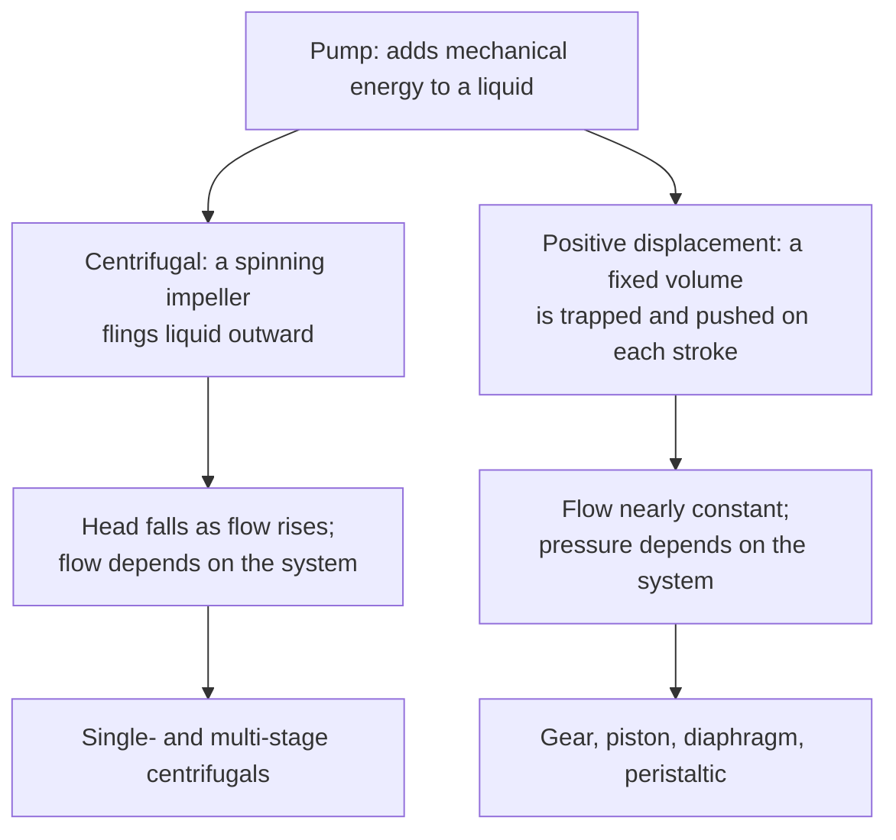

## ビデオ講義

<div class="video-container">
  <iframe
    width="560"
    height="315"
    src="https://www.youtube.com/embed/lfGMREF-V-c?start=3065"
    title="化学工学流体力学 第5章: ポンプと配管システム"
    allow="accelerometer; autoplay; clipboard-write; encrypted-media; gyroscope; picture-in-picture"
    allowfullscreen>
  </iframe>
</div>

> このビデオは以下のテキストと同じ内容をカバーしています。お好みの学習形式をお選びください。

---

# 第5章：ポンプと配管システム

本章は、その代金を支払う機械とともに本シリーズを締めくくります。第 4 章では、流体を配管に通すための費用を数えました。ここでは、それを供給するポンプに出会い、ポンプと配管系が一致する流量を見つける方法を学び、その流量を制御する 2 つのよくあるやり方 — 一方はふつう据付が安価で運転に無駄が多く、他方はふつう据付が高価で、流量が変動する用途では効率的 — を見ていきます。

**機械を配管回路に合わせる**

## 学習目標

本章を修了すると、以下ができるようになります:

  * ✅ ポンプが機械的エネルギー収支に何を供給するのかを説明できる: 高さ、圧力、そして摩擦
  * ✅ **揚程（head）** をメートル単位で定義し、$\Delta P = \rho g H$ によって圧力に換算できる
  * ✅ 遠心ポンプと容積式ポンプを区別し、それぞれがどのようなときに選ばれるかを述べられる
  * ✅ ポンプ曲線とシステム曲線が交わる **運転点（operating point）** を求め、絞りと回転数の変更がそれをどう動かすかを予測できる
  * ✅ **相似則（affinity laws）** を述べ、可変速駆動がなぜ省エネになるのかを説明できる
  * ✅ $\text{NPSH}_a > \text{NPSH}_r$ と用途に応じた余裕を用いて、吸込配管のキャビテーションリスクをふるい分けできる

**読了時間**: 20-25分 **コード例**: 1 **演習**: 3

* * *

## 5.1 ポンプの仕事

[第2章](chapter-2.html)は、機械的エネルギー収支を、ポンプが流体に渡す機械的エネルギーの項 $w_{\text{pump}}$ とともに書き下し、それを約束のまま残しておきました。続く [第4章](chapter-4.html) は、その約束を高くつくものにしました: 配管、継手、バルブにおける摩擦は機械的エネルギーを絶えず消費し、何かがそれを補い続けなければなりません。その何かがポンプであり、ここで扱うタンクからタンクへの用途では、その仕事は 3 つに分かれます。（ここでの端点は液面速度が無視できる大きな容器です。端点の速度に無視できない差がある場合には、収支に速度ヘッドの変化が第 4 の項として加わります。）

ポンプは液体を重力に逆らって **持ち上げ** なければなりません — 吸込タンクから、より高い吐出点へ。ポンプは圧力に逆らって **押し込ま** なければなりません — ある圧力の容器から、より高い圧力の容器へ。そしてポンプは、第 4 章で計算した **摩擦の請求書を支払わ** なければなりません — 乱流で摩擦係数と損失係数がほぼ一定なら、流量のおよそ 2 乗で増大する損失です。液体を 10 m 持ち上げるだけでよいポンプが、配管摩擦に打ち勝つためだけに、さらに 15 m 分のエネルギーを供給していることは十分にありえます。長い移送配管では摩擦が支配的な項になりえますが、高さや容器圧力の差が大きければ、なおそれを上回ることもあります。

遠心ポンプの性能は、ふつうジュールのエネルギーとしても、結果として生じるパスカルの上昇としても表されません — 容積式の機器では差圧で表すのが一般的ですが、遠心ポンプの曲線は **揚程（head）**、記号 $H$、単位は **メートル** で表されます:

$$ H = \frac{w_{\text{pump}}}{g} $$

**揚程は、流体の単位質量あたりではなく単位重量あたりのエネルギーです**。だからこそ、キログラムあたりの水力エネルギーを $g$ で割ると長さが残るのです。ここでの $w_{\text{pump}}$ が *流体* に渡されるエネルギーであることにも注意してください。供給される軸仕事は、その $1/\eta$ 倍だけ大きくなります。「30 m の揚程を出す」ポンプは、摩擦がなければ *適合する* どんな液体でも 30 m 持ち上げます — 水でも、ガソリンでも、硫酸でも同じです。この近似的に流体によらないという性質は、この単位が持つ実際の工学的な利点です: 銘板の 1 つの数値が、中身ではなく機械そのものを記述します — 運転条件が同程度であり、粘度その他の補正を前提としたうえでのことです。

圧力はそうではありません。ポンプが生み出す圧力上昇は、[第1章](chapter-1.html)の静水圧の関係から導かれます:

$$ \Delta P = \rho g H $$

これは、高さが等しく速度ヘッドも等しい断面の間で取ったもので、そこでは全揚程が静圧の上昇に帰着します。したがって、*同じ* 30 m の揚程でも、液体ごとに密度に比例して異なる圧力上昇になります。**揚程はポンプの性質であり、圧力はポンプと流体を合わせた性質です。** この 2 つを混同することはポンプの計算でよくある誤りであり、演習 2 でその違いを具体的に扱います。

必要な動力は揚程と流量から決まります。有効な水力動力は $\rho g Q H$ であり、軸で実際に消費される動力は、効率 $\eta$ の分だけそれより大きくなります。$\eta$ は適切に選定された遠心ポンプで通常 0.6〜0.8 です:

$$ \dot{W}_{\text{shaft}} = \frac{\rho g Q H}{\eta} $$

## 5.2 2 つの系統

化学プラントのほぼすべてのポンプは、エネルギーを *どのように* 加えるかによって区別される 2 つの系統のいずれかに属します。



**遠心ポンプ（centrifugal pump）** は、回転する羽根車（impeller）で液体を外向きに加速し、その速度を圧力に変換します。これが圧倒的な主力です: 単純で、安価で、バルブを持たず、連続運転でき、そしてスラリーや固体分の取り扱いを目的に設計された機種であれば、適合する固体分を通すこともできます — 通常の清澄液用の羽根車にはできないことです。その特徴的な挙動は、通常の運転範囲で **流量が増えると揚程がおおむね下がる** ことです — 吐出弁をより大きく開ければ、ポンプはより低い揚程でより多くの流量を出します。

**容積式ポンプ（positive-displacement pump、PD ポンプ）** は、一定の体積の液体を閉じ込め、機械的に押し出します — 歯車のかみ合い、ピストン、たわむダイヤフラムによって。その特徴的な挙動はちょうど鏡像です: **打ち勝つべき圧力によらず、流量がほぼ一定なのです。** これは強力であり、同時に危険でもあります。駆動される PD ポンプの多くは、閉じた吐出弁に対しても自らの体積を押し出そうとし続け、何かが屈するまで圧力が上がっていきます。一方で、止まる型式もあります — トルク制限のある駆動なら失速したりトリップしたりしますし、エア駆動のダイヤフラムポンプは吐出圧力が供給空気圧と釣り合えばそのまま止まります — ただし、そのふるまいはその機械と駆動に固有の性質であって、保護として頼ってよいものでは決してありません。**PD ポンプは、吐出配管に逃がし装置（relief device）を設けずに、閉じたバルブに対して運転してはなりません** — これは高度な工夫ではなく、標準的な実務です。

| | **遠心式** | **容積式** |
|---|---|---|
| **流量と圧力の関係** | 揚程が上がると流量が下がる | 流量は圧力にほぼ依存しない |
| **得意な用途** | 低〜中粘度、大流量 | 粘性液、定量供給、高圧 |
| **流れの安定性** | 滑らか | 脈動しやすい（ピストン、ダイヤフラム） |
| **吐出弁を閉じたとき** | 温度が上がる。メーカーの最小流量および締切に関する制限を守ること | 有効な保護がなければ、急速に破壊的な過圧に達しうる |
| **典型的な用途** | 移送、循環、還流、冷却水 | 定量注入、ポリマーやスラリーの移送、均質化 |

選定の出発点としての傾向はこうです: **粘性のある用途と定量供給の用途は容積式へ傾き、それ以外のたいていの用途は遠心式へ傾きます。** 高圧であることだけでは決着しません — 多段の遠心ポンプが多くの高圧用途をカバーします — し、流量、固体分、制御上の要求、信頼性、経済性のすべてが最終的な選択に関わってきます。遠心ポンプが一般的な既定の選択になるのは、それがプラントの用途の大半に適しているからです。

## 5.3 運転点

遠心ポンプは「ある流量」を持っているわけではありません。持っているのは **ポンプ曲線（pump curve）** — 右下がりの、揚程対流量の曲線 — であり、配管の側には **システム曲線（system curve、管路抵抗曲線）** があります: 打ち勝つべき実揚程（静揚程）に、[第4章](chapter-4.html)の摩擦損失を揚程として表したものを足したもので、ここで扱うような乱流で構成の固定された系ではおよそ $Q^2$ で増大します。ポンプは *両方* の曲線上にある組み合わせしか出せないので、プラントは実現可能で安定な交点、すなわち **運転点（operating point）** で運転されます。ここで描いた単調な曲線なら、その交点はちょうど 1 つです。

運転点を動かすよくある方法は 2 つあります。吐出弁を **絞る（throttling）** と摩擦が加わり、システム曲線が急になって、運転点は左へ、より低い流量へと滑っていきます。これは単純で、操作器と水力系の応答の範囲内で素早く効き、[化学工学入門 第3章](../chemical-engineering-introduction/chapter-3.html)の制御弁が行っていることそのものです。同時に無駄でもあります: ポンプは相変わらず高い揚程を出しており、その余剰はバルブで熱として破壊されます。

一方 **可変速駆動（variable-speed drive、インバータ、VSD）** は、*ポンプ* 曲線のほうを下げます。そのスケーリングを捉えるのが **相似則（affinity laws）** であり、遠心ポンプの性能を回転数 $N$ に結びつける比例関係です:

- 流量は回転数に比例: $Q \propto N$
- 揚程は回転数の 2 乗に比例: $H \propto N^2$
- 動力は回転数の 3 乗に比例: $P \propto N^3$

動力にかかる 3 乗こそが、摩擦が支配的な用途において可変速ポンプ運転を動機づける中心にあります: 回転数を 20% 下げると、軸動力はおよそ半分になります。経済性はさらに、負荷のプロファイル、実揚程、機器の効率、エネルギー価格、設備費にも左右されます。これらは理想化された関係であり — 幾何学的相似と、効率が変わらないことを仮定しています — したがって、保証ではなく最初の見積もりとして扱ってください。

以下のコードは、2 次のポンプ曲線 $H = a s^2 - bQ^2$ とシステム曲線 $H = H_{\text{static}} + kQ^2$ を交差させて運転点を求めます。ここで $a$ は **全速（基準回転数）における締切揚程（shutoff head）** であり — 回転数比 $s$ では締切揚程は $a s^2$ になります — $s$ がその回転数比です。これは **簡略化された教科書的な扱い** です: 相似則によるスケーリングを、実測の曲線ではなく理想的な 2 次曲線に適用しています。実際の選定で用いられるのは、まさにその実測の曲線のほうです。

```python
import math

RHO = 998.0      # kg/m3, water
G = 9.81         # m/s2

A = 40.0         # m, pump shutoff head at full speed
B = 0.0015       # m per (m3/h)^2, pump curve droop
H_STATIC = 12.0  # m, static lift between the two tank levels
K = 0.0012       # m per (m3/h)^2, friction coefficient of the open piping

def operating_point(k, s=1.0):
    """Pump curve H = A*s^2 - B*Q^2 meets system curve H = H_STATIC + k*Q^2."""
    q2 = (A * s**2 - H_STATIC) / (B + k)          # solve the two curves for Q^2
    q = math.sqrt(q2)                             # m3/h
    h = H_STATIC + k * q2                         # m
    p_fluid = RHO * G * (q / 3600.0) * h / 1000.0 # kW delivered to the liquid
    p_valve = RHO * G * (q / 3600.0) * ((k - K) * q2) / 1000.0  # kW burned in the valve
    return q, h, p_fluid, p_valve

cases = [("full speed, valve open", K, 1.0),
         ("throttled (k doubled)", 2 * K, 1.0),
         ("speed reduced to 80%", K, 0.8)]

print(f"{'case':>23} {'Q [m3/h]':>9} {'H [m]':>7} {'P_fluid [kW]':>13} {'P_valve [kW]':>13}")
for label, k, s in cases:
    q, h, pf, pv = operating_point(k, s)
    print(f"{label:>23} {q:9.1f} {h:7.2f} {pf:13.2f} {pv:13.2f}")

#                    case  Q [m3/h]   H [m]  P_fluid [kW]  P_valve [kW]
#  full speed, valve open     101.8   24.44          6.77          0.00
#   throttled (k doubled)      84.7   29.23          6.74          1.99
#    speed reduced to 80%      71.0   18.04          3.48          0.00
```

2 つの制御方式を突き合わせて読んでみましょう。その際、制御後の 2 つのケースが同じ流量を出しているわけではないことを忘れないでください — どちらを選ぶかを決めるエネルギーの比較は、同じ必要用役のもとで行わなければなりません。絞りは流量を 17%、101.8 から 84.7 m³/h へと減らします — そして液体に伝えられる動力はほとんど変わらず、6.77 から 6.74 kW です。ポンプが自らの曲線をより高い揚程へと登っていくだけだからです。いまや 2.0 kW 近く、ポンプの出力のおよそ 30% が、バルブで破壊されています。ポンプを 80% の回転数まで落とすと、流量は 30%、流体動力は 49% 減り、バルブで何かを焼き捨てることもありません。また、流量が相似則だけから示唆されるより大きく下がること（$0.8 \times 101.8 = 81.5$ ではなく 71.0 m³/h）にも注目してください: 相似則はポンプを記述するものであり、一方の実揚程はシステムに属していて、まったくスケールしないのです。

## 5.4 NPSH とキャビテーション

第 2 章は、エネルギー収支が容易に到達させてしまう 1 つの破綻を予告していました: ベルヌーイのトレードオフが成り立つ条件のもとで液体を十分に加速すると、その静圧は自らの蒸気圧に向かって下がり、そこで沸騰しうるのです。ポンプでこれを引き起こす局所的な圧力の極小は、**羽根車の入口と翼の前縁の近く** にあります — 翼の負圧面では、その極小がごく局所的になることもあります — そしてこの現象には名前と数値があります。

**NPSH（有効吸込ヘッド、Net Positive Suction Head）** とは、ポンプ吸込部で利用できる **絶対の全** ヘッド — ポンプの基準面に換算した静圧ヘッドに、吸込側の速度ヘッド $V_s^2/2g$ を *加えた* もの — と、運転温度における液体の飽和蒸気圧ヘッド $P^{sat}/(\rho g)$（これも絶対圧基準）との間の余裕を、揚程のメートルで表したものです — この物性は [化学工学熱力学 第3章](../chemical-engineering-thermodynamics/chapter-3.html) で導入されました。この比較にゲージ圧の読みを入れてしまうと、まるまる 1 気圧 — 水頭でおよそ 10 m — が余裕から音もなく消えます: [第1章](chapter-1.html)のゲージ圧と絶対圧の教訓が、それを忘れると最も危険になる場所に現れるのです。**有効 NPSH（NPSH available）** はプラント側から計算されます: 吸込容器の圧力、液面、そして吸込配管の摩擦です。**必要 NPSH（NPSH required）** はポンプの性質であり、そのデータシートに記載されています。規則は容赦がありません:

$$ \text{NPSH}_a > \text{NPSH}_r $$

しかも、その上に設計上の余裕を取ります — 絶対値として 0.5〜1 m の割り増しを見る用途もありますが、必要量はポンプの吸込特性、エネルギーレベル、適用される指針によって決まり、しばしば固定の高さではなく *比* として表されます。また、公表されている $\text{NPSH}_r$ がふつう何であるかにも注意してください: NPSH3、すなわち揚程がすでに 3% 低下した時点の値であり、つまりその点ではいくらかのキャビテーションが生じています。したがって、この不等式を満たすことはキャビテーションのない運転の保証にはならず、有効ヘッドがそこまで下がる前から蒸気の空洞が生じ始めているのが普通です。これを下回ると、低圧領域で空洞が発生し、下流の圧力が回復するところで激しく崩壊します。それが **キャビテーション（cavitation）** です: ポンプに砂利を入れたような騒音、振動、揚程の低下、そして羽根車の金属が点食で削り取られていくこと。

主な水力的な対策は、左辺を上げるか右辺を下げるかのいずれかです:

| 対策 | 仕組み |
|---|---|
| 吸込タンクを高くする、またはポンプを下げる | 吸込側の実揚程が増える |
| 液を冷却する | $P^{sat}$ が急激に下がる |
| 吸込配管を短く、まっすぐに、または太くする | 羽根車の手前での摩擦損失が減る |
| ポンプの回転数を下げる | $\text{NPSH}_r$ が下がる |

典型的な犠牲者は、**すでに沸点にある液体** を扱うポンプです。そこでは容器圧力の寄与がまるごと消え、有効 NPSH は、ポンプより上にある液面の高さが与えるものから吸込配管の損失を引いたものになります: リボイラーの循環ポンプ、復水ポンプ、そして飽和状態の容器から吸い込むあらゆるポンプです。そうした用途では、対策はたいてい配置上のものになります — 容器を単純にポンプよりずっと高い位置に設置するのです。

## 5.5 気体: 送風機、ブロワ、圧縮機

液体ではなく気体を動かす場合、仕事は同じですが流体は圧縮性であり、それが下流のすべてを変えます。機械は圧力上昇の大きさで格付けされます: 換気規模の圧力には **送風機（fan）**、中程度の昇圧には **ブロワ（blower）**、本格的な圧力比には **圧縮機（compressor）** です。気体を圧縮すると、ふつうその温度は上がります: 圧縮仕事は、実際の機械が熱を除去できるよりも速く気体に入るので、過程は断熱に近くなり、[化学工学熱力学 第1章](../chemical-engineering-thermodynamics/chapter-1.html) の第一法則と気体の状態関係とが、温度がどれだけ上がるかを決めます。（十分に熱を除去できれば、圧縮はむしろ等温に近くなりえます。）したがって圧縮機は高温の気体を送り出し、それは次の段の前に冷却が必要になることがあります。またその仕事は正真正銘の軸仕事、本シリーズの第 2 章がこだわった貴重な資源です。全体の圧力比や吐出温度がそれを要求する場合、用途は **間に中間冷却（intercooling）を挟んだ複数の段** に分割されます。発熱反応器における段間冷却を支配するのと同じ、段に分けて冷やすという論理です。その結果、同じ圧力比に対してより少ない仕事で済み、吐出温度も材料・潤滑油・シールの制限の内側に収まります。

## 5.6 シリーズのまとめ

5 つの章を、1 章 1 文で。**第 1 章** は、流体の物性と、何かが動き出す前から存在する圧力を確立しました。**第 2 章** は、エネルギー保存を機械的エネルギー収支とベルヌーイの式 — 圧力・速度・高さを互いに変換する道具 — に変えました。**第 3 章** は、レイノルズ数と、どの相関式が適用できるかを決める層流・乱流の分かれ目を導入しました。**第 4 章** は、配管と継手における摩擦に値段を付け、その費用を管径がどれほど鋭く支配するかを示しました。**第 5 章** は、その代金を支払う機械を用意し、それを配管回路に整合させました。

この流れはここで終わりません。本シリーズを通じて、**流束 = 係数 × 駆動力** という 1 つのパターンが繰り返し現れました — ニュートンの粘性法則で最も明確に、静水力学や乱流の水力抵抗ではそれほど文字どおりではない形で。そして同じ構造は、[化学工学伝熱](../chemical-engineering-heat-transfer/index.html) シリーズ — そこでの駆動力は温度差です — へ、さらに [化学工学物質移動と分離](../chemical-engineering-mass-transfer/index.html) シリーズ — そこでは、通常の仮定のもとで濃度差です — へと、そのまま引き継がれます。ここで学んだ摩擦係数には、そこでも類似の役割を果たす対応物があります。ただし、移動現象の定量的なアナロジーが成り立つのは限られた条件のもとだけです。

次に進む先: これらの流れが支える単位操作については *化学工学入門* シリーズへ、蒸気圧と圧縮仕事の背後にある物性モデルについては *化学工学熱力学* へ、そしてそれらすべての上に築かれるデータの層については *プロセス・インフォマティクス入門* へ。

最後までお読みいただきありがとうございました。

## 演習問題

1. **概念 — 系統を選ぶ**: 2 台のポンプを仕様決定しなければなりません。(a) 250 m³/h の冷却水循環ループ、30 °C の水。(b) 加圧された反応器へ 4 L/h で注入される触媒添加剤、精度は ±2% が要求されます。それぞれについて遠心式と容積式のどちらかを選び、その根拠を述べ、後者が備えなければならない保護装置を 1 つ挙げなさい。
   *ヒント*: それぞれの用途で、大きく安定した流量と正確な流量のどちらがより重要かを問うこと。
   *解答*: **(a) 遠心式。** 大流量、低粘度、そして精度の要求がない — 遠心ポンプがふつう経済的で単純、かつ実績の豊富な選択となる種類の用途です。（ここでは揚程が指定されていません。通常の単段の範囲内だと仮定し、選定の前に確認してください。）(b) **容積式**、具体的には定量（ダイヤフラムまたはピストン）ポンプです。その流量はストロークと回転数で決まり、吐出圧力への感度がはるかに低いので、反応器の圧力が変動しても注入量を保つには、これが適した機種の系統です — ただし ±2% そのものは、想定される流量と圧力の範囲にわたって仕様として定め、検証しなければなりません。背圧、圧縮性、逆止弁のふるまい、校正、吸込条件のいずれもがそこに関わるからです。遠心ポンプなら、システム曲線が許すだけの量を送り、その流量は反応器圧力とともに揺れてしまうでしょう。保護装置は **吐出配管に設ける圧力安全弁**（または内蔵の逃がし機構）です: 吐出を塞がれた PD ポンプは、配管、シール、あるいはケーシングが壊れるまで圧力を上げていきます。

2. **定量 — 揚程は圧力ではない**: あるポンプが **30 m の揚程** を出します。それが生み出す圧力上昇を、(a) 水 $\rho = 998$ kg/m³、(b) 有機溶媒 $\rho = 800$ kg/m³ について計算しなさい。$g = 9.81$ m/s² とします。(c) この比較は、ポンプの銘板を読むことについて何を教えていますか。
   *ヒント*: $\Delta P = \rho g H$、SI 単位を入れれば Pa で出ます。1 bar = 10⁵ Pa。
   *解答*: (a) $\Delta P = 998 \times 9.81 \times 30 = \mathbf{293{,}711\ Pa \approx 2.94\ bar}$。(b) $\Delta P = 800 \times 9.81 \times 30 = \mathbf{235{,}440\ Pa \approx 2.35\ bar}$ — およそ **20% 小さく**、密度比 $800/998 = 0.802$ のとおりです。(c) **揚程はどちらの場合も同じ** です。揚程は液体ではなく機械の性質だからです。一方 **圧力上昇は同じではありません**。したがって、銘板の揚程は圧力の数値よりもはるかによく新しい用途へ引き継がれます — それに添えて示された圧力の数値は、それが示された流体に対してのみ有効です — が、その移し替えはなお、新しい流体の粘度、運転流量と回転数、NPSH、同伴ガス、材料適合性に照らして確認しなければなりません。同じ論理は逆向きにも効きます: 水から高密度のブラインへ移されたポンプは、ほぼ同じ揚程を出しますがより高い圧力を生み、より多くの動力を消費します。$\dot{W} = \rho g Q H/\eta$ もまた密度に比例するからです。

3. **討論 — 流量が多すぎる**: 移送配管上の遠心ポンプが、プロセスに必要な量より多くの流量を送っています。運転員は吐出弁を絞ることを提案し、技術者は可変速駆動を取り付けることを提案しています。(a) それぞれが曲線と運転点に何をするかを説明しなさい。(b) 回転数を 20% 下げたときの動力の節約を見積もり、実際の節約がそれより小さい理由を述べなさい。(c) 3 人目の同僚は、代わりに *吸込* 弁を絞ることを提案しました — それの何が問題ですか。
   *ヒント*: 一方の選択肢はシステム曲線を、他方はポンプ曲線を変えます。(c) は 5.4 節の話です。
   *解答*: (a) **絞りは摩擦を加えてシステム曲線を急にします**。交点は左へ滑って流量は下がりますが、揚程は *上がり*、余剰の揚程はバルブで熱として破壊されます。5.3 節の例では、流量は 17% 下がった一方で、液体に伝えられる動力は実質的に変わらず、そのおよそ 30% がバルブで焼かれていました。**VSD はポンプ曲線を下げます**（$H \propto N^2$）。システム曲線は変わらないまま、より低い揚程でより低い流量に到達し、絞りによる余分な損失が生じません — もっとも、それは何も無駄にならないという意味ではありません。ポンプ、モーター、駆動装置、配管の損失はいずれも残ります。(b) 相似則 $P \propto N^3$ からは $0.8^3 = 0.512$、すなわち理想化された **50% 近く** の節約が得られ、計算した事例では 6.77 → 3.48 kW、流体動力で 49% の低下でした。2 つ目の数値を 1 つ目の裏付けとして読んでは **いけません**。相似則は、幾何学的に相似な運転状態をたどる経路に沿って成り立つものであり、純粋に摩擦だけの系はその経路を与えます。しかしこの系には **12 m の実揚程** があるため、運転点は別の経路をたどり、流体動力 $\rho g Q H$ は $N^3$ にまったく従いません。さらに、この 2 つの数値はそもそも同じ種類の量ですらないことに注意してください: 49% は動力の *減少* であるのに対し、0.512 は *残っている割合* です — 対応する節約は 48.8% であり、節約と残りとを比べるのが避けるべき誤りです。残るのは結論のほうです: VSD はバルブで揚程を破壊せずに低い流量に到達するので、流量が変動する適切な用途では、絞りよりかなり大きく節約しうるのです — 数値を主張する前に、同じ必要流量のもとで両者を比べてください。入力動力の節約は、実際の運転点と、ポンプ・モーター・駆動装置の効率から計算しなければなりません: **最高効率点（BEP）**（その回転数と構成におけるポンプ効率が最大となる流量）から運転点がずれるとポンプ効率は変わり、駆動装置自体にも数パーセントの損失があり、そして **実揚程は回転数とともにスケールしない** からです — これはまた、流量が $Q \propto N$ だけから予測される 81.5 m³/h ではなく 71.0 まで下がった理由でもあります。ほとんどが静的な持ち上げである系では、VSD の節約はずっと小さく、$a s^2$ が実揚程を下回れば送液そのものが止まってしまいます。(c) **吸込側のバルブを流量制御に使ってはいけません。** 吐出側の絞りはエネルギーを費やしますが、吸込側の絞りは羽根車に届く圧力を下げ、$\text{NPSH}_a$ を直接削って **キャビテーション** の危険を招きます — 騒音、振動、揚程の喪失、そして侵食された羽根車です。だからこそ、日常の流量制御は吐出側、あるいは駆動の回転数に属するのです。
