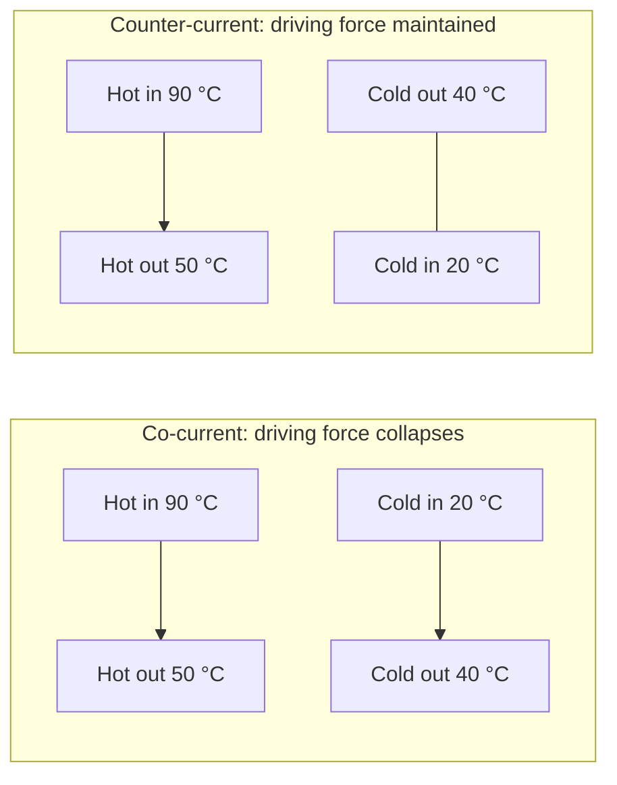

## ビデオ講義

<div class="video-container">
  <iframe
    width="560"
    height="315"
    src="https://www.youtube.com/embed/fpjFV6KX1hc?start=778"
    title="化学工学伝熱 第2章: 熱交換器と対数平均温度差（LMTD）"
    allow="accelerometer; autoplay; clipboard-write; encrypted-media; gyroscope; picture-in-picture"
    allowfullscreen>
  </iframe>
</div>

> このビデオは以下のテキストと同じ内容をカバーしています。お好みの学習形式をお選びください。

---

# 第2章：熱交換器と対数平均温度差（LMTD）

[第1章](chapter-1.html)では、境膜の熱抵抗、壁の伝導、汚れをまとめて 1 つにした数値 — 総括伝熱係数 $U$ — を組み立てました。本章はそれを使います。2 つの流体と 1 つの熱負荷が与えられたとき、どれだけ大きな熱交換器を買えばよいのでしょうか。

**プロセス熱の主力機器をサイジングする**

## 学習目標

本章を修了すると、以下ができるようになります:

  * ✅ 熱交換器（heat exchanger）がフローシートに対して何をするのか、そして熱統合（heat integration）がなぜ二重に得なのかを説明できる
  * ✅ 多管式（シェルアンドチューブ、shell-and-tube）の構造と、それが業界標準であり続けている理由を述べられる
  * ✅ 向流（counter-current）が並流（co-current）に対してどれだけの価値を持つかを数値で示せる
  * ✅ 対数平均温度差（LMTD）を計算し、なぜその平均が対数的なのかを説明できる
  * ✅ $Q = U A F \Delta T_{lm}$ により熱交換器をサイジングでき、その $U$ がどういう性質の数値なのかを述べられる
  * ✅ $\varepsilon$、NTU、$C_r$ を計算し、LMTD 法と ε-NTU 法のどちらを使うかを選べる

**読了時間**: 20-25分 **コード例**: 1 **演習**: 3

* * *

## 2.1 熱交換器の仕事

**診断問題。** ある熱交換器が、$U =$ **500** W/(m²·K)、$\Delta T_{lm} =$ **39.2** K のもとで 334.4 kW に対してサイジングされ、**17.1** m² を得て、1 シェルパス・2 管パスの装置として発注されました。試運転の日、完全に清浄な状態で、この装置は所定の熱負荷を出せるでしょうか。解答は 2.4 節にあります。

間接接触式の熱交換器は、表面で隔てられた 2 つの流体を混ぜることなく、その間で熱を移します。直接接触式の装置は両者を混ぜます。そう言ってしまうと配管工事のように聞こえますが、経済性はそうではありません。冷却を必要とする高温流体にはふつう冷却水や空気の費用がかかり、加熱を必要とする低温流体にはふつう蒸気や燃焼の費用がかかります。両者を組み合わせれば、両方の費用が同時に減ります。それが**熱統合**であり、その体系的な形 — ネットワークを描く*前に*最小のユーティリティを計算するピンチ解析（pinch analysis） — が[入門シリーズ第4章](../chemical-engineering-introduction/chapter-4.html)です。

熱交換器はその目標を実現するものであり、**多管式熱交換器**がプロセス産業の主力機器です: 一方の流体を運ぶ管を、他方の流体を運ぶ円筒形の胴（シェル）に封入し、セグメンタルバッフル — 一般的な配置です — がシェル側の流体を管の上に横切らせます。適切に設計すれば広い範囲の圧力と温度をカバーし、その範囲を決めるのは金属にかけられる費用だけではなく、許容応力、クリープ、腐食、継手、そして規格です。機械的に頑丈で、フローティングヘッド形や U 字管形なら清掃のために管束を引き抜けますが、固定管板形では引き抜けません。そしてその幾何形状は **TEMA** 規格によって成文化されているため、十分に完備した仕様書はどの製作者にも同じように読まれます。何か別のものを選ぶ理由がないかぎり、これが既定の選択です — そして理由はあります。**プレート式熱交換器**は、清浄で中程度の圧力の用途において、はるかに小さな容積でしばしばより高い $U$ に達します（[第5章](chapter-5.html)）。空冷器、二重管式、スパイラル式もそれぞれの適所を占めています。以下の熱収支の枠組みはそれらにも引き継がれますが、$U$ と幾何形状、そしてしばしば水力および配置のモデルが、それとともに変わります。

## 2.2 流れの配置

2 つの流体は同じ向きにも逆向きにも流せますが、その選択は見た目の問題ではありません。**並流**（parallel flow）では両方が同じ端から入ります。温度差は大きく始まり — 高温側入口と低温側入口の対比 — 2 つの流体が共通の中間温度へ収束するにつれて潰れていきます。**向流**では両者は反対の端から入り、高温側入口が低温側*出口*と向き合うので、温度差ははるかに均一です — 選んだ向きに沿ってそれが縮むのか、広がるのか、一定にとどまるのかは 2 つの熱容量流量によって決まり、両者が一致するときちょうど一定になります。

| | 並流 | 向流 |
|---|---|---|
| **入口** | 同じ端 | 反対の端 |
| **長さ方向の駆動力** | 入口で大きく、出口に向かって潰れる | 維持され、より均一 |
| **低温側出口と高温側出口** | 低温側出口は高温側出口より低くとどまるほかない | 低温側出口が高温側出口を**上回りうる** |
| **所定の熱負荷に必要な面積** | 大きい — ここでは **27.0 %** 多い（2.3 節） | 小さい |
| **長さ方向の流体温度勾配** | 入口端で急峻 | より緩やかで、分散している（熱応力については別途、熱機械的な評価が必要） |

3 行目が決定的です。並流では、低温流体を高温流体の出口温度より上に引き上げることは決してできません: 両者は同じ出発点から互いに近づいており、いったん出会えば熱の流れは止まります。向流にはそうした限界がありません — 低温側出口が高温側*入口*と向き合うので、低温流体は高温流体の出口温度より高温で出て行くことができます。これが並流では得られない**温度クロス**です。より均一な駆動力と併せて、これこそが向流が熱的な基準であり、機械的・水力的な配置が許すかぎり選好される理由です。多パスや直交流の装置も実務では一般的であり、以下の各節は純粋な向流を基準ケースとして扱います。



向流のブロックは、低温流体については右から左へ読んでください: 低温流体は高温流体が 50 °C で*出て行く*場所に 20 °C で入り、高温流体が 90 °C で*入って来る*場所から 40 °C で出て行きます — 70 K と 10 K ではなく、30 K と 50 K というアプローチ温度差です。

## 2.3 対数平均温度差

サイジングの式は、標準的な形をした移動の法則 — 流束は係数かける駆動力であり、それを面積にわたって積分したもの — です:

$$ Q = U A \Delta T_{lm} $$

ここで $Q$ は**熱負荷**（単位 W）、$U$ は総括伝熱係数で単位は W/(m²·K)、$A$ は伝熱面積で単位は m²、$\Delta T_{lm}$ は実効的な平均温度差です。厄介なのは、この温度差が熱交換器に沿って連続的に変化することです。では、正しい平均とは何でしょうか。

算術平均ではありません。各流体の温度は吸収した、あるいは手放した熱に比例して変化するので、両者の隔たりは面積に対して直線的にではなく指数的に縮んで — あるいは広がって — いきます。$U$ が一定、比熱が一定、熱損失が無視できるという条件で $dQ = U\,\Delta T\,dA$ を積分すると、**対数平均温度差**が得られます:

$$ \Delta T_{lm} = \frac{\Delta T_1 - \Delta T_2}{\ln(\Delta T_1 / \Delta T_2)} $$

ここで $\Delta T_1$ と $\Delta T_2$ は両端におけるアプローチ温度差です。

### 例題

熱水が 90 °C から 50 °C へ冷却され、冷水が 20 °C から 40 °C へ加熱される向流の場合。各端を正しく組み合わせてください — 高温側入口と低温側出口です:

$$ \Delta T_1 = 90 - 40 = 50\ \text{K}, \qquad \Delta T_2 = 50 - 20 = 30\ \text{K} $$

$$ \Delta T_{lm} = \frac{50 - 30}{\ln(50/30)} = \frac{20}{0.5108} = 39.2\ \text{K} $$

算術平均なら 40 K で、約 2.2% の過大評価です。$A$ は $1/\Delta T$ に比例するので、それを使えば熱交換器を約 2% 過小に設計することになります。ここでは許容範囲ですが、この誤差は一定ではありません。対数平均が**2 つの平均のうち**大きいほうになることはなく — 算術平均と一致するのは両端の温度差が等しいときだけです — 両端が不揃いになるほどその差は開きます。それでも対数平均は両端の温度差の*あいだ*にとどまり、この例では 30 K と 50 K のあいだにあります。10:1 の開きでは算術平均が 40% を超えて上振れし、仮定した設計条件に対して能力不足の熱交換器をサイジングすることになります。

**向流の価値を面積で測る。** 同じ 4 つの端点温度を並流で流すと、両端の組み合わせが入れ替わります: $\Delta T_1 = 90 - 20 = 70$ K、$\Delta T_2 = 50 - 40 = 10$ K なので、$\Delta T_{lm} = 60/\ln 7 =$ **30.83** K であり、向流の **39.15** K に対する値です。同じ熱負荷、同じ $U$、面積は $1/\Delta T_{lm}$ に比例するので、$39.15/30.83 =$ **1.270**、すなわち並流は **27.0 %** 多くの伝熱面を必要とし、しかも温度クロスはできません。2.2 節の 4 行目に、数値を与えたことになります。

## 2.4 完全なサイジング

$c_p = 4.18$ kJ/(kg·K) の水 2 kg/s が 40 K 冷却される場合を取り上げます。熱負荷は片方の流体についてのエネルギー収支から求まります:

$$ Q = \dot{m} c_p \Delta T = 2 \times 4.18 \times 40 = 334.4\ \text{kW} $$

**この係数はどういう性質の数値か。** このサイジングは、水—水の多管式装置に対する本例の**設計値（汚れ込み）**として $U = 500$ W/(m²·K) を**仮定**します。総括伝熱係数の設計用一覧表は存在しますが（McAdams, *Heat Transmission*, 3rd ed., 1954）、ここではどの表も、サービスの定義も、汚れの前提も特定していません。したがって 500 が公表された範囲の下限に位置するという主張は成立していません: 500 は本例に対して*宣言された設計入力*であって、測定値でも出典のある代表値でもなく、このサービスの清浄時の係数として提示されているのでもありません。清浄な水—水の組み合わせがそれよりどれだけ上にあるかは、第 1 章の境膜が示しています: 40 °C の IAPWS-97 の水を内径 15.75 mm の管に流したときの Dittus–Boelter 式は、1.5 m/s で $h =$ **7,277** W/(m²·K)、2.0 m/s で **9,160** を与えるので、両側とも $h \approx$ **8,000** と**仮定**します — これは例示的な等境膜の仮定です。管内の相関式はシェル側について何も語らず、シェル側の直交流、バイパス、漏れにはそれ自身のモデルが必要だからです — そして厚さ 1.65 mm の炭素鋼壁（$k = 45$ W/(m·K)）を隔て、共通の伝熱面積基準で薄肉平板近似として足し合わせます:

$$ \frac{1}{U_{\text{clean}}} = \frac{1}{8000} + \frac{0.00165}{45} + \frac{1}{8000} \;\Rightarrow\; U_{\text{clean}} = 3{,}488\ \text{W/(m²·K)} $$

そして片側あたり 0.0002 m²·K/W の汚れを加えるとこれは **1,456** になります — **58 %** の低下です。壁の割合 **12.8 %** は*清浄時*の和に属する値であり、第 1 章の平板の 6.9% に対するものです。汚れの項を加えても壁の熱抵抗は変わらないので、その割合はさらに下がります。したがって 500 でサイジングすることは、いま計算した汚れをはるかに超える熱抵抗と不確かさの余裕を含んでいることになります — それが何を表しているのかは、数値の大きさから推し量るのではなく、宣言されなければなりません。39.2 K の駆動力を使うと:

$$ A = \frac{Q}{U \Delta T_{lm}} = \frac{334{,}400}{500 \times 39.2} = 17.1\ \text{m}^2 $$

**誤り:** 500 を清浄時の係数と読み、その上に汚れ余裕を上乗せして 300 W/(m²·K) で再サイジングする — 17.1 m² は 28.5 m² になり、同じ汚れの代金を二重に払うことになります。**正しくは:** 余裕はすでに 500 の内側にあり、その 500 は計算された 2 つの係数のどちらよりも下にあります。まだ払われていない補正は以下の多パスの $F$ であり、それが 17.1 m² を 28.5 ではなく **18.9** m² にします。

**多パスの幾何形状。** 実務の多管式装置の多くは、理想的な向流から外れています。**多パス**の熱交換器は、流速と小型化のために管側流体をシェルの中で 1 往復以上させます — 2 パス、4 パス、あるいは 6 パス — すると一部のパスは並流になり、駆動力を損ないます。その手当てが**補正係数** $0 < F \le 1$ です — 理想的な向流や、等温流体のような極限では 1 に等しく、ここでの多パスの場合は 1 未満です: $Q = U A F \Delta T_{lm}$ であり、$\Delta T_{lm}$ は上の**向流**の対数平均です。1 シェルパス・2 管パスに対しては、$P = (t_2-t_1)/(T_1-t_1)$ と $R = (T_1-T_2)/(t_2-t_1)$ を用いた $F$ の閉じた形が存在します（Bowman, Mueller and Nagle, 1940）:

$$ F = \frac{\sqrt{R^2+1}}{R-1}\cdot\frac{\ln\dfrac{1-P}{1-PR}}{\ln\dfrac{2/P - 1 - R + \sqrt{R^2+1}}{2/P - 1 - R - \sqrt{R^2+1}}} $$

本章の端点温度では $P = 20/70 =$ **0.2857**、$R = 40/20 =$ **2.000** であり、$F =$ **0.9045** が得られます。線図では隠れてしまうことが 2 つ、ここから出てきます。第一に、分母の対数の引数が正でなくなるとき、**$F$ はそもそも存在しません**: その熱負荷は 1 シェルでは効率が悪いのではなく、その流れの配置では到達不能なのであり、対策の 1 つはシェルを直列にすることです。第二に、$F$ はハードウェアの等級ではありません: *指定された流れの配置*に対して — ここでは 1 シェルパス・2 管パス — $F$ は $P$ と $R$ を通じて 4 つの端点温度によって決まります。したがって、$F$ が 0.9045 である事例に対して線図から丸めた 0.85 を読み取るのは、保守的であることではなく誤りです。配置を変えれば、同じ端点温度でも別の $F$ になります。設計者は $F$ をおよそ 0.8 より上に保ちますが、これは実務上の習慣であって、計算で定まる閾値ではありません。

**診断問題の解答。** 発注されたままでは出せません。ちょうど 17.1 m² を 2 パスの装置として発注し、設計 $U =$ 500 と**仮定した線図の係数 $F = 0.85$** のもとで、目標の端点温度を固定したまま $Q = UAF\Delta T_{lm}$ を評価すると: $500 \times 17.1 \times 0.85 \times 39.2 = 284{,}886$ W $=$ **284.9** kW となり、必要な 334.4 kW に対して **15 %** の不足です。これが何であるかを正しく読んでください — 面積に対する**端点温度を固定したチェック**であって、清浄な装置の性能評価ではありません。性能評価であれば清浄時の $U$ と 1 シェル・2 パスの関係式を使い、エネルギー収支を解いて出口温度を求めるので、$\Delta T_{lm}$ も動きます。上のチェックはそうではなく、発注された伝熱面が、設計係数と仕様どおりの端点温度のもとで足りているかを問うています。その読み方では足りていません: 真の $F =$ 0.9045 では、この熱負荷には **18.9** m² が必要です。$F$ はサイジングの内側に属するものであって、あとから外付けする余裕ではありません。

```python
import math

CP_WATER = 4.18  # kJ/(kg*K)


def duty(m_dot, cp, delta_T):          # kW, from kg/s and K
    return m_dot * cp * delta_T


def lmtd(dT1, dT2):                    # K, from the two end approaches
    if abs(dT1 - dT2) < 1e-9:
        return dT1
    return (dT1 - dT2) / math.log(dT1 / dT2)


def area(Q_kW, U, dT_lm):              # m2, from Q = U * A * dT_lm
    return Q_kW * 1000.0 / (U * dT_lm)


# Hot water 90 -> 50 C against cold water 20 -> 40 C, counter-current
dT1, dT2 = 90 - 40, 50 - 20
dT_lm = lmtd(dT1, dT2)
Q = duty(2.0, CP_WATER, 40.0)

print(f"dT1 = {dT1} K, dT2 = {dT2} K")
print(f"LMTD          = {dT_lm:.2f} K")
print(f"co-current    = {lmtd(70.0, 10.0):.2f} K")
print(f"duty Q        = {Q:.1f} kW\n")

print(f"{'U [W/(m2.K)]':>13} {'area [m2]':>10}")
for U in (300, 500, 800):
    print(f"{U:>13} {area(Q, U, dT_lm):10.1f}")

# dT1 = 50 K, dT2 = 30 K
# LMTD          = 39.15 K
# co-current    = 30.83 K
# duty Q        = 334.4 kW
#
#  U [W/(m2.K)]  area [m2]
#           300       28.5
#           500       17.1
#           800       10.7
```

この振り分けが教訓であり、そのラベルが罠です。面積は $U$ に反比例します: ここで使った 500 から 40 % 下げれば伝熱面は 28.5 m² へ増え、60 % 上げれば 10.7 m² へ縮みます。この 3 行は**例示的な $U$ のシナリオ**、すなわち裏づけのある不確かさの区間ではなく感度を見るための振り分けとして読んでください。清浄／汚れ／高性能という等級としてではありません — 300 はすでに使っている設計値より下にあり、800 は単にもう 1 つの仮定した設計係数です。$U$ の不確かさはそのまま設備費へ伝播し、だからこそ第 1 章の見積もりは、あれだけの手間をかける価値があったのです。

駆動力はもう 1 つのてこです。アプローチ温度差を詰めようとすれば — より多くの熱を回収し、ユーティリティ請求書を削る — $\Delta T_{lm}$ は縮み、アプローチがゼロに近づくにつれて面積は無限大へ登っていきます: 熱回収は金属で買われるのです。実務は**最小アプローチ温度差**でこの議論に決着をつけ、第 5 章は例示的で用途に依存する値として、多管式の液体用途で **5–10 K**、プレート式で **1–2 K** を挙げています。どちらも本シリーズでは出典を示しておらず、規格でも機器の限界でもありません。どちらも経験則として述べられています。このパラメータこそ、ピンチ解析が入力として取るものです。

## 2.5 ε-NTU 法

上のサイジングがうまくいったのは、4 つの端点温度がすべて分かっていたからです。代わりに「この熱交換器とこの 2 つの入口流体があるとき、何が出てくるか」と問われると、LMTD 法は扱いにくくなります: $\Delta T_{lm}$ には出口温度が必要で、出口温度には熱負荷が必要なので、通常の道筋は推定し、解き、反復することになります。

$UA$、熱容量流量、配置の関係式が既知で物性を一定とみなせる熱交換器モデルに対しては、**温度効率-NTU**（ε-NTU）法が問いを言い換えることでこの反復を取り除きます。**温度効率（effectiveness）** $\varepsilon$ は、実際の熱負荷を熱力学的な最大値で割ったものです — 無限に大きな向流熱交換器が移動させるであろう熱量であり、熱容量流量の小さいほうの流体によって制限されます:

$$ \varepsilon = \frac{Q_{\text{actual}}}{Q_{\max}}, \qquad Q_{\max} = (\dot{m} c_p)_{\min} (T_{h,in} - T_{c,in}) $$

**移動単位数（number of transfer units）**は熱交換器の無次元の大きさであり、**熱容量流量比**は $C_r = C_{\min}/C_{\max} \le 1$ です:

$$ \text{NTU} = \frac{UA}{C_{\min}}, \qquad \varepsilon = \frac{1 - e^{-\text{NTU}(1-C_r)}}{1 - C_r\,e^{-\text{NTU}(1-C_r)}} \quad (C_r < 1) $$

後者が向流の関係式（Kays and London）です — これは*理想的な向流の基準*となる熱交換器に対する関係式であって、2.4 節が最後に扱った 1 シェル・2 管パスの装置に対するものではありません。そのハードウェアを評価するには、その装置自身の温度効率の関係式と $F$ で補正した $UA$ が必要になります。そこで、2.4 節の流体データのもとで基準となる熱交換器を取り上げましょう。高温側は $C_h = 2 \times 4.18 =$ **8.36** kW/K を運び、低温側は同じ熱負荷を 20 K の上昇で受け取るので $C_c = 334.4/20 =$ **16.72** kW/K となり、これがサイジングでは必要でありながら一度も明示されなかった低温側の流量 **4.00** kg/s を定めます。したがって $C_{\min} =$ 8.36 kW/K、$C_r = 8.36/16.72 =$ **0.500** であり、

$$ Q_{\max} = 8.36 \times (90 - 20) = 585.2\ \text{kW}, \qquad \varepsilon = \frac{334.4}{585.2} = 0.5714 $$

代わりに補正を加えない向流のサイジングから出発すると — ここで $F$ を意図的に省いていることこそが、これが発注したハードウェアではなく基準となる熱交換器を確認している理由です。面積が同じ $U$ からサイジングされているので、係数は NTU の中で打ち消し合います — $\text{NTU} = Q/(C_{\min}\Delta T_{lm}) = 334.4/(8.36 \times 39.15) =$ **1.022**、同じことですが $UA = 334.4/39.15 =$ **8.54** kW/K、これはサイジングした $U$ がサイジングした面積にわたって働いた値です。NTU = 1.022 と $C_r =$ 0.500 を代入すると $\varepsilon =$ **0.5715** となり、熱負荷比から得た **0.5714** が戻ってきます — 最後の桁が違うのは、代入の前に NTU を 4 桁に丸めたからにすぎず、丸めずに通せばどちらの道筋も **0.5714** を与えます。同じ理想向流モデルの 2 つの読み方が 4 桁で一致することは、等価な定式化どうしの代数的な整合性確認です — 有用ではありますが、独立した検証ではありません。どちらの道筋も同じ熱負荷、端点温度、収支の上に立っているからです。

| 状況 | 使うもの |
|---|---|
| 4 つの端点温度がすべて既知で、面積を求める | **LMTD** |
| 指定された熱負荷に対する新規装置の設計 | **LMTD** |
| 出口温度が未知でハードウェアが決まっている — 既存の装置を新しいサービスで評価する | **ε-NTU** |
| 装置が熱力学的限界にどれだけ近いかを確認する | **ε-NTU** |

$\varepsilon$ は性能の指標でもあります: **0.5714** のこの装置にはまだ余地がありますが、0.9 の装置はすでに利用可能な熱の 90 % を取り出しており、面積を 2 倍にしてもほとんど得るものはありません — この判断は LMTD の枠組みではほとんど見えません。

## 2.6 章末チェック

サイジングが発注書になる前に負っている確認は 5 つです。

1. **単位** — すべての係数が W/(m²·K)、すべての熱容量流量が kW/K、すべての熱負荷が kW になっていますか。面積の行は **334,400** W を $U\Delta T_{lm}$ で割っており、334.4 ではありません。
2. **収支の閉じ** — 両方の流体が同じ熱負荷を運んでいますか。高温側 $2 \times 4.18 \times 40 =$ **334.4** kW、低温側 $4.00 \times 4.18 \times 20 =$ **334.4** kW。
3. **物理的な範囲** — 対数平均は両端の温度差のあいだにあり、$\varepsilon \le 1$、$C_r \le 1$、$F \le 1$ ですか（等号は正当です: 熱容量流量が一致すれば $C_r = 1$、向流なら $F = 1$）。**39.15** K は 30 と 50 のあいだ、そして **0.5714**、**0.500**、**0.9045**。
4. **由来** — それぞれの係数は、自分がどういう性質の数値かを述べていますか。**500** は裏に表を特定しないまま宣言された*設計値（汚れ込み）*の入力、**3,488** と **1,456** は第 1 章の境膜から計算した値、**0.85** は誤った演習上の前提です。
5. **再現性** — *同じ*モデルを通る 2 つの道筋は一致しますか。熱負荷比からの $\varepsilon =$ **0.5714** と NTU からの $\varepsilon =$ **0.5714**、どちらも理想的な向流の基準に対するものです。

## 2.7 本章のまとめ

1. **熱統合** — 高温のプロセス流体を低温のそれと組み合わせること — は蒸気の請求書と冷却水の請求書を同時に削る。熱交換器はピンチの目標を実現する
2. **多管式**が主力機器である: 広い（ただし無制限ではない）圧力に対応し、機械的に頑丈で、構造によっては清掃でき、TEMA によって標準化されている。プレート式は適した清浄な用途において、しばしばより小さな容積でより高い $U$ を与える（[第5章](chapter-5.html)）
3. **向流**はここでは面積で並流に **27.0 %** 勝る — 同じ端点温度で $\Delta T_{lm} =$ **39.15** K 対 **30.83** K — そのうえ並流には届かない温度クロスに達する
4. その平均が**対数平均**である。流体間の隔たりが面積に対して指数的に変化する — 縮むことも、広がることも、熱容量流量が一致すれば一定にとどまることもある — からである: 90→50 °C と 20→40 °C では $\Delta T_{lm} = 20/0.5108 =$ **39.2** K であり、算術平均の 40 K はこれを 2.2 % 過大評価する
5. **サイジング**: $Q = 2 \times 4.18 \times 40 =$ **334.4** kW、次いで $A = 334{,}400/(500 \times 39.2) =$ **17.1** m²。この **500** W/(m²·K) は、裏に表も汚れの前提も特定されていない、宣言された例示的な*設計値（汚れ込み）*である — これらの境膜は清浄時 **3,488**、汚れ時 **1,456** を与え、**58 %** の低下になる — したがってその上に 2 つ目の汚れ余裕を重ねてはならない
6. なお適用すべき補正は $F \le 1$ であり、多パス装置では 1 未満になる: ここでは閉じた形から **0.9045**。一方、発注された 17.1 m² を仮定した $F = 0.85$ と目標の端点温度のもとで評価すると 334.4 kW の熱負荷に対して **284.9** kW となり、その端点固定のチェックで **15 %** の不足である（清浄時の性能評価としての不足ではない）。この熱負荷には **18.9** m² が必要である
7. **ε-NTU** は出口温度が未知のときに LMTD に取って代わる: $C_r =$ **0.500**、$Q_{\max} =$ **585.2** kW、熱負荷から $\varepsilon =$ **0.5714**、NTU **1.022** からも **0.5714** — これは $F$ を省いた理想的な向流の基準モデルを 2 通りに読んだ結果であって、発注した 2 パス装置ではない

**次章**: 上の顕熱の収支は、各流体の $c_p$ が一定で、熱を吸収するにつれて温度が変化することを前提としていました。純物質の流体を一定圧力で沸騰させたり凝縮させたりすると、その側の収支はエンタルピー収支に置き換えなければなりません — 流体はほぼ一定の飽和温度で大きな熱を吸収し、その係数ははるかに大きくなりえます。ただしどれだけ大きくなるかは流動様式によります。[第3章](chapter-3.html)は**沸騰、凝縮、そして蒸発缶**に取り組みます。

## 演習問題

1. **概念 — なぜ向流なのか、そして 1 シェルにできないこと**: あるプロセス流体を、95 °C で利用でき 60 °C で出て行く高温流体を使って 30 °C から 85 °C まで加熱しなければならない。(a) この熱負荷は並流で達成可能か。(b) 純粋な向流ではどうか。(c) 両端のアプローチ温度差と $\Delta T_{lm}$ はいくらか。(d) 提示された装置は 1 シェルパス・2 管パスである: $P$ と $R$ を計算し、2.4 節の閉じた形を試せ。
   *ヒント*: (d) では、線図に手を伸ばす前に分母の対数の引数を見よ。
   *解答*: (a) **不可能です。** 並流では 2 つの流体が収束するので、低温側出口が高温側出口を上回ることは決してありません。ここでは低温流体が 85 °C に達しなければならないのに高温流体は 60 °C で出て行きます — 25 K の**温度クロス**です。(b) **可能です**: 低温側出口は 95 °C の高温側*入口*と向き合うので、85 °C はどこにおいても局所の高温側温度より下にとどまります。(c) $\Delta T_1 = 95 - 85 =$ **10 K**、$\Delta T_2 = 60 - 30 =$ **30 K** なので $\Delta T_{lm} = 20/\ln 3 =$ **18.2 K** です。10 K のアプローチが制約であり、駆動力は $A = Q/(U\Delta T_{lm})$ の分母に座っています。(d) $P = (85-30)/(95-30) =$ **0.846**、$R = (95-60)/(85-30) =$ **0.636** となり、そこで分母の対数の引数が**正でなくなる**ので、閉じた形は**値を返しません**: $F$ は存在せず、この 1 シェルパス・2 管パスの配置に対して 25 K の温度クロスは*どれだけ面積を取っても*実現不能です（理想化された単一パスの向流シェルは同じ束縛を受けません）。**シェルを直列に**買い、それぞれに温度クロスの一部を負わせてください — 2.4 節が名指しした逃げ道です。線図ではこれは端から落ちる曲線として現れますが、式はきっぱりと拒否します。

2. **定量 — 油冷却器の LMTD と $F$**: 高温の油が **120 °C から 70 °C へ**冷却され、冷却水が **25 °C から 45 °C へ**加熱される向流の場合。(a) 両端のアプローチ温度差。(b) $\Delta T_{lm}$。(c) 2.3 節と比較し、$\ln(\Delta T_1/\Delta T_2)$ について論評せよ。(d) 1 シェルパス・2 管パスの場合: $P$、$R$、$F$ と、それが面積にいくらの代償を課すかを計算せよ。
   *ヒント*: 高温側入口は低温側出口と組み合わせる。$P$ と $R$ は同じ 4 つの温度から得られる。
   *解答*: (a) $\Delta T_1 = 120 - 45 =$ **75 K**、$\Delta T_2 = 70 - 25 =$ **45 K**。(b) $\Delta T_{lm} = 30/0.5108 =$ **58.7 K**。(c) 対数は 2.3 節と**同じ 0.5108** であり、それは偶然ではありません: $75/45$ も $50/30$ もどちらも $5{:}3$ に約分され、対数に入るのは*比*だけだからです。分子は異なる（30 K と 20 K）ので LMTD は異なり — 58.7 K に対して 39.2 K — どちらの算術平均もそれぞれの対数平均より約 2.2 % 上にあります。パーセントでの差は比だけで決まります。(d) $P = 20/95 =$ **0.2105**、$R = 50/20 =$ **2.500** であり、閉じた形は $F =$ **0.949** を与えます。面積は $1/F$ に比例するので $1/0.949 = 1.054$、純粋な向流よりおよそ **5 %** 多い伝熱面です。実在する代償であり、そして小さな代償です。一般には $F$ が高いほうが設計としては安心であり、0.8 前後はよく使われる目安の境界であって判定そのものではありません。$F$ の低い事例は運転上の感度と経済性によって判断されます。

3. **議論 — サイジングとその補正**: ある技術者が、設計 $U =$ **500** W/(m²·K) と $\Delta T_{lm} =$ **39.2 K** のもとで **334.4 kW** の水—水熱交換器をサイジングして **17.1 m²** を得、線図の値 $F = 0.85$ に対してそれを 1 シェルパス・2 管パスの装置として発注した。(a) 清浄な状態でこの装置は何を出すか。(b) 2.4 節の閉じた形から $F$ を計算し、熱負荷を満たす面積を求めよ。(c) 同僚が「汚れを見込んで」$U = 350$ W/(m²·K) で再サイジングすることを提案している。それの何が誤りで、正しい守り方は何か。
   *ヒント*: (a) では発注された面積を $Q = U A F \Delta T_{lm}$ に入れ、$A$ ではなく $Q$ について解け。
   *解答*: (a) 設計 $U$、仮定した $F = 0.85$、目標の端点温度のもとで評価すると $Q = 500 \times 17.1 \times 0.85 \times 39.2 = 284{,}886$ W $=$ **284.9 kW** となり、必要な 334.4 kW に対しておよそ **15 % の不足**です。これは端点温度を固定したチェックにおける、設計係数のもとでの発注面積の評価であって、清浄時の性能評価ではありません。清浄な装置を評価するなら清浄時の $U$ と 2 パスの温度効率の関係式を使い、出口温度と $\Delta T_{lm}$ が熱負荷とともに動きます。発注された面積は*純粋な向流*の面積だったので、それを 2 パスの装置として発注することは、一度も適用しなかった $F$ の補正を使い果たすことになります。(b) $P = 20/70 =$ **0.2857**、$R = 40/20 =$ **2.000**、$F =$ **0.9045** なので $A = 334{,}400/(500 \times 0.9045 \times 39.2) =$ **18.9 m²** です。仮定した 0.85 では **20.1 m²** になります。線図で丸めた前提は面積をおよそ 6 % 過大評価し、一方で $F$ を省いたことは 10 % 過小評価していました。(c) それは**汚れの二重計上**です。500 W/(m²·K) はすでに設計値（汚れ込み）として宣言されています: このサービス自身の境膜は清浄時 **3,488**、汚れ時 **1,456** を与え、どちらも 500 をはるかに上回ります。350 へ下げることは余裕を二度目に適用することであり、18.9 m² で足りる熱負荷に 28.7 m² の鋼材を買わせます。実際に効く守りは、まだ行っていない補正 — 正しい $F$ — と、根拠を示した設計 $U$ および汚れ余裕、そして想定される汚れ挙動に結びつけた清掃間隔です。そうしてはじめて、その余裕は設備費における未検証の 2 倍ではなく、根拠を述べた前提になります。

## 出典

上記の計算値はすべて `projects/PI/chemical-engineering-heat-transfer/sources/calc/ch06_repair.py` の DISPLAY 文字列を一字一句そのまま書き写したものです。ただし以下の「数値の由来」の節でこの記事の中で形成された値、あるいは丸め直した値として特定しているものは除きます。そのスクリプトを再実行しても一致しなくなった値は、この記事ではなくスクリプトの側で訂正します。

| 出典 | 引用している根拠 |
|---|---|
| Dittus, F. W. and Boelter, L. M. K., *Univ. California Publ. Eng.* **2** (1930) 443; reprinted *Int. Comm. Heat Mass Transfer* **12** (1985) 3–22 | 1930 年のもとの相関式。その加熱・冷却の係数は後年の教科書的な形とは異なります。ここで用いる $Nu = 0.023\,Re^{0.8}Pr^{0.4}$（加熱）の形はその改変形であり、一般に McAdams と結び付けられます。境膜伝熱係数 **7,277** と **9,160** W/(m²·K) の背後にあるのはこれです |
| McAdams, W. H., *Heat Transmission*, 3rd ed. (McGraw-Hill, 1954), Ch. 9 | その相関式の適用範囲: $Re > 10^4$、$0.7 < Pr < 160$、$L/D > 10$、十分に発達した乱流 |
| McAdams, W. H., *Heat Transmission*, 3rd ed. (McGraw-Hill, 1954) — 総括伝熱係数の公表された設計用一覧表 | 設計 $U$ が通常そこから取られるであろう種類の一覧表として名前を挙げたものです。**未解決の出典確認事項**: 表も、ページも、サービスの定義も、汚れの前提も特定していないため、**500** W/(m²·K) は宣言された例示的な設計入力として用いており、公表されたいずれかの範囲の下限に位置するとは主張して*いません* |
| IAPWS-97 (R7-97(2012), R12-08, R15-11)、Python パッケージ `iapws` 1.5.5 経由、2026-09-08 アクセス | 境膜伝熱係数の背後にある 40 °C・2 bar の水の $\rho$、$\mu$、$k$、$c_p$、$Pr$。$c_p =$ **4.178** kJ/(kg·K) であり、本章の 4.18 はその 3 桁表示です |
| Bowman, R. A., Mueller, A. C. and Nagle, W. M., "Mean temperature difference in design", *Trans. ASME* **62** (1940) 283–294 | 1 シェルパス／2 管パスに対する $F$ の閉じた形: **0.9045**、**0.949**、および演習 1 での拒否 |
| Kays, W. M. and London, A. L., *Compact Heat Exchangers*, 3rd ed. (McGraw-Hill, 1984) | 向流の $\varepsilon(\text{NTU}, C_r)$ 関係式と $\text{NTU} = UA/C_{\min}$ |
| Tubular Exchanger Manufacturers Association, *Standards of the TEMA* | 2.1 節で多管式の仕様標準として名前を挙げたものです。ここからは条項も数値も引用していません |

## 数値の由来

**Tier A — `ch06_repair.py` が計算し、主張している値**。DISPLAY キーとともにここに書き写しました: `db_h_1p5_m_per_s_w_per_m2_k` **7277**、`db_h_2p0_m_per_s_w_per_m2_k` **9160**、`design_film_coefficient_w_per_m2_k` **8000**、`U_clean_water_water_w_per_m2_k` **3488**、`U_fouled_water_water_w_per_m2_k` **1456**、`wall_share_realistic_percent` **12.8**、`water_40c_cp_kj_per_kg_k` **4.178**、`F_1_2_ex3` **0.9045**、`F_1_2_ex2` **0.949**、`F_1_2_ex1_feasible` **infeasible**（`F_1_2_ex1_p` **0.846**、`F_1_2_ex1_r` **0.636** を伴う）、`ex3_duty_kw` **334.4**、`ex3_lmtd_k` **39.2**、`ex3_area_ideal_m2` **17.1**、`ex3_UAFLMTD_kw` **284.9**、`ex3_area_at_f_0p85_m2` **20.1**、`ex3_area_at_correct_f_m2` **18.9**、`c_hot_kw_per_k` **8.36**、`c_cold_kw_per_k` **16.72**、`capacity_ratio` **0.500**、`qmax_kw` **585.2**、`eps_from_duty` **0.5714**、`ntu_counterflow` **1.022**、`eps_from_ntu` **0.5714**、`countercurrent_lmtd_k` **39.15**、`cocurrent_lmtd_k` **30.83**、`cocurrent_area_penalty_percent` **27.0**。**58 %** の低下はそのうち 2 つのキーから $1 - 1456/3488$ として得られ、28.5 / 17.1 / 10.7 m² の振り分けは 300 / 500 / 800 に対するコードブロック自身の算術です。

**Tier B — 引用された値であって、ここで計算したものではないもの**: Dittus–Boelter 相関式とその適用範囲、Bowman–Mueller–Nagle の $F$ 関係式、Kays–London の向流 $\varepsilon$ 関係式、IAPWS-97 の水の物性 — いずれも出典表にあります。このうち 2 つは**未解決の債務**を負っています。**500** は一覧表の名前を挙げてはいますが、表もサービスの定義も汚れの前提も特定していません。だからこそ本文は 500 を宣言された例示的な設計入力と呼び、公表された範囲についての主張を取り下げています。また炭素鋼の $k = 45$ W/(m·K) は[第1章](chapter-1.html)から転記したものであり、その引用の確定はあちらに属し、そこで進行中です。

**Tier C — 例示的であると宣言した入力。** 片側あたり **0.0002** m²·K/W の汚れ熱抵抗（`fouling_resistance_per_side_m2k_per_w`）は出典を持たない例示的な余裕であり、清浄時の係数がどこまで落ちるかを示すためだけに使っており、設計上の推奨値として使ってはいません。2.4 節の流体データ — **2** kg/s、90→50 °C 対 20→40 °C、および低温側が含意する **4.00** kg/s — は例題のための選択であって、実在のプラントではありません。演習 2 の油冷却器の温度も同じ種類の選択です。

**丸めた値を代入したことについての注記。** 2.5 節の $\varepsilon =$ **0.5715** は DISPLAY キーではありません: *印字した* NTU **1.022** を向流の関係式に代入したときに返る値であり、最後の桁を説明しているのが不一致ではなく丸めであることを示すために、`eps_from_ntu` **0.5714** と並べて示しています。

**1 つの数値は、それが誤りであるがゆえに印字しています。** 演習 3 の $F = 0.85$ は線図で丸めた前提であって、この事例の係数ではありません: 閉じた形は **0.9045** を与えます。0.85 を通しているのは、発注された 17.1 m² が目標の端点温度のもとで $Q = UAF\Delta T_{lm}$ から何を返すか — 334.4 kW の熱負荷に対する **284.9** kW — を示すためだけです。診断問題の解答でも、まとめでも、演習 3 でも、それを使うすべての計算は、仮定した $F$ と課した端点温度の上での仮想的な評価であり、そのいずれも実際の清浄時性能を述べたものではありません。
