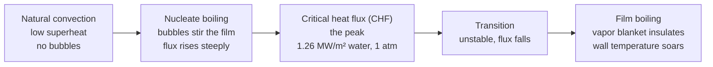
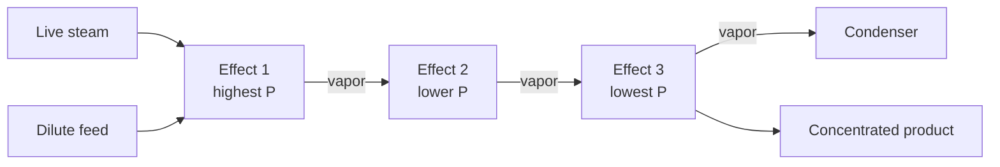

## ビデオ講義

<div class="video-container">
  <iframe
    width="560"
    height="315"
    src="https://www.youtube.com/embed/fpjFV6KX1hc?start=1509"
    title="化学工学伝熱 第3章: 沸騰、凝縮、そして蒸発装置"
    allow="accelerometer; autoplay; clipboard-write; encrypted-media; gyroscope; picture-in-picture"
    allowfullscreen>
  </iframe>
</div>

> このビデオは以下のテキストと同じ内容をカバーしています。お好みの学習形式をお選びください。

---

# 第3章：沸騰、凝縮、そして蒸発装置

最初の 2 章では、液体のまま、あるいは気体のままでいる流体に熱を出し入れしてきました。その流体に相を変えさせれば、係数は大きく上昇しうる一方で、ドライアウト、バーンアウト、過熱という新しい種類の危険が現れます。核沸騰（nucleate boiling）は、適した条件のもとでは際立って有効な熱伝達です — それが破滅的に破綻する、まさにその点に至るまでは。

**相変化：最良にして最も危険な熱伝達**

## 学習目標

本章を修了すると、以下ができるようになります:

  * ✅ 潜熱（latent heat）が、係数や駆動力と並んで、リボイラー・コンデンサー・蒸発装置の熱負荷をふつう支配する理由を説明できる
  * ✅ 沸騰曲線の順序を示し、1 atm の水に対するその限界熱流束を、出典のある相関式から定めることができる
  * ✅ バーンアウト（burnout）を、熱入力がほぼ与えられている場合に特有のハザードとして認識できる
  * ✅ 膜状凝縮（filmwise condensation）と滴状凝縮（dropwise condensation）を区別し、滴状凝縮を設計値として帳簿に載せることの代償を見積もり、不凝縮ガス（noncondensable gas）がなぜコンデンサーを機能不全にするのかを説明できる
  * ✅ 多重効用蒸発（multiple-effect evaporation）の蒸気経済（steam economy）を計算し、その生蒸気の熱負荷と伝熱面の熱負荷を区別し、結果のどの部分が理想化されているかを述べられる
  * ✅ 塔底のリボイラー（reboiler）を沸騰型熱交換器として同定し、その典型的な故障モードを 2 つ挙げられる

**読了時間**: 20-25分 **コード例**: 1 **演習**: 3

* * *

## 3.1 なぜ相変化が支配的なのか

**診断問題。** 水を **10,000** kg/h 沸騰させる装置列について、3.4 節の表は 6 効用に対して生蒸気 **1,961** kg/h、**1.23** MW を与え、単効用に対しては **11,765** kg/h、**7.38** MW を与えます。ある技術者が、6 効用の熱交換器を 1.23 MW に対してサイジングしました。伝熱面はどれだけの倍率で不足しており、その列が一度も測っていなかった量はどれでしょうか。解答は 3.4 節にあります。

[熱力学第1章](../chemical-engineering-thermodynamics/chapter-1.html)が、本章の算術を用意してくれました。101.325 kPa における水の蒸発潜熱は **2256.5** kJ/kg で、そこでの飽和温度は **99.97** °C、液の比熱は 40 °C において **4.178** kJ/(kg·K) です。3 つとも IAPWS-97 の値であり、表から読んだものではなく、本章のスクリプトが計算し主張しているものです。1 つ目を 3 つ目で割ると、その比は温度になります: $2256.5 \div 4.178 =$ **540** K。これはオーダーを述べたものです: 両者は同じ状態にあるわけではありません。蒸気 1 キログラムを凝縮させれば、液体の水 1 キログラムを 540 K 冷却するのと同じだけのエネルギーが放出されます — 液体の水では耐えられない振れ幅です。潜熱は単位質量あたりでこれらの熱負荷を支配することが多いのですが、ある用途がプラント最大の熱負荷を担うかどうかは、関わる顕熱の温度区間によります。

*係数*があるのも、また相変化です。同じスクリプトは、内径 15.75 mm の管内における強制対流の水の境膜を Dittus–Boelter 式から計算しています（相関式と適用範囲は出典表にあります）: 1.0 m/s で **5,261** W/(m²·K)、2.0 m/s で **9,160**。核沸騰と条件の良い凝縮では、それを大きく上回る係数が得られえます。その比は流動様式と幾何形状によって変わり、膜状凝縮や膜沸騰ではこれら強制対流の水の値まで、あるいはそれ以下まで下がることがあります。**本章はそれらについて帯域を挙げません**: 流通している数値は、この修復の台帳では一次資料の裏づけを持たず、以下のどの記述もそこから計算していないからです。この跳躍は 2 つの機構で説明できます。気泡が成長し激しく離脱することで、放っておけば壁面を断熱してしまう温度境界層がかき混ぜられること。そして純物質の蒸気が一定圧力で凝縮し、ほぼ一定の温度で潜熱を手放すため、凝縮側が伝熱面に沿って冷えていかないことです — もっとも、冷却側が温まるところでは局所の駆動力はやはり低下しますし、混合物は温度すべりを伴って凝縮します。

設計上の帰結は直接的です。[第1章](chapter-1.html)の総括伝熱係数において、

$$ \frac{1}{U} = \frac{1}{h_i} + \frac{L}{k} + R_f + \frac{1}{h_o} $$

（両側の汚れ抵抗はひとつの $R_f$ にまとめ、共通の面積基準ないし薄肉近似のもとで扱っています）、相変化する側が寄与する抵抗は小さいことが多いので、*もう一方*の側 — あるいは汚れ層 — が熱交換器を支配します。多くの場合であって、つねにではありません: 膜状凝縮、膜沸騰、粘性の高い液や混合液、ガスに汚染された凝縮では、相変化する側が支配側になりえますから、無視する前にその係数を他と比べてください。リボイラー、コンデンサー、蒸発装置が相変化を軸に組み立てられているのは、それが最小の伝熱面積で最大のエネルギーを動かすからです。3.6 節は、片側の抵抗をそう扱うだけの根拠が揃う前に消えたものとして帳簿に載せたとき何が起こるかを扱います。

## 3.2 沸騰曲線

加熱面を飽和液のプールに沈め、壁面温度を飽和温度より上げていきます。その差、すなわち**壁面過熱度（wall superheat）** $\Delta T_{\text{sat}} = T_{\text{wall}} - T_{\text{sat}}$ が駆動力であり、W/m² 単位の熱流束 $q''$ が応答です。一方を他方に対してプロットすれば、**沸騰曲線**が得られます — 単調ではありません。そこがまさに要点です。



過熱度が低いうちは何も沸きません。液は温まり、上昇し、**自然対流**だけで循環します。過熱度を上げると、表面の傷やくぼみで気泡が発生し、成長し、離脱します。これが**核沸騰**、スイートスポットです — 気泡の成長と離脱が、蒸発や非定常伝導と相まって、壁より冷たい液を伝熱面へ戻すので、わずかな過熱度の上昇に対して熱流束が急峻に立ち上がります。

その上昇は終わりを迎えます。プール沸騰の CHF についての 1 つの物理的な読み方では、気泡がシート状に合体するほど多くなると、その間から新しい液が伝熱面に到達できなくなります。その機構は幾何形状、流れ、濡れ性、条件に依存します。いずれにせよ曲線は**限界熱流束（CHF）** — 核沸騰が維持できる最大の熱流束 — で折り返します。Zuber に始まる流体力学的安定性の系列の相関式、

$$ q''_{\max} = 0.149\,h_{fg}\,\rho_v^{1/2}\,\bigl[\sigma g (\rho_l - \rho_v)\bigr]^{1/4} $$

を、IAPWS-97 の飽和水の熱力学物性と、別冊の IAPWS 表面張力式を用いて 1 atm で評価すると、**1.26** MW/m² が得られます。ここに印字した先頭の係数は **0.149** で、これは大きな水平平板ヒーターに対する後年の Lienhard–Dhir の改変形に結び付けられる値であり、古典的な Zuber–Kutateladze の約 0.131 ではありません。同じ物性のもとで古典的な係数を使えば、ピークはその比のぶんだけ低くなります。いずれにせよこの結果は、1 つの飽和プール沸騰の相関式が自分自身の幾何形状に対して与える予測であって、この圧力の水に対する普遍的な CHF ではありません — 設置方向、大きさ、表面状態、サブクール、流れのすべてがこれを動かします。本改訂前に本章が掲げていたオーダーの目安 1 MW/m² は、$1 \div 1.26 =$ **0.79** にあたります — オーダーとしては正直ですが、見積もりとしては低すぎます。ピークの先には**遷移沸騰**があり、そこでは蒸気の塊が生成しては崩壊し、過熱度が上がるにつれて熱流束は実際に*低下*します。さらにその先が**膜沸騰**、すなわち液と壁を隔てる蒸気の膜です。蒸気は熱をほとんど伝えないので、係数は核沸騰の枝よりはるかに低くなります。ただし安定膜沸騰の枝では熱流束は過熱度とともに再び*上昇*し、壁面温度が高くなると放射が無視できなくなります。熱流束が低下する枝は遷移沸騰であって、膜沸騰ではありません。

**過熱度の軸には、意図的に数値を入れていません。** 核沸騰の開始、CHF のピーク、ライデンフロスト極小を横軸の上に置くには、指定された表面・幾何形状・実験手順に対する実測の壁面過熱度が必要です — 流体と圧力だけではそれらは定まりません。それらは存在しますが、本改訂の時点で一次資料が手元になかったため、推定せずに省いています。この曲線は、過熱度の軸については*順序*が、熱流束の軸については*定点*が与えられているものとして読んでください — 設計者がいずれにせよ余裕を取るのは後者です。

その劣化を生き延びられるかどうかは、何が制御されているかで決まります。蒸気加熱の熱交換器は**温度が制限された**熱源に近く、凝縮する蒸気が加熱側の温度を決め、途中の熱抵抗が小さければ壁面温度もほぼ決まります: CHF を超えると熱流束が落ち、装置は能力を発揮できなくなり、オペレーターが気付きます。加熱炉の管、電気式浸漬ヒーター、あるいは原子炉燃料棒は、少なくとも制御・フィードバック・保護が働くまでは**熱入力が与えられている**状態に近いものです — バーナーは焚かれ続け、電流は流れ続け、伝熱面がどうなっていようとお構いなしです。そのとき残された自由変数は壁面温度であり、断熱性の蒸気膜を通して同じ熱流束を無理やり通そうとして、急速に、数百ケルビンも上昇しえます。それが**バーンアウト**であり、過熱による損傷、ひどければ機器の溶損に至ります。設計則は機構に従います — 熱入力がほぼ与えられているところでは、*実際の幾何形状と流れに対して検証された* CHF ないしドライアウトの予測に対する余裕をもって、核沸騰の内側にとどまること。上の 1.26 MW/m² は飽和プール沸騰の数値であり、加熱炉の管や燃料棒に対するその限界ではありません。

## 3.3 凝縮

凝縮（condensation）は同じ物理を逆向きに走らせるものであり、その下位区分が重要になります。**膜状凝縮**では、液が伝熱面を濡らし、連続的な膜となって流れ落ちます。その膜が主要な抵抗となるのが通常であり — 古典的な層流膜理論では、すべてのジュールがそこを伝導します — 鉛直面では下流に向かって膜が厚くなるにつれて局所の係数は低下します。ただし蒸気せん断、波立ち、乱流、設置方向はその傾向を変えます。**滴状凝縮**では表面が非濡れ性なので、液滴が生成し、成長し、転がり落ちて、露出した面を更新し続けます。持続的な巨視的膜は形成されず、係数は高くなりますが、液滴や促進剤の層もいくらかの抵抗を残します。*どれだけ*高くなるかは、ここでは挙げません: 流通している倍率はこの修復の台帳では出典を持たず、3.6 節が示すとおり、設計上の議論にはそれが不要だからです。

滴状凝縮による向上は、そのサービスに即した耐久性の証拠なしには見込みません。それを維持するには促進剤やコーティングが必要で、それらは摩耗し、酸化し、あるいは洗い流されることがあり、その後、表面は膜状凝縮へ戻ります。耐久性は薬剤、基材、サービスによって大きく異なり、ここでは一般的な寿命を挙げません。**膜状凝縮を前提に設計し、滴状の挙動は帳簿に載せないボーナスとして扱ってください** — それを帳簿に載せることの代価は 3.6 節でサイジングします。

これらすべてを台無しにする汚染物質が 1 つあります: **不凝縮ガス**、すなわち運転条件で凝縮しないあらゆる成分です — 真空コンデンサーへ漏れ込む空気、ブランケットの窒素、供給液に溶存していたガス。壁面へ向かう蒸気はそれらを一緒に運びますが、凝縮するのは蒸気だけなので、不凝縮ガスは滞留層として蓄積し、流入する蒸気はその層を*拡散*して通り抜けなければならなくなります — そして拡散は遅いのです。わずかな体積分率の空気が凝縮側の抵抗を支配するに至ることがあります。その効果を定量化することは本章では行わない物質移動の計算であり、そのための倍率もここでは挙げません。だからこそ、不凝縮ガスがたまりうる場所には必ずその除去手段が設けられます — **ベント**であり、真空サービスではエジェクターです。いつのまにか性能を失ったコンデンサーは、汚れているのではなくエアバインドしていることがあり、ガスを除けば性能は速やかに回復しえます。ただし、その背後にある漏れや抽出系の不具合にも手を打つことが前提です。

## 3.4 蒸発装置と蒸気経済

蒸気加熱の**蒸発装置（エバポレータ）**は水溶液から水を沸騰させて濃縮する装置であり、前の 2 つの節を 1 つの胴に収めたものです: 片側では蒸気が凝縮し、もう片側ではプロセス液が沸騰し、その間を管壁が隔てています。（別の溶媒を除去する蒸発装置もあり、電気、熱媒、あるいは直接接触で加熱されるものもあります。）ここで用いる簡略化したモデル — 供給液が沸点で入り、混合熱・熱損失・フラッシュが無視できる — では顕熱の項はないので、熱負荷は潜熱だけになります:

$$ Q = \dot{m}\lambda $$

ここで $\dot{m}$ は蒸発速度、$\lambda$ は蒸発潜熱です。

経済性はただ 1 つの比に集約されます。**蒸気経済**とは、消費した生蒸気 1 キログラムあたりに蒸発させた蒸気のキログラム数です:

$$ \text{steam economy} = \frac{\text{kg vapor evaporated}}{\text{kg live steam consumed}} $$

**単効用**の蒸発装置は、蒸気 1 キログラムを凝縮させておよそ 1 キログラムの水を蒸発させます — 経済は ≈ 1 で、これは 2 つの潜熱がほぼ等しいことに依拠し、損失と供給液の予熱を無視した理想化です。

改善策は、その蒸気を 2 度使うことです。その蒸気はそれを生み出した潜熱をなお実質的にすべて保持しているので、第 2 効用を、そこの液が**より低い温度**で沸騰するだけ**十分に低い圧力**に — 溶液の沸点上昇を上回り、なお使える駆動力が残るだけ低く — 保てば（[熱力学第3章](../chemical-engineering-thermodynamics/chapter-3.html): 飽和温度は圧力に従います）、第 1 効用の蒸気はそれを加熱するのに十分な高温だということになります。$N$ 個の効用を順に低い圧力で連ねれば、理想化された条件下で経済は $N$ に近づきます。



```python
LAMBDA = 2257.0      # kJ/kg, latent heat of water at 100 C, 1 atm; 4 s.f. form of IAPWS-97's 2256.5
EVAP = 10_000.0      # kg/h of water to be evaporated
ETA = 0.85           # ILLUSTRATIVE per-effect factor, NOT a measured constant

EVAP_DUTY = EVAP * LAMBDA / 3600.0 / 1000.0   # MW that must cross tube wall - the same for every N


def economy_ideal(n):
    """Idealized steam economy [kg vapor / kg steam]: N effects, N times the duty."""
    return float(n)


def economy_derated(n):
    """Same trend with an illustrative constant derating factor applied."""
    return ETA * n


def steam_demand(evap, economy):
    """Live steam required [kg/h] to evaporate `evap` kg/h at the given economy."""
    return evap / economy


print(f"{'effects':>7} {'ideal':>7} {'derated':>8} {'steam kg/h':>11} {'live steam MW':>14} {'evap duty MW':>13} {'vs 1-effect':>12}")
base = steam_demand(EVAP, economy_derated(1))
for n in range(1, 7):
    econ = economy_derated(n)
    steam = steam_demand(EVAP, econ)
    live = steam * LAMBDA / 3600.0 / 1000.0   # live steam into effect 1 ONLY, not the surface duty
    saving = (1.0 - steam / base) * 100.0
    print(f"{n:7d} {economy_ideal(n):7.2f} {econ:8.2f} {steam:11.0f} {live:14.2f} {EVAP_DUTY:13.2f} {saving:11.1f}%")

# effects   ideal  derated  steam kg/h  live steam MW  evap duty MW  vs 1-effect
#       1    1.00     0.85       11765           7.38          6.27         0.0%
#       2    2.00     1.70        5882           3.69          6.27        50.0%
#       3    3.00     2.55        3922           2.46          6.27        66.7%
#       4    4.00     3.40        2941           1.84          6.27        75.0%
#       5    5.00     4.25        2353           1.48          6.27        80.0%
#       6    6.00     5.10        1961           1.23          6.27        83.3%
```

**2 つの熱負荷の列は別々の量です — これが診断問題の解答です。** `live steam MW` は*生蒸気*が第 1 効用へ届ける熱であり、$1/N$ で減っていきます。それこそが装置列の目的そのものだからです。`evap duty MW` はこのモデルにおける 10,000 kg/h に対する潜熱蒸発の総熱負荷、$10{,}000 \times 2257 \div 3600 =$ **6.27** MW であり、どの $N$ でも同じです: 装置列は同じ潜熱を $N$ 回使い回すのであって、蒸発させる水が減るわけではありません。実際の装置列はさらに高温の供給液・液・凝縮液をフラッシュさせ、顕熱の負荷も担いますが、このモデルはそれらを無視しています。6 効用列の伝熱面を 1.23 MW に対してサイジングすれば、熱負荷の比はディレーティング後の経済 $0.85 \times 6 =$ **5.10** のぶんだけ誤ることになります。それが面積の不足になるのは、すべての効用が同じ $U\Delta T$ で働くというさらなる仮定のもとでのことであり、実際の装置列は効用ごとにサイジングされます。$N = 1$ では列の読みは逆転し、7.38 MW 対 6.27 MW となります。その差 $7.38 - 6.27 =$ **1.11** MW は 0.85 のディレーティングであって、例示のための仮定であり、測定された損失ではありません。

設備費は蒸気と逆向きに動きます。使える温度差を $N$ 個の効用に均等に分ければ、各効用は $\Delta T_{\text{tot}}/N$ しか得られない一方で $Q_{\text{tot}}/N$ の熱負荷を担うので、それぞれが単効用の装置とほぼ同じ面積を必要とします: **総面積はおおむね $N$ に比例して増え、一方この簡略化した等潜熱モデルでは生蒸気がおおむね $1/N$ で減ります。** 表の残りは数字ではなくその*形*を読んでください。0.85 という係数は、**損失と供給液の予熱によって実際の経済が理想の $N$ を下回ることが多いと示すために挿入された、例示のための全体ディレーティング係数**であって、測定された定数ではなく、効用ごとの逐次的な損失のモデルでもありません（コードはこれを理想値の合計に一度だけ掛けています）。高温の供給液がフラッシュしたり追加の熱回収があったりすれば、経済が $N$ を上回ることもあります。それを差し引いても残るのが収穫逓減です: 1 効用から 2 効用にすれば蒸気は 50% 減りますが、5 効用から 6 効用ではわずか 3 ポイント強しか増えません。本章は、実際の装置列の効用数について代表値を挙げません。その出典を持たないからです。それを決める経済的なトレードオフは演習 3 で扱います。

これとは別の道筋は、蒸気を段階的に使うのではなく格上げすることです。**機械式蒸気再圧縮（MVR）**は、蒸発した蒸気を、それ自身の効用を加熱できる圧力まで圧縮します。圧縮機は軸仕事 — [熱力学第2章](../chemical-engineering-thermodynamics/chapter-2.html)の貴重な資源 — を消費しますが、温度の押し上げがささやかであれば圧力比は小さいので、その仕事は再利用される潜熱のごく一部にとどまりえます。沸点上昇、熱交換器のアプローチ、圧力損失、圧縮機の非効率は、いずれも圧力比と仕事を押し上げます。

## 3.5 リボイラーとのつながり

多くの通常の蒸留塔は沸騰型の熱交換器で終わりますが、直接の蒸気吹き込みや蒸気供給によって蒸気を得る塔もあります。**リボイラー**は塔底の液を蒸発させ、還流が要求する蒸気の流れを生み出すものであり（[入門シリーズ第4章](../chemical-engineering-introduction/chapter-4.html)）、他の条件が同等であれば、還流比が高いほど沸き上げ量と熱負荷も大きくなります。塔のエネルギー費はそこを巡って議論されます。2 つの構成が主流です。**ケトル型**は、大きめの胴の中の液プールに管束を沈め、その上の気相空間へ向けて沸騰させます: 単純で、条件に寛容で、1 パスあたりの蒸発率が高い方式です。**サーモサイフォン**式は、沸騰そのものによって流体の密度を下げ、塔底のサンプからの循環を駆動させます — ポンプ不要で、ケトル型よりホールドアップが少なく滞留時間も短いことが多いため、循環系統やレイアウトによっては熱に弱い物質に適します。

繰り返し現れる故障モードが 2 つあり、これらは別々にも起こりうる異なる現象です。**汚れ（ファウリング）**は熱伝導率の低い層を堆積させ、所定の熱負荷を得るために必要な金属温度を押し上げます。堆積物が製品を熱的に劣化させる場合には自己加速するループになりえますが、晶析、粒子、腐食による汚れにはそうしたフィードバックはありません。**沸騰の劣化**は、液に面した表面の過熱度を押し込みすぎたときに起こります。堆積物越しに熱負荷を保とうとして蒸気圧力を上げること自体がそれを強いるわけではありません — 余分な温度降下の大半は堆積物にかかり、熱流束は変わらないからです — したがって両者の結びつきは、蒸気圧力そのものではなく、局所の濡れと熱流束分布の変化を通じて生じます。ピークを越えると、遷移沸騰の枝では過熱度が上がるにつれて熱負荷はむしろ*下がり*、蒸気をもっと入れようという本能がそれをさらに悪化させます。

最後の制約は流体力学が課します。塔底液は塔の圧力においてほぼ飽和状態にあるのが普通なので、自由液面そのものはポンプに吸込圧力と蒸気圧との間の余裕を与えません — [流体力学第5章](../chemical-engineering-fluid-mechanics/chapter-5.html)の **NPSH** の問題です。余裕があるとすれば、それは静水頭から吸込配管の損失を差し引いたものです。蒸留塔のサンプがポンプよりずっと高い位置に据えられているのはこのためです: ほぼ飽和した液では、利用可能 NPSH を意図して設計しておかなければなりません。

## 3.6 これが誤りに転じるところ

**滴状凝縮の係数を設計値として帳簿に載せる。** あるコンデンサーが、管内に設計境膜伝熱係数 **8,000** W/(m²·K) で冷却水を通しており — これは 3.1 節で計算した 1.0 m/s の **5,261** と 2.0 m/s の **9,160** のあいだにあります — その凝縮側は清浄な試験機では滴状で運転されています。熱負荷は演習 2 の **626.8** kW で、駆動力は 15 K です。

**誤り:** 滴状の挙動を帳簿に載せる。凝縮側の抵抗は水側に対して無視できるので、水側だけでサイジングします — $U =$ **8,000** W/(m²·K)、そして $626{,}800 \div (8{,}000 \times 15) =$ **5.22** m²。

**正しくは:** 促進剤が摩耗して表面が膜状へ戻り、以後は表面が回復されないかぎり凝縮膜が直列の抵抗になる、という例示的な劣化シナリオを取ります。膜状凝縮の係数を例示的に **5,000** W/(m²·K) とすると — ここでは出典なしと宣言した値であり、比較を具体的にするためだけに使っています — $1/U = 1/8{,}000 + 1/5{,}000 = 0.000125 + 0.0002 =$ **0.000325** m²·K/W となり、$U =$ **3,077** W/(m²·K)、同じ熱負荷には $626{,}800 \div (3{,}077 \times 15) =$ **13.6** m² が必要です。

その代償は $8{,}000 \div 3{,}077 =$ **2.60** であり、この構造は 5,000 についてどんな議論をしても生き残ります: 誤ったサイジングは凝縮側の抵抗をまるごと無視しており、それは凝縮係数が*無限大*である極限、したがって有限の滴状係数では決して到達しない $U$ の上限だからです。その装置は必要な面積の $1 \div 2.60 \times 100 =$ **38.5** % しか持たないまま残され、その不足は試運転時にこそ最も見えにくいのです。滴状の係数がまだ高く、それを隠してくれるあいだは。これが膜状凝縮を前提に設計する理由です。

## 3.7 章末チェック

相変化の熱負荷が、面積を買う前に負っている確認は 5 つです。

1. **どの熱か** — 潜熱か、顕熱か、両方か。演習 2 の供給液は沸点で入るので $Q = \dot{m}\lambda$ に顕熱の項はありません: $1{,}000 \times 2256.5 \div 3600 =$ **626.8** kW、kJ/kg と kg/s から kW が出ます。
2. **どの熱負荷か** — サイジングに使っている数値は、実際に管壁を横切りますか。3.4 節の生蒸気の列は 6 効用で **1.23** MW まで落ちますが、伝熱面の熱負荷はどの $N$ でも **6.27** MW です。誤った列でサイジングすれば $0.85 \times 6 =$ **5.10** のぶんだけ不足します。
3. **どの変数が固定されているか** — ほぼ与えられた熱流束か、それとも温度が制限された熱源か。蒸気コイルは CHF を超えると能力を落とし、電力が与えられたヒーターは制御不能な過熱の危険を負います。取るべき余裕は、*実際の幾何形状と流れに対して検証された* CHF ないしドライアウトの予測に対する熱流束の余裕です — **1.26** MW/m² は飽和プール沸騰の相関式の値であって、その限界ではありません。
4. **どの熱抵抗が直列か** — 相変化する側は、1 年後にもその表面が持っているであろう係数で帳簿に載っていますか。8,000 単独と、8,000 に 5,000 が直列の場合とでは $U =$ **8,000** 対 **3,077** W/(m²·K)、面積で **2.60** 倍の違いです。
5. **由来** — すべての数値が出典を名指ししていますか。$\lambda$、$T_{\text{sat}}$、$c_p$、CHF は IAPWS-97 と Zuber から `ch06_repair.py` を経由し、$\eta = 0.85$、$U = 2{,}500$、5,000 は例示値と宣言しています。**過熱度の定点は挙げていません。出典のあるものがないからです。**

## 3.8 本章のまとめ

1. **潜熱は代表的な顕熱の温度区間を圧倒する**: **2256.5** kJ/kg は **4.178** kJ/(kg·K) を $2256.5 \div 4.178 =$ **540** K にわたって適用したのと等しく、これが相変化を伴う機器が単位質量あたり大きなエネルギーを動かす理由である — もっとも、加熱炉のような顕熱のサービスがプラント最大の熱負荷を担うこともある
2. 核沸騰と条件の良い凝縮は、1.0–2.0 m/s で計算した単相の水の境膜 **5,261**–**9,160** W/(m²·K) を**大きく上回り**うるので、相変化する側が $U$ を支配しないことが多い — 膜沸騰や膜状凝縮では支配しうるので、当該の流動様式における実際の熱抵抗を比べること。帯域は挙げていない。出典のあるものがないからである
3. **沸騰曲線**は 自然対流 → 核沸騰 → **限界熱流束** → 遷移 → **膜沸騰** と進む。流体力学的安定性の相関式を IAPWS 物性のもとで、印字した係数 **0.149**（大きな平板ヒーター向けの改変形。古典的な Zuber の約 0.131 ではその比だけ低いピークになる）で評価すると、1 atm の水に対する飽和プール沸騰のピークは **1.26** MW/m² となり、本章が以前掲げていた **1** MW/m² に対する値である。過熱度の軸は順序付けられているだけで目盛りはない — それらの定点は出典を確認できていないため、ここには掲載していない
4. **バーンアウト**は、伝熱が劣化したあとも熱入力が続く場合に特有のリスクである: 加熱炉の管、制御されていない電気ヒーター、燃料棒はそれ自体では熱流束を逃がせないので、CHF を超えると壁面温度が急上昇する — その構成に固有の限界に対する余裕をもって、核沸騰の内側で設計すること
5. コンデンサーは、滴状凝縮の耐久性が実証されないかぎり**膜状凝縮**を前提に設計される。凝縮側の抵抗をまるごと無視することは、誤ったサイジングが取る $U$ の上限である — **8,000** 対 **3,077** W/(m²·K)、面積は **2.60** 倍不足し、熱負荷が必要とする面積の **38.5** % しかない
6. **不凝縮ガス**は凝縮面に蓄積し、蒸気にその層を拡散させることを強いる — だからこそベントとエジェクターが設けられる
7. **蒸気経済**は蒸気 1 kg あたりの蒸発蒸気 kg 数である: 単効用で ≈ 1、理想の基準値 $N$ に近づき、損失と供給液の予熱を数えればふつうそれを下回る。この簡略化したモデルでは面積が $N$ とともに増え、生蒸気はおおむね $1/N$ で減る。**MVR** は別の道筋の節約を与え、その軸仕事は温度の押し上げと圧縮機効率に従う
8. **生蒸気の熱負荷は、蒸発の総熱負荷ではない**: 1 効用から 6 効用にかけて **7.38** MW から **1.23** MW へ落ちるのに対し、このモデルでは潜熱蒸発がどの $N$ でも一定の **6.27** MW である — 落ちていく列でサイジングすれば熱負荷の比は **5.10** のぶんだけ誤りであり、各効用の面積はなおそれぞれの熱負荷と駆動力から計算されなければならない
9. **リボイラー**は沸騰型の熱交換器であり — **ケトル型**と**サーモサイフォン**が一般的な設計 — **汚れ**と**沸騰の劣化**という、別個でありながら結びつきうる 2 つの問題を抱える。ほぼ飽和した塔底液は NPSH 上の制約である

**次章**: ここまでのあらゆる機構 — 伝導、対流、沸騰、凝縮 — は、物質どうしが接していることを必要としてきました。[第4章](chapter-4.html)では**放射（radiation）**を取り上げます。放射は何も必要とせず、真空を横切り、その黒体放射能は絶対温度の 4 乗に比例します — 実在する表面どうしの正味の交換には、さらに放射率と形態係数が要ります — 加熱炉の放射部を支配しているのがこの機構です。

## 演習問題

1. **概念 — CHF を超える 2 通りのやり方**: 電気式浸漬ヒーターと蒸気加熱コイルが、同じ容器の中で 1 atm の水を沸騰させている。それぞれを限界熱流束を超えるまで押し込む。(a) それぞれの壁面温度に何が起こるかを述べよ。(b) なぜ一方だけが破壊されるのか。(c) あるリボイラーが汚れつつあり、オペレーターは熱負荷を保つために蒸気圧力を上げた。沸騰曲線は何を予測するか。
   *ヒント*: それぞれの装置がどちらの変数 — 熱流束か壁面温度か — を固定しているかを問い、そのうえで自由に動ける方の変数について沸騰曲線を読め。
   *解答*: (a) **蒸気コイル**は熱源の温度をおおむね凝縮する蒸気の温度に制限し、途中の熱抵抗が小さければ壁面温度もそれに従います。CHF を超えると曲線は折り返すので、**熱流束は下がり**ます。コイルは能力を発揮できなくなりますが、金属は蒸気温度の近くにとどまります。**電気ヒーター**は制御されていない定電力の装置として扱います — 実際の電気的な境界条件は定電力、定電圧、定電流、あるいは温度制御でありえます — この場合、核沸騰の枝上のどの点も与えられた熱流束を通せないので、運転点は膜沸騰の枝へ移り、断熱性の蒸気膜を通して同じ熱流束を駆動しようとして**壁面温度は急激に、数百ケルビンも上昇しえ**ます。(b) この理想化した比較では、熱入力が与えられている装置のほうが制御不能な過熱のリスクが大きくなります: 供給すると決めてしまったエネルギーを逃がすことができないからです。温度が制限された装置は**自己制限的**であり、蒸気加熱が一般により安全なユーティリティであるのはそのためです — ただし蒸気温度そのものが金属と製品にとって安全であることが前提です。(c) 汚れは所定の熱負荷に必要な金属温度を押し上げますが、蒸気圧力を上げて熱負荷を回復させるとき、増えた温度降下の大半は堆積物にかかるので、それ自体が液に面した過熱度を上げるわけではありません。ピークへの行進を主張する前に、金属・堆積物・液界面の温度を分けて考え、局所の熱流束と濡れを確認してください。沸騰側が劣化していれば、遷移沸騰の枝で**過熱度が上がるにつれて熱負荷は下がり**、蒸気を足そうという対応が事態を悪化させます。まず安全な運転を回復し — 熱入力を下げ、循環や液位を戻し — そのうえで診断し、汚れが確認されたら清掃することです。

2. **定量 — 蒸発装置の熱負荷と面積**: ある蒸発装置は、すでに沸点にある供給液から 1 atm で **1,000 kg/h** の水を蒸発させなければならない。$\lambda = 2256.5$ kJ/kg（IAPWS-97）とする。(a) 熱負荷を kW で計算せよ。(b) $U = 2{,}500$ W/(m²·K) — これは例示のための前提であり、出典に基づく係数ではない — と $\Delta T =$ **15 K** のもとで、必要な伝熱面積を計算せよ。(c) 蒸気の供給条件が悪化して $\Delta T$ が 10 K に下がった。同じ熱負荷にはどれだけの面積が必要になるか。
   *ヒント*: 熱負荷は単位を揃えた（kg/h → kg/s）$\dot{m}\lambda$ であり、次いで[第1章](chapter-1.html)の $A = Q/(U\,\Delta T)$ を使え。
   *解答*: (a) $Q = 1000 \times 2256.5 / 3600 =$ **626.8 kW ≈ 627 kW** — 供給液は沸点で入ってくるので顕熱の項はありません。(b) $A = 626{,}800 / (2500 \times 15) =$ **16.7 m²**。(c) $A = 626{,}800/(2500 \times 10) =$ **25.1 m²** で、同じ仕事に対して伝熱面が 50% 増えます。面積は $\Delta T$ に反比例し、だからこそ駆動力を失うことは高くつくのです — そして、使える $\Delta T$ を分割する多重効用列が、蒸気の節約の代金を鋼材で支払っているのもこのためです。

3. **議論 — 効用は何段にするか、そしていつ再圧縮するか**: 10,000 kg/h の水を蒸発させているプラントが、単効用、4 効用列、MVR のあいだで選定を行っている。(a) 3.4 節の出力を使うと、4 効用はどれだけの蒸気節約をもたらすか。また、なぜ 10 効用はめったに建設されないのか。(b) 0.85 という係数は何を表しており、何に使ってはならないか。(c) どのような条件下で MVR は多重効用列に勝るか。(d) 4 効用の行は生蒸気 1.84 MW、蒸発の熱負荷 6.27 MW と読める。熱交換器をサイジングするのはどちらで、各効用の分担はいくらか。
   *ヒント*: (a) では蒸気の傾向を、$N$ が増えたときの総面積のふるまいと比べよ。(c) では電力 1 キロワット時のコストを、蒸気 1 キロワット時のコストと比べよ。(d) では第 1 効用から出た蒸気が何に使われるかを問え。
   *解答*: (a) 4 効用は生蒸気を **75%** 削減します（表の 11,765 → 2,941 kg/h）。とても大きな $N$ に対しては、2 つの要因が押し戻します: *限界*の節約が縮小すること — 5 効用から 6 効用へ進んでもさらに 3.3 パーセントポイントしか節約できません — 一方で総伝熱面積はおおむね $N$ に比例して増え続けることです。各効用は $\Delta T_{\text{tot}}/N$ の駆動力しか受け取らないので、単効用の装置とほぼ同じ面積を必要とするからです。どこで追加の効用が不経済になるかは、エネルギー価格、設備費、使える温度幅によります。10 効用で一律に禁じられるわけではなく、本章は代表的な効用数を挙げません。加えて厳しい下限もあります: 供給蒸気と最終コンデンサーとの間の総 $\Delta T$ は決まっており、沸点上昇がそのうちの一部を各効用で食いつぶします。(b) それは**例示のためのディレーティング仮定**であり、実際の経済が理想値 $N$ を下回ることを示すためだけに挿入されたものです。測定値ではなく、機器のサイジングや保証経済値の提示に使っては**なりません**。それが代弁している効果は種類の異なるものです: 断熱を通じた熱損失、供給液の予熱や凝縮液のサブクールといった顕熱エンタルピーの項、そして熱ではなく駆動力を消費する沸点上昇です。(c) MVR が選ばれやすいのは、**蒸気に比べて電力が安い**場合、沸点上昇が小さい場合（そのとき圧縮機は小さな圧力比しか必要とせず、したがって仕事も少なくて済みます）、そして熱的な効用の段数が少ないほうが望ましい場合です — もっとも、圧縮機、蒸気ダクト、分離器、伝熱面はそれでも大きくなりえます。実際の圧縮機仕事と回避できる蒸気とから、年経費を比較してください。不利になるのは、電力が高い場合、汚れや腐食を伴うサービスでの圧縮機の保全が負担になる場合、あるいはサイトに余剰の低圧蒸気があり、多重効用列がそれを低い限界費用で吸収できる場合です。(d) 伝熱面が届けなければならないのは、生蒸気の 1.84 MW ではなく潜熱蒸発の総量 **6.27 MW** です: 10,000 kg/h の 1 キログラム残らず、装置列のどこかで管壁を横切って沸騰させられるのに対し、1.84 MW は生蒸気が第 1 効用に持ち込むぶんにすぎません — 第 2 から第 4 効用は、その前段が作った蒸気で加熱されます。この等分担のモデルでは、各効用が駆動力のおよそ 4 分の 1 にわたって $6.27 \div 4 =$ **1.57** MW を担うことになり、だからこそ 4 効用は単効用の 4 分の 1 ではなく、およそ 4 倍の面積を必要とするのです。実際の装置列は熱負荷を不均等に分け、その一部をフラッシュさせ、各効用自身の収支から効用ごとにサイジングされます。

## 出典

上記の数値はすべて、*伝熱*シリーズの出典ディレクトリにある `calc/ch06_repair.py` の DISPLAY 文字列を一字一句そのまま書き写したものか、それらの文字列に対してここで行い、すべて書き下した算術です。そのスクリプトを再実行しても一致しなくなった値は、この記事ではなくスクリプトの側で訂正します。スクリプトが外部から取り入れている定式化と参考文献は以下のとおりです:

| 出典 | 引用している根拠 |
|---|---|
| IAPWS-97（IAPWS R7-97(2012)、R12-08 粘度、R15-11 熱伝導率、R1-76 表面張力）、Python パッケージ `iapws` 1.5.5 経由、[github.com/jjgomera/iapws](https://github.com/jjgomera/iapws)（2026-09-08 アクセス） | 101.325 kPa における $\lambda =$ **2256.5** kJ/kg と $T_{\text{sat}} =$ **99.97** °C、$c_p =$ **4.178** kJ/(kg·K)、CHF の評価に入る飽和液・飽和蒸気の密度と表面張力、および Dittus–Boelter による境膜 **5,261** と **9,160** W/(m²·K) の背後にある水の物性 |
| Zuber, N. (1958), "On the stability of boiling heat transfer", *Trans. ASME* **80**, 711–720 | 飽和プール沸騰に対する限界熱流束相関式の、流体力学的安定性に基づく形。本章に印字した先頭の係数 **0.149** は Zuber の古典的な値（約 0.131）ではなく、Lienhard と Dhir に結び付けられる後年の大きな水平平板ヒーター向けの改変形であり、それについてここでは個別の引用を特定していません — 未解決の出典確認事項です。**1.26** MW/m² は、印字したこの形を IAPWS 物性（熱力学は IF97、表面張力は別冊の IAPWS 式）のもとで本スクリプトが評価した値であり、いずれかの論文から読み取った値ではありません |
| Dittus, F. W. and Boelter, L. M. K. (1930), *Univ. California Publ. Eng.* **2**, 443; 適用範囲は McAdams, W. H., *Heat Transmission*, 3rd ed. (McGraw-Hill, 1954), Ch. 9 による | 1930 年のもとの研究は加熱と冷却で別々の係数を用いていました。ここで使う $\mathrm{Nu} = 0.023\,\mathrm{Re}^{0.8}\mathrm{Pr}^{0.4}$ の形は後年の教科書的な改変形で、一般に McAdams と結び付けられ、その **Pr の指数 0.4 は加熱される流体に適用されます**（冷却では 0.3）。適用範囲は $\mathrm{Re} > 10^4$、$0.7 < \mathrm{Pr} < 160$、$L/D > 10$、滑らかな円管内の十分に発達した乱流で、物性変化が小さいこと — 3.1 節で挙げた単相の境膜の背後にある相関式です |
| BIPM, *SI Brochure*, 9th ed. (2019), Table 8 | 1 h = 3600 s、上記のすべての熱負荷における単位換算 |

## 数値の由来

**Tier A — `ch06_repair.py` が計算し、主張している値**。DISPLAY キーとともにここに引用しました: `latent_heat_100c_kj_per_kg` **2256.5**、`saturation_temperature_1atm_c` **99.97**、`water_40c_cp_kj_per_kg_k` **4.178**、`db_h_1p0_m_per_s_w_per_m2_k` **5261**、`db_h_2p0_m_per_s_w_per_m2_k` **9160**、`db_correlation` と `db_validity_range`、`db_tube_inside_diameter_mm` **15.75**、`design_film_coefficient_w_per_m2_k` **8000**、`chf_zuber_mw_per_m2` **1.26**、`chf_textbook_anchor_mw_per_m2` **1**、`total_evaporator_duty_mw` **6.27**、`live_steam_duty_effect1_mw_n1` **7.38**、`live_steam_duty_effect1_mw_n6` **1.23**、`water_property_source`。

本章のそれ以外の数値はすべて、それらの文字列に対する算術であり、現れる場所で書き下しています: $2256.5 \div 4.178 =$ **540** K。$1 \div 1.26 =$ **0.79**。3.4 節の表の 6 行（コードブロックが `LAMBDA`、`EVAP`、`ETA` だけから再現しています）。$0.85 \times 6 =$ **5.10** と $7.38 - 6.27 =$ **1.11** MW。$1/8{,}000 + 1/5{,}000 =$ **0.000325** m²·K/W と $U =$ **3,077** W/(m²·K)、$8{,}000 \div 3{,}077 =$ **2.60**、$1 \div 2.60 \times 100 =$ **38.5** %、および面積 **5.22** と **13.6** m²。演習 2 の **626.8** kW、**16.7** と **25.1** m²。演習 3 の **1.57** MW。`chf_textbook_anchor_mw_per_m2` は**旧版の**値として保持しており、現れるすべての場所でそう明示しています。

**Tier B — 引用された値であって測定値ではないもの**: IAPWS-97 の定式化、Zuber の相関式の*形*、Dittus–Boelter 相関式とその McAdams による適用範囲、そして 1 h = 3600 s。4 つとも出典表にあります。相関式は公表された代数であり、引用が支えているのはその形であって、そこから引いた数値はいずれも本スクリプトがこの条件でその形を評価した結果です。

**Tier C — 4 つの例示的な入力。はっきりそう述べます。** どれも測定値ではなく、それらから導かれる機器についての数値的な結果 — 装置列の面積比、コンデンサーの面積の代償、試運転時の議論 — はいずれも、実機に対する予測ではなく条件付きの例示です。

| 入力 | 値 | 位置づけ |
|---|---|---|
| 効用あたりのディレーティング $\eta$ | **0.85** | コードのコメント、3.4 節、演習 3(b) で例示値と宣言。実際の経済が $N$ を下回ることを示すためだけに挿入したものであり、機器のサイジングや保証経済値の提示に使ってはならない |
| 蒸発装置の $U$（演習 2） | **2,500** W/(m²·K) | 出典のない演習上の前提。演習が教えるのは $A = Q/(U\Delta T)$ であり、すべての解答はこれに比例する |
| 膜状凝縮の係数（3.6 節） | **5,000** W/(m²·K) | 直列抵抗の比較を具体的にするためだけに選んだ値。**2.60** はこれとともに動くが、動かないのは、「誤った」サイジングが無限大の係数の極限、したがって $U$ の上限であるという点である |
| 例題の流量と駆動力 | **10,000** と **1,000** kg/h、**15** K と **10** K | 問題の設定であり、切りのよい算術になるように選んだもの |

**本改訂で、出典を付けるのではなく削除したもの。** 公開版の本章が掲げていた出典のない 6 つの値を削除し、そのいずれも推定値で置き換えていません: 相変化の係数の帯域 **2,500–100,000** W/(m²·K)、蒸気コンデンサーの設計範囲 **5,000–15,000** W/(m²·K)、不凝縮の空気に対する「数倍」という倍率、滴状対膜状の「数倍高い」という倍率、装置列が落ち着く **2 から 6** 効用、そして核沸騰の開始・CHF のピーク・ライデンフロスト極小に対する壁面過熱度の定点。最後のものこそ、3.2 節がその横軸に数値を入れていないと明言している理由です: そうした定点は測定されてきましたが、それは特定の表面と実験手順に対してのみであり、出典のない数値をここに書くことはしません。同じ理由で、3.1 節と 3.8 節における相変化と単相の係数の比較は、固定した比ではなく流動様式に依存する傾向として述べられており、3.3 節ではコーティングの寿命を挙げていません。
