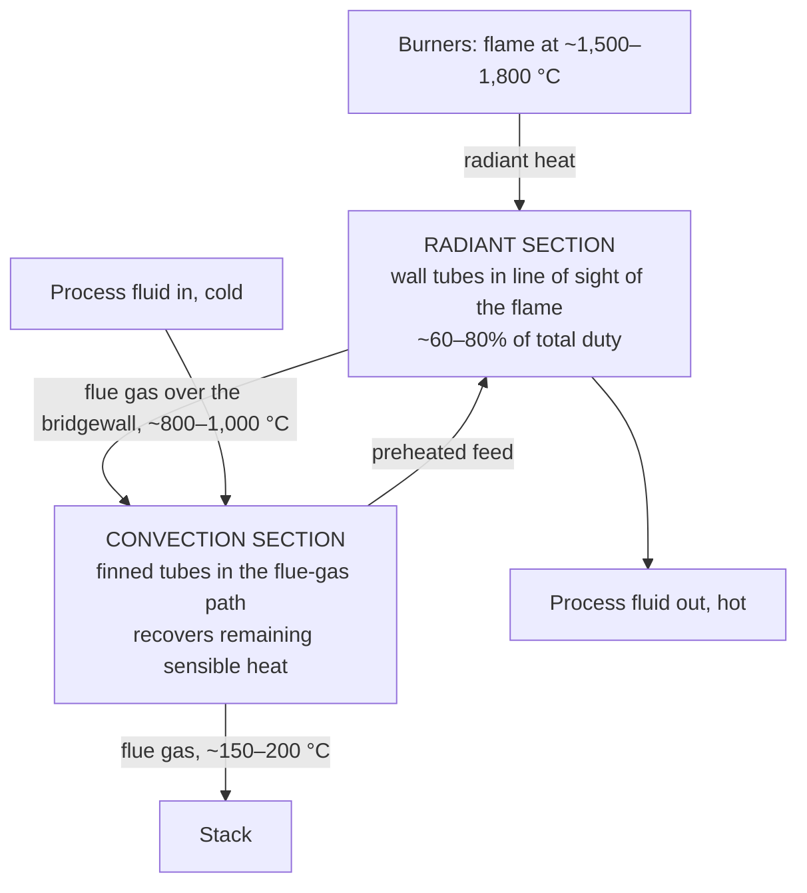

## ビデオ講義

<div class="video-container">
  <iframe
    width="560"
    height="315"
    src="https://www.youtube.com/embed/fpjFV6KX1hc?start=2311"
    title="化学工学伝熱 第4章: 放射と加熱炉"
    allow="accelerometer; autoplay; clipboard-write; encrypted-media; gyroscope; picture-in-picture"
    allowfullscreen>
  </iframe>
</div>

> このビデオは以下のテキストと同じ内容をカバーしています。お好みの学習形式をお選びください。

---

# 第4章：放射と加熱炉

本章では熱伝達の第 3 の機構 — 伝わるための物質を必要としないもの — を取り上げます。放射（radiation）は、静止空気中の温かい配管においてすでに無視できない項であり — 本章自身のモデルでは 60 °C で損失の **36.4%** を占めます — 加熱炉（fired heater）の放射部では中心的な考慮事項です。その比重が温度とともにどう上がっていくかこそが、ここでの物語です。

**媒体を必要としない熱**

## 学習目標

本章を修了すると、以下ができるようになります:

  * ✅ 伝導や対流と違って、なぜ放射が真空を越えるのかを説明できる
  * ✅ ステファン・ボルツマンの法則 $E = \varepsilon \sigma T^4$ を適用し、絶対温度を用いる理由を説明できる
  * ✅ 幾何形状に応じて小物体の式と二面間の式を選び、放射率（emissivity）から正味の交換を見積もれる
  * ✅ 温度に加えて放射率、周囲、幾何形状、対流係数から、放射の相対的な重要性を判断できる
  * ✅ プロセス加熱炉の放射部（radiant section）と対流部（convection section）、およびそれぞれを制約するものを説明できる
  * ✅ 形態係数（view factor）と管表面温度（チューブスキン温度）を挙げ、それぞれが何を支配するかを述べられる

**読了時間**: 20-25分 **コード例**: 1 **演習**: 3

* * *

## 4.1 第 3 の機構

**診断問題。** 真空ジャケット付きの極低温ラインは、壁と壁のあいだにガスがなく、内壁は $\varepsilon \approx 0.05$ のアルミ蒸着箔で巻かれ、$\varepsilon \approx 0.8$ 付近の外壁と向き合っています。この箔は放射による漏れを何倍に削るでしょうか。

放射率の比 $0.8/0.05 =$ **16** が魅力的な答えであり、そして誤った答えです — 大きな部屋の中の配管には正しく、互いしか見ていない 2 枚の壁には誤りです。そこでの実際の倍率は **13.5** 倍、両壁を箔で巻けば **26.0** 倍です。放射とは*幾何形状*が式を選ぶ領域であり、どの理想化 — 灰色面、拡散面、不透明面、関与ガス — が許されるかは表面の放射特性が決めます。その境界は 4.3 節で引きます。

[第1章](chapter-1.html)は 2 つの機構から総括伝熱係数を組み立てました。**伝導**は、分子の衝突、格子振動、金属では自由電子といった微視的な相互作用によって、物質の中をエネルギーが伝わっていくものです。**対流**は、動く流体の中でそれを運び去ります。どちらも物質を必要とし、物質を取り去れば、どちらも止まります。

放射は止まりません。放射率がゼロでないあらゆる表面は、絶対零度より高くなれば電磁波を放出し、その波はまったくの無の中を伝わります。その証拠は毎朝届きます: 日光は 1 億 5000 万キロメートルの真空を越えて屋根を温めます。その隙間を伝導するものはなく、対流するものもないのに、地上の標準的な基準条件ではおよそ 1 平方メートルあたり 1 キロワットが到達しています（ASTM G173-03 の global-tilt AM1.5 基準スペクトルを積分すると 1,000.4 W/m² になります。実際の屋根に届く量は、向き、大気、天候によります）。

厄介なのは、放射の重要性が表面、温度、幾何形状、そして何と競合しているかによって変わることです。60 °C の容器壁も放射しており、静止空気中ではその項はすでに損失のかなりの部分を占めます — 4.4 節は本章の仮定のもとでそれを **36.4%** と計算します — 強制対流のもとではその割合は小さくなります。加熱炉の中の 1,200 °C では、放射が完全に支配します。本章はその遷移点を突き止めます。

## 4.2 ステファン・ボルツマンの法則

表面の放射能力 — 単位面積・単位時間あたりに放射するエネルギー、単位は W/m² — は

$$ E = \varepsilon \sigma T^4 $$

ここで $\sigma = 5.670374 \times 10^{-8}$ W/(m²·K⁴) は**ステファン・ボルツマン定数**、$\varepsilon$ はその表面の**放射率**（次節で導入します — さしあたっては、その表面が放射体としてどれだけ優れているかを表す 0 から 1 の数だと思ってください）、$T$ はその**絶対**温度（ケルビン）です。この定数は測定されたものではありません: 2019 年の SI 再定義以降、定義定数 $h$、$k_B$、$c$ から $\sigma = 2\pi^5 k_B^4/(15 h^3 c^2)$ として厳密に決まり、したがって実験的な不確かさを持ちません。厳密なのはその表式であって、いかなる有限小数でもありません: **5.670374 × 10⁻⁸ はすでにその丸め表現であり**、以下の算術はより粗い 3 桁の $5.67 \times 10^{-8}$ を使いますが、印字した精度では何も変わりません。

（ここでの $\varepsilon$ は放射率であり、[第2章](chapter-2.html)の熱交換器の温度効率とは無関係です。この記号の衝突は標準的なものです。）

放射について異例なことはすべて、あの指数に宿っています。物性が一定で係数が固定されていれば、伝導と対流の初等的な式は温度差に対して線形です。放射能は*絶対*温度に対して 4 乗なので、放射率を固定すれば、$T$ を 2 倍にすると放射する仕事率は $2^4 = 16$ 倍になります。

### 例題：300 K 対 1,000 K

**黒体（blackbody）**（$\varepsilon = 1$）を室温 300 K に置きます:

$$ E = 5.67 \times 10^{-8} \times 300^4 = 459\ \text{W/m}^2 $$

同じ表面を 1,000 K の炉の中に置きます:

$$ E = 5.67 \times 10^{-8} \times 1000^4 = 56{,}700\ \text{W/m}^2 \approx 56.7\ \text{kW/m}^2 $$

温度は 3.3 倍になり、放射する仕事率は **123** 倍になりました。高温は放射伝熱の潜在能力を桁違いに押し上げます — もっとも、温かいタンクや炎が実際にどれだけ交換するかには、放射率と見通し、そして競合する機構がなお必要であり、それが本章の残りの内容です。

### ケルビンは省略できない

あの 4 乗の中の温度は**絶対**温度であり、摂氏の値が許されるような計算のしかたは存在しません。300 °C を 573 K ではなく「300」として代入すれば、答えは $(573/300)^4 = 13$ 倍ずれます。25 °C を「25」として代入すれば、周囲は式から消えてしまいます。さらに悪いことに、0 °C の表面を「0」として入れれば放射はゼロになりますが、これは意味をなしません — 黒体であればそこで 316 W/m² を放射し、実在の表面はその $\varepsilon$ 倍を放射しています。

これはゲージ圧を絶対圧として読むのと同じ誤りであり、指数がそれを増幅します。絶対圧の 50% の誤差は 50% の誤差のままですが、絶対温度の 50% の*過大評価*は、放射率を固定した*放射する仕事率*では $1.5^4 =$ **5.06** 倍になります — 正味の交換 $\varepsilon\sigma(T_s^4-T_{sur}^4)$ における倍率はこれとは異なります — そして 16 倍に達するには、温度を 2 倍に取り違える必要があります。放射の計算では、まずケルビンを書き込んでください。

## 4.3 放射率と実在の表面

実在の表面は黒体ではありません。**放射率** $\varepsilon$ は、実在の表面が同じ温度で達成する黒体放射に対する割合であり、0（不透明な表面についての完全な反射体）から 1（黒体）までの値をとります。以下は**出典を主張しない、教育用の概数**であり — 本章が論じる大小関係と比を担うものであって、いずれかの表面についてのデータではありません。設計では、実際の表面状態と温度に見合った放射率を用います — 必要なところでは測定から、そうでなければ条件の明示されたデータか保守的な上下限から取ります:

| 表面 | ここで用いる放射率 $\varepsilon$ |
|---|---|
| **酸化した炭素鋼** | ≈ 0.8 |
| **耐火レンガ** | ≈ 0.9 |
| **ほとんどの塗料（色を問わず）** | ≈ 0.9 |
| **研磨した鋼** | ≈ 0.1 |
| **研磨したアルミニウム／光沢箔** | ≈ 0.05 |

このうち 2 つには注釈が要ります。酸化した鋼は 0.8 付近ですが、*清浄で研磨された*鋼は 0.1 あたりなので、酸化や風化は配管の放射率を上げ、表面温度が同じであればその放射損失も上げます。そして 0.05 の光沢箔と 0.8–0.9 のそれ以外との差は設計上の道具になります: 断熱材の上に巻く**低放射率箔**は、伝導の意味での断熱材ではなく、単に放射することを拒むだけで、放射項を放射率の比 $0.8/0.05 =$ **16** 分の 1 に削ります — *ただし、巻かれた表面が大きな部屋へ放射する場合に限ります*。狭い隙間ではこの倍率は誤りであり、その理由は本節の末尾で正確に述べます。可視的な色はあてになる手がかりではありません: ふつうの白い塗料と黒い塗料は、赤外の放射率がほぼ同じです。

### 周囲との正味の交換

高温の表面は放射もすれば吸収もし、重要なのはその差だけです。**大きな周囲の中の小さな物体** — 実質的に等温な囲いの中にある配管や容器で、その囲いが黒体に近い入射放射を与えるほど大きく、物体が放射したもののうち戻ってくる分が無視できる場合 — では、正味の流束は次の形に簡単化されます

$$ q = \varepsilon \sigma (T_1^4 - T_2^4) $$

ここで $T_1$ は表面、$T_2$ は周囲で、いずれもケルビンです。屋外では空は気温の黒体ではないので、代わりに実効的な空温度と視野内の他の表面が必要になります。この形はまた、表面が**灰色面（gray surface）**であること、すなわちその吸収率が放射率に等しいこと（キルヒホッフの法則）も仮定しています — 酸化した工業表面には良い近似ですが、選択性コーティングや太陽入射に対しては不十分です。小物体の仮定も実際に効いています: 大きな部屋の中の配管では成り立ちますが、物体が自らの囲いのかなりの部分を占めるところ — 炉の管コイルは通常そうです — では破綻します。一般の場合を扱う勘定のしかたは 4.5 節で名前を挙げます。

### 物体が自分自身の囲いであるとき

その境界の外側に、よくある幾何形状が 1 つ落ちます。互いしかほとんど見ていない 2 つの表面 — 真空ジャケットのほぼ同心の壁、$A_1 \approx A_2$ — が交換する量は

$$ q = \frac{\sigma\,(T_1^4 - T_2^4)}{\dfrac{1}{\varepsilon_1} + \dfrac{1}{\varepsilon_2} - 1} $$

分母は直列の抵抗網です: 各壁の $(1-\varepsilon)/\varepsilon$ に、互いしか見ていないことによる空間抵抗 1 を加えたものです。$\sigma(T_1^4 - T_2^4)$ に掛かる係数こそ、比較すべき数値です:

| $\varepsilon_1$, $\varepsilon_2$ | 係数 | 裸に対する低減 |
|---|---|---|
| 0.8, 0.8 — 裸 | **0.6667** | — |
| 0.05, 0.8 — 内壁を箔で巻く | **0.04938** | **13.5倍** |
| 0.05, 0.05 — 両壁を箔で巻く | **0.02564** | **26.0倍** |

**誤り:** このジャケットを大きな周囲の中の小さな物体として扱い、箔を巻いた壁の放射率で $q = \varepsilon\sigma(T_1^4 - T_2^4)$ と書き、効果を放射率の比 **16倍** と報告する。**正しくは:** 二面間の式であり、片壁を箔で巻いて **13.5倍**、両壁なら **26.0倍** です。誤った答えは荒唐無稽ではありません: 正しい 2 つの値の*あいだ*に落ちるからこそ、常識的な確認を生き延びてしまいます。熱の漏れがすべて放射であるボイルオフの見積もりでは、最大 **1.6倍** ずれます。

大きな部屋の話に戻ります。以下のコードは小物体の式を 3 つの表面温度における裸配管に適用し、あわせて $h = 10$ W/(m²·K) の対流を並べています。この値は静止空気に対する例示的な数値です。

```python
SIGMA = 5.67e-8  # W/(m^2*K^4), 3 s.f. of the exact 5.670374e-8
EPS = 0.8        # oxidized steel, round figure, no source claimed
H_CONV = 10.0    # W/(m^2*K), still air, illustrative order of magnitude
T_SURR_C = 25.0


def q_radiation(t_surface_c, t_surround_c=T_SURR_C, eps=EPS):
    """Net radiative flux [W/m^2] from a small hot surface to large surroundings."""
    t_s = t_surface_c + 273.15
    t_a = t_surround_c + 273.15
    return eps * SIGMA * (t_s**4 - t_a**4)


def q_convection(t_surface_c, t_surround_c=T_SURR_C, h=H_CONV):
    """Convective flux [W/m^2] from the same surface."""
    return h * (t_surface_c - t_surround_c)


print(f"{'T_surf [C]':>11} {'q_rad':>9} {'q_conv':>9} {'rad/conv':>9} {'total':>9}")
for t in (150.0, 300.0, 600.0):
    qr = q_radiation(t)
    qc = q_convection(t)
    print(f"{t:11.0f} {qr:9.0f} {qc:9.0f} {qr/qc:9.2f} {qr+qc:9.0f}")

#  T_surf [C]     q_rad    q_conv  rad/conv     total
#         150      1096      1250      0.88      2346
#         300      4536      2750      1.65      7286
#         600     26007      5750      4.52     31757
```

4 列目、比を読んでください。150 °C では放射は対流をわずかに*下回り*ます — 実在しますが支配的ではありません。300 °C では対流の 1.65 倍、600 °C では 4.5 倍です: 対流がその区間で線形に増えた（4.6 倍）のに対し、放射はほぼ 24 倍に増えたからです。両者が等しくなる遷移点は、これらの仮定のもとでは **180 °C** 付近に落ちます。高温ラインからの損失を対流だけで見積もる人は、そのラインが高温であるほど、ますます大きく間違えることになります。

## 4.4 プラントで放射が問題になるとき

この計算から、実用的な**指針**が導かれます — 法則ではなく考え方の習慣であり、仮定した対流係数に敏感です:

- **およそ 100 °C 未満**: 放射は実在するが二次的な項である — $h = 10$ を前提にすれば、それでも損失の **33–41%** を担い、強制対流下ではこれより小さくなる。丁寧な熱損失の見積もりには含めること。ただし設計をその上に組み立ててはならない。
- **100–500 °C**: 放射と対流は同程度であり、180 °C 付近の遷移点はこの帯域にある。どちらも落とせない。
- **およそ 500–600 °C 超**: これらの仮定のもとでは放射が支配する。これを省くのは保守的なのではなく、何を設計しているかによって向きの変わる大きな誤差である。

この帯域は主張ではなく計算されたものです: $\varepsilon = 0.8$、$h = 10$ W/(m²·K)、周囲 25 °C のもとで、放射の割合 $q_r/(q_r + q_c)$ は 26 °C で **32.6%**、60 °C で **36.4%**、100 °C で **41.0%** となり、この項目が名指しする境界では 40% を超えます。

実務上の帰結が 2 つあります。第 1 は**人身保護**です。強く放射するほど高温の表面は、接触すれば火傷するほど高温でもあり、また放射流束は、対流では届かない距離で開いた炉の扉のそばを不快にするものでもあります。放射による曝露は、接触火傷や高温ガスと並んで、防護、遮蔽、時間制限が選ばれる理由の 1 つです。

第 2 はお金です。200 °C の裸配管は、演習問題 2 で計算するとおり、放射だけでおよそ 1.9 kW/m² を捨てています — その 1 平方メートルごとに、運転 1 時間ごとに。それを購入燃料に換算するには、実際の運転スケジュール、熱源、そして供給される熱の限界費用が要ります。**断熱は二重に元が取れます**: 直列に伝導抵抗を加えると同時に、冷たい外表面を差し出すことで $T^4$ の項も潰すからです。外皮が 50 °C にとどまる断熱ラインの放射はおよそ 136 W/m² で、裸の場合の 10 分の 1 未満です。[第5章](chapter-5.html)の経済的厚さの計算は、その両方を勘定に入れます。

## 4.5 炉と加熱炉

**加熱炉** — 原油を蒸留温度まで持ち上げ、改質装置を駆動し、あるいは蒸気では熱すぎて賄えないリボイラー熱負荷を供給する主力設備 — は、燃料を燃やし、その熱を管内のプロセス流体に渡します。多くのプロセス加熱炉はそれを 2 段階で行い、放射と対流が支配的になる温度域が異なることを利用します。別の構成もあります。



**放射部**は火室です: 耐火物（refractory）で内張りされた壁と、炎を直接見通す位置にあるプロセス管からなり、主として炎と赤熱した耐火物からの $T^4$ によって加熱されます。ここではガス側の伝熱を放射が支配するのがふつうですが、それで対流の係数がなくなるわけではありません: 管は炉内ガスとも対流で熱をやりとりしますし、管内のプロセス側の境膜はどこと同じく不可欠です。（Lobo–Evans のような火室放射の計算法は実効的な放射量を定義するものであって、単に対流の相関式ではない、というだけのことです。）この部分は加熱炉の熱負荷の **60–80%** を担いますが、これは出典なしで示した実務上の範囲であり、以降のどの計算にも使っていません。**対流部**は、一般的な配置ではその上にあり — 側方に配置するものもあります — より冷えたとはいえなお高温の燃焼ガスを受け取ります。そこでは対流がしだいに支配的な機構になりますが、シールドチューブやショックチューブのあたりの高温端では放射もなお無視できません。フィン付き管がその顕熱を回収し、放射コイルに入る前の供給流体を予熱します。配置は向流です: 冷たい供給流体は対流部に入り、高温の製品は放射部から出て行きます。

この絵を完成させる点が 3 つあります。**高温ガスもまた放射する。** 窒素と酸素は事実上透明ですが、燃焼生成物である**二酸化炭素と水蒸気**は赤外域で強く放射・吸収します。したがって燃焼ガスそのものが放射体であり、炎を覗くための透明な窓ではありません。（これを定量化するにはガス放射率の相関式や線図、あるいはスペクトルモデルや重価灰色ガス和モデルが必要で、本書の範囲を超えます。）

**形態係数**は幾何形状の勘定です。放射は直進するので、ある表面が放射したもののうちどれだけが別の表面に届くかは、両者の相対的な大きさ、間隔、向きによって決まります。**形態係数**は、表面どうしの幾何形状についてそれを捉える無次元の割合です — 他の管の列の陰になる管では小さく、見通しが遮られない管では大きくなります。一方、炎や放射するガスの体積は関与媒体であり、表面の形態係数ではなく、それ自身の扱いを必要とします。炉の設計はこれによってレイアウトの演習になり、4.3 節の閉じた形の式は、形態係数が実質的に 1 である特別な場合にあたります。

**管表面温度**は健全性上の重要な制約であり、プロセス出口温度とは別のものです。金属壁は内部の流体より高温になり、その金属温度は — プロセス化学、コーキング、圧力損失、バーナー能力、通風、排出と並んで — 加熱炉を制約するいくつかの限界の 1 つです。金属温度が高くなるほど**クリープ**、すなわち応力下でのゆっくりとした永久変形は加速し、その損傷は温度・応力・時間とともに蓄積して破断寿命を縮めるので、逸脱は単一の定格ではなくその 3 つに照らして判断されます。コーキングしやすい炭化水素の供給流体では、界面温度が高くなると**コークス**の堆積が促され、その熱抵抗が同じ熱負荷を通すために金属温度をさらに押し上げます — 進行するコーキングであり、制御されなければデコーキングのための停止を強い、管の健全性を脅かしかねません。管表面温度用の熱電対や赤外線サーベイが存在するのは、まさにこのためです。

## 4.6 章末チェック

放射の計算が、答えを紙の外へ出す前に負っている確認は 5 つです。

1. **単位** — 4 乗の中の温度はすべて*絶対*温度ですか。0 °C を「0」と入れれば **316** W/m² ではなくゼロになります。
2. **収支の閉じ** — 各部分は印字した合計を再現しますか。200 °C では $1{,}913 + 1{,}750 =$ **3,663** W/m² であり、放射は **52%** です。
3. **幾何形状** — その事例はモデルの境界の内側ですか。$q = \varepsilon\sigma(T_1^4 - T_2^4)$ は大きな周囲の中の小さな物体を要求します。真空ジャケットのほぼ同心・ほぼ等面積の壁には二面間の式が必要であり、係数は裸で **0.6667**、箔を巻いて **0.04938** と **0.02564** です。一般の環状空間ではその分母に面積比が必要であり、火室では形態係数と関与ガスを含む多面の囲いのモデルが必要です — どちらも、印字した等面積の式ではありません。
4. **由来** — すべての数値が出典を名指ししていますか。$\sigma$ は BIPM から、計算値はすべて `ch06_repair.py` の DISPLAY キー、放射率と $h = 10$ と加熱炉の範囲は以下で出典なしと宣言しています。
5. **再現性** — 算術は印字した被演算子から再現しますか。$146.5 \times 3.1536 \times 10^7 \div 10^{6} =$ **4,620** GJ。以前公開していた 4,615 GJ は別の 2 つの被演算子を使っていました。

## 4.7 本章のまとめ

1. **放射は媒体を必要としない**: 絶対零度より高いあらゆる表面は電磁エネルギーを放出し、それは真空を越える。伝導・対流と並ぶ第 3 の機構である。
2. **ステファン・ボルツマン**: $E = \varepsilon \sigma T^4$。$\sigma = 2\pi^5 k_B^4/(15h^3c^2)$ は 2019 年の SI 定義により厳密であり、$\sigma \approx 5.670374 \times 10^{-8}$ W/(m²·K⁴) はその丸めた小数である。黒体は 300 K で 459 W/m²、1,000 K で 56,700 W/m² を放射する — 温度が 3.3 倍で放射は 123 倍である。
3. **温度は絶対温度でなければならない。** ケルビンであり、決して摂氏ではない: 0 °C を「0」と入れれば 316 W/m² ではなくゼロになり、50% の過大評価は流束を **5.06** 倍に、2 倍の誤りは 16 倍にする。
4. **放射率** $\varepsilon$ は 0 から 1 をとる — 酸化鋼 ≈ 0.8、レンガと塗料 ≈ 0.9、光沢箔 ≈ 0.05。いずれも出典を主張しない概数である。可視的な色はあてにならない手がかりであり、これらの温度での放射は赤外である。
5. **幾何形状が式を選ぶ。** 大きな周囲の中の小さな物体では $q = \varepsilon\sigma(T_1^4 - T_2^4)$ となり、箔は放射率の比、16 倍を買う。互いしか見ていない 2 枚の壁では $\sigma(T_1^4-T_2^4)/(1/\varepsilon_1 + 1/\varepsilon_2 - 1)$ となり、同じ箔が買うのは **13.5倍**、両壁なら **26.0倍** である。**多層**断熱はシールドの枚数を加える: 同一の隙間に同一のシールドが $N$ 枚あり、表面特性が対応していて伝導結合がないという理想化のもとで、さらに $1/(N+1) =$ **0.0909**（$N = 10$）となる。放射率が異なる場合には完全な抵抗網が必要である。
6. **遷移点**: $\varepsilon = 0.8$ の配管で $h = 10$ W/(m²·K) の場合、放射は 180 °C 付近で対流に並び、600 °C ではその 4.5 倍になる。指針としては、~100 °C 未満で損失の **33–41%**、100–500 °C で対流と同程度、~500–600 °C 超で支配的である。
7. **加熱炉**は一般に**放射部**（管が炎を見通し、熱負荷の 60–80%。ガス側の対流もなお存在する）と**対流部**（フィン付き管が燃焼ガスの顕熱を回収する。高温端では放射もなお効いている）に分かれる。CO₂ と H₂O は放射する。**形態係数**が表面どうしの幾何形状を扱い、**管表面温度**がクリープとコーキングを通じて健全性上の重要な制約となる。
8. **断熱は二重に元が取れる**。伝導抵抗を加えると同時に、外表面の $T^4$ の項も一気に下げるからである。

**次章**: 4 つの章で 3 つの伝熱形態 — 伝導、対流、放射 — と、相変化を伴う伝熱が出そろいました。[第5章](chapter-5.html)はそれらを**伝熱の設計と高度化（intensification）**へと組み上げます: 汚れに耐え、経済性を満たし、より少ない機器からより多くの熱負荷を引き出す装置です。

## 演習問題

1. **概念 — 放射はどこに隠れているか**: (a) 真空ジャケット付きの極低温ラインは、壁と壁のあいだに事実上ガスがない。どの機構が残り、また内壁がアルミ蒸着箔で巻かれているのはなぜか。(b) 同一の鋼管 2 本が 400 °C で運転されており、一方は研磨したて、もう一方は長く酸化している。どちらがより多くの熱を失い、放射項ではおよそ何倍か。(c) 白い塗料は見た目には反射性が高いのに、高温の容器を白く塗ってもその放射損失にほとんど効かないのはなぜか。
   *ヒント*: 各設問について、$q = \varepsilon\sigma(T_1^4 - T_2^4)$ のどの項が変えられているのかを問え。(c) では、その容器が実際にどの波長で放射しているのかを問え。
   *解答*: (a) 真空引きは気体の伝導と対流を抑え、残るのは支持部や貫通部、残留ガスを通じた固体伝導と**放射**です。放射が残る主要な経路になることが多いのですが、そう決めてかかるのではなく比べてください。放射側の対策は $\varepsilon$ を攻めることです。しかしジャケットは大きな周囲の中の小さな物体では**ありません**: その壁はほぼ同心で $A_1 \approx A_2$ なので、係数は 4.3 節の $1/(1/\varepsilon_1 + 1/\varepsilon_2 - 1)$ です。両壁とも 0.8 の裸では $1/(1.25 + 1.25 - 1) =$ **0.6667**。内壁を 0.05 の箔で巻けば $1/(20 + 1.25 - 1) =$ **0.04938** となり、$0.6667/0.04938 =$ **13.5倍** の低減です。両壁を巻けば $1/(20 + 20 - 1) =$ **0.02564**、すなわち **26.0倍** です。放射率の比 $0.8/0.05 =$ **16** は別の問題の答えであり、実際の 2 つのケースのあいだに落ちます。そして**多層**断熱は放射率だけで効くのではありません: 同一の隙間に浮いた同一のシールドが $N$ 枚あるという理想化のもとで、交換量はさらに $1/(N+1)$ に下がり、10 層では **0.0909** の追加係数になります。MLI が効くのは、低 $\varepsilon$ のシールドを多数重ねることと、良好な真空のもとで伝導的な結合を抑えることを組み合わせるからです — シールド枚数、スペーサーの伝導、圧縮、施工がそろって効くのであって、低 $\varepsilon$ の面が 1 枚あるからではありません。(b) **酸化した管**の方であり、4.3 節の表から研磨鋼を $\varepsilon \approx 0.1$ とすれば、放射項でおよそ $0.8/0.1 =$ **8 倍**です — 同じ温度の同じ鋼が、違う肌をまとっているだけです。(c) ふつうの白い塗料とふつうの黒い塗料を比べた話であり、プロセス温度における放射率は**赤外**の性質で、一般的な非金属系の塗料の多くは赤外域で $\varepsilon \approx 0.9$ 付近にあるからです。（もともと光沢のある金属面を白く塗れば、放射損失はむしろ大きく*増え*ます。）可視的な色は可視波長の話であり、中温域の放射は主として赤外です。放射率を低くするには赤外域で適した光学的性質が必要で、清浄な金属仕上げはその代表例ですが、選択性コーティングや設計された誘電体コーティングでも実現できます。

2. **定量 — 裸配管のコスト**: 裸の酸化した鋼管の表面温度が **200 °C（473 K）**、放射率が **0.8** で、**25 °C（298 K）**の周囲へ放射している。(a) 正味の放射流束を W/m² で計算せよ。(b) $h = 10$ W/(m²·K) の対流を加えると、1 平方メートルあたりの全損失はいくらで、そのうち放射の占める割合はいくらか。(c) この配管の表面積は 40 m² で、連続運転されている。1 GJ あたり 8 USD であるとき、裸のままにしておくことは両方の機構を数えて年間いくらのコストになるか。
   *ヒント*: ケルビンで $q = \varepsilon\sigma(T_1^4 - T_2^4)$ を使え。(c) では W に 365 日の年の秒数（$365 \times 86{,}400 = 3.1536 \times 10^7$ s）を掛けよ。
   *解答*: (a) $q = 0.8 \times 5.67 \times 10^{-8} \times (473^4 - 298^4) = 0.8 \times 5.67 \times 10^{-8} \times 4.217 \times 10^{10} =$ **1,913 W/m² ≈ 1.9 kW/m²**（473 K/298 K を使用。コードのように 473.15/298.15 とすれば 1,915 W/m² で、0.1% の差です）。(b) 対流の寄与は $10 \times (200 - 25) = 1{,}750$ W/m² なので、合計は **3,663 W/m²** となり、そのうち放射は $1913/3663 =$ **52%** です — 200 °C ではほぼ拮抗しており、4.3 節の ~180 °C の遷移点と整合します。(c) 全損失 $= 3{,}663 \times 40 = 146{,}520$ W、4 桁で **146.5** kJ/s です。1 年では $146.5 \times 3.1536 \times 10^7 = 4.620 \times 10^9$ kJ $=$ **4,620 GJ** となり、費用は $4{,}620 \times 8 =$ **36,960 USD**、すなわち**年間およそ 37,000 USD** です。計算の連なりは印字したとおりです: 146.5 kJ/s に厳密な 365 日の年を掛け、丸めた 4,620 GJ に価格を掛けています。以前の刷りでは、丸めていない 146,511 W と切り捨てた $3.15 \times 10^7$ s — どちらも紙面に現れなかった被演算子 — から 4,615 GJ としていました。ここで断熱が引き合うかどうかは、この数値だけからは読み取れません: 回収年数には据付費、断熱を通り抜ける残存損失、保全と割引の仮定が必要で、そのいずれもここでは与えられていません。この演習が示しているのは、対流だけのモデルでは裸配管の損失のうち放射の **52%** を見落としていたということであり、節約額そのものは裸と断熱それぞれの完全なモデルを比べて計算しなければなりません。

3. **議論 — 加熱炉を読む**: ある製油所の加熱炉が設計熱負荷で運転されている。プロセス出口温度と燃料の焚き量がどちらも変わっていないのに、放射部の管表面温度用熱電対が数か月にわたって 40 °C 上昇している。(a) 最も可能性の高い原因は何か。(b) この傾向はなぜ自己強化的なのか。(c) 加熱炉を制約する変数が、プロセス出口温度ではなく管表面温度であるのはなぜか。(d) 同じ期間に煙突温度も上昇していたとしたら、それは何を意味するか。
   *ヒント*: 供給されている熱負荷を変えずに、管壁とプロセス流体のあいだに熱抵抗を加え得るものは何かを考えよ — そして、その熱負荷を壁を横切って一定に保つために壁が何をしなければならないかを考えよ。
   *解答*: (a) 最有力の仮説は**放射部の管の内側へのコークスの堆積**です。炭素の堆積物は金属とプロセス流体のあいだに汚れ抵抗を加えます。より大きな抵抗を通して同じ局所熱負荷を押し通すには、金属がより高い温度になければなりません — 局所の熱負荷とその他の運転条件が同等であれば、観測されたドリフトと整合します。(b) 堆積物が*金属*温度を上げ、それが堆積物と流体の界面温度も上げる場合には、コーキング速度は温度とともに急峻に上昇するので正のフィードバックが生じえ、計画的なデコーキングか計画外の管の破損で終わります。ただしこのフィードバックは、堆積が起こる面で論じなければなりません: 熱流束、バルク温度、境膜伝熱係数が一定なら、堆積物があっても流体に面した温度は必ずしも上がらないので、ループを主張する前に金属・堆積物・界面の温度を分けて考える必要があります。(c) 圧力を保持している要素はプロセス流体ではなく管の金属だからです。合金の定格を超えると、管は**クリープ** — 応力下でのゆっくりとした永久変形で、温度とともに急激に加速します — を起こし、破断に至ります。プロセス出口温度は局所のホットスポットが育つあいだも目標値に保てるので、それだけでは管の健全性を保証できません。保証するのは代表性のある表面温度の測定であり、他の運転・検査上の根拠と組み合わせて用います — 1 本の熱電対があらゆるホットスポットを拾うわけではありません。(d) 燃焼ガスの流量、組成、入口条件が同等であれば、煙突温度の上昇は排ガスとともに出て行く顕熱が増えていることを示します。**対流部**の管のガス側の汚れはその 1 つの仮説であって、唯一の診断ではありません: 過剰空気の変化、負荷、バイパス、プロセス側の汚れ、熱回収の変更も同じ症状を生みます。さらに前提との緊張にも注意してください: 焚き量と有効熱負荷がどちらも変わっていないと仮定するかぎり、その仮定のどれかか別の損失項が動いていない以上、全体効率が下がったはずはありません。熱収支を閉じ、代替仮説を検証してから、清掃の範囲を放射コイルの外へ広げてください。

## 出典

URL は 2026-09-08 に取得しました。上記で太字で印字した計算値はすべて、*伝熱*シリーズの出典ディレクトリにある `ch06_repair.py` の DISPLAY 文字列を一字一句そのまま書き写したものです。そのスクリプトを再実行しても一致しなくなった値は、この記事ではなくスクリプトの側で訂正します。

| 出典 | 引用している根拠 |
|---|---|
| [BIPM, *The International System of Units (SI)*, 9th ed. (2019), V4.01 (June 2026), DOI 10.59161/AUEZ1291, Table 1](https://www.bipm.org/en/publications/si-brochure) | $\sigma = 2\pi^5 k_B^4 / (15 h^3 c^2)$ は、Table 1 の定義定数 $h$、$k_B$、$c$ による**その表式として厳密な導出量**であり、測定値ではありません。ただし印字した小数 $5.670374 \times 10^{-8}$ W/(m²·K⁴) はその丸めです。$3.1536 \times 10^7$ s の年の背後にある 86 400 s の日は別の引用です: これは同じブローシャの Table 8 に挙げられた SI 併用単位であって、Table 1 の定義定数ではありません |
| [ASTM G173-03(2020), *Standard Tables for Reference Solar Spectral Irradiances: Direct Normal and Hemispherical on 37° Tilted Surface*](https://store.astm.org/g0173-03r20.html) | global-tilt（AM1.5）基準スペクトルの積分値は **1,000.4 W/m²** であり、4.1 節の「およそ 1 平方メートルあたり 1 キロワット」にあたります |
| `ch06_repair.py`（*伝熱*シリーズの出典、本修復） | `sigma_w_per_m2_k4`, `seconds_per_year_s`, `emissivity_bare`, `emissivity_foil`, `two_surface_factor_bare`, `two_surface_factor_inner_foil`, `two_surface_factor_both_foil`, `radiation_reduction_inner_foil`, `radiation_reduction_both_foil`, `naive_emissivity_ratio`, `mli_shield_count_n10`, `mli_factor_n10`, `still_air_h_w_per_m2_k`, `radiant_fraction_percent_26c`, `radiant_fraction_percent_60c`, `radiant_fraction_percent_100c`, `radiant_fraction_band`, `T_error_factor_plus50`, `annual_loss_kj_per_s`, `annual_loss_gj`, `annual_loss_usd`, `annual_loss_rounding_chain`, `steam_price_usd_per_gj` |

二面間の囲いの結果 $q = \sigma(T_1^4 - T_2^4)/(1/\varepsilon_1 + 1/\varepsilon_2 - 1)$ は、教科書から引用したのではなく 4.3 節で抵抗網として述べています。これについてページの引用は主張していません。$1/(N+1)$ の放射シールド係数は **4.3 節では導出しておらず** — 演習 1(a) ではじめて現れ、同一の隙間に同一のシールドが $N$ 枚あるという理想化のもとで引用しています — その導出は未完の作業です。

## 数値の由来

**Tier A — `ch06_repair.py` が計算し、主張している値。** $\sigma$ **5.670374 × 10⁻⁸** W/(m²·K⁴) と年の **3.1536 × 10⁷** s（$365 \times 86{,}400$、厳密）。囲いの係数 **0.6667** / **0.04938** / **0.02564** と、その低減 **13.5倍** および **26.0倍**。$N =$ **10** におけるシールド係数 **0.0909**。放射の割合 **32.6%** / **36.4%** / **41.0%** と帯域 **33–41%**。温度誤差の倍率 **5.06**。そして年間の連なり **146.5** kJ/s → **4,620** GJ → **36,960** USD。1 つの値は 2 つの役割を担っており、それぞれの場所で明示しています: `naive_emissivity_ratio` **16** は、大きな周囲の中の小さな物体に箔を巻いた場合（4.3 節の断熱材の巻き）には正しい倍率であり、ジャケットに対しては**誤った答え**です。そこでは囲いの式が支配します。スクリプトはこの値が **13.5** と **26.0** の厳密に中間に落ちることを主張しています — この誤りが公開を生き延びた理由です。

**Tier B — 引用された値であって測定値ではないもの**: Table 1 の定義定数から導かれる量としての $\sigma$、および Table 8 の日（BIPM, 9th ed.）。AM1.5 global-tilt の基準日射 ~1 kW/m²（ASTM G173-03(2020)）。BIPM の項目は版と各量の出所となる表を名指ししており、ASTM の項目は規格とその版を名指ししていますが、その中の特定の表までは特定していません。

**Tier C — 出典を主張せず宣言した値。** これらは大小関係を担わせるため、あるいは算術上の論点を示すために選んだ概数であり、**そのいずれも特定の表面やプラントについてのデータではありません**: 4.3 節の放射率（酸化鋼 **0.8**、レンガと塗料 **0.9**、研磨鋼 **0.1**、光沢箔 **0.05**）。静止空気に対する $h =$ **10** W/(m²·K)。4.4 節の指針全体がこれに依存していることは、その節に書いたとおりです。演習 2(c) の熱の価格 **8 USD/GJ**。そして 4.5 節の加熱炉の範囲 — 炎 **1,500–1,800 °C**、放射部の熱負荷 **60–80%**、ブリッジウォール **800–1,000 °C**、煙突 **150–200 °C**。本章には、この最後の一群から計算したものは何もありません。それらは絵柄を与えるものであり、測定値としてではなく実務として引用しています。放射率を変えれば 4.3 節の係数は動きますが、ジャケットが小さな物体ではないという結論は動きません。$h$ を変えれば 33–41% の帯域は動き、だからこそこの帯域はそれが得られた $h$ とともに述べられています。

**丸め。** 表示したすべての算術は、その傍らに印字した被演算子から再現します。2 か所は、再構成に委ねるのではなく、その連なりを明示しています: 演習 2(a) は 473/298 K と 473.15/298.15 K の差を開示しており（**1,913** 対 **1,915** W/m²、0.1%）、演習 2(c) は **4,620** GJ が印字した **146.5** kJ/s と厳密な 365 日の年から来ていることを開示しています — 以前の 4,615 GJ は、丸めていない 146,511 W と切り捨てた $3.15 \times 10^7$ s を混ぜたものでした。**計算の途中では十分な桁を保ち、意図的に丸めた中間値は開示すること** — 演習 2(c) がそうしているように。
