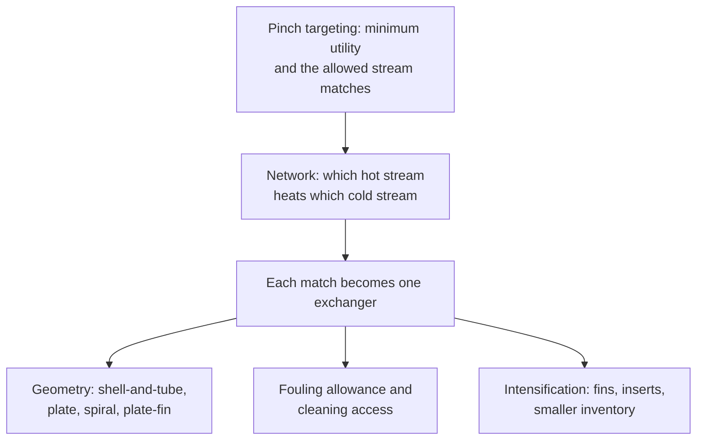

## ビデオ講義

<div class="video-container">
  <iframe
    width="560"
    height="315"
    src="https://www.youtube.com/embed/fpjFV6KX1hc?start=3091"
    title="化学工学伝熱 第5章: 伝熱設計とプロセス強化"
    allow="accelerometer; autoplay; clipboard-write; encrypted-media; gyroscope; picture-in-picture"
    allowfullscreen>
  </iframe>
</div>

> このビデオは以下のテキストと同じ内容をカバーしています。お好みの学習形式をお選びください。

---

# 第5章：伝熱設計とプロセス強化

本章は、視野を引くことで本シリーズを締めくくります。第 1 章から第 4 章までは熱交換器を 1 台ずつサイジングしてきましたが、実際のプラントはそれを数十台まとめて 1 つの熱経済として運転しています。ここでは、一つ一つのマッチをコンパクトにする機器、そのすべてに課税してくる汚れ、それを小さくするプロセス強化、そしてそれを正直に保つデジタルの層に出会います。

**単一の熱交換器からプラントの熱経済へ**

## 学習目標

本章を修了すると、以下ができるようになります:

  * ✅ ピンチによる目標値が、個々の熱交換器の設計が経済的に達成しなければならない熱負荷をどう定めるかを説明できる
  * ✅ プレート式（プレートアンドフレーム）、スパイラル式、プレートフィン式の熱交換器を説明し、多管式（シェルアンドチューブ）がなお有利な場面を述べられる
  * ✅ 汚れを直列に加わる抵抗として扱い、その結果生じる熱負荷の低下を計算できる
  * ✅ 流速の管理や洗浄スケジュールを含め、汚れに対する設計上・運転上の対応を選択できる
  * ✅ フィンがなぜ気体側に属するのか、そしてプロセス強化が本質安全設計とどうつながるのかを説明できる
  * ✅ デジタルツインが熱交換器の管理に何を加えるのか — そして熱力学がそれに何を禁じているのか — を述べられる

**読了時間**: 20-25分 **コード例**: 2 **演習**: 3

* * *

**診断問題。** ある熱交換器が清浄時の $U =$ **600** W/(m²·K) で運転されており、したがって自分自身の抵抗は $1/600 =$ **0.001667** m²K/W です。そこに $R_f =$ **0.0005** m²K/W の汚れの膜 — その 10 分の 3 — が付き、合計は **0.002167** m²K/W になります。ある同僚は熱負荷から 10 分の 3 を差し引きました。実際には熱負荷は **23.1 %** 下がります。同僚はどちらの分母で割ったのでしょうか。そして熱負荷はどちらの分母で割られるのでしょうか。5.3 節がこれに答え、5.6 節が 5 つの章すべてに対して同じ種類の問いを投げます。

## 5.1 1 台の熱交換器からネットワークへ

これまでの各章は、いずれも 1 つの機器を鍵穴から覗くように見てきました。一歩下がると、プラントは違って見えます。製油所の原油蒸留装置には数十台の熱交換器があり、その 1 台 1 台が、どの高温流体でどの低温流体を加熱するかという判断の結果です。そうした判断は、熱交換器ごとに個別に下されるものではありません。**ピンチ解析**（[化学工学入門 第4章](../chemical-engineering-introduction/chapter-4.html)）は、ネットワークを 1 本も描く前に、指定された流体の集合・ユーティリティ・最小接近温度差に対して、必要な高温・低温ユーティリティの *最小* 量を計算します。そして 3 つの黄金律 — ピンチを越えて熱を移動させない、ピンチより上で冷却ユーティリティを使わない、ピンチより下で加熱ユーティリティを使わない — は、ネットワークがその目標値に到達するために従わなければならない条件です。どれか 1 つを破ればユーティリティ需要は増えますが、その **マッチ（match、高温流体と低温流体の組み合わせ）** が物理的に禁じられるわけではありません。

目標設定（ターゲティング）はネットワークを制約します。どのマッチが存在し、それぞれが何を担うのかを決めるのは、ターゲティングではなくネットワーク合成です。許されたマッチを実際のハードウェアに変えるところが本章の舞台です — そしてマッチが*ハードウェア*になるとき、それは直列や並列に並ぶ複数のシェルかもしれず、多流体装置の一部分かもしれず、自動的に 1 台の熱交換器になるわけではありません。そこでの問いはどこまでも実務的です。伝熱面積はどれだけ必要か、どのような形状で、どれだけの設備投資で、どのような汚れに耐え、どれくらいの頻度で洗浄するのか。



この経済性は、*化学工学流体力学* [第4章](../chemical-engineering-fluid-mechanics/chapter-4.html) の管径選定と同じ韻を踏んでいます。伝熱面積を増やせば設備費が一度だけかかり、面積が足りなければユーティリティ費用が 20 年にわたって毎時間かかり続け、$\Delta T_{lm} \to 0$ の近くでは面積は際限なく増大します — [第2章](chapter-2.html) が私たちの前に立てた壁です。

## 5.2 コンパクト熱交換器

[第2章](chapter-2.html) の **多管式（シェルアンドチューブ）** 熱交換器は、産業界の既定の選択ではあっても、その最適解ではありません。清浄な液体用途におけるその対抗馬が **プレート式（プレートアンドフレーム）** 熱交換器です。薄い波板状のプレートをフレームで締め付け、2 つの流体を狭い流路に交互に流します。

この形状から 4 つの性質が導かれます。波板は流れを **低いレイノルズ数で乱流** へと遷移させるので、[第1章](chapter-1.html) の境膜伝熱係数が高くなります — ただし同じ波板が課す圧力損失という代価を伴い、これはただで手に入る利得ではなく設計上のトレードオフです。**面積密度（area density）** — 機器 1 m³ に詰め込まれた伝熱面積 — は、従来型の多管式の管束が到達できる水準よりはるかに高く、したがって同じ熱負荷がごく一部の設置面積で得られます。その数値はメーカーのデータシートに属するものであり、本ページでは引用しません。**シングルパス**の流路配置は実質的な向流を与えるので、[第2章](chapter-2.html) の補正係数 $F$ は 1 の近くにとどまります — 多パスのプレート配置や偏流ではそうなりません — そして近い温度接近は、機器クラスによって決まる比ではなく、この形式で実務上しばしば得られる利点です。業界で引用される帯域 — **プレート式で 1–2 K、多管式で 5–10 K** — は本ページでは出典未確認であり、ここに書き留めているのは見かけ上の矛盾を解くためだけです: [第2章](chapter-2.html) の「10 K 前後」は、その帯域の緩い側にある**多管式の液体用途**の値であって、あらゆる形式が従う下限ではありません。機器クラスを名指しすることが、この整合のすべてです。そしてフレームは単純に **ボルトを外せば開きます**: プレートを取り出して点検や機械的洗浄ができ、その所要時間は装置の大きさ、ガスケット、保全手順で決まります。プレートを追加すれば伝熱面積を増やせます。

限界はシールにあります。**ガスケット式** — プレートを溶接ではなくエラストマーの帯でシールしたもの — は、温度と薬品適合性に関してはそのエラストマー以上の性能にはならず、その上限はガスケットで決まります。一方**圧力**の定格は、プレートの板厚と強度、支持パターン、フレームと締結といった機械設計全体で決まり、ガスケットはその 1 要素です。どちらも特定のコンパウンドとプレート設計の性質であり、本ページではなくメーカーのデータシートから読むものです: ここに数値を挙げれば仕様として使われてしまいますが、それこそこの数値がなりえないものです。セミウェルド式、全溶接式、ブレージング式は特定の限界を広げられますが — セミウェルド式にはガスケットに由来する制約が一部残り、ブレージングにはそれ自身の制約があります — この形式を魅力的にしていた「簡単に開けられる」という利点と引き換えになります。近縁の 2 形式がすき間を埋めます。**スパイラル式熱交換器** は、2 本の長い流路を中心のまわりに巻いたもので、各流体が遮るもののない 1 本の経路を持つため、スラリーや繊維を含む流体に耐えます。**プレートフィン式** のブロックは、ブレージングしたアルミニウム製で、空気分離や LNG のような極低温の用途において、極端に高い面積密度とごく小さな温度接近を実現します。

**標準的な実務** は、なお広い範囲の用途を多管式に送り込みます。高圧と高温、直管のロッド洗浄を必要とする汚れの激しい流体、大きな蒸気体積を伴う真空・凝縮の用途、そして成熟した標準的な多管式の実務がプロジェクトを短縮する用途です。もっとも、規格化・標準化されたコンパクト機器も存在します。コンパクトであることは、より優れていることを意味しません — それは *用途が許すときに* より優れている、ということです。

## 5.3 汚れ管理

汚れは、あらゆる伝熱設計にかかる目に見えない税金です。スケール、コーク、腐食生成物、バイオフィルム、そして沈降した粒子が伝熱面に層を作ります。層が何をするかは [第1章](chapter-1.html) がすでに教えてくれています。直列に抵抗を 1 つ加えるのです。

$$ \frac{1}{U_{\text{fouled}}} = \frac{1}{U_{\text{clean}}} + R_f $$

抵抗は足し合わされるので、ある $R_f$ が与える損害は、清浄時の熱交換器がどれだけ優れていたかに完全に依存します。優れた $U$ は自分自身の抵抗が小さいので、汚れの膜がすぐにそれを支配します。凡庸な $U$ はほとんど気づきもしません。

**モデルの境界。** 以下はすべて $R_f$ が**時間とともに線形に増大する**として扱いますが、これは抵抗の増大速度が正味でほぼ一定であることを仮定しています — 堆積があるというだけではそれは保証されません。堆積速度も堆積物の熱伝導率も変わりうるからです。実際の用途はこの領域から 2 方向に外れます: 流れによる除去が堆積に追いつくところでは抵抗は漸近値に近づき — Kern–Seaton の描像です — コーキングのような反応性の汚れは、誘導期のあとに加速を示すことがあり、これも数ある軌跡の 1 つです。線形成長はその中間のケースであり、同じ初期速度の漸近曲線に対しては保守的で、しかも算術が 5 行で閉じるものです。洗浄周期は、その形の良し悪しの分だけしか良くなりません。

```python
U_CLEAN = 600.0   # W/(m2 K), clean overall coefficient
AREA = 120.0      # m2, fixed once the exchanger is built
DT_LM = 30.0      # K, log-mean temperature difference held constant

R_FOUL = [0.0, 0.0001, 0.00025, 0.0005, 0.00075, 0.001]  # m2 K/W


def fouled_U(u_clean, r_f):
    """Overall coefficient after adding a fouling resistance in series."""
    return 1.0 / (1.0 / u_clean + r_f)


def duty(u, area=AREA, dt_lm=DT_LM):
    """Q = U A dT_lm, in kW."""
    return u * area * dt_lm / 1000.0


q_clean = duty(U_CLEAN)

print(f"{'R_f [m2K/W]':>12} {'U [W/m2K]':>10} {'Q [kW]':>9} {'duty loss':>10}")
for r_f in R_FOUL:
    u = fouled_U(U_CLEAN, r_f)
    q = duty(u)
    print(f"{r_f:12.5f} {u:10.0f} {q:9.1f} {1 - q / q_clean:9.1%}")

r_half = 1.0 / U_CLEAN
print()
print(f"fouling resistance that halves the duty: {r_half:.5f} m2K/W")

#  R_f [m2K/W]  U [W/m2K]    Q [kW]  duty loss
#      0.00000        600    2160.0      0.0%
#      0.00010        566    2037.7      5.7%
#      0.00025        522    1878.3     13.0%
#      0.00050        462    1661.5     23.1%
#      0.00075        414    1489.7     31.0%
#      0.00100        375    1350.0     37.5%
#
# fouling resistance that halves the duty: 0.00167 m2K/W
```

まず最後の行から読んでください。清浄な熱交換器自身の抵抗は $1/600 = 0.00167$ m²K/W なので、ちょうどその大きさの汚れの膜が熱負荷を半分にします — そして、その 10 分の 3 の膜がすでに 23% を奪っています。汚れ係数は、無視できそうに見えるほど小さい単位で表に掲載されています。しかし無視できるものではありません。

[第1章](chapter-1.html) は、本節の切りのよい **600** ではなく計算された組み合わせに対して同じ算術を走らせています: 両側の境膜伝熱係数が **8000** W/(m²·K) のとき、清浄時の **3488** W/(m²·K) は片側あたり **0.0002** m²K/W の余裕のもとで **1456** まで落ちます — $1 - 1456/3488 =$ **58 %** が失われるのであり、その合計の汚れの膜は本節の **0.0005** より小さいのです。清浄時の熱交換器が優れているほど、同じ膜がそのうちのより大きな割合を奪います。

まず設計上の対応があります。重要で、かつ用途によって変わる対応の 1 つが **流速の管理** です — 水質、壁温、殺菌剤の注入や原料の前処理のほうが効くこともあります。遅すぎれば粒子が沈降しバイオフィルムが定着し、速すぎればエロージョンと送液動力費が効いてきます。これは *化学工学流体力学* [第4章](../chemical-engineering-fluid-mechanics/chapter-4.html) の経済流速のトレードオフが、汚れの帽子をかぶって現れたものです。次に、腐食や付着に対抗する **材質と表面の選定**、そして **実際に洗浄できる形状** — 取り外し可能な鏡板を備えた直管や、ボルトを外せば開くプレートフレームです。伝統的な対応である、汚れ代（fouling allowance）として伝熱面積を追加するやり方には罠があります。処理量が変わらないまま追加された面積が並列の流路断面積になる場合、運転開始時の流速は下がり伝熱面も冷えがちで、低いせん断によって汚れが助長される用途では、見込んだ余裕分より速く汚れが進むことがあるのです。長さを増やす場合や、パス構成や制御方法で補う場合には必ずしもそうならず、壁が冷えることはコーキングや一部のスケーリングをむしろ減らします。

運転面では、汚れは *監視* されます。流量と 4 点の温度が確実に測定されていれば — そこまで計装されていない熱交換器も多いのですが — 日常の計装から $U$ を逆算し、トレンドを取ることができます。これは教科書どおりの **ソフトセンサー**（[化学工学入門 第5章](../chemical-engineering-introduction/chapter-5.html)）です。欲しい量が直接には測定できないので、すでに手元にある安価な測定値から推定するのです。その破綻の仕方もお決まりのものです — ドリフトした流量計や汚れた保護管（サーモウェル）は、推定された $U$ をどちらの向きにも偏らせ、本物の汚れを模倣しうるのです。

そのトレンドが、そのまま本格的な最適化の入力になります。洗浄が頻繁すぎれば生産時間と人手を無駄にし、まれすぎれば余分な燃料を燃やし、処理量の削減を強いることもあります。最適点は、1 サイクルの 1 日あたり*平均*費用が下げ止まるところ — すなわちサイクル長に関するその微分がゼロになるところ — です。以下のモデルについて書き下せば、その条件は「限界のエネルギー損失が按分した停止費用に等しい」ではありません: サイクル最終日の瞬間的なエネルギー損失が、サイクルの 1 日あたり**総**平均費用 — 按分した洗浄費用に、サイクルを通じて累積したエネルギー損失の平均を*加えた*もの — に等しい、という条件です。これは費用モデルに支えられたスケジューリングの計算であり — モデルの不確かさ、点検の所見、停止時期の調整にはなお判断が要ります — そして上の熱交換器に対しては 5 行の算術です。

```python
import math

# ILLUSTRATIVE INPUTS, NOT PLANT DATA. Neither the fouling rate nor the
# shutdown cost has a source; they are declared here so the method can be
# shown. The day this returns is the answer to these two numbers.
RATE = 2.0e-6      # m2K/W per day, linear fouling growth (ILLUSTRATIVE)
SHUTDOWN = 5000.0  # USD per cleaning shutdown (ILLUSTRATIVE)
PRICE = 8.0        # USD/GJ, the heat price used in Chapter 4


def cycle_cost_per_day(days):
    """Shutdown amortized over the cycle, plus the energy fouling costs you."""
    grown = 1.0 + U_CLEAN * RATE * days
    integral = U_CLEAN * days - math.log(grown) / RATE   # int (U_clean - U)
    energy_gj = AREA * DT_LM * integral * 86400.0 / 1e9
    return (SHUTDOWN + energy_gj * PRICE) / days


best = min(range(1, 3651), key=cycle_cost_per_day)
print(best, round(cycle_cost_per_day(best)))

#  79 130
```

この 2 つの例示的な数値のもとでは、1 日あたりの総費用は **79** 日、**130** USD/日 で底を打ちます。これは内点の極小であり — 前後どちらの 1 日でも費用は増えます — 走査によって得られた最良の整数日でもあります。上で言葉にした連続の停留条件（翌日のエネルギー損失が、按分した停止費用と累積したエネルギーを合わせたサイクルの 1 日あたり平均費用に等しい）は、整数日でちょうど満たされる必要はありません。2 つの道筋が 1 つの日を指しています — 走査の産物ではなく、本物の最適点です。それが何であるかをはっきり言いましょう: **79 日はこの入力一式に対する答え** — 1 日あたり 2.0×10⁻⁶ m²K/W の汚れ速度と 5,000 USD の停止費用だけでなく、清浄時 $U$ の 600、120 m²、30 K の駆動力、8 USD/GJ の熱の価格、そして線形の汚れ則も含めて — であって、それ以外の何に対する答えでもありません。プラントは自分自身の汚れ速度と停止費用を、自分自身の機器とエネルギーの数値とともに入れることになりますし、その答えを使う前にモデルの仮定を確認しなければなりません。

**誤り:** *検討せずに*暦どおりに洗浄する — 定期修繕のたび、半年ごと、要員の手が空いたとき — 洗浄間隔が数値ではなく習慣になっているからです。**正しくは:** 翌日のエネルギー損失がサイクルの 1 日あたり平均費用を横切るところで洗浄する。停止時期の調整、信頼性、点検の必要を数え合わせれば、暦どおりの間隔が経済的な間隔だったと判明することもあります。誤りなのは、その交差のどちら側にいるのかを知らないことです。そしてどちらの誤りも隠れます: 早く洗浄しすぎれば、どの計器にも記録されない停止を浪費し、遅く洗浄しすぎれば、ふつうの燃料に見える燃料を余計に燃やします。上のトレンドされた $U$ の上に組み立てた費用曲線こそ、その 2 つを見分けるものです — 圧力損失、信頼性、製品品質と並んで。これらはそれ自体で判断を支配することもあります。

## 5.4 プロセス強化

**プロセス強化（インテンシフィケーション）** は、とりわけ「これはどれだけ大きくなければならないか」ではなく、どれだけ小さくできるかを問います — 機器が小さくなることはその成果の 1 つであり、統合、輸送の強化、エネルギー利用の改善もまた成果です。伝熱におけるその問いは、[第1章](chapter-1.html) の教訓から始まります。共通の面積基準で最も大きい熱抵抗が総括伝熱係数を支配し、従来型の清浄な気液熱交換器において、それは気体側であることが多く、その差は液体側の境膜抵抗が和にほとんど寄与しないほどです。

だから、余分な伝熱面積は抵抗のあるところに置きます。**フィン** — 気体側に張り出した金属面 — は、弱い係数に面する面積を何倍にもします。空冷器、ラジエーター、空調コイルが拡大伝熱面を空気側に持つのが一般的である理由がこれです — 内部の形状がどうであれ、内側を流れるのが水でも冷媒でも同じです。**ローフィン管** は、従来型の管束の内部で短い一体成形のフィンを備えています。**タービュレータ** — ねじった帯板やワイヤコイルを管内に挿入したもの — は流れに旋回を与えて管側の伝熱係数を上げ、その代金を圧力損失で支払います。これは改造の選択肢の 1 つであり、管側が律速の熱抵抗だと確認され、圧力損失の余裕が許す場合に適します。**ヒートパイプ** は、[第3章](chapter-3.html) の相変化の伝熱係数によって、密閉した受動的な管に沿って小さな温度降下で相当量の熱を運びます — ただしキャピラリー限界、沸騰限界、飛沫同伴限界の範囲内で。

その見返りは設備費だけではありません。小さい機器は **保有量（インベントリ）が少なく**、高温・可燃性・有毒な流体の保有量が少ないことは、危険を制御することではなく取り除くことです — [化学工学入門 第4章](../chemical-engineering-introduction/chapter-4.html) の Trevor Kletz の本質安全設計、「持っていないものは漏れない」が、優れた伝熱エンジニアリングの副産物としてやってくるのです。落とし穴は対称的です。狭い流路は 5.3 節の汚れに対して最も耐性が低いことがあります — もっとも、せん断を高める強化や、そもそも狭い流路を作らない強化もあります — したがってプロセス強化の判断は、その手法と用途に固有の汚れ挙動に照らして確認しなければなりません。

## 5.5 デジタルの層

熱交換器ネットワークは静的な対象ではありません。汚れは流体ごとに異なる速度で蓄積し、原料は変わり、外気温は振れ、条件が変われば、ネットワークは設計時に狙った最適点から離れていきます。それへの対応が、熱交換器を **再評価（リレート）する** こと — データシートを信じるのではなく、既設の機器が今日の条件下で実際に何を達成しているのかを計算し直すこと — であり、しかもそれを定期修繕のときだけでなく、プロセスの動特性と得られる情報の価値が正当化する頻度で行うことです。

これは [化学工学入門 第5章](../chemical-engineering-introduction/chapter-5.html) の意味での **デジタルツイン** です。ライブデータによってプラントと整合を保たれ続けるモデルであり、計器が答えてくれない問いに答えます。5.3 節のソフトセンサーによる $U$ と、流れ・物性・相の影響を堆積物から切り分けるための条件補正済みの清浄時ベースラインを与えられると、それはデータのある機器について汚れの状態を推定し、それを将来へ外挿し、選択肢に値段を付けます — 次の機会にどの熱交換器を洗浄するか、並列運転する機器の間で流量をどう配分するか、どこでバイパスを開けるか。稼働中のプラントで 1 回 1 回の試行が高価なときには、*ベイズ最適化* シリーズ（[シリーズ目次](../bayesian-optimization/index.html)）のサンプル効率のよい手法が 1 つの候補になりますが、問題の次元、制約、利用できる物理に照らして、モデルベースの手法やスケジューリング手法と比較検討すべきものです。

これらのどれ 1 つとして、何かを無効にするものではありません。ツインは洗浄スケジュールも最適なバイパス配分も見つけられますが、温度差ゼロを越えて熱を移すことはできませんし、400 °C の流体が 50 °C の流体を加熱するときに破壊された仕事を取り戻すこともできません。その破壊こそ、*化学工学熱力学* [第2章](../chemical-engineering-thermodynamics/chapter-2.html) のエントロピー生成 — 伝熱の衣をまとった最小仕事の議論です。ソフトウェアは、*固定された*問題設定が定める下限の内側で最適化します。ユーティリティ水準、目標値、運転条件を変えれば、フローシートを描き直さなくても到達できる性能は動きえます。一方、すでに破壊されたエクセルギーは、どのような変更によっても取り戻せません。

## 5.6 シリーズ修了チェック

6 つの問いがあり、いずれも本シリーズの計算スクリプトの中に計算された答えを持っています。示した桁に届かなければ、名前を挙げた章が戻るべき場所です。

1. **直列の熱抵抗。** 水—水、両側の境膜伝熱係数が **8000** W/(m²·K)、厚さ 1.65 mm の炭素鋼壁: $U$ と、熱抵抗に占める金属の割合は。（**3488** W/(m²·K)、**12.8 %** — 第 1 章。）
2. **適用範囲を持つ相関式。** 内径 **15.75** mm の管を 1.5 m/s で流れる冷却水: Dittus–Boelter 式は何を与え、どの流速では使用を拒まなければならないか。（**7277** W/(m²·K)。0.2 m/s では Re が **4788** となり、相関式が述べられている 10⁴ を下回ります — 第 1 章。）
3. **流路構成。** 1 シェルパス・2 管パスの装置、熱負荷 **334.4** kW、LMTD **39.2** K: $F$ はいくらで、0.85 と仮定するとどれだけの代償を払うか。（**0.9045**。真の $F$ が必要とする **18.9** m² に対して **20.1** m² を指定することになります — 第 2 章。）
4. **相変化。** 1 atm で蒸気 1 キログラムを凝縮させたときの熱と、相関式が対象とする幾何形状において 1 atm の水の*飽和プール沸騰*で核沸騰が破綻する熱流束は。（**2256.5** kJ/kg。0.149 の係数を持つ流体力学的安定性の相関式から **1.26** MW/m² — 第 3 章。）
5. **放射。** より低温の囲いと交換している高温面に、まず高温側だけ、次いで両側に光沢箔を加える: 交換量は何倍に下がるか。（**13.5** 倍、次いで **26.0** 倍 — 放射率の比だけが示唆する **16.0** 倍ではありません — 第 4 章。）
6. **プラント。** ある熱交換器が既知の速度で汚れ、1 回の停止に既知の費用がかかるとき、いつ洗浄するか。（翌日のエネルギー損失が、按分した停止費用と累積したエネルギーを合わせたサイクルの 1 日あたり平均費用に出会うところ — 5.3 節の例示的な入力一式に対しては **79** 日、あなたの入力に対しては別の日です。）

## 5.7 シリーズのまとめ

上の 6 つの問いが、5 つの章です: 直列の熱抵抗から得られる総括伝熱係数、$Q = UAF\,\Delta T_{lm}$ を通じてハードウェアに変わるその係数、核沸騰と条件の良い凝縮の高い伝熱係数を伴う相変化と、熱入力が課される場合のバーンアウトのリスク、放射とその 4 乗の放射則、そして最後にネットワーク、汚れ、洗浄周期です。

より大きな流れは、[化学工学入門 第1章](../chemical-engineering-introduction/chapter-1.html) の輸送現象の対応表です。*流束 = 係数 × 駆動力* が、3 度繰り返されます。**運動量移動** は *化学工学流体力学* シリーズ、**伝熱** が本シリーズであり、入門的なモデルでは濃度差によって駆動される**物質移動** が、[化学工学物質移動と分離](../chemical-engineering-mass-transfer/index.html) でこの三者を完成させます — そこでは境膜係数、直列の抵抗、駆動力が、すでに見覚えのあるものに映るはずです。

次に進む先: これらの熱負荷が支える単位操作については *化学工学入門* へ、第二法則が定める下限については *化学工学熱力学* へ、そしてデータの層については *プロセス・インフォマティクス入門* へ。

最後までお読みいただきありがとうございました。

## 演習問題

1. **概念 — 形式を選ぶ**: 次のそれぞれの用途について、熱交換器の形式を理由とともに指定しなさい。(a) 清浄なプロセス水 200 m³/h を冷却水で 85 °C から 40 °C へ冷却する。6 barg、要求される温度接近は 3 K、設置スペースに余裕のないプラント。(b) 320 °C、45 barg の炭化水素流体で、コークを析出する。定期修繕と定期修繕の間は連続運転。(c) 2 つの選択のうち、5.3 節の汚れの計算により大きくさらされているのはどちらで、それはなぜですか。
   *ヒント*: 性能を検討する前に、それぞれの用途を 5.2 節のシールと設計規格の限界に照らして確認すること。
   *解答*: (a) **プレート式（プレートアンドフレーム）。** 85 °C・6 barg の清浄な液–液の用途は、適した工業用プレート式熱交換器の多くの定格の内側にあり、メーカーが提示するガスケットの上限の内側に収まります。そして 3 K の温度接近こそ、この形式が最も得意とするところです: 真の向流によって $F$ が 1 の近くに保たれ、高い面積密度がこの熱負荷を小さな設置面積に収め、フレームはボルトを外せば洗浄でき、熱負荷が増えればプレートを追加できます。(b) **多管式（シェルアンドチューブ）**、取り外し可能な鏡板を備えた直管です。320 °C・45 barg ではエラストマーの帯が律速の制約となり、ガスケット式のプレート装置を端的に除外します — その確認は記憶した数値ではなくメーカーのデータシートに照らして行うものです。またコーキングする用途は機械的に洗浄されるのが一般的で、その方法は実際の堆積物と機器に応じて選ばれます — 化学洗浄や、制御された酸化・スチームデコーキングもあります — 直管のロッド洗浄は日常的な作業ですが、狭いプレート流路のコークは、いったん流路が詰まってしまえば取り除くことがきわめて難しくなります。(c) **原理的にはプレート式のほうがさらされています**: 清浄時の $U$ が高いので自身の抵抗が小さく、同じ膜がそのうちのより大きな割合を破壊するからです。5.3 節の $1 - 1456/3488 =$ **58 %** と、同じ節の **23.1 %** との対比がその感度を示しています。ただし 2 つの例は汚れ代が異なり、どちらもここで選定した機器の清浄時 $U$ でも汚れによる損失でもありません。それでも (a) で正しい選択であるのは、用途が清浄でフレームが開くからです。(b) ははるかに激しく汚れますが、洗浄できる形状に収められています。

2. **定量 — 汚れの膜の代償**: ある熱交換器が $U_{\text{clean}} = 600$ W/(m²·K) で設計されています。運転中に、汚れ抵抗 $R_f = 0.0005$ m²K/W が蓄積しました。(a) $U_{\text{fouled}}$ を計算しなさい。(b) 面積と $\Delta T_{lm}$ が一定のとき、熱負荷は何パーセント低下しますか。(c) 汚れた状態でも清浄時の熱負荷を出せるようにするには、設計段階でどれだけの追加面積が必要だったでしょうか。
   *ヒント*: 抵抗は足し合わされるので $1/U$ で扱うこと。熱負荷は $Q = UA\,\Delta T_{lm}$ なので、$A$ と $\Delta T_{lm}$ が一定なら熱負荷の比は $U$ の比そのものです。
   *解答*: (a) $1/U_{\text{fouled}} = 1/600 + 0.0005 = 0.001667 + 0.0005 = 0.002167$ m²K/W なので、$U_{\text{fouled}} = \mathbf{462\ W/(m^2 \cdot K)}$（整数に丸める前は 461.5）。(b) $A$ と $\Delta T_{lm}$ が一定なら $Q \propto U$ なので、低下は $1 - 462/600 = \mathbf{23\%}$ — 係数を小数第 1 位まで取れば 23.1% であり、5.3 節の出力の $R_f = 0.0005$ の行と一致します。(c) 熱負荷を回復するには、面積を比の逆数 $600/461.5 = 1.30$ 倍にする必要があります。すなわち **およそ 30% 多い伝熱面積** です。それが汚れ代で買えるものであり、処理量が変わらないまま並列の流路断面積として面積を足す場合には、5.3 節の警告がそのまま当てはまります。その機器は初日には流速が低く、おそらく伝熱面も冷たくなり、せん断に敏感な用途では、まさにそのために見込んだはずの汚れを加速しかねないのです。

3. **討論 — いつ洗浄するか**: ある熱交換器の逆算された $U$ が、8 か月で 18% 低下しました。洗浄には、その装置を 2 日間停止する必要があります。(a) いつ洗浄するかを判断するには、どのようなデータが必要ですか。(b) 逆算された $U$ はなぜソフトセンサーなのか、そしてそれはどのように誤らせうるでしょうか。(c) デジタルツインはここでどこに価値を加え、何ができないのでしょうか。
   *ヒント*: まず 1 日あたりの費用のバランスとして組み立て、次に、測定された低下が汚れではないとしたら何がありうるかを問うこと。
   *解答*: (a) 低下した $U$ における 1 日あたりの追加ユーティリティ費用（熱の価格に増えた熱負荷を掛けたもの、あるいはそれが強いる処理量削減の価値）、生産損失を含む停止の総費用、そして汚れ曲線の形 — なお急に増え続けているのか、すでに頭打ちになっているのか。翌日のエネルギー損失が、サイクルの 1 日あたり平均費用 — 按分した停止費用に、サイクルを通じて累積したエネルギー損失を*加えた*もの — を上回った時点で洗浄します。これは平均サイクル費用モデルの停留条件であって、停止費用の項だけではありません。5.3 節の 5 行は、線形成長で LMTD 一定の 1 つのケースについてそれを実装したものです: 任意の汚れ曲線も漸近的な汚れ曲線も扱わず、2 日間の洗浄停止もその生産損失も表現していないので、ここで答えを出すにはモデルを適合させなければなりません。その **79** 日は、*そのモデル自身の*例示的な入力一式に対して返る値であって、あなたの入力に対する値ではありません。ネットワークではこれがより難しくなります。1 台を洗浄すると、その分の熱負荷が他の機器へ移るからです。(b) それは、モデル $U = Q/(A\,\Delta T_{lm})$ を通じて、安価な日常測定 — 流量と 4 点の温度 — から、測定されていない量である汚れの状態を推定しています。推定しているのは $U$ であって汚れそのものではありません: 両者を切り分けるには、現在の条件に合わせて補正した清浄時ベースラインが要り、純向流でないハードウェアでは正しい $F$ も要ります。誤らせるのは、入力がドリフトするときです。校正のずれた流量計、よどんだ場所に入った保護管、あるいは供給流量の低下は、どの測定値が狂っているかに応じて計算上の $U$ を上にも下にも偏らせ、堆積物がまったく生じていなくても低下を模倣しえます。トレンドの形は、いくつもある手がかりの 1 つとして読んでください — ドリフトが緩やかなこともあれば、堆積物の剥離が急峻なこともあります。圧力損失とも突き合わせますが、それも流量と物性に依存しますし、熱的に無視できない堆積物が必ずしも測定できるほど圧力損失を上げるとは限りません。(c) 検証されたツインは、機器を現在の条件に照らして再評価し、データとモデルが許すかぎりで汚れを原料や外気の影響から切り分け、不確かさを明示しつつトレンドを外挿し、洗浄スケジュールやバイパス配分を実行に移す前に評価します。できないのは、熱力学的な下限を打ち破ることです。消えていく温度差を越えて熱を回収できるスケジュールはありませんし、大きな $\Delta T$ のマッチによって破壊された仕事を取り消せるモデルもありません。すでに破壊された仕事は何をしても取り戻せません。*将来*の同種の損失は、温度をよりよく整合させることで減り、それは運転やユーティリティの変更でもある程度実現でき、ネットワークの再設計ならさらに実現できます — モデリングの問題であると同時に、ピンチ解析の問題です。

## 出典

書誌情報は 2026-09-08 に確認しました。本章の計算値はいずれも、本シリーズの計算スクリプトの DISPLAY 文字列を一字一句そのまま書き写したものか、あるいは — 以下の「数値の由来」の節がそう述べている箇所については — それらの文字列に対してここで行い、表示のために整形した算術です。手元で見積もったものは 1 つもありません。

| 出典 | 引用している根拠 |
|---|---|
| Linnhoff, B. and Hindmarsh, E., "The pinch design method for heat exchanger networks", *Chemical Engineering Science* **38** (1983) 745–763, DOI [10.1016/0009-2509(83)80185-7](https://doi.org/10.1016/0009-2509(83)80185-7) | 5.1 節のピンチの目標値と 3 つの黄金律。引用のみで取得はしておらず、ここのどの数値もこれに依拠していません |
| Kern, D. Q. and Seaton, R. E., "A theoretical analysis of thermal surface fouling", *British Chemical Engineering* **4** (1959) 258–262 | 漸近的な汚れの領域。5.3 節で、そこで用いる線形モデルの境界として名前を挙げています。引用のみで取得はしておらず、ここのどの数値もこれに依拠していません |
| Kletz, T. A., "What you don't have, can't leak", *Chemistry and Industry*, 6 May 1978, 287–292 | 5.4 節で引用した本質安全設計の議論 |
| `sources/calc/ch06_repair.py`（本シリーズの計算スクリプト、Lecture Maker リポジトリ） | 以下に挙げるすべての Tier A の値。DISPLAY キーのもとで印字され、そこで主張されています |

## 数値の由来

**Tier A — `ch06_repair.py` が計算し、主張している値**。それぞれの DISPLAY キーから転記しました: `ch5_clean_resistance_m2k_per_w` **0.001667**、`ch5_fouled_resistance_m2k_per_w` **0.002167**、`U_fouled_ch5_unrounded_w_per_m2_k` **461.5**、`ch5_duty_loss_percent` **23.1**、`cleaning_optimum_days` **79**、`cleaning_optimum_cost_usd_per_day` **130**。そして修了チェックでは `design_film_coefficient_w_per_m2_k` **8000**、`U_clean_water_water_w_per_m2_k` **3488**、`U_fouled_water_water_w_per_m2_k` **1456**、`fouling_resistance_per_side_m2k_per_w` **0.0002**、`wall_share_realistic_percent` **12.8**、`db_tube_inside_diameter_mm` **15.75**、`db_h_1p5_m_per_s_w_per_m2_k` **7277**、`db_re_0p2_m_per_s` **4788**、`F_1_2_ex3` **0.9045**、`ex3_duty_kw` **334.4**、`ex3_lmtd_k` **39.2**、`ex3_area_at_f_0p85_m2` **20.1**、`ex3_area_at_correct_f_m2` **18.9**、`latent_heat_100c_kj_per_kg` **2256.5**、`chf_zuber_mw_per_m2` **1.26**、`radiation_reduction_inner_foil` **13.5**、`radiation_reduction_both_foil` **26.0**、そして `naive_emissivity_ratio` **16.0** — これは*誤った*答えとして印字され、現れるすべての場所でそう明示されています。5.3 節と演習 1(c) の **58 %** は、そのうち 2 つの文字列からここで $1 - 1456/3488$ として形成した値です。

**本章が唯一議論している丸め。** 演習 2 は $U_{\text{fouled}} =$ **462** W/(m²·K) と印字し、その傍らに「整数に丸める前は 461.5」を残しています。462 は厳密な商 461.538… を最後に一度だけ丸めた値です。スクリプトは **461** も印字しますが、これは*被演算子*を先に 0.002167 に丸めてから割った場合に得られる値です。割り算を通して精度を保ち、最後に一度だけ丸めること — したがって 462 が正しく、連なりが見えるように長いほうの値をその隣に印字しています。演習 2(b) の **23 %** は同じ損失を有効数字 2 桁にしたもので、小数第 1 位までなら **23.1 %** です。どちらも丸めた表現であり、スクリプトは長いほうの値を保持しています。

**Tier B — 引用された値であって、ここで計算したものではないもの**: 出典表の 3 件の文献。本章が依拠する物理は第 1 章から第 4 章から受け継いだものであり、その背後の物性値と相関式はそちらでそれぞれの引用を持っています。

**Tier C — 例示的であると宣言した、プラントのデータではないもの**: 5.3 節の洗浄周期における**汚れ速度 2.0×10⁻⁶ m²K/W／日**と**停止費用 5,000 USD**。どちらも出典なしで選び、使用箇所でそう明示しています。速度については、1 年ぶんの汚れが同節がすでに表にしている $R_f$ の振り分けの内側に落ちるように選んだ、というだけのものです。**8 USD/GJ** の熱の価格は第 4 章の演習 2(c) から転記したもので、あちらでも例示値であり、2 つの章が食い違わないように再発明せず流用しています。例題の熱交換器自身の前提 — $U_{\text{clean}}$ **600** W/(m²·K)、$A$ **120** m²、$\Delta T_{lm}$ **30** K、$R_f$ **0.0005** m²K/W — は本章の公開版の例題入力であり、振り分けと演習 2 が公開版と比較できるように変えずに残しています。これらは特定の熱交換器を表すものではありません。**したがって `cleaning_optimum_days` の 79 も Tier C を受け継ぎます**: それはこれらの入力に対する答えであって、いかなるプラントに対する答えでもなく、5.3 節はそれが印字される場所でそう述べています。

**意図的に印字していない数値。** ガスケット式プレートの温度・圧力の上限、管束に対するプレートの面積密度、原油蒸留装置の熱交換器の台数は、いずれも公開版では出典なしで引用されていました。ここではそれらを定性的な記述にとどめています。そうしなければ仕様として読まれてしまうからであり、最初の 2 つは特定の製品の性質であってメーカーのデータシートに属するものだからです。温度接近の帯域 **1–2 K**（プレート式）と **5–10 K**（多管式）は残していますが、出典未確認であることを使用箇所で宣言しています: その唯一の役割は比較と、第 2 章の多管式の値との整合であり、本章にはそれらから計算したものは何もありません。
