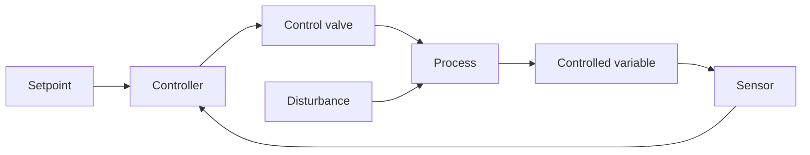

# 第3章：プロセス制御の基礎

本章では、化学プラントになぜ自動制御が必要なのか、フィードバックループはどのように働くのか、PID制御器の P・I・D の各項は何をしているのか、そしてなぜプロセスダイナミクスが制御を見た目以上に難しくするのかを説明します。

**プラントを望みの状態に保つ**

## 学習目標

本章を修了すると、以下ができるようになります:

  * ✅ プラントがなぜ定常状態にとどまらないかを説明し、制御目的を安全から利益まで順位づけできる
  * ✅ センサーから制御器を経て調節弁に至るフィードバックループをたどれる
  * ✅ P・I・D がそれぞれ何に寄与するか、そしてなぜ産業用ループの多くが PI として運用されるかを説明できる
  * ✅ 時定数とむだ時間が、ループをどこまで強くチューニング（整定）できるかをどのように制限するかを説明できる
  * ✅ カスケード制御・フィードフォワード制御・比率制御を見分け、モデル予測制御（MPC）がそれらの上位のどこに位置するかを理解できる

**読了時間**: 20-25分 **コード例**: 1 **演習**: 3

* * *

## 3.1 なぜ制御が必要か

第1章の収支は定常状態 — 時間とともに何も変化しない状態 — を前提としていました。それは便宜的な仮構です。実際のプラントは絶えず外乱を受けています。**原料組成は変動し**、**外気条件は変わり**、**触媒は失活し**、熱交換器は汚れ、**需要は週ごとに変化します**。本質的に安定なプロセスであっても、それらの外乱が置いていった先に落ち着くだけで、そこは一般に設計点ではありません。**プロセス制御**は、プラントが今どうなっているかを測定し、それを継続的に元へ引き戻します。その目的は、慣例として次の優先順位（上ほど高い）で並びます — 安全と必須の運転制約が経済的な最適化に優先しますが、複数が同時に効くこともあります:

| 目的 | 例 |
|---|---|
| **安全** | 暴走温度より下に保つ |
| **環境規制の順守** | 排出許容値の範囲内に収める |
| **設備の保護** | キャビテーション（ポンプ内で蒸気泡が崩壊する現象）、圧縮機サージ（圧縮機の流量と圧力が不安定に振動する現象。流れの逆流を伴うこともある）、熱衝撃を避ける |
| **製品品質** | 純度を規格内に保つ |
| **利益** | 制約ぎりぎりの近くで運転する |

目的同士が衝突するとき、適切に設計された制御・保護システムは安全を手放す前に利益を手放します。それは設計上の要求事項であり、アーキテクチャ、制約、インターロック、保護機能によって満たされるものであって、どんな制御システムにも自動的に備わる性質ではありません。

### 動機づけとなる例：発熱反応器

第2章では Arrhenius 式から得られる経験則 — 室温付近では 10 °C の上昇でおおよそ**速度定数が2倍になる**（そこで表にした活性化エネルギーでは2〜4倍） — を示しました。冷却された反応器に発熱反応を入れてみましょう。温度上昇は反応を加速し、反応はより速く熱を放出し、それが温度をさらに押し上げます。一方、ジャケット冷却はおおむね温度差に比例してしか増えません。したがって、ある運転点の近傍では、両者のうちどちらが温度に対してより速く増加するかが問題になります。単一状態に簡略化した熱収支では、熱発生が熱除去よりも温度に対して速く増加すれば、その運転点は局所的に不安定になります。温度は落ち着く代わりにそこから離れていき、それが**熱暴走**へ至る道筋です。ある運転点が安全か危険かを判断するには、温度だけでなく濃度、ジャケット、流量を含む反応器の完全なダイナミクスを確認しなければなりません。それが起こりうるかどうかは化学だけで決まるものではなく、設計と選ばれた運転点に依存します。まさにそれこそが、発熱反応器の設計（第4章）と制御（本章）を難しいものにしている理由です。

## 3.2 フィードバックループ

**センサー**が制御変数を測定します。**制御器**がそれを**設定値**と比較し、**偏差**を計算します。**最終制御要素** — 多くの場合は駆動部を備えた**調節弁**ですが、可変速ドライブ、電気ヒーター、ダンパーも広く使われます — が、冷却水流量や蒸気流量といった操作変数を変化させます。プロセスがそれに応答し、そしてこのサイクルが繰り返されます。



外乱は制御器を通ってではなく、プロセスに直接入ります。このためフィードバックには2つの仕事があります: **外乱抑制**（設定値は固定で、ループが変動を打ち消す — ほとんどのループがほとんどの時間やっていること）と、**設定値追従**（生産量や銘柄の切り替え時に目標値そのものが動く）です。フィードバックには1つの決定的な限界があります: **測定されていない外乱は、それが測定値に現れるまで修正を始められない**、ということです。一般には、変動が制御変数を動かしてしまってから反応するのであって、先回りして防ぐわけではありません — この隙間を突くのがフィードフォワード（3.5節）です。

### 80/20 の現実

大規模プラントでは数千のループが動いていることもありますが、その圧倒的多数は単純な**1入力1出力（SISO）フィードバックループ** — 1つの制御出力、1つの設定値、1つの操作入力 — です。多変数の制御方式は学会論文になりますが、プラントを動かしているのはありふれた流量・レベル・圧力・温度のループであり、その多くで最終制御要素は調節弁です。バルブはまた**フェイルセーフ**の思想も担っています — ただしフェイル時の動作はサービスごとの設計上の選択です。バルブはフェイルオープン、フェイルクローズ、フェイルインプレース（その位置に留まる）のいずれにも仕様化でき、どれが安全かは駆動方式と、そのバルブを失ったときにプロセスに何が起こるかによって決まります。

## 3.3 PID 制御

産業界の主力は **PID 制御器**です。プラントのループの大多数が PID 型であり、その多くは微分動作を切った **PI** として運用されています。PID は偏差 *e = 設定値 − 測定値* から、3つの項 — **現在の偏差、蓄積された偏差、偏差の傾向**に反応する項 — を用いて出力を計算します:

| 項 | 読み取るもの | 効果 |
|---|---|---|
| **P**（比例） | *今*の偏差 | 偏差が大きいほど、修正も大きい |
| **I**（積分） | 蓄積された*過去*の偏差 | 偏差が残っている限り、その寄与を変え続ける |
| **D**（微分） | *傾向* | 現在の変化率に反応する |

標準形（ISA 形）では:

$$ u(t) = K_c \left[ e(t) + \frac{1}{\tau_I} \int e\,dt + \tau_D \frac{de}{dt} \right] $$

ここで **Kc** は制御器ゲイン、**τI** は積分（リセット）時間、**τD** は微分時間です。∫ e dt は過去の偏差の累計、de/dt は偏差が今どれだけ速く変化しているか、と読んでください。どちらも手計算する必要はありません。制御器がやってくれます。

自己平衡性のあるプロセスでは、**P 単独ではふつうオフセット（定常偏差）が残ります**。比例制御器は、固定されたバイアスから偏差に比例した分だけしか出力を動かさないので、目標値で必要となる出力がそのバイアスと異なる限り、定常的なずれが残るのです。**I はそれを取り除きます**。偏差が残っている限り積分は蓄積を続け、その値を新しい定常出力として保持するからです。積分動作がほとんどの産業用ループで、とりわけ定常偏差が許されないところで使われるのはこのためです。閉ループが安定で、目標値が到達可能で、アクチュエータにそこまで動かす余力があれば、積分は一定のオフセットをゼロへ追い込みます。**D はしばしば切られます**。ノイズを含む測定値を微分するとバルブを叩くことになるためで、D が価値を発揮するのは主に応答の遅い温度ループです。

以下のシミュレーションは、1次プロセス（時定数5分）に PI 制御器を付け、*t* = 0 で設定値をステップ変化させたものです:

```python
# PI control of a first-order process, integrated with explicit Euler
tau, K = 5.0, 1.0        # process: time constant 5 min, steady-state gain 1
Kc, tauI = 2.0, 5.0      # PI tuning (lambda/IMC rule, explained in Section 3.4; lambda = 2.5 min)
dt, t_end = 0.01, 30.0   # Euler step must be much smaller than tau
setpoint = 1.0           # unit step in setpoint applied at t = 0

y, integral = 0.0, 0.0   # process output, and running integral of the error
for step in range(int(t_end / dt)):
    t = step * dt
    e = setpoint - y                    # where I want it minus where it is
    integral += e * dt                  # accumulated past error
    u = Kc * (e + integral / tauI)      # PI control action (valve signal)
    dydt = (-y + K * u) / tau           # first-order process dynamics
    y += dydt * dt                      # explicit Euler step
    if step % 500 == 0:                 # report every 5 minutes
        print(f"t = {t:4.1f} min   y = {y:5.3f}   u = {u:5.3f}")

# t =  0.0 min   y = 0.004   u = 2.004
# t =  5.0 min   y = 0.866   u = 1.134
# t = 10.0 min   y = 0.982   u = 1.018
# t = 15.0 min   y = 0.997   u = 1.002
# t = 20.0 min   y = 1.000   u = 1.000
# t = 25.0 min   y = 1.000   u = 1.000
```

出力は定常偏差なく設定値へ収束し、**表示された小数3桁の範囲で**設定値に到達します — 積分動作が仕事をしているのです。出力の読み方には注意してください。各行は、そのステップの*開始*時刻と、そのステップの更新を済ませた*後*の出力を並べているので、最初の行はプロセスの初期状態ではありません。`integral / tauI` の項を削除して P のみにすると、出力は 0.667 で止まります。33% のオフセットです。

## 3.4 プロセスダイナミクス：制御が難しい理由

プロセスが瞬時に応答するなら、制御の難しさの多くは消えるでしょう — もっとも、不確かさ、非線形性、干渉、ノイズ、制約は残ります。動特性上の難しさをもたらす代表的な要因が、次の2つです。

**慣性（時定数 τ）**。液で満たされた撹拌槽には熱容量があります。蒸気弁を開けても、温度は徐々にしか上がりません。1次プロセスは、1時定数で変化のおよそ63%を消化し、4〜5時定数でほぼ完了します。

**むだ時間（θ）**。バルブが動いた後、しばらくの間*測定される出力には何も現れません*。流体は配管を進まなければならず、組成の変化は分析計まで届かなければなりません。この**輸送遅れ**の間、制御器は目隠し状態で、古い情報に基づいて押し続けています。強く押しすぎると、ようやく届く修正が過大になり、ループは振動します。

この2つを組み合わせると、**むだ時間を伴う1次系（FOPDT）**モデル — 自己平衡性のある多くのプロセス応答に対してよく使われる低次近似 — が得られます。ステップ試験から得られる3つの数値、すなわちゲイン *K*、時定数 *τ*、むだ時間 *θ* です。重要な経験則は**むだ時間比 θ/τ** です:

| θ/τ | 難易度 | 典型例 |
|---|---|---|
| < 0.1 | より速いチューニングが許されることが多い | 多くの流量ループ |
| 0.1 – 1 | 中程度 — 通常のチューニング | ほとんどの温度ループ |
| > 1 | 難しい — 穏やかにするしかない | 分析計による組成ループ |

実際にどこまで速くチューニングできるかは、測定ノイズ、アクチュエータの限界、モデル化していない動特性、ループ間の干渉にも左右されます。また積分特性のプロセス — 多くのレベルループがそうです — には有限の自己平衡時定数が存在しないので、この比をそのまま当てはめることはできません。

**むだ時間比が大きいほど、制御器は緩慢でなければなりません** — まだ手元にない情報を修正することはできないのです。

**Ziegler と Nichols は 1942 年に古典的なチューニング経験則を発表しました**。簡単なプラント試験から *Kc*、*τI*、*τD* を導くもので、今なお標準的な出発点です。彼らの設定値は強めで振動しやすいため、現代の実務ではより穏やかなモデルベースの規則 — **ラムダチューニング**あるいは **IMC（内部モデル制御）チューニング** — が好まれます。これは技術者が閉ループ応答の速さを直接指定するもので、上の `Kc = 2`、`τI = 5` がその例です。

## 3.5 単一ループを超えて

単一ループがかかえる代表的な限界のいくつかには、3つの単純な構造が対応します。

**カスケード制御**は、あるループを別のループの内側に入れ子にします。ジャケット付き反応器では、反応器温度の*マスター*制御器はバルブを動かしません。ジャケット温度の**スレーブ制御器の設定値**を与え、そちらがバルブを動かします。速い内側ループが、冷却水の外乱が反応器温度を大きく動かす前にその影響を減らします。これは内側ループが外側ループよりずっと速いときに機能します。

**フィードフォワード制御**は*外乱そのもの*を測定し、その影響が現れる前に動きます。加熱器への供給流体が冷たくなれば、フィードフォワードは出口温度が下がるのを待たずに、冷たい供給が検出された瞬間に蒸気流量を増やします。外乱の測定とモデルが必要で、実際にはそのどちらも不完全なため、通常はフィードバックと組み合わせて使われます。

**比率制御**は、ある流量を別の流量と一定比率に保ちます。古典的な例は加熱炉の**燃料／空気比**で、効率的な燃焼を支えるために空気が燃料に追従します。加熱炉を安全に運転するには比率だけでは足りません。適切な空気の余裕、クロスリミッティング、シーケンス制御、バーナーの安全装置が必要です。

これらのループを収容しているのが、プラント全体のプラットフォームです。**分散制御システム（DCS）**が数千の調節ループを実行し、オペレータ画面を駆動し、**アラームシステム**を動かします。さらにその上には**高度プロセス制御（APC）** — 通常は**モデル予測制御（MPC）** — があり、動的モデルを用いて多数の相互作用する変数を制約下で同時に最適化し、下位の PID ループへ設定値を出します。プラントが意図的に制約ぎりぎりで運転できるのはこの層があるからです。この層が存在するのはループ同士が相互作用するためです。第1章の**リサイクル流**はプラント後段の外乱を再び前段へと運びます。そのため、あるユニットで修正された変動が、後になってリサイクルを通って戻ってくることがあります — プラント全体の制御が個々のループの総和以上である理由の1つです。より深く学ぶには、**Introduction to Process Monitoring and Control** および **Process Informatics Introduction** シリーズを参照してください。

## 3.6 本章のまとめ

- プラントは放っておいて定常を保つことはなく、熱発生が熱除去よりも温度に対して速く増加すれば、その運転点は安定化されず発熱反応器は暴走しうる。制御目的は慣例として 安全 → 環境 → 設備 → 品質 → 利益 の順に並ぶ
- フィードバックループ — センサー → 制御器 → バルブ → プロセス — は外乱を抑制し、設定値に追従する。ほとんどのループは SISO であり、末端は調節弁である
- PID は現在の偏差（P）・蓄積された偏差（I）・偏差の傾向（D）を読む。自己平衡性のあるプロセスでは P 単独でふつうオフセットが残り、I がそれを取り除き、D はノイズを増幅する — だからほとんどのループは PI として動く
- ループが達成しうる速さを主に制限するのは、しばしばむだ時間であり、他のプロセス・アクチュエータの動特性もそこに加わる。FOPDT は自己平衡性プロセスのよく使われるモデル、θ/τ は有用なチューニングの指標であり、Ziegler–Nichols（1942 年）が古典的なチューニング経験則である
- カスケード制御・フィードフォワード制御・比率制御が単一ループを拡張する。DCS がそれらのループを収容し、MPC がそこへ設定値を供給する

**次章**: プロセス設計 — そしてそのつながりは双方向です。なぜなら**よいプロセス設計は制御しやすさを考慮に入れ、不要な制御の難しさを避ける**からです。

## 演習問題

1. **概念**: ある調節弁が発熱反応器のジャケットへ冷却水を送っている。計装用空気が失われたとき、この弁はフェイルオープンとフェイルクローズのどちらであるべきか。またそれは 3.1 節のどの目的をトレードオフしているか。
   *ヒント*: 冷却が止まったら何が起こるかを問い、それから優先順位を当てはめてください。
   *解答*: ここで想定しているバックアップのない空気駆動の弁であれば、**フェイルオープン**です。空気を失うと弁を通常どおりに位置決めできなくなり、発熱反応器では冷却の喪失が危険な温度上昇や暴走を招きかねません。これは**製品品質**と**利益**を犠牲にして**安全**と**設備の保護**に資します — 過冷却は生産性を落としたりバッチを台無しにしたりしますが、それが正しいトレードオフです。

2. **定量**: コード例（*K* = 1、設定値ステップ 1.0）について、P 単独の制御器はバイアスなしで *y* = *Kc*・*K* / (1 + *Kc*・*K*) に落ち着く。*Kc* = 2 と *Kc* = 9 のときのオフセットを計算せよ。ゲインを上げることが実務上の解決策にならないのはなぜか。
   *ヒント*: オフセットは設定値と整定値との差です。
   *解答*: *Kc* = 2 では *y* = 0.667、オフセットは **0.333**。*Kc* = 9 では *y* = 0.900、オフセットは **0.100**。オフセットはゲインとともに小さくなりますが決して消えず、むだ時間のある実プロセスでは高ゲインのループは振動的になり、やがて不安定になります。適切にチューニングされた**積分動作**なら、閉ループが安定で目標値が到達可能である限り、大きな比例ゲインを使わずに一定の定常オフセットを取り除けます。

3. **議論**: ループ A は *τ* = 20 分、*θ* = 1 分。ループ B は *τ* = 4 分、*θ* = 4 分である。θ/τ を計算せよ — どちらが強くチューニングするのが難しいか。主な変動が冷却水温度の変動である反応器に対しては、カスケードとフィードフォワードのどちらを追加するか。
   *ヒント*: θ/τ の表を使い、それから速い内側ループがすでにその外乱を見ているかどうかを問うてください。
   *解答*: ループ A は θ/τ = 0.05（易しい）。ループ B は θ/τ = 1.0 — 時定数まるまる1つ分のあいだ目隠し状態なので、緩めにチューニングせざるを得ず、**はるかに難しい**です。冷却水の変動に対しては、ジャケットの測定が十分に早く応答し、内側ループが反応器ループよりずっと速く動ければ、**カスケード**が自然な選択です。そのときジャケット温度のスレーブがその変動をとらえ、反応器温度が大きくずれる前に減衰させます。フィードフォワードは有効な補完策ですが、外乱のモデルを必要とします。
