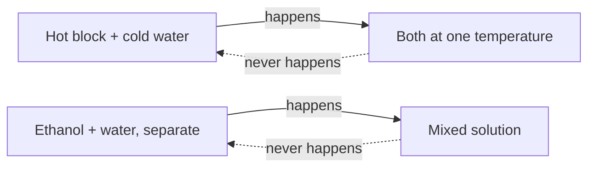
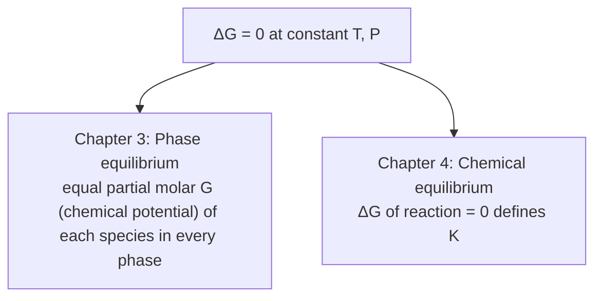

## ビデオ講義

<div class="video-container">
  <iframe
    width="560"
    height="315"
    src="https://www.youtube.com/embed/tGOpNey5U9E?start=739"
    title="化学工学熱力学 第2章: エントロピーと熱力学第二法則"
    allow="accelerometer; autoplay; clipboard-write; encrypted-media; gyroscope; picture-in-picture"
    allowfullscreen>
  </iframe>
</div>

> このビデオは以下のテキストと同じ内容をカバーしています。お好みの学習形式をお選びください。

---

# 第2章：エントロピーと熱力学第二法則

第1章は私たちに帳簿を与えました。エネルギーは保存され、私たちはそれを数えられます。本章が与えるのは**方位磁針**です。熱力学第二法則（second law）は、プロセスがひとりでにどちらへ進むのか、熱からどれだけの仕事を取り出せる可能性があるのか、そしてなぜ安定な混合物の分離にはつねに自由エネルギーの投入という代価がかかるのかを教えます。

**方向、限界、そして分離の代償**

## 学習目標

本章を修了すると、以下ができるようになります:

  * ✅ エネルギー保存だけではプロセスの方向を予測できない理由を説明できる
  * ✅ エントロピー（entropy）を状態量として定義し、熱力学第二法則を $\Delta S_{universe} \geq 0$ として述べられる
  * ✅ カルノー効率（Carnot efficiency）を計算し、なぜ仕事が熱力学的に熱より価値が高いのかを説明できる
  * ✅ 理想的な 2 成分混合物について、分離の最小仕事（minimum work of separation）を計算できる
  * ✅ その最小値を実際の蒸留のエネルギー使用量と比較し、その差を解釈できる
  * ✅ 温度・圧力を指定した閉じた系について、ギブズエネルギー（Gibbs energy）を自発性と平衡の判定基準として使える

**読了時間**: 20-25分 **コード例**: 1 **演習**: 3

* * *

## 2.1 第一法則が答えられない問い

熱い鋼のブロックを冷たい水に落としてみましょう。熱はブロックから水へ流れ、両者が同じ温度になるまで続き、エネルギーは保存されます。では逆を想像してください。水がひとりでに冷え、ブロックが熱くなっていく。エネルギーはまったく同じだけ正確に保存されます。第一法則の中に、それを禁じるものは何もありません — それでも、それは決して起こりません。

同じ非対称性はプラントのいたるところにあります。エタノールを水にかき混ぜれば溶液になりますが、その溶液がひとりでに 2 層に分かれ直すことはありません。ガスはボンベから部屋へ漏れ出しますが、押し合いながら中へ戻ることはありません。



これらのプロセスはどれも**両方**の向きでエネルギーを保存しますが、実際に観測されるのは片方の向きだけです。第一法則は帳簿係です — 量を監査しますが、方向については何も言いません。選んでいるのは、別の何かです。

その何かが**熱力学第二法則**であり、それが追いかけている量が**エントロピー**です。

## 2.2 エントロピー

**エントロピー**（記号 $S$、単位 J/K）は状態量です。内部エネルギーやエンタルピーと同じく、系がどうやってそこに至ったかではなく、現在の状態だけで決まります。絶対温度 $T$ 一定のもとでの可逆（reversible）な熱の移動については:

$$ \Delta S = \frac{Q_{rev}}{T} $$

物理的な意味を担っているのは分母の温度です。*同じ* 1 ジュールの熱でも、冷たい物体に入るときのほうが、熱い物体に入るときより*大きな*エントロピー変化を生みます。熱いブロックが水を温めて逆にはならないのはそのためです。高い $T$ でブロックが失うエントロピーは、低い $T$ で水が得るエントロピーより小さいので、この移動は全体を増やすのです。

統計的には、エントロピーは可能性の数を数えています。到達できる分子配置（**微視的状態**）が等しく確からしいとき、莫大な数の配置で実現できるマクロな状態は、わずかな数の配置でしか実現できない状態より圧倒的に確からしいのです。ガスが容器の左半分に押し込められている配置より、容器全体に広がっている配置のほうが天文学的に多いので、ガスは容器を満たします — 何かの力が押しているからではなく、ほとんどすべての配置がそう見えるからです。微視的状態が等確率のとき、エントロピーは $S = k_B \ln \Omega$、すなわちその数の対数にボルツマン定数を掛けたものです。

そして熱力学第二法則はこう述べます:

$$ \Delta S_{universe} = \Delta S_{system} + \Delta S_{surroundings} \geq 0 $$

系のエントロピーはたしかに下がりえます — 冷蔵庫は毎日水を凍らせています — が、それは外界が系の失う分と少なくとも同じだけ得る場合に限られ、全体として不可逆なプロセスでは厳密により多く得ます。等号が成り立つのは**可逆**プロセスの場合だけで、これは十分にゆっくりと、摩擦も、抑制されない膨張も、有限の温度差も、有限の化学ポテンシャル差を越える*制御されない*混合もない状態で進められ、そのまま正確に逆にたどれるという理想化です。（混合そのものが本質的に不可逆なわけではありません。選択透過膜と無限小の駆動力を使えば、混合もまた可逆として理想化できます。2.4 節が分離の代価を値付けするのに使うのは、まさにこの極限です。）現実のプロセスでこれに該当するものはありません。**あらゆる現実のプロセスはエントロピーを生成し**、温度 $T_0$ の環境を基準にすれば、生成されたエントロピーは破壊された仕事のポテンシャル $X_{destroyed} = T_0 S_{gen}$ を測っています。それは、不可逆性（irreversibility）がプラントから奪う有効仕事の — そしてエネルギー価格を掛ければお金の — 熱力学的な勘定なのです。

## 2.3 カルノー限界

熱力学第二法則のもっとも影響の大きい帰結は、熱を仕事に変えることに関するものです。熱機関は $T_h$ の高温源から熱を受け取り、仕事を生み出し、そして $T_c$ の低温源へいくらかの熱を捨てなければなりません。この排熱は、設計で取り除くべき工学上の失敗ではありません — 全体のエントロピーが減らないようにしているのがそれなのです。$\Delta S_{universe} \geq 0$ を要求すると、効率に厳しい上限が課されます:

$$ \eta_{max} = 1 - \frac{T_c}{T_h} $$

ここで両方の温度は**絶対温度**、単位はケルビンです。ボイラーが 500 °C、冷却水が 25 °C の蒸気動力プラントを考えます:

$$ T_h = 773\ \text{K},\quad T_c = 298\ \text{K} \quad\Rightarrow\quad \eta_{max} = 1 - \frac{298}{773} = 0.614 \approx 61.4\% $$

この 2 つの温度に対しては、どんなボイラー設計も、作動流体も、タービンの冶金技術も、61.4% を超えられません。実際の蒸気プラントはそれをかなり下回り — 典型的には 35–45% の範囲に収まります — 現実の膨張、有限の温度差を介した伝熱、そして摩擦がいずれもエントロピーを生成するからです。

ここから得られる工学的な教訓は、発電の枠を超えて深いものです。熱も仕事もどちらもジュールで測られますが、**両者は交換可能ではありません**。仕事は完全に、しかも自由に熱へ変換されます。熱が仕事へ変換されるのは部分的にすぎず、その割合は熱源が冷たくなるほど小さくなります:

| | 熱力学的な価値 | 実務上の帰結 |
|---|---|---|
| **仕事**（電力、軸動力、圧縮） | 高い — 完全に変換可能 | 通常もっとも高価なエネルギー投入。仕事だけでなく総コストを最小化する |
| **高温の熱**（直火加熱炉、高圧蒸気） | 中程度 | より低温の用途へ順に落として使う価値がある |
| **低温の熱**（低圧蒸気、温水） | 低い | 常温に近づくほど仕事のポテンシャルは小さい。加熱にはなお有用 |

ここから、プラントの現実が 2 つ直接に導かれます。第一に、**熱統合（heat integration）が重要**だということです — ピンチ解析（pinch analysis）（入門シリーズ 第4章）は、選んだ最小接近温度差のもとで、各流れの熱収支からプロセスの熱回収の目標値を定めて設計する手法です。その結果として、熱の一つひとつの塊はまだ役に立つ最高の温度で使われ、その仕事のポテンシャルを一段で破壊してしまうことが避けられます。第二に、**ガスの処理量や圧力比が大きいところでは、圧縮が運転コストの大きな部分を占めうる**ということです。圧縮はエネルギーの一般にもっとも高価な形である仕事を消費します。廃熱が自動的にその代わりになるわけではありませんが、代わりになりえないわけでもありません — 熱で動力サイクルを回して圧縮機を駆動することもできますし、吸収式・吸着式・エゼクタ方式の構成が機械的な圧縮の一部を置き換えることもあります。温度・効率・コストの条件次第です。

## 2.4 なぜ分離にはエネルギーがかかるのか

同じ論理を、プラントのもう一つの大きなエネルギー消費者に当てはめましょう。理想混合が自発的なのは、それがエントロピーを増やすからです — 混合物は、分かれた成分よりもはるかに多くの微視的状態を使えます。（一般には、$T$ と $P$ が指定されたもとでの自発性を決めるのは $\Delta G_{mix}$ であり、だからこそ相分離する混合物もあります。）理想混合物を同じ $T$、$P$ で純成分へ戻す分離は、**この正の混合エントロピーを逆転させる**ことであり、熱力学第二法則により、そのエントロピーはどこかへ排出されなければなりません。つまり分離には、十分な自由エネルギーの供給源が必要です。それは軸仕事でもよいのですが、蒸留のように温度差を介して供給される熱でも、あるいは利用できる別のポテンシャルでも構いません。

モル分率 $x$ の**理想的な 2 成分混合物**について、1 モルあたりの混合エントロピー（entropy of mixing）は $\Delta S_{mix} = -R\,[x \ln x + (1-x)\ln(1-x)]$ であり、温度 $T$ でそれを元に戻すための最小可逆仕事は、このエントロピーに $T$ を掛けたものです（ここでは投入仕事の大きさとして示しています。第1章の符号の約束に従えば負の符号が付きます）:

$$ w_{min} = -RT\,\big[\,x \ln x + (1-x)\ln(1-x)\,\big] $$

298 K の等モル混合物について、$R = 8.314$ J/(mol·K) を用いると:

$$ w_{min} = -(8.314)(298)\,(0.5\ln 0.5 + 0.5\ln 0.5) = (8.314)(298)(0.693) = 1717\ \text{J/mol} \approx 1.72\ \text{kJ/mol} $$

```python
import math

R = 8.314      # J/(mol K)
T = 298.0      # K

def w_min(x, T=T):
    """Minimum reversible work to separate 1 mol of an ideal binary
    mixture of composition x into two pure streams, in J/mol."""
    if x <= 0.0 or x >= 1.0:
        return 0.0
    return -R * T * (x * math.log(x) + (1 - x) * math.log(1 - x))

print(f"{'x_A':>6} {'w_min (J/mol)':>15} {'w_min (kJ/mol)':>16}")
for x in [0.01, 0.05, 0.10, 0.25, 0.50, 0.75, 0.90, 0.99]:
    w = w_min(x)
    print(f"{x:6.2f} {w:15.1f} {w/1000:16.3f}")

w50 = w_min(0.50)
print(f"\nEquimolar mixture at {T:.0f} K: w_min = {w50:.0f} J/mol = {w50/1000:.2f} kJ/mol")

#    x_A   w_min (J/mol)   w_min (kJ/mol)
#   0.01           138.7            0.139
#   0.05           491.8            0.492
#   0.10           805.4            0.805
#   0.25          1393.2            1.393
#   0.50          1717.3            1.717
#   0.75          1393.2            1.393
#   0.90           805.4            0.805
#   0.99           138.7            0.139
#
# Equimolar mixture at 298 K: w_min = 1717 J/mol = 1.72 kJ/mol
```

この曲線は対称で、$x = 0.5$ で頂点を取ります。ある温度において、等モル（50/50）の理想混合物は*混合物 1 モルあたり*の可逆分離仕事が最大になり、希薄な混合物は混合物 1 モルあたりではわずかなコストしかかかりません — もっとも、回収される微量成分 1 モルあたりで見れば非常に高くつきます。実際の分離の難しさはこの数値だけでは決まりません。比揮発度、純度と回収率の目標、相挙動、そして機器のすべてが関わってきます。

さて、心に留めておいてほしい比較です。あの等モルの分離の熱力学的な代価は、混合物 1 モルあたり約 **1.7 kJ** でした。実際の蒸留はこの下限よりはるかに効率が悪く、本章では**熱力学的最小値の 10 倍から 100 倍**という範囲を、あくまで桁を示す例示として使います。この値は追跡可能な出典なしにここで引かれたものであり、エネルギー基準かエクセルギー基準か、対象とする系、製品仕様のいずれも付いていません。さらに、この比はリボイラーの*熱*負荷を最小可逆*仕事*と比べたもの — 熱力学的に異なる資源どうしの比較 — なので、粗いエネルギー比であって不可逆性の尺度ではありません。ある分離について弁護できる数値は、プロセス、純度、圧力、熱力学モデル、ユーティリティ温度を指定してはじめて得られます。

実際の分離エネルギーと最小値との差が大きいからこそ、分離はこれほど活発な研究対象なのです。主要な代替手段はいずれも、適した分離に対してはエネルギーまたはエクセルギーの消費を減らせます — コンデンサーの熱負荷をリボイラーで再利用する**ヒートポンプ**と蒸気再圧縮、機器を統合し熱的な結合によって中間成分の再混合を減らす**隔壁塔**（1 つの塔で 2 つの分離を行う）、供給液全体を蒸発させずに済ませる**膜**や吸着（もっとも、相変化や熱による再生を依然として必要とするものもあります）。しかし、どれもがすべての場合を改善するわけではありません。利点は供給液、製品の目標、ユーティリティ条件によって変わります。

## 2.5 ギブズエネルギー：技術者の方位磁針

$\Delta S_{universe}$ を追いかけるということは外界まで勘定に入れるということで、これは扱いにくいものです。幸いにも、化学技術者が行う平衡計算は、たいてい**温度と圧力を指定した**形で立てられており — プロセスそのものは日常的に両方を変えてしまうにせよ — その条件のもとでは熱力学第二法則は系だけの物理量へと包み直されます。それが**ギブズエネルギー**です:

$$ G = H - TS $$

その威力は、そこから得られる判定基準にあります。$T$ と $P$ を一定に保った閉じた系で、仕事が圧力–体積仕事のみであり、関係する物質量が保存されるとき:

| 条件 | 意味 |
|---|---|
| $\Delta G < 0$ | 書かれた向きにプロセスは**自発的**である |
| $\Delta G = 0$ | その変化に対する駆動力がない。安定な**平衡**とは、許されるあらゆる変化に対して $G$ を最小にする状態である |
| $\Delta G > 0$ | プロセスは書かれた向きには熱力学的に**不利**であり、逆向きの変化が $G$ を下げる |

この定義は競争として読んでください。$H$ の項はエネルギーを下げること — 結合をつくる、凝縮する、そして身近な分子性固体では秩序化する — に報酬を与えます。$-TS$ の項はエントロピーを上げること — 蒸発する、混ざる、そして独立に動ける化学種を増やす解離 — に報酬を与えます。温度が審判で、それを上げるとエントロピー側が強くなります。液体が熱いと沸騰し冷たいと凍る理由も、温度を上げるとエントロピーの増える反応が有利になりうる理由も、これです。（測定できる速度で進ませるために加熱が必要なだけの反応は、速度論の話であって、ここでの話ではありません。）

このシリーズでこれから続くものはすべて、この 1 つの判定基準を 2 度当てはめたものです:



**第3章**では、$G$ を気液の境界にわたって最小化することで、各成分が両方の相で同じ化学ポテンシャルを持つという条件が得られます — これがあらゆる気液平衡（VLE）計算と塔設計の基礎です。**第4章**では、反応のギブズエネルギー変化をゼロと置くことで平衡定数 $K$ が得られます。熱化学データとファントホッフの式を組み合わせれば $K(T)$ も得られ、物質収支と運転上の制約と合わせることで、どんな触媒も超えられない平衡転化率が定まります。

## 2.6 本章のまとめ

- 第一法則はエネルギーの量を監査するが両方の向きを許す。**方向を与えるのは熱力学第二法則**である
- **エントロピー** $S$ は状態量である。等温可逆の熱移動については $\Delta S = Q_{rev}/T$ であり、統計的にはその状態が取りうる微視的状態の数を数えている
- $\Delta S_{universe} \geq 0$ であり、等号は理想化された可逆プロセスの場合だけ成り立つ — **あらゆる現実のプロセスはエントロピーを生成し**、仕事のポテンシャル $X_{destroyed} = T_0 S_{gen}$ を破壊する
- **カルノー**: 絶対温度を用いて $\eta_{max} = 1 - T_c/T_h$。500 °C/25 °C では 61.4% となるが、実際の蒸気プラントはおよそ 35–45% にとどまる
- 仕事は熱力学的に貴重で、熱は比較的安い — だからこそ熱統合が行われ、だからこそガスを扱うプロセスでは圧縮が運転コストの大きな部分を占める
- 理想混合はエントロピーを上げるので、**分離は何らかの自由エネルギー源 — 仕事、あるいは温度差を介した熱 — から代金を払わなければならない**: $w_{min} = -RT[x\ln x + (1-x)\ln(1-x)]$ であり、298 K の等モル混合物では **1.72 kJ/mol** となる
- 実際の蒸留はその最小値よりはるかに多く使う。ここで用いた **10–100 倍**という数字は出典のない例示的な範囲だが、それが指し示す余地こそが、ヒートポンプ、隔壁塔、膜の動機になっている
- **ギブズエネルギー** $G = H - TS$ は、温度・圧力を一定に保った閉じた系について、熱力学第二法則を系だけで判定できる形に変える: 変化は $\Delta G < 0$ なら自発的であり、平衡とは $G$ が最小になっている状態で、そこでは許されるあらゆる変化が $\Delta G = 0$ または $> 0$ となる

**次章**: $G$ 最小の判定基準を共存する相に適用します。気液平衡、ラウールの法則、活量係数、そして共沸混合物 — 蒸留塔がそもそもその分離を行えるかどうかを決める熱力学です。

## 演習問題

1. **概念 — 方向と 2 つの法則**: あるベンダーが、60 °C の廃熱 100 kW を受け入れて 30 kW の軸仕事を出し、25 °C の冷却水へ 70 kW を捨てる装置を主張している。(a) この主張は第一法則に反するか。(b) 熱力学第二法則に反するか。(c) その熱流から物理的に可能な最大の仕事出力はいくらか。
   *ヒント*: まずエネルギー収支を確認し、その後に主張されている効率を絶対温度を用いたカルノー限界と比較せよ。
   *解答*: (a) **いいえ** — 30 + 70 = 100 kW なので、エネルギーは保存されています。(b) **はい。** 主張されている効率は 30/100 = 30% ですが、$T_h$ = 333 K、$T_c$ = 298 K から $\eta_{max}$ = 1 − 298/333 = 0.105、すなわち **10.5%** です。(c) 100 kW が 60 °C で等温的に供給されるとみなせば、せいぜい 0.105 × 100 kW ≈ **10.5 kW** であり、現実の装置ならそれよりかなり少なく、熱を放出しながら冷えていく流れならさらに少なくなります。カルノー係数が小さいということは、低温の廃熱の仕事ポテンシャルが限られているということであり、そのために動力回収は経済的に正当化しにくいことが多いのです。適切な温度・場所・時間に見合う熱需要があるなら、その流れはそのまま加熱に使うほうが通常は好ましいといえます。

2. **定量 — 地熱発電所のカルノー効率**: ある地熱資源が 150 °C で熱を供給し、発電所は 25 °C の環境へ排熱する。(a) 熱力学的な最大効率を計算せよ。(b) 発電所が実際に 12% を達成しているとすると、それは理想の何割にあたるか。(c) 地熱発電所の効率が低くてもなお経済的に成り立ちうる理由について述べよ。
   *ヒント*: まずケルビンに換算せよ: 150 °C = 423 K、25 °C = 298 K。その上で $\eta_{max}$ = 1 − $T_c/T_h$。
   *解答*: (a) $\eta_{max}$ = 1 − 298/423 = 0.2955 ≈ **29.6%**。(b) 12/29.6 = **0.41**、カルノー限界の約 41% であり、低温のバイナリーサイクル発電所としては普通の割合です。(c) 効率は熱のうちどれだけが仕事になるかを測るものですが、**燃料は購入しません**。この資源は地質学的な時間スケールで再生可能です。もっとも、採取が熱と流体の涵養を上回れば個々の貯留層は冷却し圧力を失いうるので、還元井と貯留層管理が重要になります。したがって経済性は燃料効率ではなく、設備 1 kW あたりの資本費と生涯の正味発電量 — 坑井の生産性、資源の減衰、設備利用率、ポンプ動力、資金調達 — によって支配されます。効率 1 ポイントごとが購入した燃料である直火ボイラーとは対照的です。

3. **定量 — 分離の最小仕事**: ある流れがエタノール 10 mol% の水溶液で、298 K で純成分に分離しなければならない。理想的な 2 成分混合物として扱い、(a) 混合物 1 モルあたりの $w_{min}$ を計算し、(b) それを回収されるエタノール 1 モルあたりで表し、(c) 2.4 節の例示的な 10–100 倍の範囲をこれに当てはめ、そのような見積もりが何を意味しうるか、また何を意味しえないかを述べよ。
   *ヒント*: $w_{min}$ = −RT[x ln x + (1−x) ln(1−x)]、x = 0.10、R = 8.314 J/(mol·K)、T = 298 K。(b) では、混合物 1 モルあたり 0.10 mol のエタノールで割れ。
   *解答*: (a) x ln x = 0.10 × ln 0.10 = −0.2303、(1−x)ln(1−x) = 0.90 × ln 0.90 = −0.0948 で、その和は −0.3251 なので、$w_{min}$ = 8.314 × 298 × 0.3251 = **805 J/mol ≈ 混合物 1 モルあたり 0.81 kJ**。(b) エタノール 1 モルあたりでは 805/0.10 = **エタノール 1 モルあたり 8.05 kJ** — 混合物 1 モルあたりの数字は小さく見えても、希薄であることは高くつきます。(c) 2.4 節の例示的な 10–100 倍の範囲がこの分離に当てはまる*とすれば*、**混合物 1 モルあたり約 8–81 kJ** となります — ただしこの範囲には出典がなく、しかも熱負荷を最小仕事と比べたものなので、これは桁を示す例示であって設計用の熱負荷ではありません。ここではさらに二重に条件付きです。エタノール–水は強く非理想的で、質量で約 95.6% エタノールのあたりに共沸混合物を作るため、通常の蒸留では設問が指定する純エタノールにはまったく到達できません — この限界は第3章で説明します。現実の熱負荷は、純度・回収率・圧力・ユーティリティ温度を明示した実行可能なプロセスから求めるほかありません。
