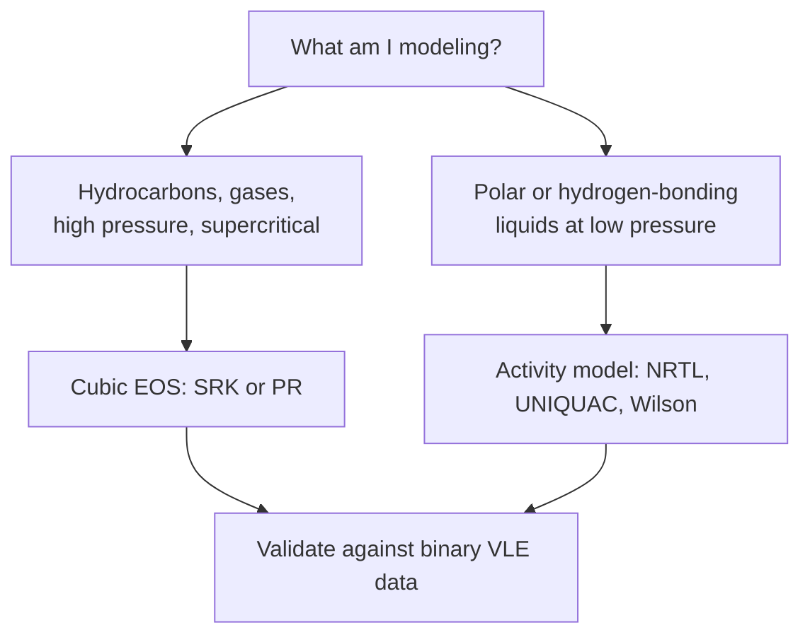

## ビデオ講義

<div class="video-container">
  <iframe
    width="560"
    height="315"
    src="https://www.youtube.com/embed/tGOpNey5U9E?start=2925"
    title="化学工学熱力学 第5章: 実在流体と状態方程式"
    allow="accelerometer; autoplay; clipboard-write; encrypted-media; gyroscope; picture-in-picture"
    allowfullscreen>
  </iframe>
</div>

> このビデオは以下のテキストと同じ内容をカバーしています。お好みの学習形式をお選びください。

---

# 第5章：実在流体と状態方程式

この最終章では、理想気体の法則を、実際のプロセスシミュレータが用いる状態方程式に置き換えます。そして、シミュレータの設定ダイアログの奥に埋もれた熱力学モデルが、その答えに価値があるかどうかを静かに決めてしまうのはなぜかを示します。

**理想気体からプロセスシミュレータへ**

## 学習目標

本章を修了すると、以下ができるようになります:

  * ✅ 理想気体の法則が十分な場面と破綻する場面を説明できる
  * ✅ 圧縮係数 Z を定義し、1 より大きい値と小さい値を解釈できる
  * ✅ ファンデルワールス式のパラメータ a と b が何を表すかを説明できる
  * ✅ 産業で用いられる3次型状態方程式を挙げ、それらが必要とする物性を述べられる
  * ✅ 対象とする系に対して、3次型状態方程式と活量係数モデルのどちらを選ぶか判断できる
  * ✅ 物理ベースのシミュレータ、デジタルツイン、ソフトセンサーが熱力学モデルに依存している理由を説明できる

**読了時間**: 20-25分 **コード例**: 1 **演習**: 3

* * *

## 5.1 理想気体が破綻するところ

ここまでのすべての章は、理想気体の法則に寄りかかってきました:

$$ PV = nRT $$

これは 2 つの仮定の上に成り立っています: 分子は体積を持たない、そして分子どうしは力を及ぼし合わない。分子が互いに遠く離れているとき — **低圧かつ高温** — には、どちらも優れた近似であり、入門的な扱いの大部分と、実際のプラント運転のかなりの部分をカバーします。

しかしこの 2 つの仮定は、エンジニアが最も気にする条件でこそ、そろって弱くなります。凝縮の近傍では引力的な相互作用が決定的になり、高圧では分子が十分密に詰まって、分子自身の体積が効いてきます。これは運転領域の中の風変わりな片隅などではありません。**気体が高密度であるか凝縮に近いところでの圧縮機の吸込・吐出**（希薄な用途は別の話です）であり、**アンモニア合成ループの 150〜300 bar**（第 4 章）であり、そして **天然ガス処理における液化と、高圧あるいは相平衡にかかわる大半の工程** です。そこで $PV = nRT$ を使うと、許容できるどんな公差からも大きく外れた誤差を生じうるのです。

そのずれを測る標準的な指標が **圧縮係数（compressibility factor）** です:

$$ Z = \frac{PV}{nRT} $$

$Z$ は実在のモル体積と理想のモル体積の比なので、$Z = 1$ はその状態でモル体積が理想気体の値に等しいことを意味するだけで — それ自体がエンタルピー・エントロピー・フガシティーまで理想的であることを保証するわけではありません — そこからのずれは、理想気体の法則が体積についてどれほど嘘をついているかを測ります。重要な領域は 2 つです:

- **$Z < 1$** — 引力が支配的。分子が互いに引き合うため、実在気体は理想気体より *コンパクト* になります。中程度の圧力でのずれを引力が支配する温度域にある多くの気体では、こちらが一般的なケースです。常温の水素とヘリウムはボイル温度より上にあるため、逆の振る舞いをします。
- **$Z > 1$** — 斥力が支配的。非常な高圧では分子自身の有限の大きさがそれ以上の圧縮に抵抗し、気体は理想気体より *コンパクトでなく* なります。

以下の表は、5.3 節のコードで計算した 300 K のメタンの値です:

| 圧力 | Z | 解釈 |
|---|---|---|
| 1 bar | 0.998 | 実質的に理想気体 |
| 50 bar | 0.924 | 引力が効く。無視すれば 8% の誤差 |
| 150 bar | 0.851 | 表に挙げたなかで $Z$ が最小 |
| 300 bar | 0.951 | 斥力が押し返す |
| 400 bar | 1.070 | 斥力が支配的、Z > 1 |

50 bar における 8% の体積誤差は、体積流量、容器サイジング、在庫量、そして圧縮仕事にとって重要です — ただし、それらのそれぞれへ 1 対 1 で持ち越されるわけではありません。在庫量はモル体積に反比例し、容器サイジングには他の基準も絡み、圧縮仕事は単一状態の体積ではなく圧縮経路全体とカロリー的な物性に依存します。それぞれを、それぞれの収支で評価しなければなりません。もはや問いは、非理想性を補正するかどうかではなく、どう補正するかです。

## 5.2 ファンデルワールスの洞察

画期的な答えは、ヨハネス・ディーデリク・ファンデルワールスが **1873 年** の博士論文で与えたもので、この仕事は後にノーベル賞を受けました。彼の発想は、破綻した仮定それぞれに 1 つずつ項を当てて、理想気体の法則を繕うことでした:

$$ \left(P + \frac{a}{V_m^2}\right)\left(V_m - b\right) = RT $$

ここで $V_m$ はモル体積です。

| パラメータ | 何を補正するか | 物理的意味 |
|---|---|---|
| **a** | 分子間引力 | 分子は内側へ引き合うため、容器壁が感じる圧力は、斥力だけを参照した値 $RT/(V_m - b)$ より *低い*。$a/V_m^2$ を足し戻す |
| **b** | 有限の分子体積 | 分子はゼロの空間に圧縮できない。自由体積は $V_m$ ではなく $V_m - b$ |

どちらのパラメータも物質ごとに固有であり、どちらもモデルの臨界点条件を通じて臨界温度と臨界圧力から推算できます — もっとも、ほかの物性データに対してフィッティングすることもできます。

これを単なるカーブフィット以上のものにしているのは、そこから帰結することです。この式は **体積について3次** であるため、臨界温度より下では、1 つの圧力に対して 3 つの実根を返しうるのです — 最大の根が蒸気的な状態、最小の根が液体的な状態、真ん中の根は物理的に不安定なものです。外側の 2 つのどちらが安定か、あるいは両者が共存するかは、フガシティーを比べることで決まります。言い換えれば、気体のために書かれた 1 つの式が、**凝縮**、**液相**、そして 2 相が区別できなくなる **臨界点** を、おのずと予測してしまうのです。これは正真正銘の発見であり、ファンデルワールスが本章のすべての祖先である理由でもあります。

同時に、これは工業的な定量的物性計算には一般に精度が足りません。現代の実務は、その構造 — 斥力項と引力項、体積について3次 — を保ったまま、中身を置き換えます。

## 5.3 実務における3次型状態方程式

産業のプロセスシミュレーションを支配しているのは、その 2 つの子孫です:

- **Soave–Redlich–Kwong（SRK式）**、Soave により **1972 年** に発表、1949 年の Redlich–Kwong 式を修正したもの
- **Peng–Robinson（PR式）**、**1976 年** に発表

どちらも体積について3次のままであり、これは実務上重要です: 3次式は、何百万回ものフラッシュ計算に対して速く確実に解けますし、その複数の根が、ファンデルワールスの発見した気液の振る舞いを保持します。どちらも純成分あたりちょうど 3 つの入力を取ります — **臨界温度 $T_c$**、**臨界圧力 $P_c$**、そして換算飽和蒸気圧から $T/T_c = 0.7$ において $\omega = -\log_{10}(P^{sat}/P_c) - 1$ と定義され、直観的には非球形性の尺度として読まれる **偏心因子 $\omega$** です。実務では、炭化水素の液密度は PR 式のほうが SRK 式よりよく予測することが多く — 通常の3次型はいずれも、検証なしに臨界点近傍で信頼することはできません — SRK 式はガス処理で長い伝統を持ちます。多くの炭化水素系では、難しい領域から離れていれば両者はよく一致しますが、液密度や相境界には無視できない差が残ることもあります。

この背後にあるのが **対応状態原理** です: 同じ **換算条件** で比べたとき

$$ T_r = \frac{T}{T_c} \qquad P_r = \frac{P}{P_c} $$

異なる流体は驚くほど似た振る舞いをします。ただし換算座標は両方が一致していなければなりません。$T_r = 1.5$ のメタンが $T_r = 1.5$ の窒素とよく似て見えるのは、換算圧力 $P_r$ も一致している場合**に限り**、しかもそのときでさえ偏心因子の違いによる差が残ります。3 つのパラメータを持つ 1 つの式が何百もの化合物をカバーできるのはこのためであり、偏心因子が存在する理由でもあります: それは、物質の換算蒸気圧を使って対応状態の振る舞いを調整するものであり、非球形性というのはその通俗的な読み方です。

以下のコードは、3次方程式を数値的に解いて、SRK 式からメタンの $Z$ を計算します。

```python
import numpy as np

def srk_Z(T, P, Tc, Pc, omega):
    """Compressibility factor Z from the Soave–Redlich–Kwong EOS."""
    Tr, Pr = T / Tc, P / Pc                       # reduced temperature and pressure
    m = 0.480 + 1.574 * omega - 0.176 * omega**2  # Soave's acentric correction
    alpha = (1.0 + m * (1.0 - np.sqrt(Tr)))**2    # temperature dependence of attraction
    A = 0.42748 * alpha * Pr / Tr**2              # dimensionless attraction term
    B = 0.08664 * Pr / Tr                         # dimensionless volume term
    # Cubic in Z:  Z^3 - Z^2 + (A - B - B^2) Z - A*B = 0
    roots = np.roots([1.0, -1.0, A - B - B**2, -A * B])
    real = np.sort(roots[np.abs(roots.imag) < 1e-9].real)
    real = real[real > B]                         # discard unphysical roots
    return real[-1]                               # vapor root = largest real root

# Methane: Tc = 190.6 K, Pc = 45.99 bar, omega = 0.011
Tc, Pc, omega = 190.6, 45.99, 0.011

print(f"{'T (K)':>7} {'P (bar)':>8} {'Tr':>6} {'Pr':>6} {'Z (vapor)':>10}")
for T, P in [(300.0, 1.0), (300.0, 50.0), (300.0, 150.0), (300.0, 300.0), (300.0, 400.0)]:
    print(f"{T:7.1f} {P:8.1f} {T/Tc:6.3f} {P/Pc:6.3f} {srk_Z(T, P, Tc, Pc, omega):10.4f}")

#   T (K)  P (bar)     Tr     Pr  Z (vapor)
#   300.0      1.0  1.574  0.022     0.9983
#   300.0     50.0  1.574  1.087     0.9238
#   300.0    150.0  1.574  3.262     0.8508
#   300.0    300.0  1.574  6.523     0.9511
#   300.0    400.0  1.574  8.698     1.0703
```

300 K・50 bar において、SRK 式は **Z = 0.924** を与えます: メタンは、理想気体の法則が予測するよりおよそ 8% 小さい体積を占めるということです。この実行結果は、5.1 節の定性的な流れも再現しています — 引力が効き始めて $Z$ が下がり、底を打ち、やがて斥力が勝って 1 を超えて上昇していきます。

同じ状態方程式は、体積以上のものをもたらします。そこから各成分の **フガシティー係数** $\phi_i$ — 実効圧力に対する補正係数であり、第 3 章のフガシティーが $f_i = \phi_i y_i P$ となり、気体が理想に近づくにつれ $\phi_i \to 1$ となるように定義されます — が計算できます。それこそが、高圧下でも平衡計算を生き延びさせるものです。第 4 章の平衡定数は、そこでは分圧のみで書かれていましたが、厳密には $K_\phi = \prod_i \phi_i^{\nu_i}$ という因子を伴います。そして **150〜300 bar のアンモニアループ** では、その因子は形式上のものではなく実質的な補正です — $Z$ と個々の $\phi_i$ は、純成分の表から読み取るのではなく、そのループの実際の温度・圧力・組成で評価しなければなりません。第 4 章の理想気体に基づく平衡計算が産業的な圧力で修復されるのは、このようにしてです: 求めようとしている組成に依存するフガシティー係数を持つ、検証済みの混合物モデルで平衡問題を解き直すのです。

## 5.4 3次型を超えて: 物性パッケージを選ぶ

3次型状態方程式は、無極性ないし弱い極性の分子 — 炭化水素、窒素、二酸化炭素、水素 — に対して、気体条件から高圧条件までの多くの場面で有用な工学モデルですが、流体ごと・物性ごとの検証は必要です（極低温の水素、臨界点近傍の CO₂、高精度が要求される密度計算などでは、それ以上のものが必要になることがあります）。単純な混合則を用いた通常の SRK 式や PR 式がうまくいかないのは **強い極性を持つ液体や水素結合する液体の混合物** で、そこでは相互作用が平均化された引力ではなく、特異的で方向性を持つものになります。水、アルコール、有機酸は、平均化された単一の引力項 $a$ では広い条件にわたって物性の振る舞いを正確に再現できない、まさにそうしたケースです。

そうした液体混合物に対して、エンジニアは代わりに **活量係数モデル** を用います — **NRTL**、**UNIQUAC**、**Wilson** が標準的な名前であり、その系自身の二成分データがない場合には、必要な官能基間相互作用パラメータが他の系からすでにフィッティングされていることを条件に **UNIFAC** が使えます。これらのモデルは液相における理想溶液からのずれを記述するもので、エタノール-水のような共沸を再現する通常の手段でもあります。3次型が原理的に共沸を扱えないわけではなく、適切な混合則とフィッティングされた混合物パラメータがあれば表現できます — ただし、単純な混合則を用いた既定の SRK 式や PR 式では、エタノール-水の気液平衡は一般に不十分です。



この選択 — **物性パッケージ** — は、シミュレーションを組み立てるうえで早い段階に来る重大な一歩であり、そして大半のユーザーが最も無造作にクリックして通り過ぎる、最も重大なものです。注意を払う価値があるのは、**誤った物性パッケージがシミュレーション精度における古典的なサイレントキラーだから** です。シミュレーションはクラッシュしません。収束し、完全な熱収支・物質収支を出力し、塔のプロファイルを小数点以下 4 桁まで報告します — それが単に誤っているだけです。エタノール-水の蒸留塔を既定の3次型状態方程式でモデル化すると共沸が消えてしまうことがあり、そうなるとシミュレータは、そこそこの段数で水の多い供給液から共沸組成の向こう側のエタノール留出物が得られると上機嫌で告げてくるでしょう — 圧力一定の通常の二成分蒸留にはできないことです。

実務的な指針は短いものです。低圧の極性液体には、活量係数モデル。炭化水素と軽質ガスには、高圧の場合も含めて3次型状態方程式。高圧一般では、実際の流体・相・求める物性に適した状態方程式を選ぶこと — 高圧だからといって、上に挙げた会合性・電解質・臨界領域の制約が消えるわけではなく、そうした系には標準的な3次型ではなく専用の定式化が必要になることもあります。迷ったとき、あるいは答えに金銭がかかっているときは、下流の結果を信用する前に、系の中の重要な組に対して **実測の二成分気液平衡データにモデルを照らして確認すること**。二成分相互作用パラメータを実データに対して回帰することは、高度な技術ではなく、日常的なプロの実務です。

## 5.5 デジタルプラントの基礎としての熱力学

物理ベースのデジタルなプロセスエンジニアリングの多くは、本章の上に乗っています。**フローシートシミュレータ** は、構造的には 3 つのものです: 物質収支とエネルギー収支、単位操作モデル、そしてそれらのモデルが要求するあらゆるエンタルピー・エントロピー・密度・平衡定数を供給する熱力学パッケージです。収支は厳密であり、単位操作モデルは近似です — 保存則、反応速度論、移動現象、機器形状のいずれもまた物理的な内容を担っていますが、熱力学はその不可欠な源のひとつであり、最も深く、最も見えにくい層なのです。

1 つ上のレベルでも同じことが言えます。**デジタルツイン**（*化学工学入門* シリーズの第 5 章を参照）は、稼働中のプラントと同期され続けるデジタルな表現であり、物理ベースのものも、経験的なものも、その両方のものもあります。フローシートモデルから作られている場合には、意図的に差し替えないかぎりそのモデルの物性パッケージを受け継ぎます。密度・露点・組成を予測する **ソフトセンサー** は、熱力学量を予測しているのであり、学習に用いた目標データの流儀を — そしてその偏りも — そのまま身につけます。

このことは機械学習に対して鋭い帰結を持ちます。**シミュレータの出力で学習した ML 代理モデルは、そのシミュレータの熱力学を — 精度も誤差も同じように — 受け継ぎます。** 代理モデルは、物性パッケージの系統的な誤差を物理と区別できません。よくフィッティングされた代理モデルは、独立した検証や診断で明らかにならないかぎり、その誤差を速やかに、何の警告も付さずに再現します。学習元のシミュレータと 0.1% で一致する代理モデルは、0.1% の精度を持つのではありません。それは、自らの精度が別問題であり誰も問わなかったモデルと、0.1% で *整合している* にすぎないのです。

そしてこれが、本シリーズの締めくくりの論点です。熱力学のリテラシーとは、状態方程式を暗記することではありません — それはシミュレータのほうがあなたよりうまく解きます。それは、200 bar では実在気体の効果を、なかったことにせず実際の温度・組成・要求精度に照らして評価しなければならないと知っていること、共沸が数値的な人工物ではなく実在する物理的制約であると知っていること、そして収束したシミュレーションはモデルについての言明であってプラントについての言明ではないと知っていることです。**熱力学のリテラシーとは、エンジニアが正しい理由でシミュレーションを疑えるようにするものなのです。**

## 5.6 シリーズのまとめ

第 1 章では **エネルギーの勘定** を確立しました: 第一法則、エンタルピー、そしてエネルギーは保存されても、有用な仕事に使える度合いは保存されないという事実です。第 2 章では、エントロピーと第二法則を通じて **方向と限界** を加えました — なぜ熱は高温の物体から低温の物体へ自発的に流れるのか、なぜ有限の温度のあいだで働くサイクル熱機関は吸収した熱のすべてを仕事に変換できないのか、そしてなぜ現実のあらゆるプロセスが仕事をする能力の一部を破壊するのか。第 3 章では、その両方を **相平衡** に適用しました。蒸留・吸収・抽出をはじめとする、平衡段に基づく分離を支えるものです — もっとも、ろ過、ふるい分け、遠心分離、そして速度差や膜による多くの分離は、別の原理に立っています。第 4 章では、同じ平衡の論理を **反応系** に拡張し、$\Delta G$ がいかなる触媒によっても引き上げられない上限を定めることを示しました。第 5 章では理想気体を捨て、産業のシミュレーションが実際に動かしている **実在流体のモデル** にたどり着きました。

これら 5 つの章はまとめて、何が実際的かを問う前に、何が可能かを描き出します — それこそが、化学工学教育において熱力学が基礎的な位置を占める理由であり、その後に続くキャリア全体にわたって役立ち続ける理由です。

次に進む先: *化学工学入門* シリーズをもう一度たどってみてください — その単位操作、反応器、設計上の判断は、熱力学が備わったいま、違って読めるはずです。そして、これらのモデルの上に築かれるデータの層については *プロセス・インフォマティクス入門* へ、1 回の実験が高価なときに意思決定を行う方法については *ベイズ最適化入門* へ進んでください。

最後までお読みいただきありがとうございました。

## 演習問題

1. **概念 — 理想気体の法則はいつ許容できるか?**: ある同僚が、(a) 1 bar・25 °C の換気ダクト内の空気、(b) ボイラードラム内の 40 bar の蒸気、(c) アンモニアループに供給される 200 bar の水素、に対して $PV = nRT$ を用いています。どの用法が擁護できますか。またそれぞれの場合に、どの 1 組の数値を確認しますか。
   *ヒント*: 換算条件で考えること — それぞれの流体は自身の臨界点からどれだけ離れているか、そして凝縮の近くにいないか。
   *解答*: **(a) は問題ありません。** 常温常圧の空気は臨界温度をはるかに上回り、換算圧力も非常に低いので、$Z \approx 1.00$ であり、理想気体の法則は 1% の何分の一という精度で正確です。**(b) は擁護できません。** ボイラードラム内の 40 bar の蒸気は飽和状態にあり、凝縮線の *上に* 乗っています。そこでは引力が支配的で、$Z$ は 1 から大きく外れます。さらに水は強く水素結合します。蒸気表か適切な物性モデルを使うべきです。**(c) も通常は実在気体としての扱いが必要です。** ただしそれは水素が極性だから（極性ではありません）ではなく、200 bar では分子体積が効いてくるからです。水素はそこで特徴的に $Z > 1$ を示すので、理想気体の法則は体積を *過小評価* します。この設問には温度も要求精度も示されていないので、簡便法を許容と判断する前に、実際の条件における誤差を定量しておくべきです。いずれの場合も確認すべき 1 組の数値は換算条件 $T_r = T/T_c$ と $P_r = P/P_c$ です: $T_r \approx 2$ を余裕をもって上回り、$P_r \approx 0.1$ を下回っていれば、理想気体でたいてい安全です。

2. **定量 — PVT データから Z を計算する**: ある仮想の気体について、**300 K**・**50 bar** で 1 mol が **0.46 L** を占めるとします（例示のための入力値であり、特定の物質や実験の出典が付いているわけではありません）。$R = 0.08314$ L·bar·mol⁻¹·K⁻¹ とします。(a) 理想気体のモル体積、(b) $Z$、(c) どちらの分子的効果が支配的かを求めなさい。
   *ヒント*: $Z = PV/(nRT)$。まず $RT$ を L·bar/mol の単位で計算すること。
   *解答*: $RT = 0.08314 \times 300 = 24.94$ L·bar/mol。(a) 理想気体のモル体積 $= RT/P = 24.94/50 = \mathbf{0.499\ L/mol}$。(b) $Z = PV/(RT) = (50 \times 0.46)/24.94 = 23.0/24.94 = \mathbf{0.922}$。(c) $Z < 1$ なので、この気体は **理想気体よりコンパクト** であり、**引力が支配的** です — 中程度の圧力と適当な温度にある多くの気体でよくある状況ですが、普遍的なものではありません。これが 5.3 節のメタンに対する SRK の結果（同じ条件で $Z = 0.924$）にどれほど近いかに注目してください。ただしこれはあくまで例示的な比較です: 5.3 節の数値は SRK の *予測* であって測定値ではなく、この設問の気体も特定されていないので、この一致が示しているのは 2 つの計算が同じ場所に着地したということであって、状態方程式がデータによって検証されたということではありません。状態方程式の検証には、不確かさが明示された、物質が特定された実験 PVT データが必要です。

3. **討論 — 物性パッケージの選定**: 2 つのシミュレーションを立ち上げなければなりません: (a) 1 atm の **エタノール-水の蒸留塔**、(b) ほぼメタンの流体を 10 bar から 100 bar まで昇圧する **天然ガス圧縮機列**。それぞれに物性モデルを選び、その根拠を述べ、それぞれについて警戒すべき失敗モードを 1 つ挙げなさい。
   *ヒント*: 難しい振る舞いが液相にあるのか、それとも高度に圧縮された気相にあるのかを問うこと。
   *解答*: **(a) エタノール-水: 活量係数モデル — NRTL または UNIQUAC。** 大気圧では気相は通常は理想として近似できます — ただし要求精度次第であり、会合する蒸気が低圧なら自動的に理想になるわけではありません — そして平衡モデルにおける難しさの主なものは **液相** にあり、そこでは水素結合が理想溶液からの強いずれと、**重量比 95.6% エタノールにおける最低沸点共沸** を生みます。単純な混合則を用いた既定の3次型状態方程式はそうした特異的な相互作用を平均化して消してしまい、共沸を完全に見落としうるので、水の多い供給液から共沸組成の向こう側のエタノール留出物が得られると約束する塔設計 — 通常の大気圧二成分塔ではどんな段数でも実現できない設計 — を生みます。これを防ぐには、**二成分相互作用パラメータを実測のエタノール-水気液平衡データに対して回帰し**、何かを設計する前に、モデルが共沸組成と共沸温度を再現することを確認します。**(b) 天然ガス圧縮機列: 3次型状態方程式 — SRK 式または PR 式。** メタンは無極性なので3次型でよく扱え、典型的な圧縮機の温度では 100 bar における非理想性は評価を要するだけの大きさになります: 5.3 節が示すとおり、SRK ではメタンは 300 K・50 bar で $Z \approx 0.92$ なので、圧縮性を無視すると体積流量を誤り、さらに圧縮経路とカロリー的な物性を通じて段の仕事も誤ります。段の仕事は単一の $Z$ からスケールするのではなく、実際の入口・出口・経路の条件で評価しなければなりません。警戒すべき失敗モードは **より重い成分** です: 実際の天然ガスはエタン、プロパン、CO₂、水を含んでおり、中間的な条件で **逆行凝縮**（等温の減圧に伴う凝縮で、多成分の相包絡線の該当領域で起こります）**あるいはハイドレート生成**（氷状の水-ガス固体）が起こるリスクがあります。純メタンではなく実際の多成分混合物をモデル化し、圧縮と冷却の経路に沿って気液の包絡線と水相の有無を確認して、液が存在する状態で運転している段が気づかれないまま生じないようにします。そしてハイドレートの安定性は別途評価します — 気液の包絡線は固相について何も語らないからです。
